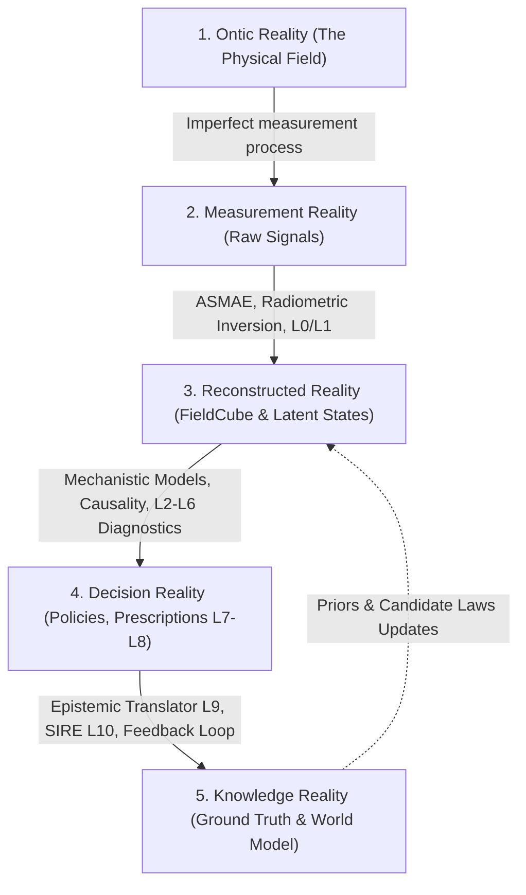
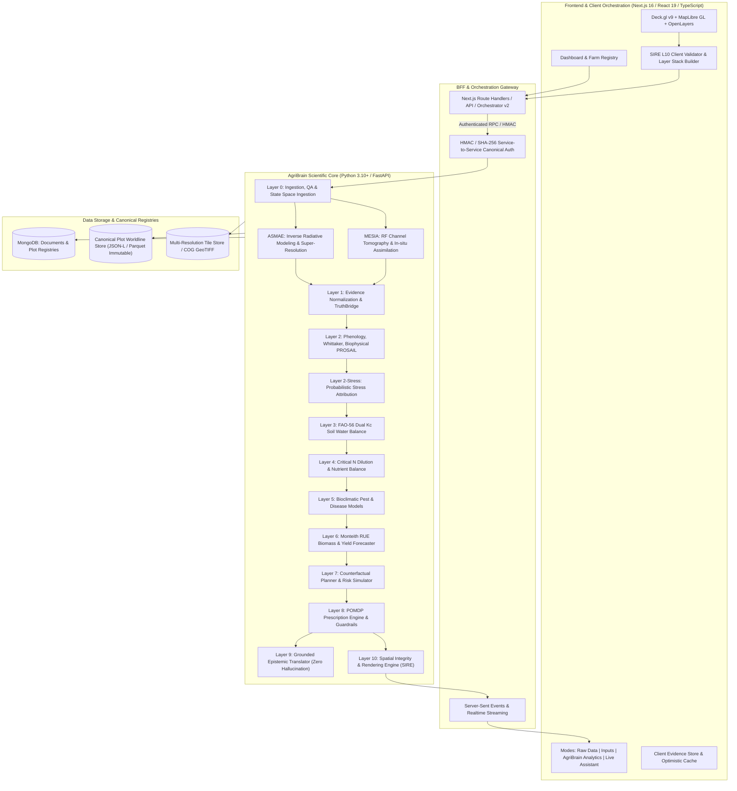

# AgriWise & AgriBrain R2: Complete Agricultural Intelligence Platform & World Model (MESIA World Model)

> **Augmented Edition R2** — *Reference Architecture, Multimodal Foundation Model, Multi-Scale Agricultural World Model, ASMAE, MESIA, Causal AI/ML, Biophysical Agronomy & Sovereign Strategy.*

---

## 📑 Table of Contents

1. [Executive Strategic Summary](#-executive-strategic-summary)
2. [Product Thesis & The 5 Realities](#-product-thesis--the-5-realities)
3. [Overall Platform Architecture (Dual-Stack)](#-overall-platform-architecture-dual-stack)
4. [Volume I — The Complete AgriWise Product](#-volume-i--the-complete-agriwise-product)
5. [Volume II — Technical Architecture & Application Services](#-volume-ii--technical-architecture--application-services)
6. [Volume III — AgriBrain: Data Science Architecture Layer by Layer](#-volume-iii--agribrain-data-science-architecture-layer-by-layer)
   - [Canonical Data Objects](#canonical-data-objects)
   - [Layer 0: Source Governance & Ingestion](#layer-0-source-governance--ingestion)
   - [ASMAE: Inverse Modeling & Microzone Assimilation](#asmae-inverse-modeling--microzone-assimilation)
   - [Layer 1: Truth Normalization & CanonicalFieldCube](#layer-1-truth-normalization--canonicalfieldcube)
   - [Layer 2: Vegetation, Phenology & Biophysics](#layer-2-vegetation-phenology--biophysics)
   - [Layer 2-Stress: Probabilistic Multi-Factorial Stress Attribution](#layer-2-stress-probabilistic-multi-factorial-stress-attribution)
   - [Layer 3: Water Intelligence & FAO-56 Dual Kc](#layer-3-water-intelligence--fao-56-dual-kc)
   - [Layer 4: N-P-K Nutrition & Critical Dilution](#layer-4-n-p-k-nutrition--critical-dilution)
   - [Layer 5: Biological Threats & Epidemiology](#layer-5-biological-threats--epidemiology)
   - [Layer 6: Mechanical Execution & Yield Prediction](#layer-6-mechanical-execution--yield-prediction)
   - [Layer 7: Counterfactual Planning & Economic Risk](#layer-7-counterfactual-planning--economic-risk)
   - [Layer 8: Prescriptive Intelligence & POMDP Policy Engine](#layer-8-prescriptive-intelligence--pomdp-policy-engine)
   - [Layer 9: Epistemic Translator & Grounded Language](#layer-9-epistemic-translator--grounded-language)
   - [Layer 10 (SIRE): Spatial Integrity & Rendering Engine](#layer-10-sire-spatial-integrity--rendering-engine)
7. [Volume X — MESIA & Multi-Scale Agricultural World Model](#-volume-x--mesia--multi-scale-agricultural-world-model)
   - [2.4 / 5.8 GHz Multistatic Radio Frequency Tomography](#24--58-ghz-multistatic-radio-frequency-tomography)
   - [Joint MESIA-ASMAE Assimilation](#joint-mesia-asmae-assimilation)
   - [MESIA Deployment Designer](#mesia-deployment-designer)
8. [Volume IX — Automated Science, Deep Causality & Layer Omega](#-volume-ix--automated-science-deep-causality--layer-omega)
   - [The Adversarial Hypothesis Court](#the-adversarial-hypothesis-court)
   - [El Oued Deep Causal Program (Hydraulic Memory)](#el-oued-deep-causal-program-hydraulic-memory)
9. [Volume IV — Biophysical & Agronomic Foundations](#-volume-iv--biophysical--agronomic-foundations)
10. [Volume V — National, Institutional & Sovereign Intelligence](#-volume-v--national-institutional--sovereign-intelligence)
11. [Volume VI & VII — Economic Model, Valuation & Capital Strategy](#-volume-vi--vii--economic-model-valuation--capital-strategy)
12. [Volume VIII — Operating Model & Strategic Roadmap](#-volume-viii--operating-model--strategic-roadmap)
13. [Constitutional Rules & Data Science Governance](#-constitutional-rules--data-science-governance)
14. [Getting Started & Deployment Guide](#-getting-started--deployment-guide)
15. [Repository Structure & Canonical Contracts](#-repository-structure--canonical-contracts)

---

## 🏛️ Executive Strategic Summary

### AgriWise in One Sentence
**AgriWise** is the sovereign agricultural operating system and unified decision intelligence platform that transforms heterogeneous signals from satellite remote sensing, in-situ radio frequency tomography (**MESIA**), agrometeorology, and ground observations into a **deterministic, probabilistic, and causal Agricultural World Model (AgriBrain)**, guaranteeing food security, water optimization, and agronomic profitability from micro-plots to the national scale.

### Fundamental Architectural Distinction

| Component | Nature & Purpose | Typical Outputs & Artifacts |
| :--- | :--- | :--- |
| **AgriWise Platform** | Application operating system, workflows, reactive user interface, plot registry, farm management, and multi-stakeholder collaboration engine. | Farm registry, plot pages, input logs, contextual alerts, task scheduling, certified reports, Deck.gl/MapLibre visualizations, REST/GraphQL APIs. |
| **AgriBrain Foundation Model** | Multimodal foundation model and biophysical, causal, mechanistic world model. Assimilates observations, infers latent states, simulates counterfactuals, and authorizes prescriptions. | Continuous scientific state $\mathcal{S}(t)$, canonical evidence cubes, RF attenuation maps, probabilistic differential diagnoses, FAO-56 irrigation scenarios, validated POMDP prescriptions. |
| **ASMAE** | Adaptive spatial assimilation engine and inverse radiative transfer modeling under strict radiometric closure. | Sub-10m/1m spatial disaggregation, surface reflectance correction, certainty masking, innovation covariances. |
| **MESIA** | Physical and algorithmic sub-system for multistatic in-situ electromagnetic tomography (2.4/5.8 GHz). | Channel attenuation matrix $S_{21}$, canopy water content (CWC) profiles, continuous biomass density without satellite latency. |

---

## 🔬 Product Thesis & The 5 Realities

AgriBrain rejects naive "black-box" AI approaches that treat agronomy as a simple statistical pixel regression problem. AgriBrain structures knowledge across **five epistemic levels of reality**:



1. **Ontic Reality**: The true but inaccessible biophysical state of the soil-plant-atmosphere continuum at time $t$ (root-zone volumetric water content, stomatal conductance, leaf chlorophyll concentration, dry biomass).
2. **Measurement Reality**: The set of noisy, partial, asynchronous, and indirect observations (Sentinel-2 TOA/BOA radiances, Sentinel-1 SAR $\sigma^0_{VV/VH}$ backscatter, MESIA RF transmission coefficients, ERA5/NASA-POWER meteorological data).
3. **Reconstructed Reality**: The latent state estimated via Bayesian data assimilation and inverse radiative models (CanonicalFieldCube, disaggregated index surfaces, calibrated soil profiles).
4. **Decision Reality**: Counterfactual evaluation of candidate actions (irrigating $X$ mm, splitting nitrogen, treating a fungal outbreak) optimized against agronomic and economic utility under risk bounds.
5. **Knowledge Reality**: The repository of validated scientific rules, candidate laws tested in the hypothesis court, and sovereign learning history stored in the **CanonicalPlotWorldline**.

---

## 🌐 Overall Platform Architecture (Dual-Stack)



---

## 📦 Volume I — The Complete AgriWise Product

### 1. Farm & Plot Registry
- Strict geometric modeling (WGS84 GeoJSON polygons, topological validation, surface calculation, slope and aspect extraction).
- Multi-site, multi-tenant management partitioned by watershed / wilaya / irrigation perimeter.
- Soil-climate profile: soil texture, stoniness, hydraulic conductivity $K_{sat}$, field capacity $\theta_{FC}$, wilting point $\theta_{WP}$, maximum rooting depth $Z_{r,max}$.

### 2. Plot Page Interaction Modes

```
+---------------------------------------------------------------------------------------------------+
|  [Raw Data Mode]           [Farmer Inputs Mode]        [AgriBrain Analytics]       [Live Assistant]     |
+---------------------------------------------------------------------------------------------------+
|  • Sentinel-2 L2A Imagery   • Sowing Date, Variety      • Stress Decomposition      • Agronomic Chatbot |
|  • Sentinel-1 SAR Backscatter• Irrigation History       • FAO-56 Water Balance      • S1/S2 Evidence    |
|  • Weather / Wind Telemetry • N-P-K Fertilizer Logs     • Phenological Trajectory   • Strict Grounding  |
|  • MESIA RF Attenuation     • Pest & Disease Scouting   • Yield Forecast (P10-P90)  • Zero-Hallucination|
+---------------------------------------------------------------------------------------------------+
```

- **Raw Data Mode**: Uninterpreted visualization of raw spectral bands (B02-B12), VV/VH polarization, weather time series (min/max temperature, solar radiation $R_s$, VPD, Penman-Monteith $ET_0$).
- **Farmer Inputs Mode**: Formal crop cycle declaration (variety, sowing density, emergence date, management interventions, irrigation schedules and volumes).
- **AgriBrain Analytics Mode**: Cartographic and tabular rendering of layer diagnostics: authorized biophysical surfaces (LAI, FAPAR, NDRE, CWC), multi-stress gauges, root-zone depletion curves.
- **Live Assistant Mode**: Research-grade conversational agronomic agent, strictly bound to the canonical evidence graph (`ClaimAuthorityRecord`).

---

## 💻 Volume II — Technical Architecture & Application Services

### 1. High-Performance Frontend & Spatial Engine
- **Framework**: Next.js 16 (App Router), React 19, TypeScript 5, TailwindCSS 4.
- **Geospatial Engine**: Deck.gl v9 coupled with MapLibre GL and OpenLayers for 60 FPS rendering of raster tiles, analytical vector overlays, and 3D mesh layers.
- **Intelligence Components**: Resolution & coverage HUD, microscopic pixel-by-pixel inspector (`PixelInspectorAuthority`), dynamic biophysical legend bar (`SurfaceLegendBar`).

### 2. Scientific Backend Stack
- **Framework**: Python 3.10+ with FastAPI, Pydantic v2 for strict contract validation, NumPy, SciPy, Numba, Rasterio, Shapely, PyProj.
- **Orchestrator v2**: Asynchronous state-DAG execution, failure recovery, background worker isolation (`background_jobs.py`).
- **Canonical Service-to-Service Authentication**: HMAC SHA-256 request signing (`internal_service_auth.py` and `internal-service-auth.ts`) with timestamp verification, replay attack prevention, and distributed nonces.

---

## 🧬 Volume III — AgriBrain: Data Science Architecture Layer by Layer

### Canonical Data Objects

```
+---------------------------------------------------------------------------------------------------+
| 1. CanonicalEvidenceGraph                                                                         |
|    Directed Acyclic Graph (DAG) recording every item of evidence (source, timestamp, sensor,      |
|    authority tier, cryptographic hash, QA vector).                                                |
+---------------------------------------------------------------------------------------------------+
| 2. CanonicalFieldCube                                                                             |
|    Unified 4D spatio-temporal tensor [Channel x Time x Height x Width], georeferenced and         |
|    interpolated, ensuring absolute spatial and radiometric alignment for the plot.                |
+---------------------------------------------------------------------------------------------------+
| 3. CanonicalPlotWorldline                                                                         |
|    Immutable state ledger recording the end-to-end history of diagnostics, decisions, in-situ    |
|    measurements, and real yields observed across seasons.                                         |
+---------------------------------------------------------------------------------------------------+
```

---

### Layer 0: Source Governance & Ingestion
- **Role**: Ingestion, quality assurance (QA) filtering, and formal admission of observation packets.
- **Providers**: Sentinel-2 (Copernicus ESA), Sentinel-1 SAR GRD, NASA POWER / ECMWF ERA5, SoilGrids ISRIC.
- **Admission Rules**: Strict masking of clouds, cirrus, and cast shadows via Scene Classification Layer (SCL). Solar zenith angle computation and topographic correction. Zero-support scene hard exclusion.

---

### ASMAE: Inverse Modeling & Microzone Assimilation
- **ASMAE** (*Assimilation and Spatial Multi-scale Adaptive Estimation*) is the spatial radiometric inversion engine.
- **Radiometric Closure**: The spatially weighted sum of reconstructed microzones $\hat{r}_m$ must strictly equal the macroscopic satellite observation $R_{obs}$:
  $$\sum_{m=1}^{M} w_m \hat{r}_m = R_{obs} \pm \epsilon_{closure}$$
- **BMA (Bayesian Model Averaging)**: Dynamic weighting of inversion models based on historical marginal likelihood across soil and crop types.
- **Target Resolution**: Continuous disaggregation from 10m/20m native resolution down to sub-decameter analytical grids (down to 1m with MESIA RF support).

---

### Layer 1: Truth Normalization & CanonicalFieldCube
- **TruthBridge**: Conflict resolution across asynchronous multi-modal sources (e.g., resolving optical cloud gaps using SAR backscatter).
- **Spatio-Temporal Interpolation**: Continuous trajectory reconstruction via spatio-temporal Gaussian processes and Whittaker penalized smoothing (2nd or 3rd order difference penalties).

---

### Layer 2: Vegetation, Phenology & Biophysics
- **Whittaker Smoothing**: Robust time-series filtering preserving true physical ruptures (harvesting, mowing, frost) while removing noise:
  $$Q = \sum_{t=1}^T (y_t - f_t)^2 + \lambda \sum_{t=1}^{T-d} (\Delta^d f_t)^2$$
- **Phenology Tracking**: Thermal time tracking via Growing Degree Days ($GDD = \sum \max(0, \frac{T_{max} + T_{min}}{2} - T_{base})$) mapped to the universal BBCH scale per crop group (cereals, olives, date palms, potatoes, tomatoes).
- **PROSAIL Biophysical Inversion**: Certified physical retrieval of LAI (*Leaf Area Index*), FAPAR (*Fraction of Absorbed Photosynthetically Active Radiation*), FCOVER (*Fraction of Green Vegetation Cover*), $C_{ab}$ (*Chlorophyll Content*), and $C_w$ (*Canopy Water Content*).

---

### Layer 2-Stress: Probabilistic Multi-Factorial Stress Attribution
- Rejects simplistic "NDVI drop = water stress" heuristics.
- Causal decomposition of the anomaly vector $\Delta \mathbf{y}$ across biophysical spectral signatures:

$$\begin{bmatrix} \Delta \text{NDVI} \\ \Delta \text{NDRE} \\ \Delta \text{NDWI} \\ \Delta \sigma^0_{VH} \\ \Delta T_{canopy} \end{bmatrix} = \sum_{k \in \{\text{Water}, \text{Nitrogen}, \text{Salinity}, \text{Heat}, \text{Disease}\}} \alpha_k \mathbf{S}_k + \mathbf{\epsilon}$$

- **Output**: Calibrated probability distribution $P(\text{Cause}_k \mid \text{Evidence}, \text{Context})$, eliminating false irrigation alarms when stress is nutritional or pathological.

---

### Layer 3: Water Intelligence & FAO-56 Dual Kc
- **Daily Root-Zone Soil Water Balance** following the FAO-56 reference standard:
  $$D_{r,t} = D_{r,t-1} - (P_t - RO_t) - I_t - CR_t + ET_{c,t} + DP_t$$
- **Dual Crop Coefficient**:
  $$ET_c = (K_{cb} + K_e) \cdot ET_0$$
  - $K_{cb}$: Basal crop transpiration coefficient (continuously derived from FCOVER and LAI).
  - $K_e$: Direct soil evaporation coefficient (driven by top 10cm soil moisture).
- **Water Stress Reduction Coefficient $K_s$**:
  $$K_s = \frac{TAW - D_r}{TAW - RAW} = \frac{TAW - D_r}{(1 - p) TAW} \quad (\text{for } D_r > RAW)$$
- **Decision Outputs**: Net irrigation requirement (mm and $\text{m}^3/\text{ha}$), depletion urgency (days to permanent wilting), 7-day forward stress forecasting.

---

### Layer 4: N-P-K Nutrition & Critical Dilution
- **Critical Nitrogen Dilution Curve** (Lemaire & Gastal):
  $$N_{crit} = a \cdot W^{-b} \quad (\text{for dry biomass } W \text{ in t/ha})$$
- **Nitrogen Nutrition Index (NNI)**:
  $$NNI = \frac{\%N_{actual}}{\%N_{crit}}$$
  - $NNI > 1.0$: Luxury consumption (leaching risk and fungal susceptibility).
  - $0.8 \le NNI \le 1.0$: Optimal nitrogen status.
  - $NNI < 0.8$: Nitrogen deficiency limiting yield potential.
- **P & K Diagnostics**: Stoichiometric N/P and N/K balances preventing nutrient lockup in calcareous or saline soils.

---

### Layer 5: Biological Threats & Epidemiology
- Bioclimatic models for fungal and bacterial disease outbreaks (downy mildew, stripe rust, powdery mildew, blight).
- Integration of leaf wetness duration ($LWD$), night relative humidity, and thermal accumulation.
- Spatio-temporal epidemiological spread modeling across watershed zones.

---

### Layer 6: Mechanical Execution & Yield Prediction
- **Trafficability**: Soil bearing capacity, topsoil moisture, and compaction/rutting risk based on soil texture.
- **Monteith Radiation Use Efficiency (RUE) Yield Forecaster**:
  $$Y = \text{HI} \cdot \sum_{t=\text{emergence}}^{\text{harvest}} \left( \text{PAR}_t \cdot \text{FAPAR}_t \cdot \text{RUE}_{max} \cdot f(T_t) \cdot K_{s,t} \cdot f(NNI_t) \right)$$
  - $\text{HI}$: Harvest Index.
  - Probabilistic yield distribution (P10, P50, P90) with 90% conformal prediction intervals.

---

### Layer 7: Counterfactual Planning & Economic Risk
- "What-If" counterfactual scenario simulations (e.g., "What if I apply 25 mm tomorrow vs. 40 mm in 4 days?").
- Cost analysis: water tariffs, pumping energy, fertilizer prices, and projected harvest market value.
- Resilience stress-testing against extreme climate shocks (early heat waves, sirocco, late frost).

---

### Layer 8: Prescriptive Intelligence & POMDP Policy Engine
- Formulated as a Partially Observable Markov Decision Process (**POMDP**).
- Optimizes action policy $\pi^*(s)$ maximizing net agronomic and economic expected utility across the full crop cycle.
- **Constitutional Guardrails**: Strict prohibition of chemical treatments or over-irrigation without verified multi-sensor evidence quorum from Layer 1 and Layer 3.

---

### Layer 9: Epistemic Translator & Grounded Language
- Advanced conversational LLM grounded **strictly** on the canonical evidence graph (`ClaimAuthorityRecord`).
- **Zero-Hallucination Guarantee**: The LLM cannot invent diagnostics or extrapolate unobserved states.
- Complete scientific auditability for every farmer-facing advisory note.

---

### Layer 10 (SIRE): Spatial Integrity & Rendering Engine
- **SIRE** is the constitutional gatekeeper of visual map rendering.
- Every layer rendered on the map (Deck.gl / MapLibre) must possess verified derivation lineage (`derivation_lineage.py`), legend metadata contracts (`surface-legend-meta.mjs`), and an explicit authorization status.
- Prevents rendering unverified or cloud-corrupted surfaces.

---

## 📡 Volume X — MESIA & Multi-Scale Agricultural World Model

### What is MESIA?
**MESIA** (*Micro-Environmental Sensing & In-situ Attenuation*) is the in-situ radio frequency tomography and environmental sensing sub-system developed for AgriBrain.

```
                           [ Satellites S1 / S2 ]
                                     |
                                     v
+-------------------------------------------------------------------------+
|                                                                         |
|     [ MESIA RF Anchor 1 ]  ~~~ 2.4/5.8 GHz Tomography ~~~  [ Anchor 2 ] |
|             |          \                                 /       |      |
|             |           \--- Canopy RF Attenuation ---/         |      |
|             |                         |                         |      |
|     [ Crop / Canopy ]                 v             [ Soil Moisture ]   |
|             |               [ CWC & LAI Profile ]               |      |
|             |                         |                         |      |
|     [ MESIA RF Anchor 3 ]  ~~~~~~~~~~~~~~~~~~~~~~~~~~~~~~~  [ Anchor 4 ] |
|                                                                         |
+-------------------------------------------------------------------------+
                                     |
                                     v
                       [ ASMAE Assimilation Engine ]
```

### 2.4 / 5.8 GHz Multistatic Radio Frequency Tomography
- Leverages electromagnetic wave propagation across ISM bands (2.4 GHz and 5.8 GHz) through crop canopies.
- Because the complex dielectric constant of liquid water ($\epsilon_r \approx 80$) far exceeds that of dry plant matter ($\epsilon_r \approx 3$) and air ($\epsilon_r \approx 1$), the attenuation ($S_{21}$) and phase shift directly measure **Canopy Water Content (CWC)** and fresh biomass along the link.
- Continuous minute-by-minute temporal resolution, fully immune to clouds, fog, and darkness.

### Joint MESIA-ASMAE Assimilation
- ASMAE uses MESIA in-situ attenuation measurements as real-time boundary constraints in satellite inversion (Sentinel-2 & Sentinel-1).
- Continuously calibrates soil and canopy radiative parameters, eliminating atmospheric drift uncertainties.

### MESIA Deployment Designer
- Integrated algorithmic tool that calculates the optimal anchor count, 3D RTK coordinates, mast heights, and mesh topology for maximum field coverage at minimal infrastructure cost.

---

## ⚖️ Volume IX — Automated Science, Deep Causality & Layer Omega

### The Adversarial Hypothesis Court
AgriBrain implements a formal scientific arbitration framework where rival hypotheses compete against real-world observations:
- Each hypothesis $\mathcal{H}_i$ is represented by a distinct mechanistic model.
- The court computes Bayes factors and predictive marginal likelihoods.
- Hypotheses are only promoted to knowledge status if they significantly outperform the null hypothesis and survive counterfactual falsification tests.

### El Oued Deep Causal Program (Hydraulic Memory)
Landmark AgriBrain deployment in the Souf oasis and Ghout ecosystems (El Oued, Algeria):

```
                  +---------------------------------------------------+
                  |  Observed Anomaly: Localized wilting in           |
                  |  date palm groves and vegetable crops             |
                  +---------------------------------------------------+
                                            |
         +----------------------------------+----------------------------------+
         |                                  |                                  |
         v                                  v                                  v
+------------------+              +------------------+               +------------------+
| Hypothesis A     |              | Hypothesis B     |               | Hypothesis C     |
| Classic Water    |              | Osmotic Saline   |               | Hydraulic Memory |
| Deficit          |              | Stress (Gypsum)  |               | & Root Anoxia    |
| (Drought)        |              |                  |               |                  |
+------------------+              +------------------+               +------------------+
         |                                  |                                  |
         x [REFUTED by S1 SAR               x [REFUTED by                      | [CONFIRMED]
            surface moisture]                  soil chemistry]                 | Rising water table,
                                                                               | root asphyxiation
                                                                               | and hydraulic memory
```

- **Result**: AgriBrain prevented disastrous recommendations to add more irrigation water to waterlogged soil, prescribing drainage and saline wedge management instead.

---

## 🌾 Volume IV — Biophysical & Agronomic Foundations

1. **Soil-Plant-Atmosphere Continuum (SPAC)**: Modeling water potential gradients $\Psi_{soil} \to \Psi_{root} \to \Psi_{leaf} \to \Psi_{air}$.
2. **Radiative Transfer Physics**: PROSAIL (PROSPECT + SAIL) coupled with semi-empirical microwave backscatter (Water Cloud Model - WCM).
3. **Saharan & Mediterranean Pedology**: Explicit representation of gypcrete encrustations, coarse sandy soils with low water-holding capacity, salinity ($EC_e$), and alkaline pH dynamics.

---

## 🏛️ Volume V — National, Institutional & Sovereign Intelligence

- **Food Security Early Warning**: National dashboards forecasting cereal and strategic crop yields 2 months ahead of harvest.
- **Strategic Water Governance**: Mapping agricultural groundwater withdrawals across the Complex Terminal and Continental Intercalaire aquifers.
- **Parametric Crop Insurance**: Objective parametric index loss certification after flood, drought, sirocco, or frost events for fast, fraud-proof compensation.
- **Air-Gapped Sovereign Deployment**: Fully containerized architecture capable of running 100% on national sovereign infrastructure without external cloud dependencies.

---

## 💼 Volume VI & VII — Economic Model, Valuation & Capital Strategy

### Product Packaging & Market Segments

| Offering | Target Customer | Modules Included | Business Model |
| :--- | :--- | :--- | :--- |
| **Farmer Free** | Smallholders (< 5 ha) | Plot tracking, local weather, basic alerts, crop calendar. | Free (Acquisition & ground truth incentive). |
| **Farmer Plus** | Commercial farmers & SMEs | Full AgriBrain L2-L6 diagnostics, yield forecasts, FAO-56 irrigation scheduler. | Monthly or seasonal subscription per hectare. |
| **Enterprise & Co-ops** | Cooperatives, agribusinesses, traders | Multi-plot console, MESIA deployment, input supply scheduling, logistics. | Annual platform license + per-sensor fee. |
| **Sovereign & Banking** | Ministries, insurers, development banks | National world model, fraud detection, macro harvest forecasts, drought alerts. | Multi-year sovereign SLA / insured plot volume. |

---

## 🚀 Getting Started & Deployment Guide

### 1. System Requirements
- **Node.js**: v20.x or v22.x
- **Python**: v3.10, v3.11, v3.12, or v3.13
- **Database**: MongoDB 6.0+ (or Docker)
- **Package Managers**: `npm` or `pnpm`, `pip` or `uv`

### 2. Frontend Installation & Startup

```bash
# Clone the repository
git clone https://github.com/webClone/AgriWise.git
cd agriwise

# Install dependencies
npm install

# Run frontend contract tests and world validation
npm run test:frontend
npm run validate:r2-world

# Start Next.js development server
npm run dev
```

### 3. Backend (AgriBrain) Installation & Startup

```bash
# Create and activate virtual environment
py -3 -m venv .venv
.venv\Scripts\activate   # On Windows
# source .venv/bin/activate # On Linux/macOS

# Install scientific dependencies
pip install -r services/agribrain/requirements.txt

# Run the complete 463-test scientific suite
pytest services/agribrain/tests -v

# Start the AgriBrain FastAPI server
npm run api
# or directly:
# py -m uvicorn services.agribrain.app.main:app --port 8000 --reload
```

### 4. Environment Configuration (`.env`)

Copy `.env.example` to `.env` and configure:

```ini
# Database & Authentication
DATABASE_URL="mongodb://localhost:27017/agriwise"
NEXTAUTH_SECRET="your-jwt-secret-key"
NEXTAUTH_URL="http://localhost:3000"

# Canonical Internal Service-to-Service Secret (HMAC SHA-256)
INTERNAL_SERVICE_KEY="canonical-agribrain-auth-secret"

# AI / LLM Providers
GEMINI_API_KEY="your-gemini-api-key"

# Remote Sensing & Meteorological Data
SENTINEL_HUB_CLIENT_ID="your-client-id"
SENTINEL_HUB_CLIENT_SECRET="your-client-secret"
NASA_API_KEY="your-nasa-api-key"
```

---

## 📁 Repository Structure & Canonical Contracts

```
agriwise/
├── packages/
│   └── contracts/                 # Canonical JSON schemas (ASMAE, Auth)
├── public/                        # Static assets, experience tiles, and icons
├── services/
│   └── agribrain/                 # AgriBrain Python Scientific Core
│       ├── app/                   # FastAPI Endpoints, DTOs & Service Auth
│       ├── common/                # Alias resolvers, crop cycle contexts
│       ├── layer0/                # Layer 0: Ingestion, QA & State Space
│       ├── layer05_asmae/         # ASMAE: Inverse modeling & super-resolution
│       ├── layer1/                # Layer 1: Truth normalization & FieldCube
│       ├── layer2_veg_int/        # Layer 2: Vegetation, Whittaker & Phenology
│       ├── layer2_uncertainty/    # Layer 2-Stress: Probabilistic causal attribution
│       ├── layer3_water/          # Layer 3: FAO-56 water balance & irrigation
│       ├── layer10_sire/          # Layer 10: SIRE Spatial integrity & rendering
│       ├── orchestrator_v2/       # Execution controller for DAG pipelines
│       ├── scientific_contracts/  # Strict Pydantic scientific contracts
│       ├── world_model/           # Canonical World Model & Worldlines
│       └── tests/                 # 463-test scientific and contract suite
├── src/
│   ├── app/                       # Next.js App Router (Pages, API routes, Marketing)
│   ├── components/                # React 19 Components (Dashboard, Deck.gl Maps, HUD)
│   ├── hooks/                     # Custom hooks (useLayer10, usePlotMap)
│   └── lib/                       # TS/MJS libraries (AgriBrain client, contracts)
├── tests/
│   └── frontend/                  # Frontend contract unit tests
├── .gitignore                     # Strict exclusion of caches and artifacts
├── package.json                   # Node.js dependencies and scripts
└── README.md                      # Complete R2 MESIA Master Monograph Documentation
```

---

## 📜 Constitutional Rules & Data Science Governance

1. **Authority Closure Rule**: No agronomic state may be published without complete cryptographic provenance in a `ClaimAuthorityRecord`.
2. **Reality Separation Rule**: Raw measurements must never be conflated with assimilated states, nor predictions with observations.
3. **Uncertainty Transparency Rule**: Every diagnostic and forecast must include a calibrated, conformal uncertainty interval.
4. **Prescriptive Zero-Hallucination Rule**: No Large Language Model (LLM) is authorized to generate or alter agronomic thresholds autonomously.
5. **Data Sovereignty Rule**: Farmer field data remains their exclusive property, safeguarded by end-to-end encryption and strict multi-tenant isolation.

---

<p align="center">
  <b>AgriWise & AgriBrain R2</b> — <i>Advancing Precision Agriculture and Food Sovereignty into the Era of Causal, Scientific AI.</i>
</p>
