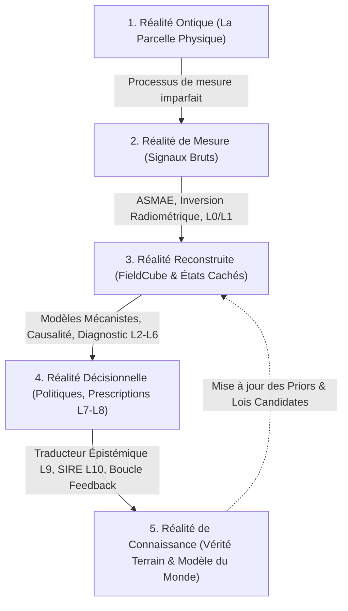
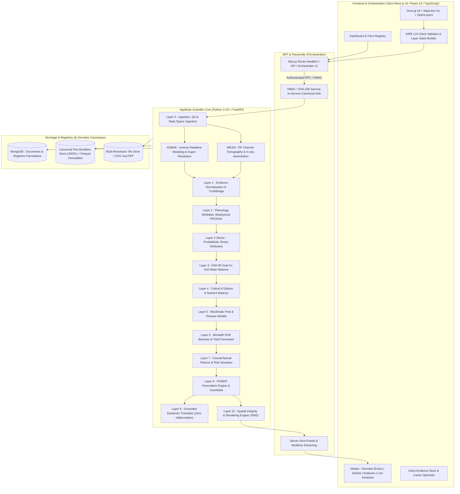

# AgriWise & AgriBrain R2 : Plateforme Complète d'Intelligence Agricole & Modèle du Monde (MESIA World Model)

> **Édition Augmentée R2** — *Architecture de Référence, Modèle Fondamental Multimodal, Modèle du Monde Agricole Multi-Échelle, ASMAE, MESIA, IA/ML Causale, Agronomie Biophysique & Souveraineté Nationale.*

---

## 📑 Table des Matières

1. [Synthèse Stratégique Exécutive](#-synthèse-stratégique-exécutive)
2. [Thèse Produit & Les 5 Réalités](#-thèse-produit--les-5-réalités)
3. [Architecture Globale de la Plateforme (Dual-Stack)](#-architecture-globale-de-la-plateforme-dual-stack)
4. [Volume I — Le Produit AgriWise Complet](#-volume-i--le-produit-agriwise-complet)
5. [Volume II — Architecture Technique & Services Applicatifs](#-volume-ii--architecture-technique--services-applicatifs)
6. [Volume III — AgriBrain : Architecture de Science des Données Couche par Couche](#-volume-iii--agribrain--architecture-de-science-des-données-couche-par-couche)
   - [Objets Canoniques de Données](#objets-canoniques-de-données)
   - [Couche 0 : Gouvernance des Sources & Ingestion](#couche-0--gouvernance-des-sources--ingestion)
   - [ASMAE : Modélisation Inverse & Assimilation Microzones](#asmae--modélisation-inverse--assimilation-des-microzones)
   - [Couche 1 : Normalisation de la Vérité & CanonicalFieldCube](#couche-1--normalisation-de-la-vérité--canonicalfieldcube)
   - [Couche 2 : Végétation, Phénologie & Biophysique](#couche-2--végétation-phénologie--biophysique)
   - [Couche 2-Stress : Attribution Multi-Factorielle Probabiliste](#couche-2-stress--attribution-multi-factorielle-probabiliste)
   - [Couche 3 : Diagnostic Hydrique & FAO-56 Dual Kc](#couche-3--diagnostic-hydrique--fao-56-dual-kc)
   - [Couche 4 : Nutrition N-P-K & Dilution Critique](#couche-4--nutrition-n-p-k--dilution-critique)
   - [Couche 5 : Menaces Biologiques & Épidémiologie](#couche-5--menaces-biologiques--épidémiologie)
   - [Couche 6 : Exécution Mécanique & Prédiction de Rendement](#couche-6--exécution-mécanique--prédiction-de-rendement)
   - [Couche 7 : Planification Contrefactuelle & Risque Économique](#couche-7--planification-contrefactuelle--risque-économique)
   - [Couche 8 : Intelligence Prescriptive & Moteur POMDP](#couche-8--intelligence-prescriptive--moteur-pomdp)
   - [Couche 9 : Traducteur Épistémique & Langage Ancré](#couche-9--traducteur-épistémique--langage-ancré)
   - [Couche 10 (SIRE) : Intégrité Spatiale & Autorisation de Rendu](#couche-10-sire--intégrité-spatiale--autorisation-de-rendu)
7. [Volume X — MESIA & Modèle du Monde Agricole Multi-Échelle](#-volume-x--mesia--modèle-du-monde-agricole-multi-échelle)
   - [Tomographie Radiofréquence Multistatique 2.4 / 5 GHz](#tomographie-radiofréquence-multistatique-24--5-ghz)
   - [Couplage MESIA-ASMAE & Assimilation Conjointe](#couplage-mesia-asmae--assimilation-conjointe)
   - [MESIA Deployment Designer](#mesia-deployment-designer)
8. [Volume IX — Science Automatisée, Causalité Profonde & Couche Oméga](#-volume-ix--science-automatisée-causalité-profonde--couche-oméga)
   - [Le Tribunal Contradictoire des Hypothèses](#le-tribunal-contradictoire-des-hypothèses)
   - [Programme de Causalité Profonde d'El Oued (Mémoire Hydraulique)](#programme-de-causalité-profonde-del-oued)
9. [Volume IV — Fondements Biophysiques & Agronomiques](#-volume-iv--fondements-biophysiques--agronomiques)
10. [Volume V — Intelligence Nationale, Institutionnelle & Souveraine](#-volume-v--intelligence-nationale-institutionnelle--souveraine)
11. [Volume VI & VII — Modèle Économique, Valorisation & Stratégie Financière](#-volume-vi--vii--modèle-économique-valorisation--stratégie-financière)
12. [Volume VIII — Modèle Opérationnel & Feuille de Route](#-volume-viii--modèle-opérationnel--feuille-de-route)
13. [Règles Constitutionnelles & Gouvernance de la Science des Données](#-règles-constitutionnelles--gouvernance-de-la-science-des-données)
14. [Guide de Démarrage & Déploiement](#-guide-de-démarrage--déploiement)
15. [Structure du Dépôt & Contrats Canoniques](#-structure-du-dépôt--contrats-canoniques)

---

## 🏛️ Synthèse Stratégique Exécutive

### AgriWise en une phrase
**AgriWise** est le système d'exploitation agricole souverain et la plateforme d'intelligence décisionnelle unifiée qui transforme les signaux hétérogènes de télédétection spatiale, de tomographie radiofréquence in-situ (**MESIA**), d'agrométéorologie et d'observations terrain en un **Modèle du Monde Agricole déterministe, probabiliste et causal (AgriBrain)**, garantissant la sécurité alimentaire, l'optimisation hydrique et la rentabilité agronomique à l'échelle de la micro-parcelle comme du territoire national.

### Distinction Architecturale Fondamentale

| Composante | Nature & Finalité | Sorties & Artefacts Typiques |
| :--- | :--- | :--- |
| **AgriWise Platform** | Système d'exploitation applicatif, flux de travail, interface utilisateur réactive, registre parcellaire, gestion d'exploitation et moteur de collaboration multi-acteurs. | Registre des exploitations, pages de parcelles, journaux d'intrants, alertes contextuelles, ordonnancement des tâches, rapports certifiés, visualisations Deck.gl/MapLibre, API REST/GraphQL. |
| **AgriBrain Foundation Model** | Modèle fondamental multimodal et modèle du monde biophysique, causal et mécaniste. Assimile les observations, infère les états cachés, simule les contrefactuels et arbitre les prescriptions. | État scientifique continu $\mathcal{S}(t)$, cubes canoniques de preuves, cartes d'atténuation RF, diagnostics différentiels probabilistes, scénarios d'irrigation FAO-56, prescriptions POMDP validées. |
| **ASMAE** | Moteur d'assimilation spatiale adaptative et de modélisation radiative inverse sous fermeture énergétique stricte. | Désagrégation spatiale sub-10m/1m, réflectance de surface corrigée, masquage de certitude, covariances d'innovation. |
| **MESIA** | Sous-système physique et algorithmique de tomographie électromagnétique in-situ multistatique (2.4/5.8 GHz). | Matrice d'atténuation de canal $S_{21}$, profils de teneur en eau de canopée (CWC), densité de biomasse continue sans latence satellite. |

---

## 🔬 Thèse Produit & Les 5 Réalités

AgriBrain structure l'ensemble de la connaissance et des algorithmes autour de **cinq niveaux de réalité épistémique** :



1. **Réalité Ontique** : L'état biophysique vrai mais inaccessible du continuum sol-plante-atmosphère à l'instant $t$ (humidité volumique racinaire, conductance stomatique, concentration foliaire en chlorophylle, biomasse sèche).
2. **Réalité de Mesure** : L'ensemble des observations bruitées, partielles, asynchrones et indirectes (radiances TOA/BOA Sentinel-2, rétrodiffusion $\sigma^0_{VV/VH}$ Sentinel-1, coefficients de transmission RF MESIA, données météo ERA5/NASA-POWER).
3. **Réalité Reconstruite** : L'état latent estimé par assimilation bayésienne et modèles radiatifs inverses (CanonicalFieldCube, surfaces d'indices désagrégées, profils de sol calibrés).
4. **Réalité Décisionnelle** : L'évaluation contrefactuelle des actions possibles (irriguer $X$ mm, fractionner l'azote, traiter un foyer cryptogamique) optimisée selon un critère d'utilité agronomique et économique sous risque maîtrisé.
5. **Réalité de Connaissance** : L'ensemble des règles scientifiques validées, des lois candidates éprouvées au tribunal des hypothèses, et de l'historique d'apprentissage souverain stocké dans le **CanonicalPlotWorldline**.

---

## 🌐 Architecture Globale de la Plateforme (Dual-Stack)



---

## 📦 Volume I — Le Produit AgriWise Complet

### 1. Registre des Exploitations & Parcelles
- Modélisation géométrique stricte (polygones GeoJSON WGS84, contrôle topologique, validation de surface, calcul de pente et orientation).
- Gestion multi-sites, multi-locataires et partitionnement par bassin versant / wilaya / périmètre irrigué.
- Fiche signalétique sol-climat : type de sol, pierrosité, conductivité hydraulique $K_{sat}$, capacité au champ $\theta_{FC}$, point de flétrissement $\theta_{WP}$, profondeur racinaire max $Z_{r,max}$.

### 2. Modes d'Interaction de la Page Parcelle

```
+---------------------------------------------------------------------------------------------------+
|  [Mode Données Brutes]     [Mode Saisies Exploitant]   [Mode Analyses AgriBrain]   [Assistance Live]   |
+---------------------------------------------------------------------------------------------------+
|  • Imagerie Sentinel-2 L2A  • Semis, Variété, Date      • Décomposition des Stress  • Chatbot Agronome  |
|  • Rétrodiffusion S1 SAR    • Historique des Irrigations • Bilan Hydrique FAO-56    • Raisonnement S1-S2|
|  • Données Météo / Vent     • Apports d'Engrais N-P-K   • Trajectoire Phénologique  • Justification     |
|  • Atténuation RF MESIA     • Observations Ravageurs    • Prédiction de Rendement   • Zéro-Hallucination|
+---------------------------------------------------------------------------------------------------+
```

- **Mode Données Brutes** : Visualisation non interprétée des couches spectrales (B02-B12), polarisation VV/VH, séries temporelles météorologiques (température min/max, rayonnement solaire $R_s$, VPD, ETP Penman-Monteith).
- **Mode Saisies Utilisateur** : Déclaration formelle du cycle cultural (variété, densité de semis, date d'émergence, interventions culturales, dates et volumes d'irrigation).
- **Mode Analyses AgriBrain** : Restitution cartographique et tabulaire des diagnostics de couches : surfaces biophysiques autorisées (LAI, FAPAR, NDRE, CWC), jauges de stress, profils racinaires.
- **Mode Assistance en Direct** : Agent conversationnel agronomique de niveau chercheur, strictement branché sur le graphe de preuves canonique (`ClaimAuthorityRecord`).

---

## 💻 Volume II — Architecture Technique & Services Applicatifs

### 1. Pile Frontend & Cartographie Haute Performance
- **Framework** : Next.js 16 (App Router), React 19, TypeScript 5, TailwindCSS 4.
- **Moteur Géospatial** : Deck.gl v9 combiné à MapLibre GL et OpenLayers pour le rendu ultra-rapide de tuiles matricielles, de vecteurs analytiques et de couches de maillage 3D à 60 FPS.
- **Composants d'Intelligence** : HUD de couverture et résolution temporelle, panneau d'inspection microscopique pixel-par-pixel (`PixelInspectorAuthority`), barre de légende biophysique dynamique (`SurfaceLegendBar`).

### 2. Pile Backend Scientifique
- **Framework** : Python 3.10+ avec FastAPI, Pydantic v2 pour la validation stricte des contrats, NumPy, SciPy, Numba, Rasterio, Shapely, PyProj.
- **Orchestration v2** : Exécution asynchrone DAG d'états, gestion de reprise sur panne, isolation des tâches de calcul lourd via workers dédiés (`background_jobs.py`).
- **Authentification Canonical Service-to-Service** : Signature HMAC SHA-256 des requêtes inter-services (`internal_service_auth.py` et `internal-service-auth.ts`) avec validation d'horodatage, prévention des attaques par rejeu et nonces distribués.

---

## 🧬 Volume III — AgriBrain : Architecture de Science des Données Couche par Couche

### Objets Canoniques de Données

```
+---------------------------------------------------------------------------------------------------+
| 1. CanonicalEvidenceGraph                                                                         |
|    Graphe acyclique orienté (DAG) consignant chaque élément de preuve (source, timestamp,         |
|    capteur, niveau d'autorité, signature cryptographique, vecteur de qualité QA).                 |
+---------------------------------------------------------------------------------------------------+
| 2. CanonicalFieldCube                                                                             |
|    Tenseur spatio-temporel 4D [Canal x Temps x Hauteur x Largeur] unifié, géoréférencé et        |
|    interpolé, garantissant l'alignement radiométrique et spatial absolu de la parcelle.           |
+---------------------------------------------------------------------------------------------------+
| 3. CanonicalPlotWorldline                                                                         |
|    Journal d'état immuable consignant l'historique complet des diagnostics, décisions,            |
|    mesures in-situ et rendements réels observés sur la parcelle à travers les saisons.            |
+---------------------------------------------------------------------------------------------------+
```

---

### Couche 0 : Gouvernance des Sources & Ingestion
- **Responsabilité** : Ingestion, filtrage de qualité (QA) et admission formelle des paquets d'observation.
- **Fournisseurs** : Sentinel-2 (Copernicus ESA), Sentinel-1 SAR GRD, NASA POWER / ECMWF ERA5, SoilGrids ISRIC.
- **Règles d'admission** : Masquage strict des nuages, cirrus et ombres portées via masque SCL (Scene Classification Layer). Calcul de l'angle de zénith solaire et correction topographique. Rejet immédiat des scènes à support spatial nul (zéro-support hard exclusion).

---

### ASMAE : Modélisation Inverse & Assimilation des Microzones
- **ASMAE** (*Assimilation and Spatial Multi-scale Adaptive Estimation*) est le moteur d'inversion radiométrique spatiale.
- **Fermeture Radiométrique** : La moyenne pondérée spatialement des micro-zones reconstruites $\hat{r}_m$ doit égaler exactement la réflectance macroscopique observée par le satellite $R_{obs}$ :
  $$\sum_{m=1}^{M} w_m \hat{r}_m = R_{obs} \pm \epsilon_{closure}$$
- **BMA (Bayesian Model Averaging)** : Pondération dynamique des modèles d'inversion selon leur vraisemblance marginale historique sur le type de sol et la culture.
- **Résolution Cible** : Désagrégation continue de la résolution native 10m/20m vers des grilles analytiques sub-décamétriques (jusqu'à 1m avec appui MESIA).

---

### Couche 1 : Normalisation de la Vérité & CanonicalFieldCube
- **TruthBridge** : Résolution des conflits entre sources asynchrones (ex: divergence entre radar S1 et optique S2 en période de couverture nuageuse).
- **Interpolation Spatio-Temporelle** : Reconstruction des trajectoires continues via processus gaussiens spatio-temporels et lissage adaptatif de Whittaker avec pénalisation d'ordre 2 ou 3.

---

### Couche 2 : Végétation, Phénologie & Biophysique
- **Filtrage de Whittaker** : Lissage robuste des séries temporelles spectrales préservant les ruptures physiques réelles (ex: fauche, récolte, gelée) tout en éliminant le bruit résiduel :
  $$Q = \sum_{t=1}^T (y_t - f_t)^2 + \lambda \sum_{t=1}^{T-d} (\Delta^d f_t)^2$$
- **Modélisation Phénologique** : Suivi thermique en Degrés-Jours Unifiés ($GDD = \sum \max(0, \frac{T_{max} + T_{min}}{2} - T_{base})$) couplé à l'échelle BBCH universelle pour chaque groupe de culture (blé, orge, maïs, olivier, palmier-dattier, pomme de terre, tomate).
- **Inversion Biophysique PROSAIL** : Estimation physique certifiée du LAI (*Leaf Area Index*), FAPAR (*Fraction of Absorbed Photosynthetically Active Radiation*), FCOVER (*Fraction of Green Vegetation Cover*), $C_{ab}$ (*Chlorophyll Content*), et $C_w$ (*Canopy Water Content*).

---

### Couche 2-Stress : Attribution Multi-Factorielle Probabiliste
- Rejette l'assimilation simpliste "baisse de NDVI = manque d'eau".
- Décomposition causale du vecteur d'anomalie $\Delta \mathbf{y}$ sur la base des signatures biophysiques :

$$\begin{bmatrix} \Delta \text{NDVI} \\ \Delta \text{NDRE} \\ \Delta \text{NDWI} \\ \Delta \sigma^0_{VH} \\ \Delta T_{canopy} \end{bmatrix} = \sum_{k \in \{\text{Eau}, \text{Azote}, \text{Sel}, \text{Chaleur}, \text{Maladie}\}} \alpha_k \mathbf{S}_k + \mathbf{\epsilon}$$

- **Sortie** : Distribution de probabilité calibrée $P(\text{Cause}_k \mid \text{Évidences}, \text{Contexte})$, évitant les faux positifs d'irrigation lorsque le stress est d'origine azotée ou phytopathologique.

---

### Couche 3 : Diagnostic Hydrique & FAO-56 Dual Kc
- **Bilan Hydrique Journalier de la Zone Racinaire** selon la méthodologie de référence FAO-56 :
  $$D_{r,t} = D_{r,t-1} - (P_t - RO_t) - I_t - CR_t + ET_{c,t} + DP_t$$
- **Coefficient Cultural Double** :
  $$ET_c = (K_{cb} + K_e) \cdot ET_0$$
  - $K_{cb}$ : Transpiration basale de la plante (dérivée continûment du FCOVER et LAI).
  - $K_e$ : Évaporation directe du sol nu (fonction de l'humidité des 10 premiers centimètres).
- **Stress et Coefficient de Réduction $K_s$** :
  $$K_s = \frac{TAW - D_r}{TAW - RAW} = \frac{TAW - D_r}{(1 - p) TAW} \quad (\text{pour } D_r > RAW)$$
- **Sortie Décisionnelle** : Volume net d'irrigation requis (mm et $\text{m}^3/\text{ha}$), urgence temporelle (jours avant flétrissement irréversible), prévision de stress à 7 jours.

---

### Couche 4 : Nutrition N-P-K & Dilution Critique
- **Courbe de Dilution Critique d'Azote** (Lemaire & Gastal) :
  $$N_{crit} = a \cdot W^{-b} \quad (\text{pour la biomasse sèche } W \text{ en t/ha})$$
- **Indice de Nutrition Azotée (NNI)** :
  $$NNI = \frac{\%N_{actuel}}{\%N_{crit}}$$
  - $NNI > 1.0$ : Consommation de luxe (risque de lessivage et sensibilité cryptogamique).
  - $0.8 \le NNI \le 1.0$ : Statut azoté optimal.
  - $NNI < 0.8$ : Carence azotée limitant le potentiel de rendement.
- **Diagnostic Phosphore ($P$) et Potassium ($K$)** : Équilibre stœchiométrique N/P et N/K pour prévenir les blocages nutritionnels en sol calcaire ou salin.

---

### Couche 5 : Menaces Biologiques & Épidémiologie
- Modèles bioclimatiques de développement fongique et bactérien (mildiou, rouille jaune, oïdium, bactériose).
- Intégration de la durée d'humectation foliaire ($LWD$), de l'humidité relative nocturne et du cumul thermique.
- Propagation spatio-temporelle à l'échelle du bassin agricole pour l'alerte collective précoce.

---

### Couche 6 : Exécution Mécanique & Prédiction de Rendement
- **Faisabilité d'Intervention** : Portance du sol, humidité de surface et risque d'orniérage / tassement mécanique selon la texture du sol.
- **Modèle de Rendement Efficience de Rayonnement (Monteith RUE)** :
  $$Y = \text{HI} \cdot \sum_{t=\text{émergence}}^{\text{récolte}} \left( \text{PAR}_t \cdot \text{FAPAR}_t \cdot \text{RUE}_{max} \cdot f(T_t) \cdot K_{s,t} \cdot f(NNI_t) \right)$$
  - $\text{HI}$ : Indice de récolte (*Harvest Index*).
  - Fourchette de rendement probabiliste (P10, P50, P90) avec intervalle de confiance conforme à 90%.

---

### Couche 7 : Planification Contrefactuelle & Risque Économique
- Simulation de scénarios alternatifs "What-If" (ex: "Si j'applique 25 mm demain au lieu de 40 mm dans 4 jours ?").
- Évaluation du coût de l'eau, de l'énergie de pompage, du prix des engrais et de la valeur marchande projetée de la récolte.
- Résilience face aux chocs climatiques extrêmes (canicule précoce, sirocco, gel tardif).

---

### Couche 8 : Intelligence Prescriptive & Moteur POMDP
- Formulation en Processus Décisionnel de Markov Partiellement Observable (**POMDP**).
- Optimisation de la politique d'action $\pi^*(s)$ maximisant l'espérance d'utilité agronomique et financière nette sur tout le cycle cultural.
- **Garde-fous Constitutionnels Stricts** : Interdiction formelle de prescrire un traitement chimique ou une sur-irrigation sans quorum de preuves validé par la Couche 1 et Couche 3.

---

### Couche 9 : Traducteur Épistémique & Langage Ancré
- Traducteur IA conversationnel de pointe (LLM) conditionné **exclusivement** par le contexte formalisé dans le `ClaimAuthorityRecord`.
- **Règle Zéro-Hallucination** : Le LLM n'a pas le droit d'inventer un diagnostic ou d'extrapoler un état non présent dans le graphe de preuves.
- Traçabilité et justification scientifique de chaque recommandation transmise à l'agriculteur.

---

### Couche 10 (SIRE) : Intégrité Spatiale & Autorisation de Rendu
- **SIRE** (*Spatial Integrity & Rendering Engine*) : Gardien constitutionnel du rendu cartographique.
- Toute couche affichée sur la carte (Deck.gl / MapLibre) doit posséder un lignage de dérivation certifié (`derivation_lineage.py`), des métadonnées de légende (`surface-legend-meta.mjs`) et un statut d'autorisation explicite.
- Empêche l'affichage de cartes extrapolées non autorisées ou corrompues par un masque nuageux.

---

## 📡 Volume X — MESIA & Modèle du Monde Agricole Multi-Échelle

### Qu'est-ce que MESIA ?
**MESIA** (*Micro-Environmental Sensing & In-situ Attenuation*) est le sous-système de tomographie radiofréquence in-situ développé pour AgriBrain.

```
                           [ Satellites S1 / S2 ]
                                     |
                                     v
+-------------------------------------------------------------------------+
|                                                                         |
|     [ Ancre RF MESIA 1 ]  ~~~ 2.4/5.8 GHz Tomographie ~~~  [ Ancre 2 ]  |
|             |          \                                 /       |      |
|             |           \--- Atténuation de Canopée ---/        |      |
|             |                         |                         |      |
|     [ Canopée / Culture ]             v             [ Humidité Sol ]    |
|             |               [ Profil CWC & LAI ]                |      |
|             |                         |                         |      |
|     [ Ancre RF MESIA 3 ]  ~~~~~~~~~~~~~~~~~~~~~~~~~~~~~~~  [ Ancre 4 ]  |
|                                                                         |
+-------------------------------------------------------------------------+
                                     |
                                     v
                       [ Moteur d'Assimilation ASMAE ]
```

### Tomographie Radiofréquence Multistatique 2.4 / 5 GHz
- Utilise la propagation des ondes électromagnétiques dans les bandes ISM (2.4 GHz et 5.8 GHz) à travers la canopée végétale.
- La constante diélectrique complexe de l'eau liquide ($\epsilon_r \approx 80$) étant très supérieure à celle de la matière végétale sèche ($\epsilon_r \approx 3$) et de l'air ($\epsilon_r \approx 1$), l'atténuation du signal $S_{21}$ et le déphasage mesurent directement la **teneur en eau de la canopée (Canopy Water Content - CWC)** et la biomasse fraîche sur le trajet optique.
- Résolution temporelle continue (mesures à la minute), insensible aux nuages, au brouillard et à la nuit.

### Couplage MESIA-ASMAE & Assimilation Conjointe
- ASMAE utilise les mesures d'atténuation MESIA comme contraintes aux limites ultra-précises dans l'inversion spatiale des données Sentinel-2 et Sentinel-1.
- Permet de calibrer en continu les paramètres radiatifs du sol et de la végétation, éliminant les incertitudes liées aux dérives atmosphériques satellitaires.

### MESIA Deployment Designer
- Outil algorithmique intégré calculant le nombre optimal d'ancres RF, leurs coordonnées 3D (GPS-RTK), leur hauteur au-dessus du sol et la topologie de maillage radio pour une couverture parcellaire maximale au coût d'infrastructure minimal.

---

## ⚖️ Volume IX — Science Automatisée, Causalité Profonde & Couche Oméga

### Le Tribunal Contradictoire des Hypothèses
AgriBrain implémente un mécanisme formel d'arbitrage scientifique où plusieurs hypothèses concurrentes s'affrontent face aux observations :
- Chaque hypothèse $\mathcal{H}_i$ est représentée par un modèle mécaniste distinct.
- Le tribunal calcule le facteur de Bayes et la vraisemblance marginale prédictive.
- Une hypothèse n'est promue en règle de connaissance que si elle surpasse significativement l'hypothèse nulle et résiste aux tests contrefactuels de falsification.

### Programme de Causalité Profonde d'El Oued
Application phare d'AgriBrain dans les oasis et ghouts du Souf (El Oued, Algérie) :

```
                  +---------------------------------------------------+
                  |  Anomalie Observée : Flétrissement localisé       |
                  |  dans les palmeraies et cultures maraîchères       |
                  +---------------------------------------------------+
                                            |
         +----------------------------------+----------------------------------+
         |                                  |                                  |
         v                                  v                                  v
+------------------+              +------------------+               +------------------+
| Hypothèse A      |              | Hypothèse B      |               | Hypothèse C      |
| Déficit Hydrique |              | Stress Osmotique |               | Mémoire          |
| Classique        |              | Salin (Gypse)    |               | Hydraulique      |
| (Manque d'eau)   |              |                  |               | & Asphyxie       |
+------------------+              +------------------+               +------------------+
         |                                  |                                  |
         x [RÉFUTÉE par S1 SAR              x [RÉFUTÉE par                     | [CONFIRMÉE]
            humidité de surface]               chimie des sols]                | Remontée de nappe,
                                                                               | anoxie racinaire
                                                                               | et mémoire hydrique
```

- **Résultat** : AgriBrain évite la recommandation désastreuse d'irriguer davantage un sol saturé en profondeur, préconisant au contraire le drainage et la gestion du biseau salin.

---

## 🌾 Volume IV — Fondements Biophysiques & Agronomiques

1. **Continuum Sol-Plante-Atmosphère (SPAC)** : Modélisation des transferts de potentiel hydrique $\Psi_{sol} \to \Psi_{racine} \to \Psi_{feuille} \to \Psi_{air}$.
2. **Physique du Transfert Radiatif** : Modèles PROSAIL (PROSPECT + SAIL) et couplage semi-empirique avec la polarisation SAR (modèle Water Cloud Model - WCM).
3. **Pédologie Saharienne & Méditerranéenne** : Prise en compte explicite des encroûtements gypseux, de la texture sableuse à très faible rétention d'eau, de la salinité (conductivité électrique $EC_e$) et du pH alcalin.

---

## 🏛️ Volume V — Intelligence Nationale, Institutionnelle & Souveraine

- **Surveillance de la Sécurité Alimentaire** : Tableau de bord national prévoyant les volumes de production de céréales, légumes stratégiques et arboriculture avec 2 mois d'avance sur les récoltes.
- **Gestion Stratégique de l'Eau** : Cartographie des prélèvements agricoles sur les nappes phréatiques et fossiles (complexe terminal et continental intercalaire).
- **Assurance Récolte & Triage Post-Catastrophe** : Certification indicielle objective des pertes après inondation, sécheresse extrême, sirocco ou gel pour le déblocage rapide et équitable des fonds de solidarité.
- **Déploiement Souverain Air-Gapped** : Architecture conteneurisable déployable à 100% sur les centres de données nationaux sans aucune dépendance vers des clouds publics tiers.

---

## 💼 Volume VI & VII — Modèle Économique, Valorisation & Stratégie Financière

### Matrice des Offres & Packaging

| Offre | Cible | Modules Inclus | Modèle Économique |
| :--- | :--- | :--- | :--- |
| **Farmer Free** | Petits exploitants (< 5 ha) | Suivi parcellaire, météo locale, alertes de base, calendrier cultural. | Gratuit (Incentive d'acquisition & vérité terrain). |
| **Farmer Plus** | Agriculteurs individuels & PME | Diagnostics complets AgriBrain L2-L6, prévision de rendement, plan d'irrigation FAO-56. | Abonnement mensuel ou saisonnier par hectare. |
| **Coopératives & Entreprises** | Groupements, négociants, agro-industries | Console multi-parcelles, déploiement MESIA, ordonnancement des intrants, logistique. | Licence annuelle + frais par capteur MESIA. |
| **Gouvernement & Banques** | Ministères, assureurs, banques de développement | Modèle du monde national, détection de fraude, prévisions de récolte macro, alertes sécheresse. | Contrat souverain pluriannuel / parcelles assurées. |

---

## 🚀 Guide de Démarrage & Déploiement

### 1. Prérequis Système
- **Node.js** : v20.x ou v22.x
- **Python** : v3.10, v3.11, v3.12 ou v3.13
- **Base de données** : MongoDB 6.0+ (ou Docker)
- **Gestionnaire de paquets** : `npm` ou `pnpm`, `pip` ou `uv`

### 2. Installation & Lancement du Frontend

```bash
# Cloner le dépôt
git clone https://github.com/webClone/AgriWise.git
cd agriwise

# Installer les dépendances
npm install

# Lancer la suite de tests frontend & validation du monde
npm run test:frontend
npm run validate:r2-world

# Démarrer le serveur de développement Next.js
npm run dev
```

### 3. Installation & Lancement du Backend Scientifique (AgriBrain)

```bash
# Créer et activer un environnement virtuel
py -3 -m venv .venv
.venv\Scripts\activate   # Sur Windows
# source .venv/bin/activate # Sur Linux/macOS

# Installer les dépendances scientifiques
pip install -r services/agribrain/requirements.txt

# Lancer la suite complète de 463 tests unitaires et d'intégration
pytest services/agribrain/tests -v

# Démarrer l'API FastAPI AgriBrain
npm run api
# ou directement :
# py -m uvicorn services.agribrain.app.main:app --port 8000 --reload
```

### 4. Configuration de l'Environnement (`.env`)

Copier `.env.example` vers `.env` et renseigner :

```ini
# Base de données & Authentification
DATABASE_URL="mongodb://localhost:27017/agriwise"
NEXTAUTH_SECRET="votre-cle-secrete-jwt"
NEXTAUTH_URL="http://localhost:3000"

# Clé interne pour l'authentification inter-services sécurisée (HMAC SHA-256)
INTERNAL_SERVICE_KEY="cle-authentification-canonique-agribrain"

# Fournisseurs d'IA & LLM
GEMINI_API_KEY="votre-cle-gemini-api"

# Télédétection & Données Météorologiques
SENTINEL_HUB_CLIENT_ID="votre-client-id"
SENTINEL_HUB_CLIENT_SECRET="votre-client-secret"
NASA_API_KEY="votre-cle-nasa"
```

---

## 📁 Structure du Dépôt & Contrats Canoniques

```
agriwise/
├── packages/
│   └── contracts/                 # Schémas JSON canoniques partagés (ASMAE, Auth)
├── public/                        # Actifs statiques, tuiles d'expérience et icônes
├── services/
│   └── agribrain/                 # Core Scientifique Python AgriBrain
│       ├── app/                   # Endpoints FastAPI, DTOs & Authentification
│       ├── common/                # Résolveurs d'alias, contextes de cycle cultural
│       ├── layer0/                # Couche 0 : Ingestion, QA & State Space
│       ├── layer05_asmae/         # ASMAE : Modélisation inverse & super-résolution
│       ├── layer1/                # Couche 1 : Normalisation de vérité & FieldCube
│       ├── layer2_veg_int/        # Couche 2 : Végétation, Whittaker & Phénologie
│       ├── layer2_uncertainty/    # Couche 2-Stress : Attribution causale probabiliste
│       ├── layer3_water/          # Couche 3 : Bilan hydrique FAO-56 & irrigation
│       ├── layer10_sire/          # Couche 10 : SIRE Intégrité spatiale & rendu
│       ├── orchestrator_v2/       # Contrôleur d'exécution de pipelines
│       ├── scientific_contracts/  # Contrats scientifiques Pydantic stricts
│       ├── world_model/           # Modèle du Monde canonique & Lignes de vie
│       └── tests/                 # Suite de 463 tests scientifiques et de contrats
├── src/
│   ├── app/                       # Next.js App Router (Pages, API routes, Marketing)
│   ├── components/                # Composants React 19 (Dashboard, Cartes Deck.gl, HUD)
│   ├── hooks/                     # Hooks personnalisés (useLayer10, usePlotMap)
│   └── lib/                       # Bibliothèques TS/MJS (AgriBrain client, contrats)
├── tests/
│   └── frontend/                  # Tests unitaires de contrats Node.js frontend
├── .gitignore                     # Exclusion stricte des caches et artefacts
├── package.json                   # Dépendances et scripts Node.js
└── README.md                      # Documentation Maîtresse Complète R2 MESIA
```

---

## 📜 Règles Constitutionnelles & Gouvernance

1. **Règle de Clôture d'Autorité** : Aucun état agronomique ne peut être publié sans une trace cryptographique complète de ses preuves d'origine (`ClaimAuthorityRecord`).
2. **Règle de Séparation des Réalités** : Une mesure brute ne doit jamais être confondue avec un état assimilé, ni une prédiction avec une observation.
3. **Règle de Transparence d'Incertitude** : Tout diagnostic ou prédiction doit être obligatoirement assorti d'un intervalle d'incertitude conforme et calibré.
4. **Règle de Zéro-Hallucination Prescriptive** : Aucun grand modèle de langage (LLM) n'est autorisé à modifier un seuil ou une recommandation agronomique de manière autonome.
5. **Règle de Souveraineté des Données** : Les données parcellaires des exploitants demeurent leur propriété exclusive et sont protégées par chiffrement et isolation multi-tenant stricte.

---

<p align="center">
  <b>AgriWise & AgriBrain R2</b> — <i>Propulser l'Agriculture de Précision et la Souveraineté Alimentaire vers l'Ère de l'IA Scientifique et Causale.</i>
</p>
