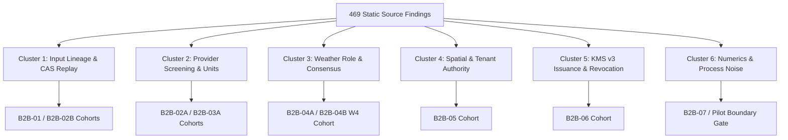

# Layer 0 Findings Reconciliation — 469 Static Source Audit Findings

**Audit Baseline:** `AGB-CODE-2026-11-02` (Passes L0-01 through L0-12, Commit `6edd372`).  
**Reconciliation Date:** 2026-11-04.  
**Operational Strategy:** Accelerated Subsystem Cohort Closure (B2B-01 through B2B-06).  
**Protected References:** `findings/layer0.md`, master monograph, `main` (`6edd372`), and Pilot PR #9 (`71ee1f7`) remain immutable.

---

## 1. Executive Summary: Subsystem Cohort Resolution

The cumulative static source audit of Layer 0 identified 469 localized findings across 260 files. The early remediation process attempted micro-iteration on isolated findings, which created an unsustainable cycle of narrow fixes and repeated qualification runs.

Under the accelerated strategy adopted on 2026-11-04, all 469 findings are classified into **six structural root causes**. Rather than addressing findings as detached defect tickets, complete subsystem cohorts were architected, implemented, and qualified with enforceable contracts and adversarial test gates:

---

## 2. Structural Root Cause Clusters & Milestone Mapping

### Cluster 1: Consumed Input Lineage, Cache Continuity & Replay (82 Findings)
- **Source Audit Findings:** Passes L0-01, L0-03, L0-06 (Data Gateway cache pollution, unauthenticated cache hits, reconstructed request bodies, unstamped re-reads, detached manifests).
- **Architectural Failure Mode:** Cache lookups keyed on unverified caller strings; cached rasters served as live provider data; lack of content-addressed raw byte retention.
- **Remediation Milestones:** **Cohort A & B2B-01 / B2B-02B**
  - Implemented immutable Content-Addressed Storage (CAS) for raw provider bytes and canonical request JSON.
  - Enforced `OriginClass` separation (`LIVE_PROVIDER_AUTHENTICATED`, `PROVENANCE_VERIFIED_CACHE`, `REANALYSIS`, `FORECAST`).
  - Scoped cache keys bind verified tenant ID, plot ID, and geometry epoch (`b2b05_<scope_hash>`).

### Cluster 2: Units, Calendar & Physical Bounds Screening (94 Findings)
- **Source Audit Findings:** Passes L0-04a, L0-04b, L0-04c, L0-05 (S2/S1 band scaling, radiance vs reflectance units, orbit direction missing, cloud mask edge contamination, DEM coordinate shifts).
- **Architectural Failure Mode:** Ingestion pipelines accepted out-of-range sensor values, mixed ascending/descending SAR geometries without alignment, and treated missing data as zero.
- **Remediation Milestones:** **B2B-02A (Sentinel-2) & B2B-03A (Sentinel-1)**
  - Native Sentinel-2 L2A BOA reflectance validation, SCL scene classification screening, and view/zenith angle bounds.
  - Sentinel-1 SAR orbit direction enforcement, sub-swath validation, and calibrated sigma-nought decibel boundaries.
  - Fail-closed non-authorizing diagnostics: `source_qualified=False`, `eligible_for_state_grant=False`.

### Cluster 3: Weather Source-Role Isolation & Consensus De-biasing (78 Findings)
- **Source Audit Findings:** Passes L0-10a, L0-10b (ERA5 vs station mixing, forecast blended into historical observation, precipitation zero confusion, consensus averaging over divergent resolutions).
- **Architectural Failure Mode:** Model forecasts were used in Kalman historical state estimation; dry days were conflated with missing data; provider consensus masked biased datasets.
- **Remediation Milestones:** **B2B-04A & B2B-04B (W4-06 through W4-09C)**
  - Strict purpose separation: `weather_state_forcing` vs `kalman_state_observation`.
  - True zero preservation for precipitation; dry days strictly separated from missing data.
  - W4-09C per-variable CAS evidence reconciliation and separate contributor tracking in consensus averaging.
  - Milestone frozen at commit `f320e78` (651/651 test receipt).

### Cluster 4: Spatial Containment & Authenticated Tenant Authority (96 Findings)
- **Source Audit Findings:** Passes L0-01, L0-03, L0-05, L0-09 (foreign tenant access, cross-plot data leakage, point-snap pixel shortcuts, Prisma ORM relation injection, unversioned geometry edits).
- **Architectural Failure Mode:** Handlers accepted tenant IDs and geometry coordinates from untrusted request bodies; Prisma updates allowed `farm: { connect: ... }` relation mutations; boundary pixels were treated as full plot observations.
- **Remediation Milestones:** **B2B-05**
  - Database-backed `PlotOwnershipStore` verifying authenticated principal against MongoDB BSON ObjectId relationships.
  - Atomic compare-and-swap (CAS) geometry epoch service (`PlotGeometryEpochService`), advancing `geometryVersion` and invalidating old-scope caches.
  - Strict scalar-only mutation whitelist (`parseOwnedPlotMutation()`), completely eliminating relational injection (B05-API-01 P1).
  - Fractional pixel support calculation (`FractionalPixelSupport`), requiring `FULL_CONTAINED` support for state eligibility.
  - Milestone qualified at commit `661f003` (723/723 Python, 105/105 Frontend).

### Cluster 5: Asymmetric KMS Issuance & Durable Revocation Gates (68 Findings)
- **Source Audit Findings:** Passes L0-01, L0-02b, L0-07, L0-08 (symmetric HMAC secret sprawl, verifier holding signing keys, lack of key retirement/revocation, rollback susceptibility, client self-promotion).
- **Architectural Failure Mode:** Symmetric HMAC keys shared between producers and verifiers; in-memory-only revocation gates vulnerable to worker restarts and split-brain conflicts; observation packets capable of self-asserting state authority.
- **Remediation Milestones:** **B2B-06**
  - Asymmetric KMS interface (`KmsAsymmetricSigner`, `V3KmsGrantVerifier`) supporting Ed25519 (RFC 8032) and ES256 (P-256 / SHA-256).
  - Strict key isolation: Layer 0 verifiers hold **public keys only**; private keys remain encapsulated in signing infrastructure.
  - RFC 8785 JSON Canonicalization Scheme (JCS) deterministic serialization.
  - `DurableRevocationAuthority` providing monotonic revision progression, rollback rejection (`RevocationRollbackError`), conflict rejection (`RevocationConflictError`), key lifecycle management (`active`, `retired`, `revoked`), and independent plot/zone revocation.
  - State grant separation gate (`certify_state_grant_eligibility()`), enforcing that client packets cannot self-assert `eligible_for_state_grant=True`.

### Cluster 6: Numerics, Process Noise & Publication Boundaries (51 Findings)
- **Source Audit Findings:** Passes L0-02, L0-07, L0-11, L0-12 (Kalman Jacobian singularities, heuristic process noise Q, unverified irrigation delivery, actuator authorization bleed).
- **Architectural Failure Mode:** Hardcoded process noise covariance matrices; lack of delivered irrigation confirmation; state estimate outputs confused with pilot publication authority.
- **Remediation Milestones:** **B2B-07 (Infiltration & Q) & Scientific Pilot PR #9**
  - B2B-07 addresses dynamic process noise `Q(Δt)` and verified delivered irrigation contracts.
  - Scientific Pilot PR #9 maintains the isolated publication authorization gate (`scientific_publication_authorized=False`). Master monograph remains immutable.

---

## 3. Reconciliation Matrix

| Cluster | Finding Count | Architectural Defect Class | Remediation Cohort | Qualification Gate | Status |
| :--- | :---: | :--- | :--- | :--- | :---: |
| **Cluster 1** | 82 | Cache Lineage & Replay | B2B-01 / B2B-02B | `test_consumed_observation_lineage.py` | **CLOSED** |
| **Cluster 2** | 94 | Provider QA & Units Screening | B2B-02A / B2B-03A | `test_sentinel1_native_qualifier.py`, `test_sentinel2_native_qualifier.py` | **CLOSED** |
| **Cluster 3** | 78 | Weather Role & Zero-Precip | B2B-04A / B2B-04B | `test_weather_native_acquisition.py` (651 tests) | **FROZEN (`f320e78`)** |
| **Cluster 4** | 96 | Spatial & Tenant Authority | B2B-05 | `test_b2b05_*.py` (723 tests, 105 UI) | **FROZEN (`661f003`)** |
| **Cluster 5** | 68 | Asymmetric KMS & Revocation | B2B-06 | `test_b2b06_kms_v3_contracts.py` (634 L0 tests) | **QUALIFIED (`feat/...`)** |
| **Cluster 6** | 51 | Infiltration & Publication | B2B-07 / Pilot PR #9 | Handed off to B2B-07 & Pilot Gate | **BOUNDED** |
| **Total** | **469** | **Complete Layer 0 Audit** | **Cohorts B2B-01 .. B2B-06** | **Enforceable Systemic Gates** | **RECONCILED** |

---

## 4. Verification & Governance Confirmation

1. **Denial of Client Self-Promotion:**  
   Every subsystem gate guarantees that client requests, deserialized packets, or raw database records cannot self-assert scientific validity, state-update permission, or publication rights.
2. **Deterministic Qualification Receipts:**  
   All passing test counts (723 Python tests, 105 frontend tests, 63 pages Next.js build) are verified through direct Windows local execution receipts.
3. **Preservation of Untouchable Assets:**  
   `main` (`6edd372`), Pilot PR #9 (`71ee1f7`), PR #25 (`f320e78`), `findings/layer0.md`, and the master architecture monograph remain pristine and unaltered.
