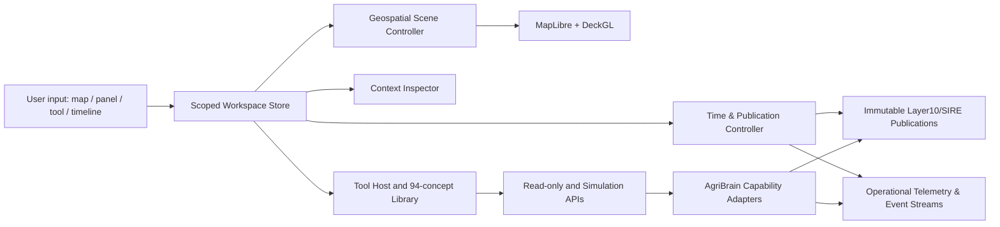

# Akaloris Plot Workspace — Unified Geospatial Interaction Design V1
**Status:** proposed UX and platform design, NOT an implemented release  
**Date:** 2026-11-12  
**Source baseline:** `1ee2c20119af29dd1f0a0b46c85217d91206b744` (subsequent integration commits in this workstream are audit/design docs only)  
**Companion audit:** [Nine-pass AgriBrain capability study](../00_MASTER_CAPABILITY_AUDIT.md), [94 intended tool concepts](../PASS_08_Complete_Tool_Registry.md), [previous plot-page security/UX audits](../../plot-page-refactor-audit-2026-11-12/ROUND_2_DEEPER/R2_MASTER_INDEPENDENT_AUDIT.md)
## Decision
Akaloris is **a tool operating environment around AgriBrain**, not a static dashboard and not just a thirteen-layer scientific viewer. Every built, experimental, hardware-dependent and planned tool is discoverable. Map visualization, side panels, scientific history, and tool workbenches share **one** scoped selection and temporal context. Capability visibility does not confer execution authority.

We are designing the complete experience before implementing pieces. No application code, monograph, released tag, PR #28, 52-package register or protected main is altered by this design.

## Five non-negotiable user experiences
1. **Explore everything spatially**: map shows simultaneously eligible scientific surfaces, zones, sensor positions, camera positions, actual/planned drone tracks, MESIA receivers/qualified coverage, geolocated events, sampling points, experiments and tasks. Users toggle categories individually; declutter when necessary. Nonspatial information remains in tool/timeline, not faked as a pin.
2. **Select once; inspect everywhere**: a user clicking a sensor on the map highlights the corresponding device in the sensor tool, changes the inspector and can pivot to linked measurements; selecting from a device list pans to the same pin. This applies to zones, missions, scenes, events, cameras, state surfaces and experiment assets.
3. **Science stays honest**: observations, admitted measurements, fused state, proxy, prior, hypothesis, simulation and forecast receive distinct badges and provenance. A nearby device is merely co-located until a signed/verified source-to-state evidence link exists.
4. **Interactive laboratory**: scenarios, what-if changes, drone route plans and controlled MESIA experiments can be configured and previewed interactively **without altering the immutable scientific publication**. Real hardware actions need separate authority, not a button turning simulation into reality.
5. **Stateful historical replay**: one timeline coordinates historical publications, scene captures, device/event timestamps and forecasts while distinguishing data's observation instant, first-availability time, publication time, valid-time and actual wall-clock live now.

## Proposed UX layout
Desktop: (1) global Plot/Season/Snapshot header; (2) persistent narrow pin-able Tool Dock with All Tools search; (3) central resizable map; (4) right Context Inspector, capable of becoming a wider Tool Panel; (5) bottom multi-track timeline; (6) optional secondary compare pane and full-size tool workbench that keeps linked plot/map context. The map is never hidden merely to see a sensor, drone, experiment or MESIA tool.

## Primary UI areas
- **Overview**: concise field summaries, current evidence status, map, actionable scouting only when supported.
- **Explore**: map and independent layer catalog; combine observations, 13-state SIRE and geographic objects.
- **ASMAE Lab**: 13 canonical state rows, posterior+sigma, provenance, authorization, covariance only if qualified.
- **Research**: what-if and controlled experiments with isolated sandboxed results.
- **History**: time-peel, events, scene footprints, plot snapshots, mission history and evidence changes.
- **Operations**: scouting tasks, device health, irrigation planning, execution proposals under observation-only safety.

**Tool Dock** independently opens: Sensors, Drone Missions, MESIA Observatory, Satellite, ASMAE States, Camera, Ground Truth, Experiments, Water, Nutrients, Disease, Planner, AI Advisor, Reports and the full Tool Library. Tool ≠ primary workspace tab.

## Deliverables
- [01 — Layout & navigation](01_WORKSPACE_LAYOUT_AND_NAVIGATION.md)
- [02 — Map scene and visual grammar](02_MAP_SCENE_AND_OBJECT_LAYERS.md)
- [03 — Shared context, selection and time protocols](03_SELECTION_TIME_AND_EVENT_PROTOCOL.md)
- [04 — Tool interoperability and end-to-end user flows](04_INTERACTIVE_TOOL_WORKFLOWS.md)
- [05 — Proposed API, permissions and materialization](05_TOOL_ADAPTERS_AND_API_CONTRACTS.md)
- [06 — Qualification matrix and implementation slices](06_ACCEPTANCE_GATES_AND_ROLLOUT.md)

## Constraints and existing findings
- Preserve map render authorization and browser materialization receipts from `src/components/farm/map/PlotMapShell.tsx` and `src/hooks/useLayer10.ts`.
- Fix MultiPolygon holes and geometry-identity cache bug in `buildPolygonMask.ts` before scientific use.
- Do not relabel timeout awaiting publication as confirmed ASMAE engine failure.
- Frontend sensor status API lacks geolocation despite backend registered lat/lon/depth.
- Current drone hook uses mock dispatch and simulated telemetry/weather. MESIA experiment harnesses lack hardware/DB. The UX should include their complete intended workflows while showing their real availability.
- The 13 ASMAE coordinate order/schema is frozen. Registered surface types do not mean 13 currently authorized geospatial renderings.
- **Actuation constraint:** `AKALORIS_LAYER0_ENABLE_VERIFIED_IRRIGATION=false`, observation only.
## Design assumptions to revisit with user before implementation
- Hybrid map-first workspace, adjustable inspector and detachable full workbenches.
- Default pin set: sensors + zones + recent events; drone/MESIA layers visible on demand. Every category is always in the layer catalog regardless of data availability.
- One primary canonical raster, one optional comparison; independently toggleable vector/event layers.
- Tool eligibility should be displayed on both entry cards and specific action controls, never hidden.
## Evidence quality
This is a design specification grounded in representative pinned GitHub code and earlier multi-pass audits; it is **not** an exhaustive function-by-function backend audit and contains no new test/field/browser execution.
