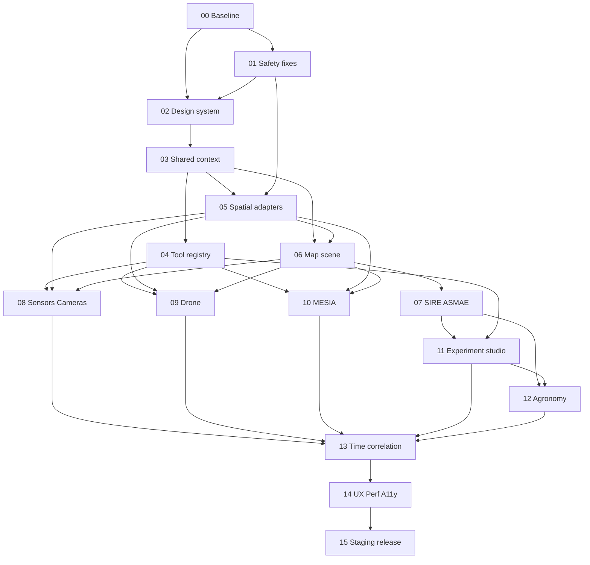

# Program Sequencing, Dependency DAG, PR Strategy, Capacity and Change Ownership
## Dependency DAG

## Workstream parallelization
- After P03, A2 works Tool Registry/host (P04), A5 builds backend feature adapters (P05), A1 finalizes UX shell, A3 writes test harness and shape validation for P06. They may design in parallel; code integration must respect P03 contracts.
- After P06, ASMAE (P07), Sensors (P08), Drone (P09), MESIA (P10) may be developed in separate tool plugin boundaries, but need stable central selection/time APIs. Share acceptance contract tests, not a sprawling mutable dashboard.
- Experiments (P11) can mock a valid published baseline in a sandbox before P07 runtime integration, but merge waits for immutable snapshot separation tests.
- Event/timeline (P13) depends on normalized data edges from each subsystem; implement schema earlier in P03/P05, present final UI after tool streams exist.
- P14 a11y/performance probes must run continuously at every pass; final P14 is full sweep, not first UX review.
## Proposed PR structure
`feature/plot-workspace-p00-inventory`, `fix/plot-workspace-p01-safety`, `feat/plot-workspace-p02-shell`, ... `feat/plot-workspace-p14-qualify-ui`, `release/plot-workspace-p15-staging`. Branch names are suggestions, not created. Each pass PR targets a verified integration base or stacked dependency PR; never automatically merge into protected `main` or Draft #28.
File ownership: `PlotMapShell.tsx`/map layers owned by geospatial workstream; `useLayer10.ts` and L10 contracts owned by scientific workstream; `PlotDashboard.tsx` and plot route by integration shell; sensor/drone/MESIA workspaces by per-tool owner. Communicate API-contract edits before touching another workstream's files. No all-at-once rewrite.
## Effort / capacity planning (planning ranges, **not** ETAs)
| Pass group | Relative size | Main uncertainty |
|---|---|---|
| P00–P01 | M–L | security/geometry regressions, setting test baseline |
| P02–P04 | L | shell contracts and historical state migration |
| P05–P06 | XL | data adapters, map picking, render semantics |
| P07 | XL | scientific authorization, 13-state completeness |
| P08–P10 | XL | device integrations and hardware truth boundaries |
| P11–P12 | XL | sandbox isolation and diverse agronomic capabilities |
| P13–P14 | L–XL | temporal joins, browser/performance qualification |
| P15 | L | real staging environment/negative controls |
These are qualitative complexity bands. Commit to calendar dates only after P00 baseline and staffed reviewer availability. Hardware/field experiments are a separate workstream whose duration is unknowable from repo inspection alone.
## Role capacity
For one primary developer, conduct sequential implementation with narrower pass PRs and invite independent reviewers only for high-risk changes; claiming 9 parallel full-time agents would be misleading. For a real multidisciplinary team, allocate A2/A3/A5/A4 parallel branches after shared contract freeze, and A6/A7 continuous red-team. A1/A8 review each visual increment.
## Change budget & review threshold
Prefer PRs touching <= 1 major subsystem and with source-compatible tests; if a pass needs > ~20 meaningful application files, split its implementation into Pxx-A/B/C without changing its contract or acceptance gate. Never 'accept' by LOC or percentages. No breaking source contract without explicit version and migration test.
## Rollback
Release feature flag separate from source adapters; old plot layout must remain usable while new V2 is toggled off. A rejected scientific surface still uses old safe unavailable/diagnostic UI; rollback never removes audited historical publication. Hardware dispatch flags remain independent and OFF.
