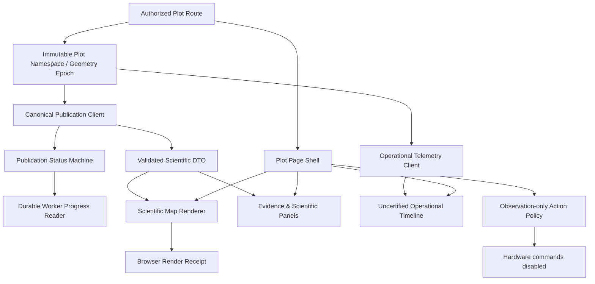

# Akaloris Plot Page — Pass 08: Target Refactor Architecture, Priority Plan, and Exit Gates

> **Audit evidence scope:** Static GitHub source inspection pinned to commit `1ee2c20119af29dd1f0a0b46c85217d91206b744` and the provided 1600×900 browser screenshot. Files were retrieved from the repository and inspected structurally; selected control-flow paths were deep-traced. No local Next.js/FastAPI runtime, tests, browser automation, or production hardware was executed. Findings distinguish observed screenshot behavior, confirmed source behavior, and test-required hypotheses.

## Pass coverage

- This is a cross-cutting synthesis; it reuses **109 prior source files**, no additional file added to the denominator.
- Source data-flow traces: inherited from passes 01–07.
- Browser/runtime verification: **0 executed sessions** (source-and-screenshot audit only).

## Decision: refactor the shell, not the science

The screenshot and source indicate a **legacy-complex client presentation layer around an improving scientific back end**. A complete rewrite of AgriBrain to solve a frontend timeout or UX defect would introduce unnecessary risk. Refactor by **vertical slice and sealed scientific contracts**, with the existing branch/tag boundaries maintained.

### Target architecture

### Proposed refactor packages and deliverables

| Slice | Refactor scope / target owner | Acceptance objective | Priority |
|---|---|---|---|
| RF-01 | `plot-route` + `PlotPageShell` + strict session/ownership resolver | No empty tenant and correct plot identity across tabs | P1 |
| RF-02 | `canonical-publication-client` + single immutable `PlotPublicationState` | Distinguish RUNNING, WAITING_FOR_HEAD, PUBLISHED, INVALID, FAILED; no false errors after 20s | P1 |
| RF-03 | `durable-job-progress` keyed by plot + job + generation | Only terminal eligible failures allow replacement jobs | P1 |
| RF-04 | `scientific-data-contract` gateway | All 11 explicit fields checked for new snapshots; exact lineage/geometry | P1 |
| RF-05 | `plot-spatial-authority` (GeoJSON mask, bounds, epoch, CRS) | Multipolygons/holes respected; cache never uses stale geometry | P1 |
| RF-06 | `PlotMapCanvas` + layer factories + `RenderReceiptCollector` | Distinguish visual basemap from materialized scientific raster | P1 |
| RF-07 | `PlotEvidencePanel` + scientific readability/labels | Honest statuses, readable farmer/expert evidence view | P2 |
| RF-08 | `PlotToolbar` / `ContextHeader` / responsive layout | Compact, accessible, no panels collide across viewport widths | P2 |
| RF-09 | `ObservationOnlyActions` + strict simulator segregation | Mock E-STOP/command cannot appear as real hardware success | P1 |
| RF-10 | `OperationalTelemetryClient` + `NonCanonicalContext` | No promotion of live telemetry or cached intelligence to certified evidence | P2 |
| RF-11 | integrated test harness + Playwright screenshots | One actual Publisher → FastAPI → Next API → DeckGL proof | P1 |

### Recommended implementation order (without broad scientific remediation)

**Wave A — Correctness (do first):** RF-01, RF-02, RF-03, RF-04, RF-05, RF-09. Add regression tests for observed screenshot failure, run duplication, scope, holes, stale mask, mock action UI.

**Wave B — Vertical product proof:** RF-06 + RF-11 on one known valid **observation-only** canonical snapshot; capture real browser render receipt and screenshot; confirm no command paths.

**Wave C — Visual/product refactor:** RF-07, RF-08, RF-10 and performance cleanup, one functional panel at a time; preserve all provenance and authorization behavior.

**Wave D — Pilot-ready acceptance:** full regression, staging publisher → API → browser; rollback plan; record exact commit plus screenshots and data hashes. No master monograph changes, no merging Draft PR #28 merely to prove the UI.

### Source-level success metrics (not synthetic percentages)

- Correctly show canonical status: **0 false FAILED when job is only waiting** across delayed scenarios.
- Geometry mask: **0 incorrect pixel materializations** in holes/other polygons and after same-bounds edits.
- Science authority: **0 positive render receipts** when invalid or non-materialized; no cross-tenant snapshot.
- Controls: **0 simulated command responses shown as real execution**; observation-only hardware dispatch **0**.
- Screens: no overlap or clipped controls at target viewports; user can interpret “no science” vs “satellite imagery available”.
- Integration: one published snapshot proceeds through real publisher → signed FastAPI → owner-scoped Next API → actual DeckGL browser pixels, with exact ID and hash matching.

### Explicit boundaries and things not done

- This is a **complete refactor design for the inspected page system**, not implementation of the new UI.
- No production runtime, local database, network, browser DevTools, memory profiling, accessibility scanner or actual Playwright browser was run.
- No code, tag, PR, or protected branch was modified.
- Keep `AKALORIS_LAYER0_ENABLE_VERIFIED_IRRIGATION=false`; independent hardware interlocks required.
- Existing scientific Layer 0/1 contracts, ASMAE code, 52-package register, and monograph are outside the frontend-refactor scope.