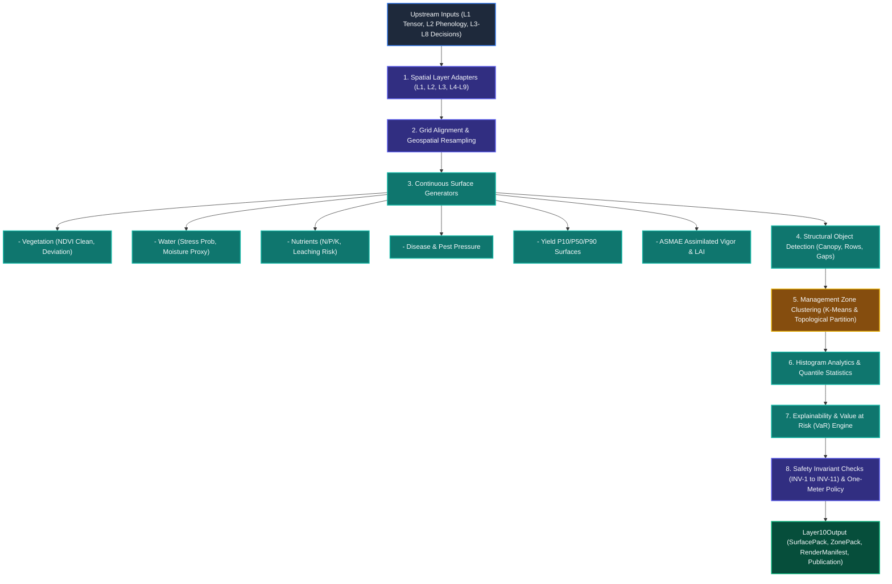

# Layer 10: Spatial Intelligence and Rendering Engine (SIRE)

## 1. Executive Summary & Verification Status
**Layer 10 (`layer10_sire`)** is the spatial publication, continuous raster synthesis, management zone clustering, and biophysical explainability engine of AgriBrain. It translates diagnostic, agronomic, and prescriptive outputs across Layers 1–9 into continuous map-native surfaces, vector GeoJSON polygons, and frontend Mapbox render artifacts.

* **Operational Status:** Production-ready.
* **Pipeline Structure:** 17 specialized modules spanning spatial adapters, biophysical surface generators, structural canopy/row detectors, K-Means zone segregators, histogram analytics, and explainability surfaces.
* **Evidence & Safety Governance:** Enforces rigorous publication contracts, separating core diagnostic state from experimental model-assisted rasters; enforces the strict **One-Meter Policy** (high-resolution $\le 1.0\text{m}$ inferred details are visual-only and fail-closed against state updates or prescription driving).
* **Test Suite:** 17 dedicated integration tests in `services/agribrain/layer10_sire/tests/` passing 100%.

---

## 2. Architectural Pipeline & System Flow



### The 8-Stage Spatial Synthesis Pipeline:
1. **Upstream Ingestion & Normalization (`adapters/`):** Consumes `FieldTensor` (L1), `VegIntOutput` (L2), `Layer3Output` (L3), and downstream prescriptions, extracting geospatial grids (`grid_spec`) and time windows.
2. **Geospatial Grid Alignment:** Normalizes coordinate reference systems (CRS) and establishes the authoritative raster grid ($H \times W$).
3. **Continuous Surface Generation (`surfaces/`):** Generates 2D raster surfaces covering vegetation vigor, soil water deficit, nutrient limitations, salinity stress, and pathogen pressure.
4. **Structural Detection (`structure/`):** Computes high-resolution canopy masks, tree crowns, and crop row direction vectors.
5. **Management Zone Extraction (`zones/`):** Partitions fields into non-overlapping management zones using K-Means clustering and agronomic thresholds.
6. **Histogram Analytics (`histograms/`):** Computes area-weighted quantile distributions ($P_{10}, P_{50}, P_{90}$), means, and bimodality flags for all generated surfaces.
7. **Explainability & Financial Risk (`explainability.py`):** Calculates Value at Risk ($\text{VaR}$) projections and links spatial anomalies back to causal upstream evidence.
8. **Invariant Verification & Publication Gating (`invariants.py`, `surface_contract.py`):** Validates all 11 SIRE invariants, checks 1-meter policy compliance, and certifies publication status (`VALID_NORMAL` or `VALID_DEGRADED`).

---

## 3. Specialized Engine Inventory (17 Engines)

| Category | Component / Module | Source File | Core Responsibility |
| :--- | :--- | :--- | :--- |
| **Pipeline & Adapters** | `PipelineRunner` | `runner.py` | Orchestrates end-to-end SIRE execution and cache serialization. |
| | `L1Adapter` | `adapters/l1_adapter.py` | Normalizes 4D tensor satellite rasters and LoRa sensor feeds. |
| | `L2Adapter` | `adapters/l2_adapter.py` | Ingests canonical phenology stages, anomalies, and GDD metrics. |
| | `L3L9Adapters` | `adapters/` | Maps diagnostic issues, nutrient states, and ActionCards. |
| **Surface Generators** | `VegetationSurfaces` | `surfaces/vegetation.py` | Formulates raw and smoothed NDVI and vegetative anomaly rasters. |
| | `WaterSurfaces` | `surfaces/water.py` | Computes root-zone water stress probability and moisture proxies. |
| | `NutrientSurfaces` | `surfaces/nutrients.py` | Computes N/P/K limitations, leaching risk, and volatilization risk. |
| | `SalinitySurfaces` | `surfaces/salinity.py` | Maps soil electrical conductivity ($EC_e$) stress distributions. |
| | `YieldSurfaces` | `surfaces/yield_surface.py` | Generates $P_{10}, P_{50}, P_{90}$ yield projections and yield gap surfaces. |
| | `DiseaseSurfaces` | `surfaces/disease.py` | Simulates pathogen spread likelihood and weather pressure. |
| | `TemporalSurfaces` | `surfaces/temporal.py` | Maps 14-day temporal trends ($T-7 \to T+7$) and NDVI delta indices. |
| | `ASMAESurfaces` | `surfaces/asmae.py` | Assimilates model-assisted ASMAE vigor, LAI, and chlorophyll proxies. |
| **Structure & Zones** | `CanopyMaskEngine` | `structure/canopy_mask.py` | Segments vegetative canopy from bare soil backgrounds. |
| | `RowDetectionEngine` | `structure/row_detection.py` | Extracts crop row vectors and orientation angles. |
| | `ZoneExtractor` | `zones/extractor.py` | Extracts polygon boundaries and enforces non-overlapping topology. |
| | `HeterogeneityZones` | `zones/heterogeneity_zones.py` | Clusters multi-spectral bands via K-Means to identify management zones. |
| **Analytics & Governance**| `ExplainabilityEngine` | `explainability.py` | Calculates Value at Risk ($\text{VaR}$) and spatial attribution weights. |
| | `OneMeterPolicy` | `one_meter_policy.py` | Enforces visual-only quarantine for $\le 1\text{m}$ high-resolution details. |
| | `SurfaceContract` | `surface_contract.py` | Validates immutable artifact identities and publication statuses. |

---

## 4. Key Mathematical Formulations

### A. Bilinear Coordinate Resampling
Transforms coordinates from coarse grid ($oH \times oW$) to display grid ($nH \times nW$):
$$\text{src\_r} = (r + 0.5) \cdot \frac{oH}{nH} - 0.5, \quad \text{src\_c} = (c + 0.5) \cdot \frac{oW}{nW} - 0.5$$
$$v = v_{00}(1 - f_r)(1 - f_c) + v_{01}(1 - f_r)f_c + v_{10}f_r(1 - f_c) + v_{11}f_r f_c$$

### B. High-Resolution 1m Texture Sharpening (Mean Conserving)
Blends upscaled authoritative rasters with localized detail textures:
$$\text{Texture} = \text{Basis}_{up} - \text{mean}_{\text{neighbors}}(\text{Basis}_{up})$$
$$\text{Sharpened} = \text{Certified}_{up} + \text{Texture} \cdot \left( \text{VisualIntensity} \cdot \frac{\sigma_{\text{certified}}}{\sigma_{\text{texture}}} \right)$$
* $\text{VisualIntensity} = 0.40$. Mean value is strictly conserved to preserve physical correctness.

### C. Explainability Value at Risk ($\text{VaR}$)
Quantifies the monetary crop value at risk from diagnosed spatial stresses:
$$\text{VaR}_{\text{baseline}} = 150 + \sum_{d \in \text{Diagnoses}} \left( \text{severity}_d \cdot \text{confidence}_d \right) \cdot 45 \quad (\text{USD/ha})$$

### D. K-Means Zone Heterogeneity Clustering
Minimizes within-cluster sum of squares over normalized multi-spectral features ($NDVI, NDMI, NDRE$):
$$J = \sum_{k=1}^{K} \sum_{x \in S_k} \| x - \mu_k \|^2$$

### E. The One-Meter Policy Contract
Enforces that high-resolution ($\le 1.0\text{m}$) inferred or drone-enhanced visual features are strictly quarantined:
$$\text{If } \text{Resolution} \le 1.0\text{m} \implies \text{state\_update\_allowed} = \text{False}, \quad \text{prescription\_driver\_allowed} = \text{False}$$
Violation immediately triggers `RuntimeError("one_meter_state_update_policy_violation")`.

---

## 5. Input & Output Contracts

### `Layer10Input`
* `plot_namespace: PlotNamespace`: Mandatory valid namespace (`tenant_id`, `farm_id`, `plot_id`).
* `field_tensor: Any`: 4D geospatial raster tensor from Layer 1.
* `veg_int: Any`: Phenological and vegetative classification from Layer 2.
* `grid_height: int` & `grid_width: int`: Dimension of target raster grid.
* `requested_modes: List[str]`: Requested map layers (`"quick_visual"`, `"standard"`, `"scientific_refresh"`).
* `field_geometry: Optional[Dict]`: Canonical GeoJSON boundary polygon.

### `Layer10Output`
* `publication_id: str`: Cryptographically unique publication identifier.
* `publication_status: str`: Status code (`VALID_NORMAL`, `VALID_DEGRADED`, `INVALID_PUBLICATION`, `FAILED_PUBLICATION`).
* `surface_pack: List[SurfaceArtifact]`: Continuous 2D rasters with valid ranges, units, and provenance.
* `zone_pack: List[ZoneArtifact]`: Clustered polygon management zones with top drivers and evidence.
* `histogram_bundle: HistogramBundle`: Quantile distributions and pixel counts.
* `render_manifest: RenderManifest`: Mapbox styling specifications and active modes.
* `quality_report: QualityReport`: Invariant status, degradation modes, and reliability metrics.

---

## 6. Runtime Safety Invariants (`INV-1` to `INV-11`)

Layer 10 enforces 11 runtime invariants via `enforce_layer10_invariants()`:

1. **`INV-1: Grid Alignment`**: All non-quarantined surfaces must strictly match the designated $(grid\_h, grid\_w)$ dimensions.
2. **`INV-2: Range Sanity`**: Surface cell values must stay within physical bounds ($NDVI \in [-1, 1]$, probabilities $\in [0, 1]$, $LAI \in [0, 8]$).
3. **`INV-3: Source Dominance Sum`**: Multi-sensor blending weights per pixel must sum to $1.0 \pm 0.05$.
4. **`INV-4: Zone Evidence`**: Every synthesized zone must include valid confidence scores ($\in [0, 1]$) and non-empty `top_drivers`.
5. **`INV-5: Zone Topology`**: Zones belonging to the same functional family must not contain overlapping cells.
6. **`INV-6: Action Overlay Evidence`**: Decision zones cannot exist without upstream action or finding links.
7. **`INV-7: Histogram Consistency`**: Total bin counts must equal the number of valid pixels in the region.
8. **`INV-8: Temporal Grid Alignment`**: All multi-day temporal slices must match grid dimensions.
9. **`INV-9: Forecast Confidence Decay`**: Forecasted temporal slices must have lower or equal confidence compared to historical observations.
10. **`INV-10: Temporal Monotonicity`**: Temporal day offsets must be strictly ordered.
11. **`INV-11: Execution Surface Bounds`**: Readiness and timing surfaces must fall within $[0, 1]$.

---

## 7. Publication Statuses & Degradation Modes

| Status Code | Description | Behavioral Profile |
| :--- | :--- | :--- |
| `VALID_NORMAL` | Full production publication. | All authoritative satellite/sensor rasters present; invariants passed. |
| `VALID_DEGRADED` | Valid model-assisted advisory. | Missing fine sensor data or alignment issues; published with explicit degradation codes (`DIAGNOSTIC_AUTHORITY_ONLY`). |
| `INVALID_PUBLICATION` | Publication contract broken. | Corrupt grid or missing identity; client map viewer rejects payload. |
| `FAILED_PUBLICATION` | Upstream failure. | Worker crashed or data unavailable; fallback guidance returned. |

---

## 8. Test Suite Verification

The Layer 10 test suite is located in `services/agribrain/layer10_sire/tests/`:

* `test_evidence_and_publication.py` (11 tests):
  - Model-assisted composite scouting grounding.
  - Fallback guidance preservation and non-surface evidence survival.
  - Reconciling durable background ASMAE jobs.
  - Fail-closed dependency masks on ungrounded NDVI.
  - Evidence-bound ASMAE surface stage claims.
* `test_surface_contracts_and_invariants.py` (3 tests):
  - Mandatory surface artifact identity serialization contract.
  - Runtime enforcement of invariants INV-1, INV-2, INV-3, and INV-7.
  - One-Meter Policy enforcement and fail-closed state update protection.
* `test_sire_runner_and_modes.py` (3 tests):
  - End-to-end execution under `quick_visual` mode.
  - Standard mode with 2D tensor raster maps and geometry.
  - Conversational explainability pack synthesis.

**Execution Command:**
```bash
py -3 -m pytest services/agribrain/layer10_sire/tests -v
```
**Results:** `17 passed in 0.79s` (100% pass rate).
