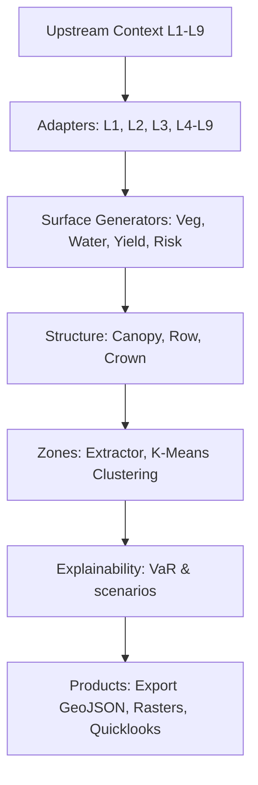

# Layer 10: Spatial Intelligence and Rendering Engine (SIRE)

This layer builds continuous maps, extracts management zones, and computes biophysical explainability parameters.

## 1. Engine Inventory (Exact Count: 17)

This layer contains exactly 17 specialized engines:
1. **Pipeline Orchestration Runner** ([runner.py](file:///c:/Users/E-C/Desktop/agriwise/services/agribrain/layer10_sire/runner.py)): Coordinates the end-to-end execution of adapters, surface generators, zone extractors, histograms, and exporting.
2. **Upstream Layer Adapters** (in `adapters/`): Normalizes Layer 1-9 inputs (`L1Adapter`, `L2Adapter`, `L3Adapter`, `L4L9Adapters`).
3. **Vegetation Surface Generator** ([surfaces/vegetation.py](file:///c:/Users/E-C/Desktop/agriwise/services/agribrain/layer10_sire/surfaces/vegetation.py)): Formulates raw/cleansed NDVI.
4. **Water Stress Surface Generator** ([surfaces/water.py](file:///c:/Users/E-C/Desktop/agriwise/services/agribrain/layer10_sire/surfaces/water.py)): Simulates ET maps and water deficits.
5. **Salinity Surface Generator** ([surfaces/salinity.py](file:///c:/Users/E-C/Desktop/agriwise/services/agribrain/layer10_sire/surfaces/salinity.py)): Estimates electrical conductivity (EC) stress.
6. **Nutrient Surface Generator** ([surfaces/nutrients.py](file:///c:/Users/E-C/Desktop/agriwise/services/agribrain/layer10_sire/surfaces/nutrients.py)): Generates N/P/K stress maps.
7. **Yield Surface Generator** ([surfaces/yield_surface.py](file:///c:/Users/E-C/Desktop/agriwise/services/agribrain/layer10_sire/surfaces/yield_surface.py)): Generates $P_{10}$, $P_{50}$, $P_{90}$ yield surfaces.
8. **Disease Surface Generator** ([surfaces/disease.py](file:///c:/Users/E-C/Desktop/agriwise/services/agribrain/layer10_sire/surfaces/disease.py)): Simulates disease pressure distributions.
9. **Temporal Surface Generator** ([surfaces/temporal.py](file:///c:/Users/E-C/Desktop/agriwise/services/agribrain/layer10_sire/surfaces/temporal.py)): Computes delta and trend trend profiles.
10. **Execution Surface Generator** ([surfaces/execution.py](file:///c:/Users/E-C/Desktop/agriwise/services/agribrain/layer10_sire/surfaces/execution.py)): Generates readiness and prioritization maps.
11. **Canopy Mask Engine** ([structure/canopy_mask.py](file:///c:/Users/E-C/Desktop/agriwise/services/agribrain/layer10_sire/structure/canopy_mask.py)): Segments canopy vegetation.
12. **Row Detection Engine** ([structure/row_detection.py](file:///c:/Users/E-C/Desktop/agriwise/services/agribrain/layer10_sire/structure/row_detection.py)): Extracts row direction vectors.
13. **Crown Detection Engine** ([structure/crown_detection.py](file:///c:/Users/E-C/Desktop/agriwise/services/agribrain/layer10_sire/structure/crown_detection.py)): Identifies tree crowns.
14. **ZoneExtractor** ([zones/extractor.py](file:///c:/Users/E-C/Desktop/agriwise/services/agribrain/layer10_sire/zones/extractor.py)): Validates zone overlaps.
15. **K-Means Zone Segregation** ([zones/heterogeneity_zones.py](file:///c:/Users/E-C/Desktop/agriwise/services/agribrain/layer10_sire/zones/heterogeneity_zones.py)): Clusters multi-spectral bands.
16. **Product Export Engine** ([products/export.py](file:///c:/Users/E-C/Desktop/agriwise/services/agribrain/layer10_sire/products/export.py)): Packages GeoJSON, rasters, and Mapbox assets.
17. **Premium Explainability Engine** ([explainability.py](file:///c:/Users/E-C/Desktop/agriwise/services/agribrain/layer10_sire/explainability.py)): Computes Value at Risk (VaR) and evidence weights.

## 2. Internal Wiring & Sequencing

## 3. Inputs & Outputs (Cross-Layer Wiring)
- **Upstream Inputs**:
  - Unified grid parameters, GDD trends, active diagnoses, split-application rates, and action schedules from **Layer 1** through **Layer 9**.
- **Downstream Outputs**:
  - `Layer10Output` containing continuous Mapbox rasters, GeoJSON vectors, quicklook previews, and VaR projections presented on the dashboard.

## 4. Mathematical & Logic Formulations
- **Bilinear Mapping**:
  $$	ext{src\_r} = (r + 0.5) 	imes rac{oH}{nH} - 0.5$$
  $$v = v_{00}(1 - f_r)(1 - f_c) + v_{01}(1 - f_r)f_c + v_{10}f_r(1 - f_c) + v_{11}f_rf_c$$
- **Value at Risk (VaR)**:
  $$	ext{VaR}_{	ext{baseline}} = 150 + \sum_{d \in 	ext{Diagnoses}} \left(	ext{severity}_d 	imes 	ext{confidence}_d
ight) 	imes 45$$

## 5. Scientific References
- **Gonzales, R. C., & Woods, R. E. (2018)**. *Digital Image Processing*. Pearson.
- **MacQueen, J. (1967)**. *Some Methods for Classification and Analysis of Multivariate Observations*. Berkeley Symposium.
