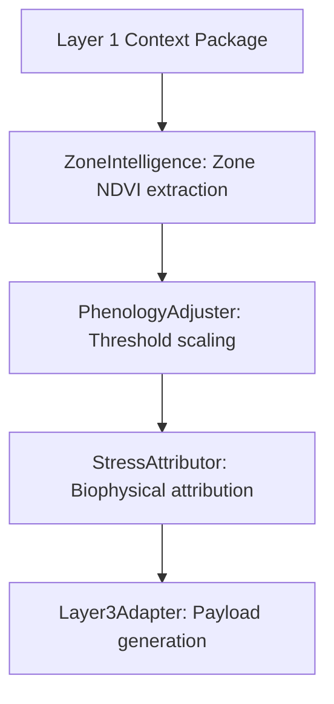

# Layer 2: Photosynthetic Vigor and Biophysical Stress Attribution

This engine computes zone-level photosynthetic indices and attributes vegetation anomalies to specific stress categories (water, nutrients, disease).

## 1. Engine Inventory (Exact Count: 5)

This layer contains exactly 5 specialized engines:
1. **Layer2IntelligenceEngine** ([engine.py](file:///c:/Users/E-C/Desktop/agriwise/services/agribrain/layer2_intelligence/engine.py)): Orchestrates zone feature filtering, stress summaries, and health metrics.
2. **PhenologyAdjuster** ([phenology_adjuster.py](file:///c:/Users/E-C/Desktop/agriwise/services/agribrain/layer2_intelligence/phenology_adjuster.py)): Modulates stress thresholds based on current BBCH crop stages and GDD.
3. **StressAttributor** ([stress_attributor.py](file:///c:/Users/E-C/Desktop/agriwise/services/agribrain/layer2_intelligence/stress_attributor.py)): Executes the biophysical stress attribution equations.
4. **ZoneIntelligence** ([zone_intelligence.py](file:///c:/Users/E-C/Desktop/agriwise/services/agribrain/layer2_intelligence/zone_intelligence.py)): Computes vegetation indices and baseline anomalies per zone.
5. **Layer3Adapter** ([outputs/layer3_adapter.py](file:///c:/Users/E-C/Desktop/agriwise/services/agribrain/layer2_intelligence/outputs/layer3_adapter.py)): Serializes stress vectors and diagnostics for Layer 3.

## 2. Internal Wiring & Sequencing

## 3. Inputs & Outputs (Cross-Layer Wiring)
- **Upstream Inputs**:
  - `Layer1ContextPackage` containing spatial indexes and fused features from **Layer 1**.
- **Downstream Outputs**:
  - `Layer3InputContext` stress vectors, chlorophyll indexes, and evidence lists routed to **Layer 3 (Decision)**.

## 4. Mathematical & Logic Formulations
- **Solar-Induced Chlorophyll Fluorescence (SIF) Index**:
  $$	ext{RCI} = rac{	ext{SIF}}{	ext{PAR}} 	imes f(	ext{Temp})$$
- **Photochemical Reflectance Index (PRI)**:
  $$	ext{PRI} = rac{R_{531} - R_{570}}{R_{531} + R_{570}}$$
- **Bayesian Stress Posterior**:
  $$P(	ext{Stress}_k | 	ext{Evidence}) = rac{P(	ext{Evidence} | 	ext{Stress}_k) \cdot P(	ext{Stress}_k)}{\sum_j P(	ext{Evidence} | 	ext{Stress}_j) \cdot P(	ext{Stress}_j)}$$

## 5. Scientific References
- **Gamon, J. A., et al. (1992)**. *A Three-Band Formula for the Photochemical Reflectance Index*. Remote Sensing of Environment.
- **Guanter, L., et al. (2012)**. *Retrieval and Analysis of Solar-Induced Chlorophyll Fluorescence from GOSAT*. Remote Sensing of Environment.
- **Flexas, J., et al. (2002)**. *Steady-State Chlorophyll Fluorescence for Water Stress Detection*. Photosynthesis Research.
