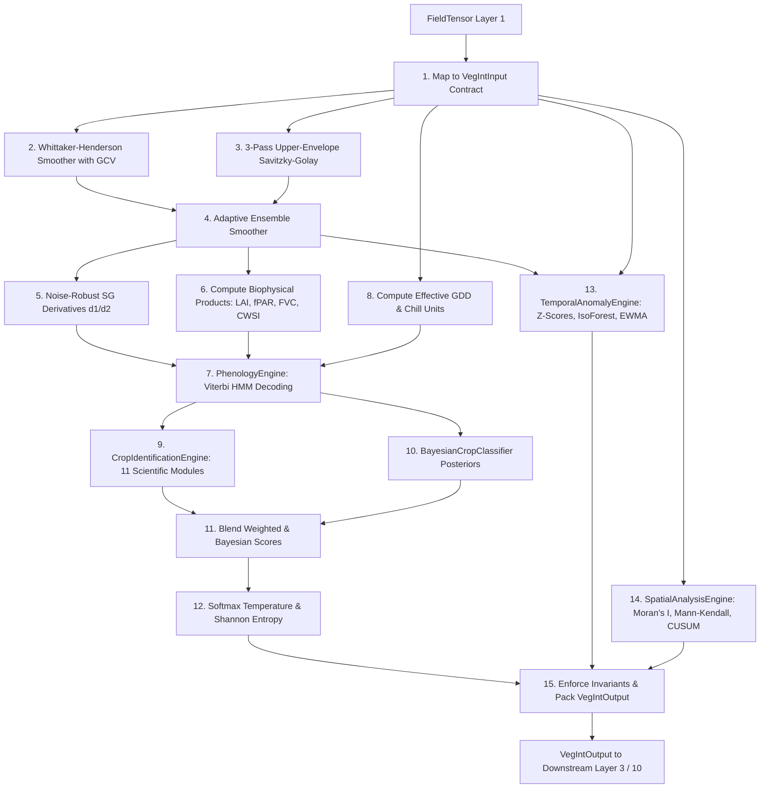

# Layer 2 (VegInt): Canopy Dynamics, Growth Modeling, and Crop Identification

This layer represents the biophysical signature translation and crop-cycle recognition module of the AgriWise system. It converts fused NDVI and multi-spectral telemetry from **Layer 1** and gridded climatic forces from **Layer 0** into continuous phenological growth states, computes robust crop health and water productivity metrics, isolates physical temporal anomalies, and identifies agricultural crop types using Bayesian and information-theoretic classifiers.

---

## 1. Granular Engine Inventory (7 Active Modules)

Layer 2 coordinates seven specialized active engines to execute canopy signal processing, biophysical estimation, HMM phenological decoding, and crop variety classification:

### A. Core Orchestration
1. **VegetationIntelligenceEngine** ([runner.py](file:///c:/Users/E-C/Desktop/agriwise/services/agribrain/layer2_veg_int/runner.py)): Coordinates the top-level execution sequence, instantiates sub-engines, parses upstream `FieldTensor` objects into strict input contracts, enforces domain-specific biophysical invariants, and computes the composite `CropHealthIndex`.

### B. Signal Preprocessing & Temporal Growth
2. **GrowthCurveEngine** ([growth_engine.py](file:///c:/Users/E-C/Desktop/agriwise/services/agribrain/layer2_veg_int/growth_engine.py)): Models historical and seasonal canopy trajectories. Fits raw telemetry using an online Whittaker-Henderson smoother with Generalized Cross-Validation (GCV) and upper-envelope bias correction. Blends outputs with Savitzky-Golay models in an adaptive ensemble and calculates noise-robust first/second derivatives (canopy growth velocity and acceleration).
3. **Biophysical Product Generator** (Within [growth_engine.py](file:///c:/Users/E-C/Desktop/agriwise/services/agribrain/layer2_veg_int/growth_engine.py)): Estimates physical biophysical metrics including Leaf Area Index (LAI) via Beer-Lambert inversions, Fraction of Absorbed Photosynthetically Active Radiation (fPAR), Fractional Vegetation Cover (FVC), Net Primary Productivity (NPP) via the Potter 1993 CASA model, Crop Water Stress Index (CWSI), and FAO-56 crop coefficient ($K_c$) water balances.

### C. Phenological Decoding
4. **PhenologyEngine** ([phenology_engine.py](file:///c:/Users/E-C/Desktop/agriwise/services/agribrain/layer2_veg_int/phenology_engine.py)): Decodes crop developmental stages (e.g. BARE_SOIL, EMERGENCE, VEGETATIVE, REPRODUCTIVE, SENESCENCE, HARVESTED, DORMANCY) using a log-space Hidden Markov Model (HMM) and Viterbi decoding. Integrates thermal time limits, obligate vernalization chill unit gates, and photoperiod day length constraints.

### D. Automated Crop Identification
5. **CropIdentificationEngine** ([crop_identification.py](file:///c:/Users/E-C/Desktop/agriwise/services/agribrain/layer2_veg_int/crop_identification.py)): Evaluates field plots against a 209-crop central registry. Combines 11 distinct scientific modules (including regional sowing calendars, Köppen climate suitability, De Martonne aridity thresholds, and botanical family rules) to score crop likelihoods and output ranked candidate matches.
6. **BayesianCropClassifier** ([crop_ml.py](file:///c:/Users/E-C/Desktop/agriwise/services/agribrain/layer2_veg_int/crop_ml.py)): Infers crop class posterior probability distributions using multi-dimensional Gaussian likelihoods over TIMESAT phenological curve features. Adapts dynamically using regional priors and per-crop empirical variance parameters learned from confirmed field feedback.

### E. Anomaly & Spatial Behavior
7. **TemporalAnomalyEngine** ([anomaly_engine.py](file:///c:/Users/E-C/Desktop/agriwise/services/agribrain/layer2_veg_int/anomaly_engine.py)): Monitors deviations between observed vegetation signals and modeled biological growth. Combines robust multi-index Z-scores, unsupervised Isolation Forests, and Exponentially Weighted Moving Average (EWMA) control charts to identify crop stress (heat, water, frost, wind, or nutrient deficiency) and waterlogging events.
8. **SpatialAnalysisEngine** ([spatial_engine.py](file:///c:/Users/E-C/Desktop/agriwise/services/agribrain/layer2_veg_int/spatial_engine.py)): Tracks sub-field zone stability using global Moran's I spatial correlation, evaluates long-term drift via Mann-Kendall trend tests, and fires localized CUSUM deviation alarms.

---

## 2. Internal Wiring & Sequencing

---

## 3. Upstream & Downstream Integration

* **Upstream Inputs (from Layer 1)**:
  * Unified daily plot-level fused NDVI, EVI, NDWI, and NDMI timeseries.
  * Spatial zone-level vegetation statistics.
  * SAR Sentinel-1 backscatter ratios ($VV$, $VH$).
  * Grid-assimilated meteorological forcing (temperature mean, maximum, minimum, precipitation, reference evapotranspiration $ET_0$, and GDD).
* **Downstream Outputs (to Layer 3 & 10)**:
  * Daily phenological stage indexes (BBCH equivalents) and transition dates routed to **Layer 3 (Decision)**.
  * Physical crop evapotranspiration demand ($ET_c$) and soil water balances routed to **Layer 3 (Water)**.
  * Robust, crop-normalized canopy health index scores, temporal anomalies, and spatial zone alarms ingested by **Layer 10 (SIRE)**.

---

## 4. Granular 21-Step Pipeline Execution

Every daily run of the Layer 2 Canopy Dynamics and Crop Identification engine follows this deterministic sequence:

1. **Ingest Layer 1 Telemetry**: Collects the `FieldTensor` payload containing raw/interpolated Sentinel indices and meteorology.
2. **Resolve Crop Parameters**: Queries agricultural metadata using `_resolve_crop_phenology_config` and `CropRecord` to determine crop-specific base temperatures, optimum temperature bounds, and check if the crop follows perennial winter rest cycles (`DORMANCY`).
3. **Parse Input Vectors**: Normalizes input values into lists of structured `VegIntInput` contract elements carrying daily variables.
4. **Initialize Whittaker Weights**: Computes initial smoother weights $w_i = 1 / (\sigma_i + 0.01)$ based on daily measurement uncertainties.
5. **Optimize Whittaker Lambda**: Selects the optimal smoothing factor $\lambda$ via Generalized Cross-Validation (GCV), searching across a multi-grid candidate domain to minimize out-of-sample prediction error.
6. **Solve Banded Linear System**: Solves the sparse banded system $(W + \lambda D^T D)z = W y$ using a Cholesky solver to obtain the base smoothed profile.
7. **Execute Upper-Envelope Corrections**: Iteratively adjusts weights over 3 correction passes, inflating weights for observations above the trend (cloud-free signals) and deflating weights for negative residuals (cloud dips).
8. **Generate Savitzky-Golay Canopy Profile**: Applies a 3-pass upper-envelope Savitzky-Golay filter to smooth cloud dips in the original signal.
9. **Blend Adaptive Ensemble**: Blends the Whittaker-Henderson and Savitzky-Golay profiles using dynamic inverse-residual weights to produce the final `ndvi_fit` canopy profile.
10. **Extract Noise-Robust Derivatives**: Computes daily growth velocity ($d\text{NDVI}/dt$) and acceleration ($d^2\text{NDVI}/dt^2$) using Savitzky-Golay derivative filtering to preserve peak timing.
11. **Calculate Leaf Area Index**: Translates smoothed NDVI into daily Leaf Area Index (LAI) using a light-extinction Beer-Lambert formulation.
12. **Calculate fPAR and FVC**: Computes Fraction of Absorbed PAR (fPAR) and Fractional Vegetation Cover (FVC) to measure canopy light absorption and density.
13. **Model CASA NPP**: Simulates daily Net Primary Productivity (NPP) using the Potter 1993 CASA model, incorporating solar declination, day length, and temperature/water stress factors.
14. **Balance Evapotranspiration Water Demand**: Computes daily crop water demand ($ET_c$) using a stage-dependent crop coefficient ($K_c$) according to FAO-56 protocols.
15. **Quantify Crop Water Deficit**: Tracks daily actual evapotranspiration ($ET_{actual}$) and water deficit ($ET_{deficit}$) using rainfall and soil moisture buffers.
16. **Evaluate Water Use Efficiency (WUE)**: Evaluates AquaCrop-style water use efficiency ($WUE$) and crop water productivity ($CWP$) over trailing 14-day windows.
17. **Calculate Effective GDD & Chill Units**: Computes effective Growing Degree Days using Sánchez 2014 temperature stress heat penalties and day length photoperiod factors. Tracks Richardson winter chill units to manage vernalization progress.
18. **HMM Viterbi Phenological Decoding**: Decodes daily phenological stages by running Viterbi decoding over 5 multivariate features (NDVI, velocity, GDD, NDWI, photoperiod), enforcing minimum state durations and gating transitions using vernalization levels.
19. **Run Crop Identification Scores**: Evaluates the plot against 209 crop templates across 11 scientific scoring modules to calculate ranked crop candidates.
20. **Run Bayesian Crop Classifier**: Computes posteriors using Gaussian likelihoods over phenology features, blending results with weighted scores using dynamic feedback-adaptive weights.
21. **Calibrate Softmax Entropy & Spatial Stability**: Converts blended scores into probabilities using a calibrated temperature $T=0.02$ and evaluates Shannon entropy. Runs Moran's I spatial stability, Mann-Kendall trend tests, and CUSUM zone alerts, finalizing the `VegIntOutput` payload and verifying all layer invariants.

---

## 5. Mathematical & Biophysical Formulations

### A. Whittaker-Henderson Smoother with GCV-Adaptive Lambda
The GrowthCurveEngine minimizes the penalized sum of squares to resolve the trade-off between signal fidelity and curve smoothness:
$$Q = (y - z)^T W (y - z) + \lambda z^T D^T D z$$
This yields the banded system:
$$(W + \lambda D^T D) z = W y$$
where:
* $y$ is the raw NDVI observation vector of length $n$.
* $z$ is the smoothed target vector.
* $W$ is the diagonal matrix of normalized uncertainty weights: $w_i = 1 / (\sigma_i + 0.01)$.
* $D$ is the $d$-th order difference matrix (typically $d=2$).
* $\lambda$ is the smoothing factor, selected by minimizing the Generalized Cross-Validation (GCV) function:
$$GCV(\lambda) = \frac{n \cdot \sum_{i=1}^n w_i (y_i - z_i)^2}{(n - \text{df})^2}$$
The degrees of freedom are approximated using the trace of the hat matrix:
$$\text{df} \approx \sum_{i=1}^n \frac{w_i}{w_i + 4\lambda}$$

---

### B. 3-Pass Upper-Envelope Savitzky-Golay Filter
To remove negative cloud-contamination dips, the GrowthCurveEngine applies a 3-pass envelope correction (Chen et al. 2004). For each pass, weights are adjusted based on the sign of residuals:
$$w_i^{(k+1)} = \begin{cases}
1.2 \cdot w_i^{(k)} & \text{if } y_i \ge z_i^{(k)} \quad \text{(above-fit: cloud-free)} \\
0.5 \cdot w_i^{(k)} & \text{if } y_i < z_i^{(k)} \quad \text{(below-fit: cloud-contaminated)}
\end{cases}$$
where $w_i$ is constrained within $[0.01, 5.0]$. The Savitzky-Golay smoothed value $y_i^*$ is computed using local polynomial convolution:
$$y_i^* = \frac{\sum_{j=-M}^{M} C_j y_{i+j}}{N}$$
where $C_j$ are the least-squares polynomial coefficients of order $p$ over window $2M+1$.

---

### C. Double-Logistic Vigor Curve
Canopy seasonal development is modeled using the asymmetric double-logistic equation:
$$VI(t) = VI_{min} + (VI_{max} - VI_{min}) \cdot \left(\frac{1}{1 + e^{-m_1 (t - ip_1)}} + \frac{1}{1 + e^{m_2 (t - ip_2)}} - 1\right)$$
where:
* $VI(t)$ is the modeled vegetation index value at time $t$.
* $VI_{min}, VI_{max}$ represent the bare soil background and seasonal peak indices.
* $m_1, m_2$ represent the greenup and senescence transition rates.
* $ip_1, ip_2$ represent the inflection points for the rising and falling limbs.

---

### D. Beer-Lambert Leaf Area Index & fPAR
Daily Leaf Area Index (LAI) is computed from the fraction of absorbed photosynthetically active radiation (fPAR) using the Myneni (1997) light-extinction equation:
$$\text{fPAR} = \max\left(0.0, \min\left(0.95, 1.25 \cdot \text{NDVI} - 0.025\right)\right)$$
$$\text{LAI} = -\frac{\ln(1 - \text{fPAR})}{k_{ext}}$$
where $k_{ext}$ is the light extinction coefficient (default $0.50$ for erectophile crops).

---

### E. Fractional Vegetation Cover (FVC)
Fractional Vegetation Cover measures green canopy ground fraction:
$$\text{FVC} = \left(\frac{\text{NDVI} - \text{NDVI}_{soil}}{\text{NDVI}_{veg} - \text{NDVI}_{soil}}\right)^2$$
where $\text{NDVI}_{soil} = 0.10$ and $\text{NDVI}_{veg} = 0.85$.

---

### F. CASA Net Primary Productivity Model
Net Primary Productivity (NPP) in $\text{gC/m}^2\text{/day}$ is modeled using the Potter (1993) CASA process model:
$$\text{NPP} = \text{fPAR} \cdot \text{PAR} \cdot \epsilon_{max} \cdot T_{scalar} \cdot W_{scalar}$$
where:
* $\text{PAR}$ is the incident Photosynthetically Active Radiation approximated from solar declination $\delta$ and day length:
  $$\text{PAR} = 0.75 \cdot \left(\text{Solar Constant} \cdot \frac{3600 \cdot \text{Day Length}}{10^6}\right) \cdot 0.48$$
* $\epsilon_{max}$ is the maximum light-use efficiency ($0.604\text{ gC/MJ}$ for generic C3 crops).
* $T_{scalar}$ is the temperature stress scalar bounding optimal crop ranges:
  $$T_{scalar} = \max\left(0.0, \min\left(1.0, \min\left(\frac{T - T_{min}}{T_{opt} - T_{min}}, \frac{T_{max} - T}{T_{max} - T_{opt}}\right)\right)\right)$$
* $W_{scalar}$ is the water stress scalar derived from the Crop Water Stress Index:
  $$W_{scalar} = 0.5 + 0.5 \cdot (1 - \text{CWSI})$$

---

### G. FAO-56 Crop Water Balance & WUE
Daily crop water demand ($ET_c$) and actual crop water use ($ET_{actual}$) are balanced using:
$$\text{ET}_c = K_c \cdot \text{ET}_0$$
$$\text{ET}_{deficit} = \max\left(0.0, \text{ET}_c - \text{Rain}\right)$$
$$\text{ET}_{actual} = \min\left(\text{ET}_c, \text{Rain} + \theta_{\text{buffer\_soil}}\right)$$
AquaCrop-style Water Use Efficiency (WUE) and Crop Water Productivity (CWP) are computed as:
$$\text{WUE} = \frac{\Delta \text{Biomass}}{\sum \text{ET}_{actual}} \quad (\text{gC/m}^2\text{/mm})$$
$$\text{CWP} = \left(\frac{\text{Total Biomass}}{\sum \text{ET}_{actual}}\right) \cdot 10.0 \quad (\text{kg/m}^3)$$

---

### H. Sánchez 2014 Effective Growing Degree Days
Daily growing degree days are adjusted for extreme heat stress and photoperiod constraints:
$$\text{Effective GDD} = \max\left(0, T_{mean} - T_{base}\right) \cdot \text{photo\_factor} \cdot \text{heat\_penalty}$$
where:
* $\text{photo\_factor} = \begin{cases} \min(1.0, \text{Day Length} / 14.0) & \text{if short-day crop} \\ 1.0 & \text{otherwise} \end{cases}$
* $\text{heat\_penalty} = \begin{cases} \max\left(0.0, 1.0 - \frac{T_{max} - T_{opt\_max}}{10}\right) & \text{if } T_{max} > T_{opt\_max} \\ 1.0 & \text{otherwise} \end{cases}$
* The day length ($\phi$) is calculated from solar declination ($\delta$) and latitude ($\theta$):
  $$\phi = \frac{24}{\pi} \arccos\left(-\tan \theta \tan \delta\right)$$

---

### I. Richardson 1974 Vernalization Chill Units
Chill units ($CU$) are accumulated for crops that require vernalization before starting their reproductive stage:
$$CU = \sum_{t=1}^T \mathbb{I}\left(\text{chill\_min} < T_{min} < \text{chill\_max}\right)$$
For obligate vernalizers (such as winter wheat or barley), transition to the reproductive stage is penalized in log-space until vernalization is at least 80% complete:
$$\text{Penalty}_{vern} = \begin{cases} 0.0 & \text{if progress} \ge 0.8 \\ -15.0 & \text{if progress} < 0.5 \\ -8.0 \cdot (1.0 - \text{progress}) & \text{otherwise} \end{cases}$$

---

### J. Viterbi Hidden Markov Model Phenology Decoding
The PhenologyEngine decodes daily stages using log-space Viterbi optimization. The transition matrix restricts the crop to a forward-only stage progression, and applies penalties for transitions that occur before minimum stage durations are met. The multivariate emission log-likelihood is:
$$\ln P(x_t \mid s_k) = \sum_{j=1}^M \ln \mathcal{N}\left(x_{t,j}; \mu_{k,j}, \sigma_{k,j}^2\right) + \text{Penalty}_{GDD}(s_k, GDD_t) + \text{Penalty}_{vern}(s_k, CU_t)$$
where:
* $x_t$ is the feature vector at time $t$: $[\text{NDVI}, \text{velocity}, \text{GDD\_fraction}, \text{NDWI}, \text{photoperiod}]$.
* $\ln \mathcal{N}(x; \mu, \sigma^2) = -0.5 \left(\frac{x - \mu}{\sigma}\right)^2 - \ln \sigma - 0.5 \ln(2\pi)$
* $\text{Penalty}_{GDD}$ is the chronological check gating stages until minimum GDD is reached:
  $$\text{Penalty}_{GDD} = \begin{cases} 0.0 & \text{if } GDD \ge GDD_{min} \\ -10.0 & \text{if } GDD < 0.5 \cdot GDD_{min} \\ -5.0 \cdot \left(1 - \frac{GDD}{GDD_{min}}\right) & \text{otherwise} \end{cases}$$

---

### K. De Martonne Aridity Index
Regional climate suitability under rainfed conditions is classified using:
$$I_{\text{DM}} = \frac{P}{T + 10}$$
where $P$ is annual precipitation in mm and $T$ is annual mean temperature in °C. Rainfed crop growth is restricted if $I_{\text{DM}}$ falls below crop-specific thresholds (e.g. $I_{\text{DM}} \ge 12.0$ for wheat, $I_{\text{DM}} \ge 8.0$ for barley).

---

### L. Bayesian Crop Classifier Posteriors
The BayesianCropClassifier calculates crop probabilities using Gaussian likelihoods over phenological parameters:
$$P(c_k \mid D) \propto P(D \mid c_k) \cdot P(c_k)$$
$$\ln P(D \mid c_k) = \frac{1}{M} \sum_{j=1}^M \left[-0.5 \left(\frac{\theta_j - \bar{\theta}_{k,j}}{\sigma_{k,j}}\right)^2\right] + \text{Penalty}_{evergreen}(c_k) + \text{Penalty}_{seasons}(c_k)$$
where:
* $\theta_j$ represents extracted TIMESAT metrics: $[\text{peak\_ndvi}, \text{trough\_ndvi}, \text{amplitude}, \text{peak\_frac}, \text{los\_frac}]$.
* $\bar{\theta}_{k,j}$ represents expected crop signature values.
* $\sigma_{k,j}$ represents learned crop-specific standard deviations.
* $\text{Penalty}_{evergreen} = \begin{cases} 0.0 & \text{if evergreen match} \\ -3.0 & \text{otherwise} \end{cases}$
* $\text{Penalty}_{seasons} = -0.5 \frac{(\text{observed\_seasons} - \text{expected\_peaks})^2}{\max(1, \text{expected\_peaks})}$.

---

### M. Softmax Shannon Entropy Confidence
Blended crop identification scores ($s_i$) are normalized into probabilities using a temperature-scaled softmax function ($T=0.02$):
$$p_i = \frac{e^{(s_i - s_{max}) / T}}{\sum_{j=1}^N e^{(s_j - s_{max}) / T}}$$
Shannon entropy evaluates the dispersion of this probability distribution:
$$H(C) = -\sum_{i=1}^N p_i \log_2 p_i$$
The final calibrated confidence score is:
$$\text{Confidence} = 1.0 - \frac{H(C)}{\log_2(N_{crops})}$$
where $N_{crops} = 10$ is the number of top candidate classes evaluated.

---

## 6. Data Schemas & Contracts

### A. VegIntInput (`schema.py`)
Incoming daily telemetry observations ingested from Layer 1:
* `date` (`str`): Observation date string (ISO 8601 `YYYY-MM-DD`).
* `ndvi_obs` (`Optional[float]`): Raw optical Sentinel-2 observed NDVI (if observed).
* `ndvi_unc_obs` (`float`): Satellite sensor instrumentation uncertainty.
* `is_observed` (`bool`): Flag denoting if a satellite pass occurred.
* `rain` (`float`): Daily accumulated precipitation (mm).
* `tmean` (`float`): Daily mean temperature (°C).
* `gdd` (`float`): Growing degree days (°C-days).
* `vv` (`Optional[float]`): Sentinel-1 SAR VV backscatter amplitude.
* `vh` (`Optional[float]`): Sentinel-1 SAR VH backscatter amplitude.
* `evi` (`Optional[float]`): Enhanced Vegetation Index.
* `ndwi` (`Optional[float]`): Normalized Difference Water Index.
* `ndmi` (`Optional[float]`): Normalized Difference Moisture Index.
* `et0` (`Optional[float]`): Reference evapotranspiration (mm/day).
* `temp_max` (`Optional[float]`): Daily maximum temperature (°C).
* `temp_min` (`Optional[float]`): Daily minimum temperature (°C).

### B. ModeledCurveOutput (`schema.py`)
Fitted canopy growth timeseries and derived biophysical profiles:
* `ndvi_fit` (`List[float]`): Whittaker-SG ensemble smoothed NDVI profile.
* `ndvi_fit_d1` (`List[float]`): Canopy growth velocity ($d\text{NDVI}/dt$).
* `ndvi_fit_d2` (`List[float]`): Canopy growth acceleration ($d^2\text{NDVI}/dt^2$).
* `ndvi_fit_unc` (`List[float]`): Standard error of the ensemble fit.
* `lai_series` (`List[float]`): Leaf Area Index (LAI) series.
* `cwsi_series` (`List[float]`): Crop Water Stress Index (CWSI) series.
* `fpar_series` (`List[float]`): Fraction of Absorbed PAR series.
* `fvc_series` (`List[float]`): Fractional Vegetation Cover series.
* `npp_series` (`List[float]`): Net Primary Productivity series ($\text{gC/m}^2\text{/day}$).
* `quality` (`CurveQuality`): RMSE, outlier fraction, and observation coverage statistics.

### C. CropHealthIndex (`schema.py`)
Composite biophysical health metrics compiled at runtime:
* `overall_score` (`float`): Scaled composite health score $[0.0, 1.0]$ (0=dead, 1=optimal).
* `ndvi_health` (`float`): Normalized NDVI relative to crop-specific peak signatures.
* `water_stress_index` (`float`): Combined CWSI and ET deficit water stress.
* `lai_estimate` (`float`): Current Leaf Area Index.
* `lai_peak` (`float`): Peak Leaf Area Index recorded during the season.
* `biomass_proxy` (`float`): Net primary biomass proxy (normalized Area Under Curve).
* `vigor_trend` (`str`): Vigor trajectory classification (`IMPROVING`, `STABLE`, `DECLINING`).
* `vigor_slope` (`float`): Robust Theil-Sen slope of recent NDVI trajectory.
* `anomaly_penalty` (`float`): Cumulative anomaly penalty.
* `confidence` (`float`): Reliability based on observation coverage.
* `et_actual` (`float`): FAO-56 actual crop evapotranspiration (mm/day).
* `et_deficit` (`float`): Crop water deficit ($ET_c - ET_a$ in mm/day).
* `vegetation_fraction` (`float`): Fractional Vegetation Cover (FVC).
* `fpar_current` (`float`): Leaf light absorption fraction.
* `wue` (`float`): Water Use Efficiency ($\text{gC/m}^2\text{/mm}$).
* `crop_water_productivity` (`float`): Crop water productivity ($\text{kg/m}^3$).
* `vernalization_progress` (`float`): Progress of winter vernalization $[0.0, 1.0]$.

### D. VegetationAnomaly (`schema.py`)
Detected stress conditions and structural canopy changes:
* `anomaly_id` (`str`): Deterministic ID hash.
* `type` (`AnomalyType`): One of: `STALL`, `DROP`, `EARLY_SENESCENCE`, `DELAYED_EMERGENCE`, `WATER_STRESS`, `EXCESS_MOISTURE`, `NUTRIENT_DEFICIENCY`, `HEAT_STRESS`, `FROST_DAMAGE`, `WIND_DAMAGE`, `POSITIVE_ANOMALY`.
* `date_range` (`List[str]`): Start and end dates `[YYYY-MM-DD, YYYY-MM-DD]`.
* `severity` (`float`): Anomaly intensity $[0.0, 1.0]$ scaled from Z-scores.
* `confidence` (`float`): Unified confidence $[0.0, 1.0]$ blending Z-scores and Isolation Forest paths.
* `description` (`str`): Explanatory summary text.
* `likely_cause` (`str`): Highest-probability cause label.
* `attribution` (`AttributionEvidence`): Probability breakdown across water, moisture, heat, frost, nutrient, and structural damage pathways.

---

## 7. Academic & Scientific References

* **Whittaker Smoothing & GCV**: Eilers, P. H. (2003). *A perfect smoother*. Analytical Chemistry, 75(14), 3631-3636.
* **Savitzky-Golay Cloud Correction**: Chen, J., et al. (2004). *A simple method for reconstructing a high-quality NDVI time-series data set based on the Savitzky-Golay filter*. Remote Sensing of Environment, 91(3), 332-344.
* **TIMESAT Phenology**: Jönsson, P., & Eklundh, L. (2004). *TIMESAT—a program for analyzing time-series of satellite sensor data*. Computers & Geosciences, 30(8), 833-845.
* **Beer-Lambert LAI**: Myneni, R. B., et al. (1997). *Estimation of leaf area index and fraction of absorbed photosynthetically active radiation from multispectral satellite data*. IEEE Transactions on Geoscience and Remote Sensing, 35(6), 1380-1393.
* **CASA NPP Model**: Potter, C. S., et al. (1993). *Terrestrial ecosystem production: A process model based on global satellite and surface data*. Global Biogeochemical Cycles, 7(4), 811-841.
* **FAO-56 Water Balance**: Allen, R. G., et al. (1998). *Crop evapotranspiration-Guidelines for computing crop water requirements-FAO Irrigation and drainage paper 56*. FAO, Rome, 300(56), D05909.
* **AquaCrop Water Productivity**: Steduto, P., et al. (2009). *AquaCrop—The FAO crop model to simulate yield response to water: I. Parameterization and testing for maize*. Agronomy Journal, 101(3), 548-559.
* **Sánchez Thermal Time**: Sánchez, B., et al. (2014). *Growing degree days, solar radiation and precipitation as agricultural and climate-change indicators in Spain*. European Journal of Agronomy, 52, 230-244.
* **HMM Phenology & Viterbi**: Rabiner, L. R. (1989). *A tutorial on hidden Markov models and selected applications in speech recognition*. Proceedings of the IEEE, 77(2), 257-286.
* **Bayesian Crop Classification**: Khatami, R., et al. (2016). *Meta-analysis of land cover mapping accuracy*. Remote Sensing of Environment, 184, 89-101.
* **Information-Theoretic Softmax Entropy**: Shannon, C. E. (1948). *A mathematical theory of communication*. The Bell System Technical Journal, 27(3), 379-423.
