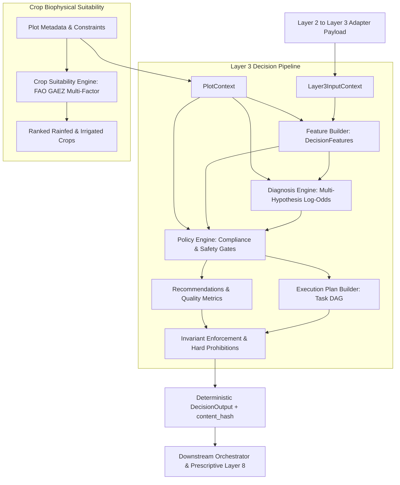

# Layer 3.5: Decision Intelligence & Agronomic Actions (`layer3_decision`)

## 1. Overview and Architectural Scope

**Layer 3 Decision Intelligence** is the deterministic diagnostic and agronomic action planning engine. It transforms interpreted biological, hydrological, and operational context into structured diagnoses, compliance-gated recommendations, task execution plans, and biophysical crop suitability assessments.

Layer 3 Decision enforces strict architectural principles:
- **Zero Raw Data Ingestion**: It never fetches raw data or queries Layer 1 sensor arrays directly; it consumes only interpreted intelligence via `Layer3InputContext`.
- **Absolute Determinism**: For identical `Layer3InputContext` and `PlotContext`, the engine generates an identical `DecisionOutput` with an identical cryptographic `content_hash()`.
- **Decoupled Action Planning**: Emits structured DAG execution plans (`ExecutionPlan`) with task dependencies, resources, and degradation modes.



---

## 2. Directory Layout & Module Structure

```
services/agribrain/layer3_decision/
├── runner.py                     # Main coordinator: DecisionIntelligenceEngine
├── schema.py                     # Canonical schemas: DecisionOutput, ExecutionPlan, TaskNode
├── invariants.py                 # 12 internal decision invariants and auto-fix rules
├── context_invariants.py         # Input validation gates and mathematical context checks
├── suitability_engine.py         # FAO GAEZ-inspired 212-crop biophysical suitability scoring
├── __init__.py                   # Package exports
├── diagnosis/                    # Diagnostic Inference
│   ├── inference.py              # Multi-hypothesis Bayesian log-odds scoring & FAO-33 Ky factors
│   └── __init__.py
├── features/                     # Feature Extraction & Synthesis
│   ├── builder.py                # Pure function: Layer3InputContext -> DecisionFeatures
│   ├── evapotranspiration.py     # Energy balance and water budget feature derivation
│   └── __init__.py
├── knowledge/                    # Agronomic Ontologies & Priors
│   ├── crops.py                  # Crop-specific developmental and economic priors
│   ├── ontology.py               # Problem types, causal drivers, and hypothesis definitions
│   └── __init__.py
├── policy/                       # Agronomic Governance & Action Gating
│   ├── policies.py               # Compliance rules, fallback mechanisms, execution policies
│   └── __init__.py
└── tests/                        # Dedicated Test Suite (10 test cases)
    ├── test_decision_engine.py   # Full cycle deterministic execution & degradation tests
    ├── test_diagnosis_engine.py  # Log-odds scoring, hypothesis ranking, FAO-33 Ky tests
    └── test_suitability_engine.py# 212-crop GAEZ suitability evaluation & limiting factors
```

---

## 3. Mathematical & Algorithmic Foundations

### 3.1 Deterministic Decision Pipeline (`runner.py`)

The `DecisionIntelligenceEngine` executes a deterministic 11-step pipeline:
1. **Input Validation**: Verifies `Layer3InputContext` usability and data health scores.
2. **Context Invariant Checking**: Runs `enforce_context_invariants` to prevent corrupted inputs.
3. **Feature Synthesis**: `build_decision_features` extracts operational signals, rain totals, and thermal days without touching raw sensor rasters.
4. **Multi-Hypothesis Diagnosis**: Evaluates competing stress hypotheses using evidence weights and counter-evidence.
5. **Policy Evaluation**: Filters candidate actions through safety and environmental compliance gates.
6. **Execution Plan Generation**: Constructs a topological Directed Acyclic Graph (DAG) of executable `TaskNode` objects.
7. **Quality Metrics Computation**: Determines reliability score and sets `DegradationMode` (`NORMAL`, `NO_SAR`, `LOW_SAR_CADENCE`, `WEATHER_ONLY`, `DATA_GAP`).
8. **Audit Trail Construction**: Records feature snapshots and evidence attribution traces for agronomist explainability.
9. **Invariant Enforcement**: Evaluates 12 hard invariants with deterministic corrections.
10. **Hard Prohibition Verification**: Enforces 10 absolute prohibitions (e.g. no chemical spraying during high wind or blooming).
11. **Cryptographic Content Hashing**: Generates SHA-256 fingerprint over diagnoses, recommendations, tasks, and metrics.

---

### 3.2 Multi-Hypothesis Diagnostic Inference (`diagnosis/inference.py`)

Diagnoses stress and structural risks using log-odds scoring:
$$ \log \frac{P(H \mid \mathbf{E})}{1 - P(H \mid \mathbf{E})} = \log \frac{P(H)}{1 - P(H)} + \sum_{i} w_i \cdot s_i(\mathbf{E}) - \sum_{j} c_j \cdot s_j(\mathbf{E}) $$
where:
- $P(H)$ is the prior probability of the problem class.
- $w_i$ is positive evidence weight, $s_i(\mathbf{E})$ is normalized feature contribution.
- $c_j$ is counter-evidence penalty.

#### FAO-33 Yield Response Factor ($K_y$) Sensitivity
Yield sensitivity to water deficits is conditioned on developmental stage via FAO-33 (Doorenbos & Kassam 1979):
$$ \left( 1 - \frac{Y_a}{Y_m} \right) = K_y \left( 1 - \frac{ET_a}{ET_m} \right) $$
- Flowering/Reproductive sensitivity: $K_y = 1.50$ (maize), $K_y = 0.55$ (wheat).
- Vegetative sensitivity: $K_y = 0.20 - 0.40$.
- Ripening / Senescence: $K_y \le 0.20$.

---

### 3.3 Crop Biophysical Suitability Engine (`suitability_engine.py`)

Evaluates all 212 crops in `CROP_REGISTRY` against site-specific biophysical attributes following the FAO Global Agro-Ecological Zoning (GAEZ v4) framework:

$$\text{Suitability Score} = \sum_{k=1}^9 W_k \cdot S_k \quad [0 - 100]$$

| Dimension | Weight ($W_k$) | Evaluation Criteria |
| :--- | :---: | :--- |
| **Temperature Suitability** | **20%** | Mean temperature vs. crop optimal range $[T_{\text{opt},\min}, T_{\text{opt},\max}]$ |
| **Rainfall Adequacy** | **20%** | Annual precipitation vs. crop water requirement (evaluated rainfed vs. irrigated) |
| **Soil pH Compatibility** | **15%** | Soil pH vs. botanical family optimum (e.g., Poaceae 5.5–7.5, Oleaceae 6.5–8.5) |
| **GDD Availability** | **10%** | Thermal accumulation $(T_{\text{mean}} - T_{\text{base}}) \times \text{FrostFreeDays}$ |
| **Soil Texture & AWC** | **10%** | USDA texture suitability (clay, loam, sandy loam) by architecture class |
| **Soil Salinity Tolerance** | **10%** | Maas & Hoffman (1977) threshold $EC_e$ and slope degradation penalty |
| **Season Length** | **5%** | Crop growing days vs. local frost-free window |
| **Slope & Elevation** | **5%** | Terrain slope tolerance (e.g. rice $\le 3\%$, cereals $\le 15\%$, perennials $\le 30\%$) |
| **Thermal Risk (Frost/Heat)** | **5%** | Frequency of extreme events ($T_{\min} < 0^\circ\text{C}$ or $T_{\max} > 38^\circ\text{C}$) |

#### Output Classification (FAO Land Evaluation Framework)
- **S1 (Highly Suitable)**: Score $\ge 80$
- **S2 (Moderately Suitable)**: Score $60 - 79$
- **S3 (Marginally Suitable)**: Score $40 - 59$
- **N (Not Suitable)**: Score $< 40$

---

## 4. Test Suite and Verification

The Layer 3 Decision test suite is organized in [`services/agribrain/layer3_decision/tests/`](file:///c:/Users/E-C/Desktop/agriwise/services/agribrain/layer3_decision/tests/) containing **3 test modules** and **10 tests**:

| Test Module | Tests | Scope |
| :--- | :---: | :--- |
| `test_decision_engine.py` | 3 | Deterministic pipeline execution, cryptographic content hashing, degradation under data gaps |
| `test_diagnosis_engine.py` | 3 | Multi-hypothesis Bayesian log-odds, FAO-33 Ky yield sensitivity factors, low-stress baselines |
| `test_suitability_engine.py` | 4 | 212-crop GAEZ suitability scoring, limiting factor extraction, rainfed vs. irrigated rankings |
| **Total** | **10** | **100% Green across all 10 tests** |
