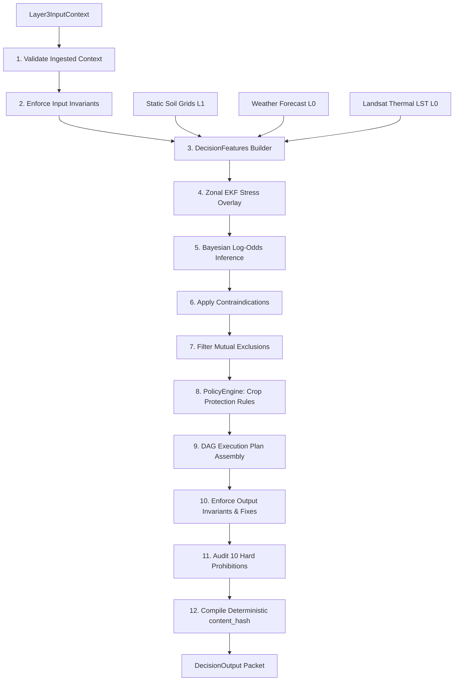

# Layer 3: Diagnostic Decision Intelligence & Causal Execution Plans

This layer acts as the diagnostic brain of the AgriWise system. It is responsible for multi-hypothesis diagnostic reasoning over biophysical signals interpreted by **Layer 2 (VegInt)**, evaluating agricultural constraints and policies, and generating deterministic execution plans represented as Directed Acyclic Graphs (DAGs) of prioritized farming actions.

---

## 1. Granular Engine Inventory (6 Active Modules)

Layer 3 Decision Intelligence coordinates exactly six specialized active engines:

### A. Core Orchestration
1. **DecisionIntelligenceEngine** ([runner.py](file:///c:/Users/E-C/Desktop/agriwise/services/agribrain/layer3_decision/runner.py)): Coordinates the top-level execution sequence, validates context payloads, builds decision feature sets, triggers diagnostic reasoning, routes recommendations through agricultural policy gates, assembles deterministic execution plans, and compiles quality/provenance metrics.

### B. Probabilistic Diagnostics
2. **DiagnosisEngine** ([diagnosis/inference.py](file:///c:/Users/E-C/Desktop/agriwise/services/agribrain/layer3_decision/diagnosis/inference.py)): Runs the multi-hypothesis Bayesian diagnostic inference. Computes log-odds scores by accumulating weighted biophysical evidence, applies contraindication penalties, resolves logical mutual exclusions, and measures spatial hotspot area distributions.
3. **DecisionFeatures** ([features/builder.py](file:///c:/Users/E-C/Desktop/agriwise/services/agribrain/layer3_decision/features/builder.py)): Consolidates interpreted satellite anomalies, soil water balances, local forecast variables, vapor pressure deficits (VPD), Land Surface Temperature (LST) energy balances, and drone structural indicators into normalized feature matrices.

### C. Policy & Agronomics
4. **PolicyEngine** ([policy/policies.py](file:///c:/Users/E-C/Desktop/agriwise/services/agribrain/layer3_decision/policy/policies.py)): Enforces agronomic whitelists, local chemical regulatory limits, and water quotas. Maps diagnoses onto prioritized farming actions and blocks illegal or highly risky pesticide/fertilizer applications.
5. **CropProfileEngine** ([knowledge/crops.py](file:///c:/Users/E-C/Desktop/agriwise/services/agribrain/layer3_decision/knowledge/crops.py)): Manages species-specific crop parameters, including growth stage temperature thresholds, base GDD scales, and Doorenbos-Kassam yield response factors ($K_y$) for stress sensitivity.

### D. Water Balance Features
6. **WaterBudget** ([features/evapotranspiration.py](file:///c:/Users/E-C/Desktop/agriwise/services/agribrain/layer3_decision/features/evapotranspiration.py)): Computes diagnostic crop water budgets, evaluates daily root zone depletion levels, and models the satellite-derived Evaporative Stress Index (ESI) using crop coefficients ($K_c$) from Layer 2.

---

## 2. Internal Wiring & Sequencing

---

## 3. Upstream & Downstream Integration

* **Upstream Inputs (from Layer 2)**:
  * Unified stress attribution envelopes (water, thermal, nutrient, biotic anomalies).
  * Crop-normalized health indices and robust vigor slopes.
  * Extracted TIMESAT phenology stages (BBCH equivalent values) and stage transition dates.
  * Zonal vegetation variability statistics and CUSUM zone alerts.
  * Upstream meteorological values (rain, maximum/minimum temperatures, $ET_0$, and GDD).
* **Downstream Outputs (to Layer 6 & Layer 10)**:
  * Deterministic `DecisionOutput` packets carrying active diagnoses (probability, severity, and spatial hotspot lists).
  * Prioritized compliance-gated `Recommendation` matrices.
  * Structured causal `ExecutionPlan` task DAGs dispatched directly to **Layer 6 (Execution)**.
  * Audit trails and provenance logs evaluated by **Layer 10 (SIRE)**.

---

## 4. Granular 21-Step Pipeline Execution

Every daily run of the Layer 3 decision intelligence pipeline follows this deterministic sequence:

1. **Ingest Context**: Consumes the `Layer3InputContext` adaptor payload from Layer 2.
2. **Validate Input Variables**: Inspects the input payload using `_validate_input` to screen for missing plot IDs or unusable state statuses.
3. **Audit Input Invariants**: Executes `enforce_context_invariants` to mathematically validate incoming variable boundaries (such as capping NDVI, soil moisture, and temperatures).
4. **Assemble Decision Features**: Instantiates the `DecisionFeatures` matrix, compiling historical drydown intervals, rain vectors, and active vegetation anomalies.
5. **Ingest Climatic Forecasts**: Integrates 7-day meteorological rain and temperature forecasts, raising warning alerts when forecast data is missing.
6. **Lookup Crop Sensitivity Profiling**: Extracts species-specific crop parameters and retrieves growth-stage-dependent yield response factors ($K_y$).
7. **Extract Soil Grids Context**: Pulls static soil attributes (texture class, clay %, pH, and organic matter) from the Layer 1 static database.
8. **Ingest Land Surface Temperatures**: Extracts Land Surface Temperature (LST), canopy-air delta temperature ($T_c - T_a$), and transpiration metrics.
9. **Calculate Evaporative Demands**: Evaluates vapor pressure deficits (VPD) and daily wind speeds.
10. **Assess Drone Structural Details**: Inspects high-resolution close-range drone imagery for localized weed pressures and mechanical crop damage.
11. **Zonal EKF Stress Scans**: Iterates sub-field zones, overlaying EKF stress markers, area cover percentages, and zone-specific phenological indices.
12. **Initialize Bayesian Priors**: Initializes prior probabilities in log-space for all evaluated `ProblemType` hypotheses.
13. **Accumulate Biophysical Evidence**: Iterates over evidence features, calculating log-odds contributions based on calibrated weights and standardized scores:
    $$\Delta_{logit} = w_i \cdot \text{score}_i$$
14. **Apply Contraindication Adjustments**: Subtracts logit odds when contradictory biophysical states occur (e.g. subtracting water stress odds when precipitation is abundant).
15. **Reconvert Log-Odds to Probability**: Converts accumulated logit scores back into posterior probabilities ($P(c_k \mid D)$).
16. **Proportionally Scale Severity**: Computes biophysical stress severity, scaling output severity with stage sensitivity $K_y$ multipliers:
    $$\text{Severity} = \text{Base Severity} \cdot (0.5 + K_y)$$
17. **Determine Affected Zonal Area**: Compares spatial zone diagnostics to compile hotspot lists and aggregate field area percentages.
18. **Resolve Mutual Exclusions**: Screens diagnoses through mutual exclusion filters to eliminate contradictory hypotheses (e.g. locking out water stress when waterlogging is confirmed).
19. **Run Policy Engine Constraints**: Dispatches diagnoses to `generate_plan`, screening recommendations against local pesticide/herbicide whitelists and daily water quotas.
20. **Assemble Execution DAG**: Converts approved recommendations into an `ExecutionPlan` containing `TaskNode` structures. Computes deterministic start/review dates and builds dependency edges (e.g., marking `VERIFY` tasks as prerequisites for `INTERVENE` tasks).
21. **Enforce Output Invariants & Invalidate Prohibitions**: Executes `enforce_layer3_invariants` to auto-correct state values, audits the results against the **10 Hard Prohibitions**, evaluates quality/reliability scores, compiles step performance times, and hashes the package to output the final `DecisionOutput` payload.

---

## 5. Mathematical & Biophysical Formulations

### A. Bayesian Log-Odds Diagnostic Reasoning
To prevent rounding errors and efficiently handle multi-source evidence, the DiagnosisEngine processes hypothesis calculations in log-odds space:
$$\text{logit}(P) = \ln\left(\frac{P}{1 - P}\right)$$
The posterior log-odds of a diagnosis given multiple biophysical features is computed additively:
$$\text{logit}\left(P(H \mid E_1, E_2, \dots, E_m)\right) = \text{logit}\left(P(H)\right) + \sum_{i=1}^m w_i \cdot \text{score}_i$$
where:
* $P(H)$ is the prior probability of the problem (e.g., $P(\text{WaterStress}) = 0.10$).
* $w_i$ is the empirical weight of the evidence term $[0.0, 5.0]$.
* $\text{score}_i$ is the normalized biophysical index score $[-1.0, 1.0]$.
The final probability is mapped back to the $[0, 1]$ range using the logistic sigmoid function:
$$P(H \mid E_1, E_2, \dots, E_m) = \frac{1}{1 + e^{-\text{logit}(P)}}$$

---

### B. Doorenbos-Kassam FAO-33 Yield Response to Water
Yield reductions caused by soil water deficits are modeled using the empirical FAO-33 framework:
$$\left(1 - \frac{Y_a}{Y_m}\right) = K_y \cdot \left(1 - \frac{ET_a}{ET_m}\right)$$
where:
* $Y_a$ and $Y_m$ represent the actual harvested yield and the maximum potential yield.
* $ET_a$ and $ET_m$ represent the actual crop evapotranspiration and the maximum potential crop water requirements (potential $ET_c$).
* $K_y$ is the stage-specific yield response factor, defining how sensitive the crop is to water deficits at different growth phases:
$$\text{Maize } K_y = \begin{cases}
0.40 & \text{Emergence / Vegetative} \\
1.50 & \text{Reproductive (Flowering / Silking)} \\
0.50 & \text{Maturity (Grain Fill)}
\end{cases}$$

---

### C. Satellite-Derived Evaporative Stress Index (ESI)
The ESI diagnostic feature measures crop transpiration deficits relative to atmospheric evaporative demand:
$$\text{ESI} = 1.0 - \frac{ET_a}{ET_m}$$
where:
* $ET_m = K_c \cdot ET_0$ is the potential crop water demand.
* $ET_a$ is the actual crop water consumption estimated from satellite LST thermal profiles.

---

### D. Zonal Severity Area Aggregation
For fields with multiple sub-zones, the global diagnosis severity and affected area are aggregated from the zonal status map:
$$\text{Affected Area \%} = \sum_{z \in Z_{\text{active}}} \text{Area \%}(z)$$
$$\text{Global Severity} = \max_{z \in Z_{\text{active}}} \left(\text{Severity}(z)\right)$$

---

### E. Directed Acyclic Graph (DAG) Validity
ExecutionPlan task DAG dependency loops are prevented by checking that the adjacency matrix has no cycles:
$$\text{Trace}(A^k) = 0 \quad \forall \ k \in [1, N]$$
where $A$ is the binary adjacency matrix of the execution plan graph with $N$ tasks.

---

## 6. Data Schemas & Contracts

### A. PlotContext (`schema.py`)
Static field attributes and structural soil properties:
* `crop_type` (`str`): Crop name in lowercase (e.g. `wheat`, `maize`, `citrus`).
* `planting_date` (`str`): Date of sowing (`YYYY-MM-DD`).
* `irrigation_type` (`str`): Irrigation type (e.g. `drip`, `pivot`, `rainfed`).
* `management_goal` (`str`): Crop goal (e.g. `yield_max`, `cost_min`, `sustainable`).
* `soil_texture_class` (`str`): Soil texture classification (e.g. `clay`, `loam`).
* `soil_clay_pct` (`Optional[float]`): Soil clay percentage.
* `soil_ph` (`Optional[float]`): Soil pH level.

### B. EvidenceTerm (`schema.py`)
Calibrated log-odds evidence components:
* `feature_name` (`str`): Biophysical feature name (e.g. `rain_sum_14d`, `esi`).
* `window` (`str`): Temporal analysis window (e.g. `14d`, `current`).
* `value` (`float`): Raw variable value.
* `score` (`float`): Normalized score range $[-1.0, 1.0]$.
* `weight` (`float`): Metric contribution weight $[0.0, 5.0]$.
* `contribution` (`float`): Logit adjustment delta ($w_i \cdot \text{score}_i$).

### C. Diagnosis (`schema.py`)
Probabilistic diagnostic conclusion:
* `problem_id` (`str`): Diagnosis type (e.g. `WATER_STRESS`, `FUNGAL_DISEASE_RISK`).
* `probability` (`float`): Posterior probability $[0.0, 1.0]$.
* `severity` (`float`): Stress intensity $[0.0, 1.0]$.
* `confidence` (`float`): Data quality confidence ceiling $[0.0, 1.0]$.
* `evidence_trace` (`List[EvidenceTerm]`): Supporting evidence.
* `problem_class` (`ProblemClass`): Diagnosis class (`DIAGNOSIS`, `RISK`, `EVENT`, `SYSTEM`).
* `drivers_used` (`List[Driver]`): Telemetry bands used (e.g. `RAIN`, `NDVI`, `LST`).
* `drivers_missing` (`List[Driver]`): Core bands that were missing.
* `affected_area_pct` (`float`): Percentage of the field area affected.
* `hotspot_zone_ids` (`List[str]`): Hotspot zones affected.

### D. Recommendation (`schema.py`)
Compliance-gated farming action:
* `action_id` (`str`): Recommendation ID.
* `action_type` (`str`): Action type (`VERIFY`, `INTERVENE`, `ALERT`).
* `priority_score` (`float`): Trailing priority score $[0.0, 1.0]$.
* `expected_impact` (`float`): Expected crop impact.
* `is_allowed` (`bool`): Policy gate check approval flag.
* `blocked_reason` (`List[str]`): Description of policy blocks.
* `linked_diagnosis_ids` (`List[str]`): Diagnosis IDs that triggered this recommendation.
* `explain` (`str`): Agronomic explanation text.
* `preconditions` (`List[str]`): Required field conditions.

### E. TaskNode & ExecutionPlan (`schema.py`)
The generated directed task graph:
* `tasks` (`List[TaskNode]`): List of task nodes, each detailing `task_id`, `type`, `instructions`, `depends_on`, and `target_zones`.
* `edges` (`List[Dict[str, str]]`): DAG dependency edges (`{"from": "TASK_A", "to": "TASK_B"}`).
* `recommended_start_date` (`str`): Start date (`YYYY-MM-DD`).
* `review_date` (`str`): Next review date.

### F. DecisionOutput (`schema.py`)
The canonical output of the Layer 3 decision engine:
* `run_id_l3` (`str`): Unique execution ID.
* `lineage` (`Dict[str, str]`): Lineage run IDs (`{"l1_run_id": "...", "l2_run_id": "..."}`).
* `timestamp_utc` (`str`): UTC timestamp.
* `diagnoses` (`List[Diagnosis]`): List of active diagnoses.
* `recommendations` (`List[Recommendation]`): List of compliance recommendations.
* `execution_plan` (`ExecutionPlan`): The final causal task graph.
* `quality_metrics` (`QualityMetrics`): Ingress data completeness metrics.
* `data_health` (`DataHealthScore`): Overall data health assessment.
* `provenance` (`Layer3Provenance`): Lineage and invariant checks.
* `diagnostics` (`Layer3Diagnostics`): Processing status and warning outputs.

---

## 7. Academic & Scientific References

* **Causal Reasoning**: Pearl, J. (2009). *Causality: Models, Reasoning, and Inference*. Cambridge University Press.
* **FAO-33 Yield Response to Water**: Doorenbos, J., & Kassam, A. H. (1979). *Yield Response to Water*. FAO Irrigation and Drainage Paper 33, Food and Agriculture Organization of the United Nations, Rome.
* **Bayesian Networks in Agriculture**: Kulasiri, D., & Verwoerd, W. (2002). *A Bayesian Belief Network Approach to Agricultural Management Decision Support*. Agricultural Systems, 74(1), 91-107.
* **Penman-Monteith & Crop Demands**: Allen, R. G., et al. (1998). *Crop Evapotranspiration: Guidelines for Computing Crop Water Requirements*. FAO Irrigation and Drainage Paper 56.
