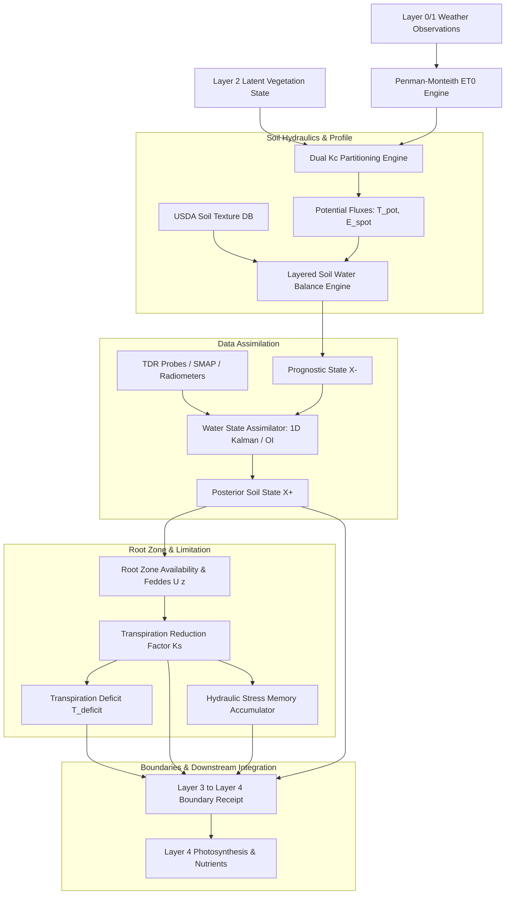

# Layer 3.0: Water Intelligence & Soil Hydrology (`layer3_water`)

## 1. Overview and Architectural Scope

**Layer 3 Water Intelligence** is the biophysical process engine governing the **Soil-Plant-Atmosphere Continuum (SPAC)**. It models vertical soil hydrology, atmospheric evaporative demand, canopy water extraction, and plant water limitation.

Layer 3 Water executes between Vegetation Intelligence (Layer 2) and Nutrient / Photosynthesis Intelligence (Layer 4). It operates under strict causal and epistemic boundaries:
- **Consumes**: Layer 2 Latent Vegetation State ($X_t^{L2}$: LAI, FVC, active rooting depth proxy $Z_r$) and Layer 0/1 Weather / Soil Observations.
- **Produces**: Physical water balance states ($X_t^{L3}$: Dual $K_c$ fluxes, soil profile moisture $\theta(z)$, depletion $D_r$, root stress coefficient $K_s$, transpiration deficit $T_{\text{deficit}}$, and hydraulic stress memory).
- **Emits**: Immutable, cryptographically hashed boundary receipt (`Layer3ToLayer4BoundaryReceipt`) consumed by Layer 4 (Nutrients & NUE) and downstream prescriptive layers.



---

## 2. Directory Layout & Module Structure

```
services/agribrain/layer3_water/
├── runner.py                     # Main coordinator: WaterIntelligenceEngine.execute_pipeline
├── evapotranspiration.py         # Top-level ET wrappers and atmospheric utilities
├── irrigation_optimizer.py       # Irrigation scheduling heuristics and allocation checks
├── soil_moisture.py              # Soil moisture helper conversions and volumetric calculations
├── water_stress.py               # Stress index calculation and threshold evaluation
├── __init__.py                   # Package exports
├── et/                           # Atmospheric & Evaporative Demand
│   ├── penman_monteith.py        # FAO-56 Reference Evapotranspiration (ET0)
│   ├── dual_kc.py                # FAO-56 Dual Kc Partitioning (Kcb, Ke, Tpot, Espot)
│   └── humidity.py               # Psychrometric calculations, vapor pressure, VPD
├── soil/                         # Soil Hydraulics & Multi-Layer Balance
│   ├── layered_water_balance.py  # 5-layer vertical water balance, tipping bucket, mass closure
│   └── soil_profile.py           # USDA 11-class soil database & Van Genuchten parameters
├── root_zone/                    # Root Zone Geometry & Availability
│   └── availability.py           # TAW, RAW, p_adj, depletion Dr, Feddes uptake U(z)
├── limitation/                   # Transpiration Limitation
│   └── water_limitation_engine.py# Transpiration reduction factor Ks and deficit T_deficit
├── assimilation/                 # Sensor Data Assimilation
│   └── water_state_assimilator.py# 1D Kalman Filter / Optimal Interpolation for TDR probes
├── solver/                       # Numerical Solver Selection
│   └── solver_selector.py        # Adaptive solver selection (EMPIRICAL_BUCKET)
├── forecast/                     # Probabilistic Ensemble Forecasting
│   └── ensemble_forecast.py      # Monte Carlo / NWP depletion trajectories P(Dr > RAW)
├── decision/                     # Prescriptive Control Analysis
│   └── mpc_irrigation_optimizer.py# Receding horizon MPC optimizer (shadow analysis)
├── contracts/                    # Immutable Formal State Contracts
│   ├── water_state.py            # WaterState, HydraulicStressMemoryState, BoundaryReceipt
│   ├── atmospheric_state.py      # AtmosphericState, ET0 observations
│   ├── irrigation_state.py       # IrrigationDecision, IrrigationConstraints
│   ├── assimilation_state.py     # SoilObservationVector, AssimilationDiagnostic
│   ├── authority.py              # WaterPhysicsAuthority, HydrologyMode, SolverFidelity
│   ├── state_factory.py          # Canonical WaterStateFactory
│   ├── transition_graph.py       # Valid hydrological state transitions
│   └── water_uncertainty.py      # WaterUncertaintyBudget (quad-component quadrature)
└── tests/                        # Dedicated Test Suite (31 test cases)
    ├── test_l3_water_contracts.py
    ├── test_l3_water_engine.py
    ├── test_l3_world_model_maturation.py
    └── test_l3_l4_boundary_contract.py
```

---

## 3. Mathematical & Algorithmic Foundations

### 3.1 Atmospheric Evaporative Demand & Dual $K_c$ (`et/`)

#### FAO-56 Penman-Monteith Reference Evapotranspiration ($ET_0$)
Computed over a hypothetical grass reference crop ($h = 0.12\text{ m}, r_s = 70\text{ s/m}, \alpha = 0.23$):
$$ ET_0 = \frac{0.408 \Delta (R_n - G) + \gamma \frac{900}{T_{\text{mean}} + 273} u_2 (e_s - e_a)}{\Delta + \gamma (1 + 0.34 u_2)} $$
where:
- $R_n$ is net radiation at crop surface (MJ/m²/day), $G$ is soil heat flux density.
- $T_{\text{mean}}$ is mean daily air temperature at 2 m height (°C).
- $u_2$ is wind speed at 2 m height (m/s).
- $e_s - e_a$ is saturation vapor pressure deficit (kPa), computed using Tetens (1930) formulation with FAO-56 Eq. 11–12 averaging.
- $\Delta$ is slope of saturation vapor pressure curve, $\gamma$ is psychrometric constant ($0.067\text{ kPa/°C}$ at sea level).

#### Dual $K_c$ Transpiration / Evaporation Partitioning
Decouples plant transpiration from direct soil surface evaporation:
$$ ET_c = (K_{cb} + K_e) ET_0 $$
1. **Basal Crop Coefficient ($K_{cb}$)**:
   Derived from Layer 2 canopy dynamics using continuous Beer-Lambert extinction:
   $$ K_{cb} = K_{c,\min} + (K_{cb,\text{full}} - K_{c,\min}) \cdot (1 - \exp(-k_{\text{ext}} \cdot \text{LAI})) $$
   conditioned on climate adjustments ($u_2, \text{RH}_{\min}$) when crop height $h > 0.1\text{ m}$.
2. **Soil Evaporation Coefficient ($K_e$)**:
   $$ K_e = K_r \cdot (K_{c,\max} - K_{cb}) \le f_{ew} \cdot K_{c,\max} $$
   where $f_{ew}$ is exposed and wetted soil fraction, and $K_r \in [0, 1]$ is the evaporation reduction coefficient dependent on topsoil cumulative depletion.
3. **Potential vs. Actual Fluxes**:
   $$ T_{\text{pot}} = K_{cb} \cdot ET_0, \quad E_{s,\text{pot}} = K_e \cdot ET_0 $$
   $$ T_{\text{act}} = K_s \cdot T_{\text{pot}}, \quad T_{\text{deficit}} = (1 - K_s) \cdot T_{\text{pot}} $$

---

### 3.2 Soil Hydraulics & Discretized Balance (`soil/`)

#### USDA Soil Hydraulic Database & Van Genuchten Parameters
11 standardized USDA soil texture classes parameterized for water retention $\theta(h)$ and unsaturated conductivity $K(h)$:
$$ \theta(h) = \theta_r + \frac{\theta_s - \theta_r}{\left[1 + |\alpha h|^n\right]^{1 - 1/n}} $$
$$ K(h) = K_{\text{sat}} \cdot \frac{\left( (1 + |\alpha h|^n)^m - |\alpha h|^{n-1} \right)^2}{(1 + |\alpha h|^n)^{m(l+2)}} $$

#### 5-Layer Vertical Discretization
Soil profile is discretized into 5 physical depth intervals:
- **Layer 1**: $0 - 10\text{ cm}$ (topsoil evaporation zone $Z_e$)
- **Layer 2**: $10 - 30\text{ cm}$ (shallow root development)
- **Layer 3**: $30 - 60\text{ cm}$ (core vegetative root zone)
- **Layer 4**: $60 - 100\text{ cm}$ (deep taproot zone)
- **Layer 5**: $100 - 150\text{ cm}$ (subsoil boundary / deep drainage)

#### Mass Balance Conservation Invariant
For each layer $i$ over time step $\Delta t$:
$$ \theta_i(t) = \theta_i(t-1) + \frac{I_i + P_{i-1} - P_i - E_i - U_i}{\Delta z_i} $$
where $I_i$ is net infiltration, $P_i$ is downward percolation, $E_i$ is direct evaporation, and $U_i$ is root water extraction.
*Strict Invariant*: Total profile mass balance closure error must satisfy:
$$ \left| \sum_{i=1}^5 \Delta S_i - (\text{Inflow} - \text{Outflow}) \right| < 10^{-5}\text{ mm} $$

---

### 3.3 Root Zone Depletion & Water Limitation (`root_zone/`, `limitation/`)

#### Available Water Capacities
- **Total Available Water (TAW)**:
  $$ \text{TAW} = 1000 \cdot (\theta_{\text{fc}} - \theta_{\text{wp}}) \cdot Z_r \quad [\text{mm}] $$
- **Readily Available Water (RAW)**:
  $$ \text{RAW} = p_{\text{adj}} \cdot \text{TAW} \quad [\text{mm}] $$
  where $p_{\text{adj}}$ is adjusted for atmospheric evaporative demand:
  $$ p_{\text{adj}} = p_{\text{table}} + 0.04 \cdot (5 - ET_c) \quad \text{clamped to } [0.1, 0.8] $$

#### Transpiration Reduction Factor ($K_s$)
When root zone depletion $D_r > \text{RAW}$, soil matric potential restricts root water uptake:
$$ K_s = \begin{cases} 
1.0 & \text{if } D_r \le \text{RAW} \\
\frac{\text{TAW} - D_r}{\text{TAW} - \text{RAW}} = \frac{\text{TAW} - D_r}{(1 - p_{\text{adj}}) \text{TAW}} & \text{if } \text{RAW} < D_r < \text{TAW} \\
0.0 & \text{if } D_r \ge \text{TAW} 
\end{cases} $$

#### Feddes Root Extraction Distribution $U(z)$
Root extraction is distributed across vertical layers using active root length density:
$$ U_i = T_{\text{act}} \cdot \frac{r_i \cdot \Delta z_i}{\sum_j r_j \cdot \Delta z_j} $$
where $r_i$ is effective root fraction in layer $i$, terminating at depth $Z_r$.

---

### 3.4 Data Assimilation (`assimilation/`)

#### 1D Kalman Filter / Optimal Interpolation
Blends prognostic soil moisture states ($X^-$) with sensor observations ($y$):
$$ X^+ = X^- + \mathbf{K} (y - \mathbf{H} X^-) $$
$$ \mathbf{K} = \mathbf{P}^- \mathbf{H}^T (\mathbf{H} \mathbf{P}^- \mathbf{H}^T + \mathbf{R})^{-1} $$
- **Observation Matrix $\mathbf{H}$**: Maps sensor depths (e.g. TDR probes at 10, 20, 40 cm) to discretized profile layers.
- **Physical Bounds**: Posterior moisture $\theta_i^+$ is strictly projected to physical limits $[\theta_{r, i}, \theta_{s, i}]$.
- **Flux Correction**: Posterior updates recompute hydraulic conductivity $K_s(\theta^+)$ and percolation fluxes without breaking mass conservation.

---

### 3.5 Hydraulic Stress Memory & Ensemble Forecasting (`forecast/`, `contracts/`)

#### Hydraulic Stress Memory State
Crops do not instantly recover when re-watered; cavitation and stomatal sluggishness induce residual stress memory:
- **Cumulative Transpiration Deficit**: $\text{CTD} = \sum_{t} T_{\text{deficit}, t} \quad [\text{mm}]$.
- **Consecutive Stress Days**: Count of continuous days with $K_s < 0.7$.
- **VPD Stress Integral**: $\int \text{VPD}(t) \cdot (1 - K_s(t)) \, dt$.
- **Cavitation Recovery Rate**: Exponential recovery function governing post-stress stomatal conductance resumption.

#### Probabilistic Ensemble Forecasting
Simulates 50 Monte Carlo depletion paths over a 7–14 day forecast horizon under calibrated Numerical Weather Prediction (NWP) ensembles:
$$ \mathbb{P}(\text{Stress at day } t) = \mathbb{P}(D_r(t) > \text{RAW}(t)) $$

---

## 4. Test Suite and Verification

The Layer 3 Water test suite is organized in [`services/agribrain/layer3_water/tests/`](file:///c:/Users/E-C/Desktop/agriwise/services/agribrain/layer3_water/tests/) containing **4 test modules** and **31 tests**:

| Test Module | Tests | Scope |
| :--- | :---: | :--- |
| `test_l3_water_contracts.py` | 9 | Mass balance conservation, potential/actual ET partitioning, transition graph invariants, uncertainty quadrature |
| `test_l3_water_engine.py` | 14 | Penman-Monteith ET0, dual Kc engine, multi-layer soil hydrology, tipping bucket cascade, MPC allocation hold |
| `test_l3_world_model_maturation.py` | 6 | Van Genuchten hydraulic potential, Kalman data assimilation, stress memory accumulation, solver degradation |
| `test_l3_l4_boundary_contract.py` | 2 | Causal boundary barrier, information encapsulation between Water and Bio/Nutrient intelligence |
| **Total** | **31** | **100% Green across all 31 tests** |
