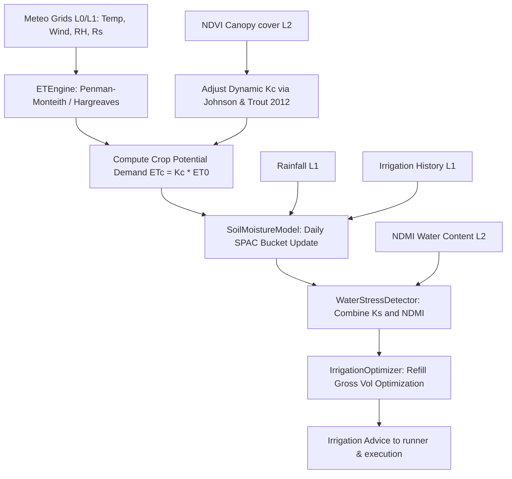

# Layer 3 (Water): Evapotranspiration, Soil Moisture, and Irrigation Optimizer

This layer models water flows across the soil-plant-atmosphere continuum (SPAC) and designs optimal irrigation scheduling. It computes aerodynamic and radiative energy balances to model plant transpiration, simulates daily root zone soil moisture depletion, and optimizes irrigation timings and water volume demands.

---

## 1. Granular Engine Inventory (4 Active Modules)

Layer 3 Water SPAC Systems coordinate exactly four specialized active engines:

### A. Crop Evapotranspiration
1. **ETEngine** ([evapotranspiration.py](file:///c:/Users/E-C/Desktop/agriwise/services/agribrain/layer3_water/evapotranspiration.py)): Computes reference evapotranspiration ($ET_0$) using Penman-Monteith FAO-56 or Hargreaves-Samani equations, parses crop-specific coefficients ($K_c$) from FAO-56 Table 12, applies advective adjustments for arid zones (FAO-56 Eq. 62), and estimates potential crop evapotranspiration ($ET_c$).

### B. Hydrological Soil Balance
2. **SoilMoistureModel** ([soil_moisture.py](file:///c:/Users/E-C/Desktop/agriwise/services/agribrain/layer3_water/soil_moisture.py)): Simulates daily root-zone water storage. Models inflows (precipitation and irrigation) and outflows (actual transpiration and gravitational percolation drainage) using a single-layer bucket model configured for soil texture classes (sand, loam, or clay).

### C. Stress Monitoring
3. **WaterStressDetector** ([water_stress.py](file:///c:/Users/E-C/Desktop/agriwise/services/agribrain/layer3_water/water_stress.py)): Combines trailing 3-day average soil transpiration stress coefficients ($K_s$) and satellite-derived Normalized Difference Moisture Index (NDMI) anomalies from Layer 2 to calculate a unified water stress probability and identify data/model discrepancies.

### D. Irrigation Optimization
4. **IrrigationOptimizer** ([irrigation_optimizer.py](file:///c:/Users/E-C/Desktop/agriwise/services/agribrain/layer3_water/irrigation_optimizer.py)): Generates actionable irrigation advice by checking depletion levels against management thresholds, calculating the gross water volume required to refill the soil to field capacity, and adjusting for application efficiencies (drip, sprinkler, or flood).

---

## 2. Internal Wiring & Sequencing

---

## 3. Upstream & Downstream Integration

* **Upstream Inputs (from Layer 1 & 2)**:
  * Unified daily meteorological forcing (minimum/maximum temperatures, relative humidity mean, wind speed at 2m, and shortwave solar radiation).
  * Fused daily Sentinel-2 NDVI and NDMI timeseries.
  * Extracted Viterbi phenology stages (BBCH equivalent values).
  * Soil texture classifications (sand, loam, clay fractions).
* **Downstream Outputs (to Layer 3 Decision & Layer 10)**:
  * Calculated actual crop transpiration ($ET_{actual}$) and water deficit ($ET_{deficit}$) routed to the **Layer 3 Decision runner**.
  * Root-zone soil moisture depletion rates ($D_r$) and transpiration stress coefficients ($K_s$) routed to **Layer 3 Decision builder**.
  * Optimized irrigation recommendations (action, gross volume, and urgency) routed to **Layer 6 (Execution)** and **Layer 10 (SIRE)**.

---

## 4. Granular 21-Step Pipeline Execution

Every daily run of the Layer 3 water SPAC modeling pipeline follows this deterministic sequence:

1. **Ingest Climatic Forcing**: Collects the gridded daily meteorological telemetry (temperatures, wind speed, relative humidity, and solar radiation) from Layer 1.
2. **Extract Crop Class parameters**: Identifies the crop variety (e.g. wheat, maize, citrus) to retrieve crop-specific coefficients ($K_{c,\text{ini}}$, $K_{c,\text{mid}}$, $K_{c,\text{end}}$) from FAO-56 Table 12.
3. **Parse Growth Phase**: Obtains the active Viterbi phenological stage (e.g. Emergence, Reproductive) from Layer 2.
4. **Compute Vapour Pressures**: Resolves saturation vapor pressures ($e_s(T_{\text{max}})$, $e_s(T_{\text{min}})$) and actual vapor pressure ($e_a$) using relative humidity.
5. **Compute Psychrometric Constants**: Calculates local atmospheric pressure using field elevation and resolves the psychrometric constant ($\gamma$) and saturation vapor curve slope ($\Delta$).
6. **Compute Extraterrestrial Solar Radiation**: Calculates solar declination ($\delta$), hour angle ($\omega_s$), and daily extraterrestrial radiation ($R_a$) based on day of year (DOY) and latitude.
7. **Calculate Net Radiative Balance**: Synthesizes net shortwave radiation ($R_{ns}$) and net longwave radiation ($R_{nl}$) to solve for net radiation ($R_n$).
8. **Solve Reference Evapotranspiration ($ET_0$)**: Evaluates daily reference evapotranspiration ($ET_0$) using the FAO-56 Penman-Monteith equation.
9. **Execute Hargreaves Fallback**: If wind speed or relative humidity are missing, falls back to the temperature-based Hargreaves-Samani equation.
10. **Calculate Fractional Canopy Cover**: Computes daily fractional vegetation cover ($F_c = 1.26 \cdot \text{NDVI} - 0.18$) using the Johnson & Trout (2012) calibration.
11. **Derive Dynamic Crop Coefficient ($K_c$)**: Interpolates the crop coefficient:
    $$K_c = K_{c,\text{min}} + (K_{c,\text{full}} - K_{c,\text{min}}) \cdot F_c$$
12. **Apply Advective Arid Corrections**: Adjusts mid-season $K_c$ using FAO-56 Eq. 62 when min relative humidity falls below 45% or wind speed exceeds 2 m/s.
13. **Model Potential Crop Evapotranspiration ($ET_c$)**: Multiplies $ET_0$ by the adjusted $K_c$ to obtain potential crop water demand.
14. **Initialize Soil Texture Properties**: Queries sand, loam, or clay fractions to retrieve volumetric water content field capacity ($\theta_{fc}$) and wilting point ($\theta_{wp}$).
15. **Compute Total Available Water (TAW)**: Resolves root-zone water capacity in mm:
    $$\text{TAW} = 1000 \cdot (\theta_{fc} - \theta_{wp}) \cdot Z_r$$
16. **Evaluate Root Zone Water Inflow**: Sums daily rainfall precipitation ($P_t$) and applied irrigation water ($I_t$).
17. **Determine Root Zone Depletion ($D_r$)**: Evaluates water depletion:
    $$D_r(t) = \text{TAW} - S_t(t-1)$$
18. **Calculate Daily Transpiration Stress Coefficient ($K_s$)**: Evaluates evapotranspiration reduction:
    $$K_s = \begin{cases} 1.0 & \text{if } D_r \le 0.6 \cdot \text{TAW} \\ \max\left(0, \frac{\text{TAW} - D_r}{0.4 \cdot \text{TAW}}\right) & \text{otherwise} \end{cases}$$
19. **Model Actual Evapotranspiration ($ET_{actual}$)**: Scales transpiration outflow:
    $$ET_{actual} = ET_c \cdot K_s$$
20. **Compute Daily Soil Water Balance**: Updates bucket soil water storage:
    $$S_t(t) = S_t(t-1) + \text{Inflow} - ET_{actual}$$
    If storage exceeds field capacity ($S_t > \text{TAW}$), excess water is drained as runoff drainage.
21. **Run Stress Detections & Optimize Irrigation**: Fuses the trailing 3-day average soil $K_s$ and satellite NDMI indices to calculate a unified water stress probability ($P_{\text{stress}}$). If $D_r > \text{mgmt\_threshold} \cdot \text{TAW}$, triggers irrigation and computes the gross water volume needed to refill the root zone to field capacity, adjusted for application efficiency (drip $95\%$, sprinkler $80\%$, flood $60\%$).

---

## 5. Mathematical & Biophysical Formulations

### A. FAO-56 Penman-Monteith Evapotranspiration
The ETEngine computes daily reference evapotranspiration ($ET_0$) using Penman-Monteith energy and aerodynamic balance equations:
$$\text{ET}_0 = \frac{0.408 \cdot \Delta \cdot (R_n - G) + \gamma \cdot \frac{900}{T + 273} \cdot u_2 \cdot (e_s - e_a)}{\Delta + \gamma \cdot (1 + 0.34 \cdot u_2)}$$
where:
* $\text{ET}_0$ is the reference crop evapotranspiration ($\text{mm/day}$).
* $R_n$ is the net radiation at the crop surface ($\text{MJ/m}^2\text{/day}$).
* $G$ is the soil heat flux density ($\text{MJ/m}^2\text{/day}$), assumed negligible on a daily scale.
* $T$ is the mean daily air temperature at 2m height (°C).
* $u_2$ is the wind speed at 2m height ($\text{m/s}$).
* $e_s$ is the saturation vapor pressure ($\text{kPa}$), computed from temperature bounds:
  $$e_s = \frac{e^0(T_{\text{max}}) + e^0(T_{\text{min}})}{2} \quad \text{where } e^0(T) = 0.6108 \cdot e^{\frac{17.27 \cdot T}{T + 237.3}}$$
* $e_a$ is the actual vapor pressure ($\text{kPa}$), derived from mean relative humidity:
  $$e_a = e_s \cdot \left(\frac{\text{RH}_{\text{mean}}}{100}\right)$$
* $\Delta$ is the slope of the saturation vapor pressure-temperature curve ($\text{kPa/°C}$):
  $$\Delta = \frac{4098 \cdot \left[0.6108 \cdot e^{\frac{17.27 \cdot T}{T + 237.3}}\right]}{(T + 237.3)^2}$$
* $\gamma$ is the psychrometric constant ($\text{kPa/°C}$):
  $$\gamma = 0.000665 \cdot P \quad \text{where } P = 101.3 \cdot \left(\frac{293 - 0.0065 \cdot \text{elevation}}{293}\right)^{5.26}$$

---

### B. Hargreaves-Samani Temperature-Only Fallback
When relative humidity or wind speed data is unavailable, $ET_0$ is estimated using temperature extremes and extraterrestrial solar radiation:
$$\text{ET}_0 = 0.0023 \cdot R_a \cdot (T_{mean} + 17.8) \cdot \sqrt{T_{max} - T_{min}}$$
where $R_a$ is the extraterrestrial radiation in $\text{mm/day}$ equivalent, calculated from day of year (DOY) and latitude.

---

### C. Dynamic Crop Coefficients & Advective Adjustments
Dynamic crop coefficients ($K_c$) are scaled using fractional canopy cover ($F_c$), calculated using the Johnson & Trout (2012) calibration:
$$F_c = \max\left(0.0, \min\left(1.0, 1.26 \cdot \text{NDVI} - 0.18\right)\right)$$
$$K_c = K_{c,\text{min}} + (K_{c,\text{full}} - K_{c,\text{min}}) \cdot F_c$$
In arid regions with low relative humidity or high winds, mid-season $K_c$ is adjusted using FAO-56 Equation 62:
$$K_{c,\text{mid\_adj}} = K_{c,\text{mid}} + \left[0.04 \cdot (u_2 - 2) - 0.004 \cdot (\text{RH}_{\text{min}} - 45)\right] \cdot \left(\frac{h}{3}\right)^{0.3}$$
where $h$ is the mean crop height in meters (constrained to $[0.1, 10.0]$), $u_2$ is wind speed, and $\text{RH}_{\text{min}}$ is minimum relative humidity.

---

### D. Daily Root Zone Soil Moisture Balance
Soil Moisture Model tracks the soil water storage bucket ($S_t$) using the daily hydrological balance:
$$S_t(t) = S_t(t-1) + P_t + I_t - ET_{\text{actual}}(t) - \text{Runoff}_t - \text{Percolation}_t$$
where:
* $P_t$ is rainfall precipitation (mm).
* $I_t$ is applied irrigation (mm).
* $ET_{\text{actual}}$ is actual crop evapotranspiration (mm).
* $\text{Runoff}_t + \text{Percolation}_t = \max\left(0.0, S_t(t-1) + P_t + I_t - ET_{\text{actual}}(t) - \text{TAW}\right)$ represent excess water that drains once soil moisture storage exceeds field capacity.

---

### E. Root Zone Depletion & Stress Coefficients
The daily root zone depletion ($D_r$) measures the water deficit in the crop root zone:
$$D Dr = \text{TAW} - S_t$$
Transpiration is reduced under water stress conditions, modeled using the FAO-56 water stress coefficient ($K_s$):
$$K_s = \begin{cases}
1.0 & \text{if } D_r \le p \cdot \text{TAW} \quad \text{(No Stress)} \\
\max\left(0.0, \frac{\text{TAW} - D_r}{(1 - p) \cdot \text{TAW}}\right) & \text{if } D_r > p \cdot \text{TAW} \quad \text{(Stress Zone)}
\end{cases}$$
where $p$ is the soil water depletion fraction (typically $0.60$ representing $60\%$ depletion threshold). Actual crop evapotranspiration is then calculated as:
$$ET_{\text{actual}} = K_s \cdot ET_c$$

---

### F. Gross Irrigation Refill Requirements
When root zone depletion exceeds the management threshold ($D_r > \text{mgmt\_threshold} \cdot \text{TAW}$), the gross irrigation water volume required to refill the soil profile to field capacity is computed:
$$\text{Gross Irrigation} = \frac{D_r}{\eta_{\text{irrigation}}} \quad (\text{mm})$$
where $\eta_{\text{irrigation}}$ is the application efficiency of the irrigation system:
$$\eta_{\text{irrigation}} = \begin{cases}
0.95 & \text{Drip Irrigation} \\
0.80 & \text{Sprinkler Systems} \\
0.60 & \text{Flood Irrigation}
\end{cases}$$

---

## 6. Scientific References

* **FAO-56 Evapotranspiration Standard**: Allen, R. G., et al. (1998). *Crop Evapotranspiration: Guidelines for Computing Crop Water Requirements*. FAO Irrigation and Drainage Paper 56, Rome.
* **SPAC Hydrology & Soil Water**: Feddes, R. A., et al. (1978). *Simulation of Field Water Use and Crop Yield*. John Wiley & Sons, New York.
* **Penman-Monteith Aerodynamic Model**: Monteith, J. L. (1965). *Evaporation and Environment*. Symposia of the Society for Experimental Biology, 19, 205-234.
* **NDVI to Crop Cover Calibration**: Johnson, L. F., & Trout, T. J. (2012). *Satellite NDVI relation to crop coefficient for major horticultural crops in California*. Agricultural Water Management, 109, 68-74.
