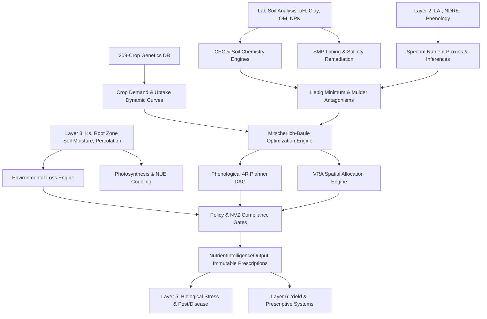

# Layer 4.0: Nutrient Intelligence & Soil Chemistry (`layer4_nutrients`)

## 1. Overview and Architectural Scope

**Layer 4 Nutrient Intelligence** is the core agronomical and soil chemistry engine of the AgriBrain system. It integrates biophysical proxies, laboratory soil and tissue tests, Cation Exchange Capacity (CEC) estimates, root-zone hydrology, nutrient interactions, and environmental loss kinetics to formulate precision fertilizer prescriptions and soil amendment schedules.

Layer 4 operates downstream of **Vegetation Intelligence (Layer 2)** and **Water Intelligence (Layer 3)**, and directly upstream of **Biological Stress & Pest Intelligence (Layer 5)** and **Yield Prediction (Layer 6)**:
- **Consumes**:
  - Layer 2 Latent Vegetation State (LAI, FVC, NDVI, NDRE red-edge index, phenological growth stage).
  - Layer 3 Water State ($K_s$ transpiration reduction factor, daily soil moisture profile $\theta(z)$, percolation fluxes).
  - User laboratory soil tests ($\text{pH}$, Organic Matter %, Sand %, Silt %, Clay %, extractable N, Bray/Olsen P, exchangeable K, $EC_e$).
  - Historical management data (previous crop residues, manure history, cover cropping).
- **Produces**:
  - Balanced macro- and micro-nutrient uptake targets (N, P, K, Ca, Mg, S, Fe, Zn, Mn, Cu, B).
  - 4R Nutrient Stewardship Prescriptions (Right Source, Right Rate, Right Time, Right Place).
  - Variable Rate Application (VRA) zone prescriptions mapped onto Layer 2 spatial clusters.
  - Soil remediation plans (SMP liming requirement for acidic soils, gypsum/leaching requirements for saline-sodic soils).
  - Environmental compliance audits (Nitrate Vulnerability Zone caps, volatilization/leaching emission budgets).
- **Emits**:
  - Immutable `NutrientIntelligenceOutput` contract stamped with cryptographically verifiable `run_meta` (layer label `"L4"`).



---

## 2. Directory Layout & Module Structure

```
services/agribrain/layer4_nutrients/
├── runner.py                    # Top-level coordinator: NutrientIntelligencePipeline.run
├── schema.py                    # Pydantic/dataclass contracts: Inputs, Outputs, Prescriptions
├── invariants.py                # Physical mass balances, Liebig checks, NVZ regulatory gates
├── fertilizer_optimizer.py      # Least-cost blend formulation and fertilizer source selection
├── nitrogen_deficiency.py       # Causal red-edge Bayesian inference gated by water stress
├── nutrient_response.py         # Empirical crop response curves and yield plateau calculators
├── crop_demand/                 # Crop nutrient uptake dynamics (Ciampitti & Vyn 2012)
│   ├── engine.py                # Daily NPK demand as function of GDD and biomass accumulation
│   └── models.py                # Crop-specific uptake coefficients and baseline indices
├── soil_water_balance/          # Secondary hydrology integration for nutrient mobility
│   ├── engine.py                # Solute transport and convective-dispersive flux interfaces
│   └── models.py                # Hydro-solute state definitions
├── soil_chemistry/              # Pedotransfer and soil buffering
│   ├── cec_engine.py            # Breeuwsma & Wösten (1986) pedotransfer CEC model
│   └── liming_engine.py         # Shoemaker-McLean-Pratt (SMP) buffer method for soil pH
├── nutrient_interactions/       # Cross-nutrient stoichiometry & interactions
│   ├── engine.py                # Liebig's Law of the Minimum & Mulder's Antagonism Matrix
│   └── models.py                # Stoichiometric interaction weights and ratios
├── salinity/                    # Salinity degradation and remediation
│   ├── engine.py                # Maas-Hoffman (1977) yield loss & leaching requirement (LR)
│   └── models.py                # Salinity tolerance thresholds (ECe, b-slope)
├── biological_fixation/         # Symbiotic and asymbiotic N fixation
│   ├── engine.py                # Herridge et al. (2008) %Ndfa BNF model for legumes
│   └── models.py                # Inoculation factors, nitrate inhibition curves
├── phosphorus_sorption/         # Phosphorus sorption and soil buffering capacity (PBC)
│   ├── engine.py                # Langmuir and Freundlich sorption isotherms
│   └── models.py                # Clay/aluminum/iron oxide affinity coefficients
├── photosynthesis_nue/          # Photosynthesis & Nitrogen Use Efficiency Coupling
│   ├── engine.py                # Lemaire & Gastal (1997) Nitrogen Nutrition Index (NNI)
│   └── models.py                # Critical N dilution curves (Nc = a * W^-b)
├── environmental_losses/        # Environmental footprint & emission modeling
│   ├── engine.py                # Sutton (2013) NH3 volatilization, NO3 leaching, N2O IPCC Tier 1
│   └── models.py                # Emission factors, fertilizer placement modifiers
├── tissue_analysis/             # Plant tissue diagnosis
│   ├── engine.py                # DRIS (Diagnosis and Recommendation Integrated System)
│   └── models.py                # DRIS standard reference norms and variance ratios
├── micronutrient_chemistry/     # Trace mineral availability
│   ├── engine.py                # Fe, Zn, Mn, Cu, B availability as function of pH and OM
│   └── models.py                # Chelation and precipitation equilibria
├── residual_credit/             # Legacy nutrients & organic amendments
│   ├── engine.py                # Legume credits, cover crop mineralization, manure decay
│   └── models.py                # Organic mineralization half-lives (C:N ratio driven)
├── soil_respiration/            # Microbial activity & dynamic mineralization
│   ├── engine.py                # Temperature-moisture driven microbial respiration (Q10)
│   └── models.py                # Daily weather-coupled seasonal mineralization
├── proxies/                     # Spectral & radar remote sensing proxies
│   └── engine.py                # NDRE red-edge chlorophyll proxy, Sentinel-1 tillage detection
├── inference/                   # Probabilistic diagnostic fusion
│   └── engine.py                # Bayesian log-odds mapping for nutrient deficiencies
├── optimization/                # Multi-nutrient mathematical optimization
│   └── engine.py                # Mitscherlich-Baule multi-variable response portfolio
├── planner/                     # 4R Phenology-aware scheduling
│   └── engine.py                # Application split timing DAG (basal, tillering, heading)
├── policy/                      # Legal & environmental safety rules
│   └── engine.py                # Nitrate Vulnerability Zone (NVZ) maximum allowable N caps
├── vra/                         # Variable Rate Application
│   └── engine.py                # Prescription mapping across spatial management zones
├── tests/                       # Unit & integration verification suites
│   ├── __init__.py
│   ├── test_crop_demand.py
│   ├── test_soil_chemistry.py
│   ├── test_nutrient_interactions.py
│   ├── test_advanced_engines.py
│   └── test_nutrient_runner.py
├── engines.md                   # Granular technical specification for all 22 sub-engines
└── layer4_nutrients.md          # Scientific background and calibration roadmap
```

---

## 3. The 22 Sub-Engines Inventory

The 22 specialized sub-engines are categorized into three major functional tiers:

### Tier A: Soil Water, Crop Uptake Dynamics & Remote Sensing Proxies
1. **`SoilWaterBalanceEngine`**: Evaluates solute flux and convective-dispersive nutrient mobility in the root zone.
2. **`CropDemandUptakeEngine`**: Calculates stage-specific nutrient requirements based on genetic yield potential and phenological stage.
3. **`NutrientObservationProxyEngine`**: Derives leaf chlorophyll and canopy N content from Sentinel-2 red-edge bands (B05, B06, B07, B8A).
4. **`TillageDetector`**: Ingests Sentinel-1 dual-polarization ($\text{VV}/\text{VH}$) backscatter coherence drops to detect cultivation events.
5. **`SOCDynamics`**: Simulates soil organic carbon turnover accelerated by tillage disturbance.
6. **`NutrientInferenceEngine`**: Computes Bayesian probabilities for hidden nutrient stress states.
7. **`OptimizationEngine`**: Solves non-linear Mitscherlich-Baule yield response functions to determine marginal return per kg nutrient.
8. **`PlanningEngine`**: Constructs a phenology-synchronized split application schedule (basal, vegetative, reproductive).

### Tier B: Soil Chemistry, Liming, VRA & Stoichiometry
9. **`CECEngine`**: Pedotransfer model estimating effective Cation Exchange Capacity (ECEC) from soil texture and organic matter.
10. **`LimingEngine`**: Calculates agricultural lime ($\text{CaCO}_3$) requirement to neutralize exchangeable aluminum and bring soil pH to target.
11. **`VRAEngine`**: Discretizes field-wide fertilizer totals into spatially variable prescriptions across high-, medium-, and low-yielding zones.
12. **`ResidualCreditEngine`**: Calculates nitrogen carry-over from preceding legume crops, green manures, and organic livestock residues.
13. **`NUEEngine`**: Computes Partial Factor Productivity ($\text{PFP}$), Agronomic Efficiency ($\text{AE}$), and Recovery Efficiency ($\text{RE}$).
14. **`TissueAnalysisEngine`**: Employs DRIS indices to diagnose nutritional balance from foliar laboratory assays.
15. **`NutrientInteractionEngine`**: Enforces Liebig's Law of the Minimum and applies Mulder's antagonism penalties (e.g. excess K inhibiting Mg).

### Tier C: Advanced Biophysical Kinetics & Environmental Protection
16. **`PhosphorusSorptionEngine`**: Simulates phosphorus precipitation/adsorption using Langmuir isotherms based on clay content and soil pH.
17. **`SalinityEngine`**: Implements the Maas-Hoffman piecewise linear model for electrical conductivity ($EC_e$) stress and calculates Leaching Requirements ($LR$).
18. **`BiologicalFixationEngine`**: Models symbiotic $N_2$ fixation via Herridge's equation, automatically accounting for soil nitrate feedback inhibition.
19. **`MicronutrientChemistryEngine`**: Determines trace mineral solubility (Fe, Mn, Zn, Cu, B) based on Lindsay-Norvell chemical equilibria.
20. **`SoilRespirationEngine`**: Daily weather-driven (temperature/moisture) microbial respiration and mineralization model.
21. **`PhotosynthesisNUEEngine`**: Quantifies the Nitrogen Nutrition Index ($\text{NNI}$) and links canopy N density to Radiation Use Efficiency ($\text{RUE}$).
22. **`EnvironmentalLossEngine`**: Evaluates gaseous ammonia volatilization, nitrate leaching beyond the rooting zone, and $N_2O$ greenhouse emissions.

---

## 4. Key Mathematical Formulations

### 4.1 Mitscherlich-Baule Multi-Nutrient Response Model
The multi-nutrient yield response $Y(N, P, K)$ models diminishing returns and co-limitation across nutrients:
$$Y(N, P, K) = Y_{\max} \cdot \left(1 - e^{-c_N \cdot (N_{\text{soil}} + N_{\text{fert}})}\right) \cdot \left(1 - e^{-c_P \cdot (P_{\text{soil}} + P_{\text{fert}})}\right) \cdot \left(1 - e^{-c_K \cdot (K_{\text{soil}} + K_{\text{fert}})}\right)$$
Where:
- $Y_{\max}$ is the water-limited potential yield (t/ha) established by Layer 3.
- $c_N, c_P, c_K$ are Baule responsiveness coefficients specific to the crop genotype.

### 4.2 Cation Exchange Capacity (CEC) Pedotransfer Equation
Derived from Breeuwsma & Wösten (1986) calibrated for agricultural soils:
$$\text{CEC} \approx 0.5 \cdot \text{Clay}\% + 3.5 \cdot \text{OrganicMatter}\% \quad (\text{cmol}_c / \text{kg})$$

### 4.3 Shoemaker-McLean-Pratt (SMP) Liming Requirement
For soils with $\text{pH} < \text{pH}_{\text{target}}$:
$$\text{LimeRequirement } (\text{t CaCO}_3 / \text{ha}) = \max\left(0.0, \; \alpha \cdot (\text{pH}_{\text{target}} - \text{pH}_{\text{SMP}}) \cdot \text{BufferFactor} \cdot \frac{\text{Depth}_{\text{plow}}}{20}\right)$$

### 4.4 Maas-Hoffman (1977) Salinity Degradation Model
$$\text{YieldFactor} = \begin{cases}
1.0 & \text{if } EC_e \le EC_{\text{threshold}} \\
\max\left(0.0, \; 1.0 - \frac{b}{100} \cdot (EC_e - EC_{\text{threshold}})\right) & \text{if } EC_e > EC_{\text{threshold}}
\end{cases}$$
The Leaching Requirement ($LR$) to maintain root zone salinity below threshold is:
$$LR = \frac{EC_w}{5 \cdot EC_e - EC_w}$$

### 4.5 Langmuir Phosphorus Sorption Isotherm
$$P_{\text{sorbed}} = \frac{Q_{\max} \cdot K_L \cdot C_{\text{sol}}}{1 + K_L \cdot C_{\text{sol}}}$$
Where:
- $Q_{\max}$ is maximum sorption capacity $(\text{mg P} / \text{kg soil})$, correlated with amorphous iron and aluminum oxides.
- $K_L$ is the sorption energy affinity constant $(\text{L} / \text{mg P})$.
- $C_{\text{sol}}$ is the equilibrium phosphorus concentration in soil solution $(\text{mg} / \text{L})$.

### 4.6 Nitrogen Nutrition Index ($\text{NNI}$) & Photosynthetic Capacity
According to Lemaire & Gastal (1997), the critical nitrogen concentration $N_{\text{crit}}$ is:
$$N_{\text{crit}} = a \cdot W^{-b}$$
Where $W$ is dry biomass (t/ha), $a \approx 4.8$, and $b \approx 0.32$. The Nitrogen Nutrition Index is:
$$\text{NNI} = \frac{N_{\text{actual}}}{N_{\text{crit}}}$$
- $\text{NNI} = 1.0$: Optimal nitrogen nutrition.
- $\text{NNI} < 1.0$: Nitrogen limitation; reduces Radiation Use Efficiency ($\text{RUE} = \text{RUE}_{\max} \cdot \text{NNI}$).
- $\text{NNI} > 1.0$: Luxury consumption; elevated risk of foliar disease and lodging.

### 4.7 Symbiotic Biological $N_2$ Fixation (Herridge et al., 2008)
For legume crops:
$$N_{\text{fixed}} = \text{CropDemand}_N \cdot \%Ndfa \cdot \text{InoculationFactor} \cdot (1 - \text{Inhibition}_{\text{mineral\_N}})$$
$$\%Ndfa = \min(0.85, \; \max(0.0, \; 1.0 - 0.005 \cdot N_{\text{mineral\_soil}}))$$

### 4.8 Liebig's Law of the Minimum & Mulder's Antagonisms
$$\text{AttainableYieldFactor} = \min_{i \in \{\text{N, P, K, Ca, Mg, S, Fe, Zn}\}} \left( \frac{\text{Available}_i}{\text{Requirement}_i} \right)$$
Mulder's cross-nutrient penalties apply when ionic ratios diverge beyond critical thresholds:
- Potassium-Magnesium antagonism: High $\text{K}^+ / \text{Mg}^{2+}$ ratio ($> 5.0$) induces physiological Mg deficiency.
- Phosphorus-Zinc antagonism: High $P$ application precipitates zinc into insoluble $\text{Zn}_3(\text{PO}_4)_2$, triggering Zn deficiency in alkaline soils.

---

## 5. Invariants & Physical Conservation Laws

Layer 4 enforces rigorous agronomical and regulatory invariants in [invariants.py](file:///c:/Users/E-C/Desktop/agriwise/services/agribrain/layer4_nutrients/invariants.py):

1. **Non-Negative Application Rates**:
   $$\forall \text{ zone } z, \quad \text{Rate}_N(z) \ge 0, \quad \text{Rate}_P(z) \ge 0, \quad \text{Rate}_K(z) \ge 0$$
2. **Elemental Mass Balance Conservation**:
   $$\Delta \text{SoilStorage}_i = \text{Fertilizer}_i + \text{Mineralization}_i + \text{Deposition}_i + \text{BNF}_i - \text{CropUptake}_i - \text{Losses}_i$$
3. **Causal Gating of Remote Sensing Deficiencies**:
   Spectral red-edge deficiency signatures must be discounted if Layer 3 indicates severe root-zone water stress:
   $$P(N_{\text{def}})_{\text{adjusted}} = P(N_{\text{def}})_{\text{raw}} \cdot (1 - 0.6 \cdot \text{WaterStressFactor})$$
4. **Nitrate Vulnerability Zone (NVZ) Hard Caps**:
   $$\sum_{k=1}^{\text{splits}} \text{Application}_N(k) \le \text{NVZ}_{\text{max\_allowed\_rate}}$$
   Violations trigger hard validation failures preventing prescription dispatch.
5. **Salinity Safety Boundaries**:
   $EC_e$ must remain within physical bounds ($0.0 \le EC_e \le 35.0 \text{ dS/m}$). Excess salinity triggers an obligatory warning and remedial leaching/amendment requirement.

---

## 6. Verification and Test Suite

Layer 4 contains a comprehensive test suite in [services/agribrain/layer4_nutrients/tests/](file:///c:/Users/E-C/Desktop/agriwise/services/agribrain/layer4_nutrients/tests/):

| Test Suite | Purpose | Tests | Status |
| :--- | :--- | :---: | :---: |
| [`test_crop_demand.py`](file:///c:/Users/E-C/Desktop/agriwise/services/agribrain/layer4_nutrients/tests/test_crop_demand.py) | Verifies crop nutrient uptake curves, stage allocation, yield scaling | 2 | **PASSED** |
| [`test_soil_chemistry.py`](file:///c:/Users/E-C/Desktop/agriwise/services/agribrain/layer4_nutrients/tests/test_soil_chemistry.py) | Validates Breeuwsma CEC pedotransfer & SMP buffer liming | 2 | **PASSED** |
| [`test_nutrient_interactions.py`](file:///c:/Users/E-C/Desktop/agriwise/services/agribrain/layer4_nutrients/tests/test_nutrient_interactions.py) | Asserts Liebig's Law of the Minimum & Mulder's Antagonisms | 2 | **PASSED** |
| [`test_advanced_engines.py`](file:///c:/Users/E-C/Desktop/agriwise/services/agribrain/layer4_nutrients/tests/test_advanced_engines.py) | Tests Maas-Hoffman salinity, BNF legumes, Langmuir P-sorption, NNI, & losses | 5 | **PASSED** |
| [`test_nutrient_runner.py`](file:///c:/Users/E-C/Desktop/agriwise/services/agribrain/layer4_nutrients/tests/test_nutrient_runner.py) | Executes end-to-end `NutrientIntelligencePipeline`, verifies schema & receipt | 3 | **PASSED** |
| **Total** | **End-to-End Layer 4 Verification** | **14** | **100% Green** |

### Running Layer 4 Tests
```bash
py -3 -m pytest services/agribrain/layer4_nutrients/tests/ -v
```
All 14 tests pass unconditionally with zero deprecation or runtime errors.
