# Layer 4: Nutrient Dynamics, Soil Chemistry, and VRA Optimization

Layer 4 acts as the biophysical, chemical, and economic decision engine for crop nutrition within the AgriBrain workspace. Grounded in the **4R Nutrient Stewardship** framework (Right Rate, Right Time, Right Place, Right Source), this layer simulates daily multi-nutrient soil dynamics, cation exchange reactions, soil organic carbon (SOC) transformations, symbiotic nitrogen fixation, salinity thresholds, phosphorus fixation isotherms, and physical/environmental transport losses. 

By integrating remote sensing biophysical indicators from Layer 2 (LAI, fPAR, CWSI, NPP) and water budget variables from Layer 3, Layer 4 generates probabilistic multi-nutrient deficiency estimates and economically optimized Variable Rate Application (VRA) fertilizer prescriptions that comply with regional regulatory frameworks.

---

## 1. Core Engine Inventory (Exact Count: 22)

Layer 4 coordinates exactly **22 specialized core engines** split across five primary disciplines:

### Category A: Hydrology, Tillage, and Soil Carbon
1. **SoilWaterBalanceEngine** (`layer4_nutrients/soil_water_balance/engine.py`): Models daily vertical water movement and solute displacement using a single-bucket model. It calculates field capacity ($\theta_{fc}$), wilting point ($\theta_{wp}$), saturation moisture ($\theta_{sat}$), and total available water ($TAW$) using Saxton-Rawls pedotransfer equations. It predicts deep drainage percolating below the crop root zone, which acts as the transport carrier for nitrogen leaching.
2. **SAR Tillage Detection** (`layer4_nutrients/proxies/engine.py`): Processes Sentinel-1 SAR dual-polarization ($\text{VV}$ and $\text{VH}$) backscatter time series. Major mechanical soil inversion events break surface crusts, increasing random roughness and surface dielectric properties. This increases the co-polarized ($\text{VV}$) and cross-polarized ($\text{VH}$) backscatter coefficients while causing a temporal decorrelation of the InSAR coherence phase.
3. **SOC Dynamics** (`layer4_nutrients/proxies/engine.py`): Models soil organic carbon pool decomposition rates based on van Bemmelen's conversion factor ($\text{SOC} = \text{OM} \times 0.58$), temperature, clay content, and tillage class to predict baseline mineralization potential.

### Category B: Multi-Nutrient Demand and Observation Proxies
4. **CropDemandUptakeEngine** (`layer4_nutrients/crop_demand/engine.py`): Estimates daily crop removal requirements for macronutrients ($\text{N}$, $\text{P}$, $\text{K}$, and $\text{S}$) and secondary nutrients. It models cumulative seasonal nutrient uptake as a function of thermal time (GDD) or days-in-season, modulated by the yield target and crop-specific demand curves.
5. **NutrientObservationProxyEngine** (`layer4_nutrients/proxies/engine.py`): Fuses remote sensing vegetative indices ($\text{NDVI}$, $\text{NDRE}$, and spatial coefficient of variation) with user soil lab parameters ($\text{ppm}$ concentration of $\text{N}$, $\text{P}$, $\text{K}$, and $\text{pH}$) to assemble diagnostic evidence vectors for Bayesian updating.
6. **NutrientInferenceEngine** (`layer4_nutrients/inference/engine.py`): Synthesizes heterogeneous evidence streams (soil tests, tissue analyses, vegetative indices, water stress indexes) using a Bayesian log-odds update scheme to estimate the dynamic probability of deficiency for each target nutrient.

### Category C: Cation and pH Soil Chemistry
7. **CECEngine** (`layer4_soil_chemistry/cec_engine.py`): Estimates Cation Exchange Capacity ($CEC$, $\text{cmol}(+)/\text{kg}$) based on clay content, sand content, and organic matter to determine the exchangeable basic cation saturation index.
8. **LimingEngine** (`layer4_soil_chemistry/liming_engine.py`): Computes agricultural lime ($CaCO_3$ equivalent) required to raise soil pH using the SMP (Shoemaker-McLean-Pratt) buffer method or soil clay/organic matter exchange buffer capacities.
9. **NutrientInteractionEngine** (`layer4_nutrients/nutrient_interactions/engine.py`): Evaluates Liebig's Law of the Minimum to identify the ultimate yield limiting factor and models antagonist/synergist chemistry (e.g., K-Mg-Ca competition).

### Category D: Advanced Biophysical and Chemical Physics Models (v4.0)
10. **PhosphorusSorptionEngine** (`layer4_nutrients/phosphorus_sorption/engine.py`): Simulates chemical phosphorus fixation and buffering capacity. It models phosphate ion adsorption and precipitation onto active soil fractions using the Langmuir adsorption isotherm, scaling sorption maximums ($Q_{max}$) as a function of soil pH, clay percentage, and active iron/aluminum oxides (in acidic soils) or calcium carbonate surfaces (in alkaline soils).
11. **SalinityEngine** (`layer4_nutrients/salinity/engine.py`): Evaluates electrical conductivity ($EC_e$, $\text{dS/m}$) and Sodium Adsorption Ratio ($SAR$) impact on root water uptake and crop yields. It implements the Maas-Hoffman crop tolerance model, computing osmotic head reductions that decrease crop water use efficiency and suppress active nutrient absorption rates.
12. **BiologicalFixationEngine** (`layer4_nutrients/biological_fixation/engine.py`): Models symbiotic dinitrogen ($\text{N}_2$) fixation for legume crops (e.g., soybeans, chickpeas, alfalfa) via *Rhizobium* and *Bradyrhizobium* relationships. The engine scales the biological fixation rate based on soil mineral nitrogen concentrations (nitrate inhibition), soil temperature, root zone water stress, and soil pH.
13. **MicronutrientChemistryEngine** (`layer4_nutrients/micronutrient_chemistry/engine.py`): Simulates the chemical solubility and bio-availability of essential micronutrients (Iron $\text{Fe}$, Zinc $\text{Zn}$, Manganese $\text{Mn}$, Boron $\text{B}$, Copper $\text{Cu}$). It models pH-dependent solubility limits, chelation pathways with dissolved organic matter, and specific mineral surface adsorption dynamics.
14. **SoilRespirationEngine** (`layer4_nutrients/soil_respiration/engine.py`): Simulates daily heterotrophic soil respiration and organic matter carbon/nitrogen mineralization. It implements a dual-pool carbon model (fast-decomposing microbial biomass and slow-decomposing humus) driven by the Lloyd-Taylor temperature relationship and soil moisture scaling factors.
15. **PhotosynthesisNUEEngine** (`layer4_nutrients/photosynthesis_nue/engine.py`): Couples canopy light interception with nitrogen utility. Using the Lemaire-Salette nitrogen dilution curve, it computes the critical nitrogen concentration ($N_c$) as a function of dry biomass, determines the Nitrogen Nutrition Index ($NNI$), and bounds daily Net Primary Productivity ($NPP$) as a function of nitrogen sufficiency.
16. **EnvironmentalLossEngine** (`layer4_nutrients/environmental_losses/engine.py`): Simulates environmental loss pathways. It maps daily nitrogen leaching via the Burns solute displacement model, ammonia volatilization using a modified Sommer model (integrating soil pH, temperature, wind speed, and placement depth), and denitrification ($N_2O$ and $N_2$ gas release) via a modified DAYCENT water-filled pore space (WFPS) response function.

### Category E: Spatial Optimization, Planning, and Regulation
17. **OptimizationEngine** (`layer4_nutrients/optimization/engine.py`): Computes economic optimal fertilizer rates by fitting crop yield response curves (Mitscherlich-Baule, Quadratic-Plateau, Linear-Plateau, Square-Root models) with marginal return cost-benefit constraints.
18. **VRAEngine** (`layer4_nutrients/vra/engine.py`): Translates bulk field fertilizer recommendations into spatial prescription maps. It combines Layer 2 crop vigor zones with localized soil textures to interpolate application rates, enforcing physical hardware limits and spatial smoothing constraints.
19. **PlanningEngine** (`layer4_nutrients/planner/engine.py`): Schedules split-application timing windows across a crop's phenological growth stages, optimizing the temporal distribution of nutrients to match crop uptake curves.
20. **ComplianceGate** (`layer4_nutrients/policy/compliance_gate.py`): Evaluates fertilizer prescriptions against environmental regulations, such as the EU Nitrate Directive (170 kg organic N/ha limit inside NVZs) and local environmental safety guidelines.
21. **ResidualCreditEngine** (`layer4_nutrients/residual_credit/engine.py`): Calculates residual nitrogen credits from preceding legume crops, cover crops, or organic manure applications, estimating the slow release of mineral nitrogen through temperature-dependent organic matter decay models.
22. **TissueAnalysisEngine** (`layer4_nutrients/tissue_analysis/engine.py`): Integrates leaf tissue chemistry diagnostics using the Diagnosis and Recommendation Integrated System (DRIS) and critical concentration sufficiency ranges.

---

## 2. Internal Wiring & Processing Sequence

The execution sequence represents a 21-step daily loop that processes soil hydrology, physical tillage disruptions, chemical cation exchange, salinity limitations, biological fixation, heterotrophic respiration, crop nitrogen dilution, and environmental transport losses to optimize spatial fertilizer applications.

```mermaid
graph TD
    classDef engine fill:#1f2937,stroke:#3b82f6,stroke-width:2px,color:#fff;
    classDef input fill:#111827,stroke:#10b981,stroke-width:2px,color:#fff;
    classDef output fill:#111827,stroke:#ec4899,stroke-width:2px,color:#fff;

    In_Soil[Fused Soil & Topography] -->|Step 1| Assembler[L4 Input Context Assembler]
    In_SAR[Sentinel-1 SAR VV/VH] -->|Step 2| SAR_Till[1. SAR Tillage Detector]:::engine
    SAR_Till -->|Step 3| SOC_Min[2. SOC Dynamics Engine]:::engine
    SOC_Min -->|Step 4| SWB[3. Soil Water Balance Engine]:::engine
    SWB -->|Step 5| CDU[4. Crop Demand & Uptake Engine]:::engine
    
    CDU -->|Step 6| NOP[5. Nutrient Observation Proxies]:::engine
    NOP -->|Step 7| CEC[6. Cation Exchange Capacity Engine]:::engine
    CEC -->|Step 8| Liming[7. Liming Engine]:::engine
    
    Liming -->|Step 9| Residual[8. Residual N Credit Engine]:::engine
    Residual -->|Step 10| Cation[9. Cation Balance & Competition]:::engine
    Cation -->|Step 11| Sorption[10. Phosphorus Sorption Isotherm]:::engine
    Sorption -->|Step 12| Salinity[11. Salinity & Osmotic Check]:::engine
    Salinity -->|Step 13| BNF[12. Legume Biological Fixation]:::engine
    
    BNF -->|Step 14| Respiration[13. Soil Respiration & OM Decay]:::engine
    Respiration -->|Step 15| Dilution[14. Photosynthesis-NUE Dilution]:::engine
    Dilution -->|Step 16| EnvLoss[15. Environmental Loss Pathways]:::engine
    
    EnvLoss -->|Step 17| Tissue[16. Tissue Analysis DRIS]:::engine
    Tissue -->|Step 18| Inference[17. Bayesian log-odds Inference]:::engine
    Inference -->|Step 19| Opt[18. Liebig Yield Optimization]:::engine
    
    Opt -->|Step 20| VRA[19. Spatial VRA Zone Interpolation]:::engine
    VRA -->|Step 21| Planning[20. Split Application & Compliance]:::engine
    Planning --> Out[21. NutrientIntelligenceOutput]:::output
```



### The 21-Step Daily Execution Loop

1. **Standalone Context Assembly**: Aggregates spatial soil properties, topography datasets, crop configurations, historic crop rotations, daily meteorological observations, and management goals.
2. **SAR Surface Roughness Analysis**: Evaluates Sentinel-1 dual-polarization ($\text{VV}$ and $\text{VH}$) backscatter time series, detecting mechanical soil inversion events by monitoring roughness-induced increases in cross-polarized backscatter and temporal decorrelation in InSAR coherence.
3. **Soil Carbon Mineralization Potential Calibration**: Translates soil organic matter ($\text{OM}$) to soil organic carbon ($\text{SOC}$) using the van Bemmelen factor. It scales baseline nitrogen mineralization rates as a function of clay percentage and SAR-derived tillage soil disruption factors.
4. **FAO-56 Dual-Crop Soil Water Balance Simulation**: Models daily vertical water fluxes in the root zone, calculating evapotranspiration ($\text{ET}$), surface runoff, deep drainage, and daily depletion factors.
5. **Crop Multi-Nutrient Daily Demand Tracking**: Simulates daily crop demand curves for $\text{N}$, $\text{P}$, $\text{K}$, and $\text{S}$ using phenological development stages and yield-target crop removal coefficients.
6. **Observation Proxy Evidence Gathering**: Fuses remote sensing vegetative indices ($\text{NDVI}$, $\text{NDRE}$), spatial coefficient of variation, and crop growth velocity with lab-derived soil analysis records to compile evidence vectors.
7. **Cation Exchange Capacity Modeling**: Estimates exchangeable basic cation adsorption sites ($CEC$, $\text{cmol}(+)/\text{kg}$) based on clay mineralogy, sand content, and organic matter fractions.
8. **SMP Soil pH Buffer Capacity Computation**: Calculates active exchange acidity and determines agricultural lime requirements using Shoemaker-McLean-Pratt (SMP) buffer relationships to adjust acidic soils.
9. **Organic Residue Mineralization Credit Assessment**: Calculates nitrogen credits from previous legume rotations or cover crop residue incorporation using temperature-dependent decay kinetics.
10. **Cation Exchange Balance Auditing**: Analyzes calcium ($\text{Ca}^{2+}$), magnesium ($\text{Mg}^{2+}$), and potassium ($\text{K}^{+}$) base saturation percentages, identifying potential nutrient uptake antagonisms.
11. **Langmuir Phosphate Sorption Partitioning**: Solves the Langmuir sorption isotherm to partition soil phosphorus between dissolved orthophosphate in solution, labile sorbed phosphorus, and highly insoluble iron/aluminum or calcium precipitates.
12. **Maas-Hoffman Salinity Crop Suppression Check**: Assesses the electrical conductivity ($EC_e$) of the soil solution, using the Maas-Hoffman model to calculate potential yield reductions and osmotic head uptake constraints.
13. **Legume Rhizobia Symbiotic BNF Estimation**: Simulates biological nitrogen fixation, scaling the atmospheric N contribution based on soil mineral nitrogen concentrations (nitrate feedback inhibition), water stress indices, and temperature constraints.
14. **Lloyd-Taylor Active Carbon Respiration Simulation**: Calculates heterotrophic soil respiration and microbial biomass nitrogen mineralization using the Lloyd-Taylor temperature relationship and soil moisture scaling.
15. **Lemaire-Salette Canopy N Dilution Analysis**: Couples Layer 2 biophysical indices ($\text{LAI}$, $\text{fPAR}$) with crop dry biomass to determine the critical nitrogen concentration ($N_c$) and the Nitrogen Nutrition Index ($NNI$).
16. **DAYCENT, Sommer, and Burns Loss Modeling**: Computes daily transport and gas emissions, calculating ammonia volatilization (Sommer model), denitrification gas releases ($N_2O$ and $N_2$ via DAYCENT), and nitrate leaching (Burns model).
17. **Tissue Analysis DRIS Alignment**: Processes leaf tissue test concentrations (if available), calculating Diagnosis and Recommendation Integrated System (DRIS) indices to identify micronutrient deficiencies.
18. **Bayesian Multi-Nutrient Deficiency Updating**: Updates the probability of deficiency for each nutrient by combining prior expectations, water stress, soil reserves, tissue diagnostics, and spectral proxies in log-odds space.
19. **Liebig Minimum Yield & Economic Return Optimization**: Evaluates yield limits across macronutrients using Liebig's Law of the Minimum. It fits Mitscherlich-Baule yield response models to find the economically optimal fertilizer rates under price-cost constraints.
20. **VRA Zone Interpolation**: Allocates fertilizer rates across spatial management zones, adjusting application rates to match localized soil productivity indices.
21. **Split-Application Timing DAG Scheduling & Compliance Audit**: Validates optimal timing windows for split applications using crop growth stages and growing degree days, then passes the prescription through the ComplianceGate to check NVZ constraints.

---

## 3. Mathematical & Biophysical Formulations

To ensure biophysical accuracy and predictive capability, Layer 4 implements a suite of peer-reviewed mathematical formulations, detailed below.

### 1. Multi-Nutrient Mitscherlich-Baule Crop Yield Response Curve
Rather than evaluating nutrients in isolation, crop yield is modeled using the multi-nutrient Mitscherlich-Baule function (Baule, 1918). This formulation captures the law of diminishing marginal returns for each nutrient while representing their cooperative interactions:

$$Y(N_f, P_f, K_f) = Y_{max} \cdot \left[ 1 - e^{-c_N \cdot (N_{soil} + N_f)} \right] \cdot \left[ 1 - e^{-c_P \cdot (P_{soil} + P_f)} \right] \cdot \left[ 1 - e^{-c_K \cdot (K_{soil} + K_f)} \right]$$

Where:
* $Y(N_f, P_f, K_f)$ is the predicted crop yield ($\text{t/ha}$).
* $Y_{max}$ is the biophysically limited maximum potential yield ($\text{t/ha}$) for the current season, constrained by solar radiation, temperature, and water availability.
* $N_{soil}, P_{soil}, K_{soil}$ are the estimated pre-existing available soil nutrient reserves ($\text{kg/ha}$).
* $N_f, P_f, K_f$ are the applied mineral fertilizer rates ($\text{kg/ha}$).
* $c_N, c_P, c_K$ are crop-specific response curvature coefficients ($\text{ha/kg}$), representing the nutrient uptake efficiency of the species.

### 2. Langmuir Phosphorus Sorption Isotherm
Phosphorus availability is highly constrained by chemical sorption onto the soil mineral matrix. The engine simulates this partitioning using the Langmuir adsorption isotherm (Langmuir, 1918):

$$S = \frac{Q_{max} \cdot K_L \cdot C}{1 + K_L \cdot C}$$

Where:
* $S$ is the mass of phosphate adsorbed per unit mass of solid phase ($\text{mg P/kg soil}$).
* $Q_{max}$ is the maximum adsorption capacity of the soil ($\text{mg P/kg soil}$), which is modeled dynamically based on soil clay percentage, organic matter, and active sesquioxides:
  $$Q_{max} = f(\text{clay}, \text{OM}, \text{pH})$$
* $K_L$ is the Langmuir adsorption affinity constant ($\text{L/mg P}$), representing binding strength.
* $C$ is the equilibrium concentration of soluble orthophosphate in the soil solution ($\text{mg P/L}$).

To capture pH-dependent fixation pathways, the model adjusts $Q_{max}$ and $K_L$ based on soil pH:
* **Acidic soils ($\text{pH} < 6.0$)**: Dominated by high-affinity chemisorption onto amorphous iron and aluminum hydrous oxides ($\text{Fe-P}$ and $\text{Al-P}$ precipitation):
  $$Q_{max, \text{acid}} = \alpha_{\text{acid}} \cdot [Fe_{ox} + Al_{ox}]$$
* **Alkaline soils ($\text{pH} > 7.3$)**: Dominated by precipitation with calcium carbonate surfaces, forming insoluble dicalcium and octacalcium phosphates:
  $$Q_{max, \text{alk}} = \alpha_{\text{alk}} \cdot [CaCO_3]$$

### 3. Maas-Hoffman Soil Salinity Yield Suppression Curve
High soil salinity reduces crop yields by lowering the osmotic potential of the soil solution, which restricts root water uptake and active nutrient absorption. The model implements the threshold-slope Maas-Hoffman formulation (Maas & Hoffman, 1977):

$$Y_{rel} = \begin{cases} 100 & \text{if } EC_e \le a \\ \max\left(0, 100 - b \cdot (EC_e - a)\right) & \text{if } EC_e > a \end{cases}$$

Where:
* $Y_{rel}$ is the potential crop yield relative to a non-saline control ($\%$).
* $EC_e$ is the electrical conductivity of the saturated soil paste extract ($\text{dS/m}$).
* $a$ is the salinity threshold value ($\text{dS/m}$), below which yield is unaffected.
* $b$ is the percent yield decrease per unit increase in salinity above the threshold ($\% \text{ per dS/m}$).

### 4. Symbiotic Biological Nitrogen Fixation (BNF) Model
Symbiotic nitrogen fixation in legumes is simulated using a modified demand-inhibition formulation. Fixation provides N to meet the crop's nitrogen demand, but is inhibited when high levels of mineral nitrogen (nitrate and ammonium) are present in the soil:

$$\text{BNF}_{daily} = \text{Demand}_{N, daily} \cdot \beta_{max} \cdot f(T_s) \cdot f(\theta_s) \cdot f(\text{pH}) \cdot \Phi(N_{min})$$

Where:
* $\text{Demand}_{N, daily}$ is the daily crop nitrogen uptake demand ($\text{kg N/ha/day}$).
* $\beta_{max}$ is the maximum potential fraction of demand met by BNF (typically $0.80 - 0.90$ under optimal nodulation).
* $f(T_s)$ is the soil temperature stress multiplier:
  $$f(T_s) = \exp\left(-\left[\frac{T_s - T_{opt}}{T_{sens}}\right]^2\right)$$
* $f(\theta_s)$ is the root zone soil water stress multiplier, computed from Layer 3 depletion metrics.
* $f(\text{pH})$ is the nodulation pH stress factor, which penalizes fixation in acidic soils ($\text{pH} < 5.8$):
  $$f(\text{pH}) = \max\left(0, \min\left(1, \frac{\text{pH} - 4.5}{1.5}\right)\right)$$
* $\Phi(N_{min})$ is the mineral nitrogen feedback inhibition term, representing the down-regulation of nodule activity in N-rich environments:
  $$\Phi(N_{min}) = \exp\left(-\gamma_{bnf} \cdot N_{min, root}\right)$$
  Where $N_{min, root}$ is the inorganic soil nitrogen reserve in the root zone ($\text{kg N/ha}$), and $\gamma_{bnf}$ is the feedback sensitivity coefficient.

### 5. Soil Respiration and Organic Matter Decomposition (Lloyd-Taylor)
Daily carbon decomposition and heterotrophic soil respiration ($R_s$) are simulated using the Lloyd-Taylor equation (Lloyd & Taylor, 1994), which models temperature sensitivity more accurately than simple $Q_{10}$ formulations:

$$R_s = R_{ref} \cdot \exp\left( E_0 \cdot \left[ \frac{1}{T_{ref} - T_0} - \frac{1}{T_s - T_0} \right] \right) \cdot f(\theta)$$

Where:
* $R_s$ is the daily soil organic carbon respiration rate ($\text{kg C/ha/day}$).
* $R_{ref}$ is the reference respiration rate at temperature $T_{ref}$ ($293.15 \text{ K}$ or $20^\circ\text{C}$), calibrated against soil organic carbon fractions.
* $E_0$ is the activation energy parameter ($308.56 \text{ K}$).
* $T_0$ is the lower temperature boundary parameter ($227.13 \text{ K}$).
* $T_s$ is the average daily soil temperature ($\text{K}$).
* $f(\theta)$ is the soil moisture limitation function:
  $$f(\theta) = \frac{\theta - \theta_{wp}}{\theta_{fc} - \theta_{wp}} \cdot \left( \frac{\theta_{sat} - \theta}{\theta_{sat} - \theta_{fc}} \right)^{\frac{\theta_{sat} - \theta_{fc}}{\theta_{fc} - \theta_{wp}}}$$

Daily organic nitrogen mineralization is coupled to the carbon respiration flux through the soil carbon-to-nitrogen ratio ($C:N$):

$$\text{N}_{mineralized} = \left(\frac{R_s}{C:N}\right) \cdot \epsilon_{eff} \cdot \Omega_{till}$$

Where $\epsilon_{eff}$ is the microbial assimilation efficiency factor, and $\Omega_{till}$ is the tillage multiplier (Conventional = $1.3$, No-Till = $0.9$).

### 6. Lemaire-Salette Nitrogen Dilution and Nitrogen Nutrition Index (NNI)
To determine the crop's physiological nitrogen status, Layer 4 couples Layer 2 biophysical features ($\text{LAI}$, $\text{fPAR}$) and dry biomass accumulation with the Lemaire-Salette crop nitrogen dilution curve (Lemaire & Salette, 1984):

$$N_c = a \cdot W^{-b}$$

Where:
* $N_c$ is the critical shoot nitrogen concentration ($\% \text{ dry matter}$), representing the minimum tissue N required for maximum crop growth rate.
* $W$ is the accumulated shoot dry biomass ($\text{t/ha}$), derived from Layer 2 Net Primary Productivity ($\text{NPP}$).
* $a$ is the crop-specific critical N concentration at $1 \text{ t/ha}$ biomass (e.g., $4.8$ for C3 crops, $3.4$ for C4 crops).
* $b$ is the dimensionless dilution exponent (typically $0.32 - 0.40$).

The physiological nitrogen status is quantified using the **Nitrogen Nutrition Index (NNI)**:

$$NNI = \frac{N_{actual}}{N_c}$$

Where:
* $NNI = 1.0$: Nitrogen sufficiency.
* $NNI < 1.0$: Nitrogen deficiency (growth rate is limited by N availability).
* $NNI > 1.0$: Luxury consumption (excess nitrogen accumulation).

### 7. Sommer Ammonia Volatilization Model
Urea fertilizer applied to the soil surface is susceptible to ammonia ($\text{NH}_3$) volatilization loss, driven by enzymatic hydrolysis. The volatilization fraction ($L_{vol}$) is simulated using a modified Sommer model (Sommer et al., 2004):

$$L_{vol} = N_{applied} \cdot \left( \frac{1}{1 + \exp\left(-\kappa_{vol} \cdot (\text{pH}_{soil} - \text{pK}_a)\right)} \right) \cdot f(T_s) \cdot \left( 1 - \exp\left(-\zeta \cdot U_{10}\right) \right) \cdot \Gamma_{place}$$

Where:
* $\text{pK}_a$ is the acid dissociation constant for the ammonium/ammonia equilibrium ($9.25$ at $25^\circ\text{C}$).
* $f(T_s)$ is the temperature scaling factor, reflecting the temperature dependence of Henry's Law and urea hydrolysis rates.
* $U_{10}$ is the daily wind speed at $10\text{m}$ height ($\text{m/s}$).
* $\Gamma_{place}$ is the application placement depth multiplier:
  * Surface broadcast = $1.0$
  * Banded surface = $0.70$
  * Deep injection ($>5\text{cm}$) = $0.05$ (near-complete elimination of volatilization).

### 8. Burns Soil Nitrate Leaching Model
Solute leaching of mobile anions ($\text{NO}_3^-$) is simulated using the Burns displacement model (Burns, 1975). On days when rainfall and irrigation exceed evapotranspiration and the soil moisture exceeds field capacity, the fraction of nitrate leached ($L_{leach}$) from a soil layer of depth $z$ ($\text{cm}$) is calculated as:

$$L_{leach} = \left[ \frac{P_{eff}}{\theta_{fc} \cdot z + P_{eff}} \right]^{\frac{\theta_{fc} \cdot z}{\theta_{fc} \cdot z - \theta_{fc, dry} \cdot z}}$$

Where:
* $P_{eff}$ is the effective water drainage percolating through the layer ($\text{cm}$), computed as rainfall + irrigation - evapotranspiration - runoff.
* $\theta_{fc}$ is the volumetric water content of the soil at field capacity ($\text{cm}^3/\text{cm}^3$).
* $\theta_{fc, dry}$ is the minimum mobile solute water retention threshold.

---

## 4. Programmatic Data Contract Schemas

To maintain architectural integrity and support automated integration testing, all Layer 4 engines communicate via explicit, strongly-typed Pydantic and dataclass structures.

### 1. `NutrientIntelligenceOutput` (The Final Layer 4 Delivery)
This schema represents the complete output compiled by Layer 4 and routed to Layer 6 and Layer 10.

```python
@dataclass
class NutrientIntelligenceOutput:
    run_meta: RunMeta
    nutrient_states: Dict[Nutrient, NutrientState]
    nutrient_budgets: Dict[Nutrient, NutrientBudget]
    prescriptions: List[Prescription]
    verification_plan: ExecutionPlan
    
    # Soil Hydrology & Crop Demand
    swb_output: SoilWaterBalanceOutput
    crop_demand: CropDemandOutput
    
    # SAR Roughness & Mineralization
    tillage_detection: TillageDetection
    soc_dynamics: SOCDynamics
    
    # Cation & Chemical Physics Results
    nutrient_interactions: Optional[NutrientInteractionOutput] = None
    cec_analysis: Optional[CECResult] = None
    lime_requirement: Optional[LimeRequirementOutput] = None
    phosphorus_sorption: Optional[PSorptionResult] = None
    salinity_assessment: Optional[SalinityResult] = None
    biological_fixation: Optional[BNFResult] = None
    micronutrient_chemistry: Optional[MicronutrientResult] = None
    soil_respiration: Optional[SoilRespirationResult] = None
    photosynthesis_nue: Optional[PhotoNUEResult] = None
    environmental_losses: Optional[EnvLossResult] = None
    
    # Spatial & Quality metrics
    vra_prescriptions: Dict[str, VRAOutput] = field(default_factory=dict)
    tissue_analysis: Optional[TissueAnalysisOutput] = None
    l2_biophysical_snapshot: Dict[str, Any] = field(default_factory=dict)
    quality_metrics: QualityMetricsL4 = field(default_factory=QualityMetricsL4)
    data_health: DataHealthScore = field(default_factory=DataHealthScore)
    audit: AuditSnapshot = field(default_factory=AuditSnapshot)
```

### 2. `NutrientState` (Probabilistic Assessment Contract)
Represents the dynamic status of a target nutrient, decoupling probability of deficiency from data confidence.

```python
@dataclass
class NutrientState:
    nutrient: Nutrient
    state_index: float              # [-1.0, +1.0] : -1 = severe deficiency
    probability_deficient: float    # [0.0, 1.0]
    confidence: float               # [0.0, 1.0] (Data trust ceiling)
    severity: Severity              # LOW, MODERATE, HIGH, CRITICAL
    drivers_used: List[Driver]
    evidence_trace: List[EvidenceLogit]
    confounders: List[Confounder]
    estimated_available_kg_ha: Optional[float] = None
    estimated_demand_kg_ha: Optional[float] = None
    balance_kg_ha: Optional[float] = None
    notes: str = ""
```

### 3. `NutrientBudget` (The Physical Accounting Contract)
Provides a mass-balance accounting of supply, demand, and environmental losses.

```python
@dataclass
class NutrientBudget:
    nutrient: Nutrient
    
    # Supply Components (kg/ha)
    soil_test_available: float
    residual_credit: float
    mineralization: float
    atmospheric_deposition: float
    biological_fixation: float
    irrigation_n: float
    
    # Demand & Loss Components (kg/ha)
    crop_removal: float
    immobilization: float
    leaching_loss: float
    volatilization_loss: float
    denitrification_loss: float
    
    @property
    def total_supply(self) -> float:
        return (self.soil_test_available + self.residual_credit + 
                self.mineralization + self.atmospheric_deposition + 
                self.biological_fixation + self.irrigation_n)
                
    @property
    def total_demand(self) -> float:
        return self.crop_removal
        
    @property
    def total_losses(self) -> float:
        return (self.immobilization + self.leaching_loss + 
                self.volatilization_loss + self.denitrification_loss)
                
    @property
    def balance(self) -> float:
        return self.total_supply - self.total_demand - self.total_losses
```

### 4. `Prescription` (The 4R Action Prescribed Contract)
Represents a specific, actionable prescription mapped across spatial and temporal dimensions.

```python
@dataclass
class Prescription:
    action_id: ActionId
    nutrient: Nutrient
    
    # Rate & Product Selection
    rate_kg_ha: float
    product: FertilizerProduct
    product_rate_kg_ha: float
    source_rationale: str
    
    # Spatial & Temporal Splits
    timing_window: TimingWindow
    splits: List[SplitApplication]
    method: ApplicationMethod
    zone_rates: Dict[str, float]  # VRA: zone_id -> rate (kg/ha)
    
    # Rules, Risks, & compliance
    risk_if_wrong: RiskIfWrong
    preconditions: List[str]
    is_allowed: bool
    blocked_reason: List[str]
    environmental_risk: EnvironmentalRisk
    regulatory: RegulatoryCompliance
    audit: PrescriptionAudit
```

---

## 5. Academic References

The mathematical formulations and biophysical models implemented in Layer 4 are based on the following peer-reviewed literature:

* **Mitscherlich Yield Curve**: Mitscherlich, E. A. (1909). *Das Gesetz des Minimums und das Gesetz des abnehmenden Bodenertrages*. Landwirtschaftliche Jahrbücher, 38, 537-552.
* **Baule Multi-Nutrient Interaction**: Baule, B. (1918). *Zu Mitscherlichs Gesetz der physiologischen Beziehungen*. Landwirtschaftliche Jahrbücher, 51, 363-385.
* **Langmuir Adsorption Isotherm**: Langmuir, I. (1918). *The Adsorption of Gases on Plane Surfaces of Glass, Mica and Platinum*. Journal of the American Chemical Society, 40(9), 1361-1403.
* **Maas-Hoffman Salinity Crop Tolerance**: Maas, E. V., & Hoffman, G. J. (1977). *Crop Salt Tolerance—Current Assessment*. ASCE Journal of the Irrigation and Drainage Division, 103(2), 115-134.
* **Lloyd-Taylor Temperature Sensitivity**: Lloyd, J., & Taylor, J. A. (1994). *On the Temperature Dependence of Soil Respiration*. Functional Ecology, 8(3), 315-323.
* **Lemaire-Salette Crop N Dilution**: Lemaire, G., & Salette, J. (1984). *Relation entre dynamique de croissance et dynamique de prélèvement d'azote pour un peuplement de graminées fourragères. I. Etude de l'effet de la complémentation azotée*. Agronomie, 4(5), 423-430.
* **Sommer Ammonia Volatilization**: Sommer, S. G., Schjoerring, J. K., & Denmead, O. T. (2004). *Ammonia Emission from Mineral Fertilizer and Organic Manures*. Advances in Agronomy, 82, 163-222.
* **Burns Solute Leaching Model**: Burns, I. G. (1975). *An Equation to Predict the Leaching of Surface-Applied Nitrate*. Journal of Agricultural Science, 85(3), 443-454.
* **Saxton-Rawls Soil Pedotransfers**: Saxton, K. E., & Rawls, W. J. (2006). *Soil Water Characteristic Estimates by Texture and Organic Matter for Clay and Sandy Soils*. Soil Science Society of America Journal, 70(5), 1569-1578.
