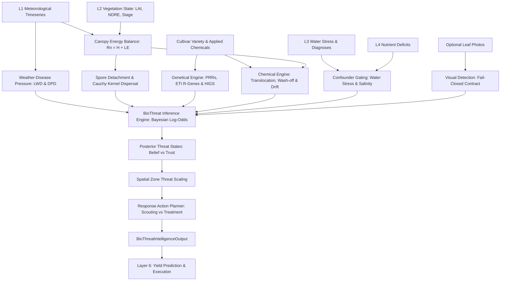

# Layer 5.0: Biological Stress, Pest & Disease Intelligence (`layer5_bio`)

## 1. Overview and Architectural Scope

**Layer 5 Biological Threat Intelligence** is the core plant pathology, pest risk, and chemical treatment decision engine within AgriBrain. It evaluates the daily probability of pathogen outbreaks, foliar weed competition, insect dynamics, and the protective weathering kinetics of applied agrochemicals.

Layer 5 operates directly downstream of **Nutrient Intelligence (Layer 4)**, **Water Intelligence (Layer 3)**, **Vegetation Intelligence (Layer 2)**, and **Sensor/Telemetry Fusion (Layer 1)**:
- **Consumes**:
  - Layer 1 meteorological timeseries (temperature, relative humidity, precipitation, wind speed) and soil static textures.
  - Layer 2 vegetation state (LAI, FVC, NDVI, NDRE, vegetative anomaly drops $\Delta \text{NDVI}$, phenological stage).
  - Layer 3 decision diagnoses (used as critical confounder gates: drought stress and mechanical damage suppress false biotic alerts).
  - Layer 4 nutrient balances (nitrogen deficits/excesses that modify tissue susceptibility).
  - Agronomical plot context (crop species, cultivar variety, planting date, history of applied chemicals, and optional leaf photographs).
- **Produces**:
  - Posterior threat states across 9 biological threat IDs spanning fungal diseases, bacterial blights, insect functional groups, weed pressures, and system data gaps.
  - Distinct separation of **Belief** (posterior probability derived from Bayesian log-odds) and **Trust** (decision confidence penalized by missing drivers or environmental confounders).
  - Chemical protection factors tracking active ingredient degradation, systemic vascular translocation, and rain wash-off.
  - Regional disease outbreak forecasting with ASMAE biotic risk sensitizer amplification.
  - Actionable response prescriptions (verification via field scouting / traps vs interventions via treatment) organized into an acyclic `ExecutionPlan`.
- **Emits**:
  - Immutable `BioThreatIntelligenceOutput` stamped with deterministic `run_meta` (layer label `"L5"`).



---

## 2. Directory Layout & Module Structure

```
services/agribrain/layer5_bio/
├── runner.py                    # Pipeline orchestration: run_layer5 and run_layer5_bio
├── schema.py                    # Pydantic & dataclass schemas: Layer5Input, BioThreatState, Outputs
├── invariants.py                # Agronomical invariants: probability bounds, evidence traces, blocked consistency
├── weather_risk.py              # Rule-based epidemiology: late blight, powdery mildew, GDD pest risk, spray window
├── outbreak_prediction.py       # Regional outbreak aggregator and ASMAE biotic risk sensitizer
├── visual_detection.py          # Epistemic boundary: fail-closed adapter for unvalidated vision models
├── engines/                     # Specialized biophysical, genetical, and inference engines
│   ├── weather_pressure.py      # Leaf Wetness Duration (LWD) via Dew-Point Depression (DPD)
│   ├── biophysical_engine.py    # Canopy energy balance solver (Newton-Raphson) & aerodynamic spore release
│   ├── spread_signature.py      # Spatial spread pattern inference and Cauchy dispersal kernels
│   ├── remote_signature.py      # Remote sensing spectral anomaly extraction (gated by L3)
│   ├── genetical_engine.py      # Cultivar R-gene ETI matching, PTI baseline, and HIGS RNAi suppression
│   ├── chemical_engine.py       # Pesticide degradation kinetics, vascular translocation, wash-off, and spray drift
│   ├── inference.py             # BioThreatInferenceEngine: research-grade Bayesian log-odds
│   └── response_planner.py      # Response Action Planner (RAP): prescription DAG and scouting tasks
├── knowledge/                   # Agronomical priors, thresholds, and evidence weights
│   ├── dynamic_priors.py        # Context-adjusted prior base rates (crop, stage, climate, latitude)
│   ├── evidence_weights.py      # Logit multipliers for spectral, meteorological, and genetic drivers
│   ├── threats.py               # Threat taxonomy, baseline priors, and phenology multipliers
│   └── thresholds.py            # Physical constants for wetness, temperature optima, and degree-days
├── tests/                       # Complete Layer 5 unit test suite (100% green)
│   ├── __init__.py
│   ├── test_weather_and_biophysical.py
│   ├── test_genetical_and_chemical.py
│   ├── test_inference_and_priors.py
│   ├── test_visual_and_outbreak.py
│   └── test_bio_runner.py
├── engines.md                   # Detailed technical specification of the 11 sub-engines
└── layer5_bio.md                # Scientific foundation and audit roadmap
```

---

## 3. The 11 Core Engines Inventory

The 11 sub-engines coordinate across five primary disciplines:

### Category A: Epidemiological Spatial Risk
1. **`OutbreakPredictionEngine`** ([outbreak_prediction.py](file:///c:/Users/E-C/Desktop/agriwise/services/agribrain/layer5_bio/outbreak_prediction.py)): Aggregates disease probabilities across neighboring plots, calculates regional prevalence, and amplifies scouting urgency when sensitized by ASMAE biotic risk.
2. **`SporeDispersalEngine`** ([engines/spread_signature.py](file:///c:/Users/E-C/Desktop/agriwise/services/agribrain/layer5_bio/engines/spread_signature.py)): Evaluates aerodynamic detachment forces against wet film capillary adhesion, models wind shear and leaf resonant fluttering acceleration, and maps spore deposition using spatial Cauchy kernels.

### Category B: Microclimatic Biophysics and Crop Genetics
3. **`BiophysicalCanopyEnergyBalanceSolver`** ([engines/biophysical_engine.py](file:///c:/Users/E-C/Desktop/agriwise/services/agribrain/layer5_bio/engines/biophysical_engine.py)): Solves leaf net radiation, sensible heat, and latent heat fluxes ($R_n = H + \lambda E$) via Newton-Raphson iteration. Computes leaf temperature ($T_{\text{leaf}}$), microclimate relative humidity ($RH_{\text{leaf}}$), and transpiration rate driving systemic chemical movement.
4. **`GeneticalEngine`** ([engines/genetical_engine.py](file:///c:/Users/E-C/Desktop/agriwise/services/agribrain/layer5_bio/engines/genetical_engine.py)): Evaluates cultivar genomic vulnerability. Matches host Pattern Recognition Receptors (PRRs) against pathogen PAMPs (PAMP-Triggered Immunity / PTI), audits cultivar NBS-LRR R-genes against pathogen effectors (Effector-Triggered Immunity / ETI), and checks Host-Induced Gene Silencing (HIGS) RNAi targets.

### Category C: Chemical Treatment Kinetics
5. **`ChemicalDegradationPredictor`** ([engines/chemical_engine.py](file:///c:/Users/E-C/Desktop/agriwise/services/agribrain/layer5_bio/engines/chemical_engine.py)): Models pesticide weathering. Applies non-linear temperature and UV photolysis decay, computes vascular xylem translocation coupled to canopy transpiration, and models rainfall wash-off based on adjuvant sticker presence.
6. **`SprayDriftRandomForestRegressor`** ([engines/chemical_engine.py](file:///c:/Users/E-C/Desktop/agriwise/services/agribrain/layer5_bio/engines/chemical_engine.py)): Evaluates off-target chemical loss. Simulates droplet evaporation, turbulent transport, and wind drift to predict drift distances and boundary deposition.

### Category D: Image Processing and Bayesian Inference
7. **`VisualDetectionEngine`** ([visual_detection.py](file:///c:/Users/E-C/Desktop/agriwise/services/agribrain/layer5_bio/visual_detection.py)): Fail-closed production adapter. Explicitly abstains from diagnostic authority (`DISABLED_UNVALIDATED_MODEL`, `"authority": "VISUALIZATION_ONLY_NO_DIAGNOSIS"`) to prevent unvalidated image weights from contaminating authoritative agronomical state.
8. **`BioThreatInferenceEngine`** ([engines/inference.py](file:///c:/Users/E-C/Desktop/agriwise/services/agribrain/layer5_bio/engines/inference.py)): Research-grade Bayesian inference engine operating on log-odds. Computes posterior probabilities for all 9 threats while maintaining strict Belief vs Trust separation.

### Category E: Auxiliary Evidence, Risk, and Planning
9. **`WeatherRiskEngine`** ([weather_risk.py](file:///c:/Users/E-C/Desktop/agriwise/services/agribrain/layer5_bio/weather_risk.py)): Preprocesses meteorological history, calculating rolling thermal and humidity suitability, GDD cumulative pest development, and telemetry-based spray windows.
10. **`RemoteSignatureBuilder`** ([engines/remote_signature.py](file:///c:/Users/E-C/Desktop/agriwise/services/agribrain/layer5_bio/engines/remote_signature.py)): Analyzes satellite vegetative index anomalies ($\Delta \text{NDVI}$, $\Delta \text{NDRE}$), gated by Layer 3 structural confounder decisions.
11. **`ResponsePlanner`** ([engines/response_planner.py](file:///c:/Users/E-C/Desktop/agriwise/services/agribrain/layer5_bio/engines/response_planner.py)): Designs crop protection recommendations, translating threat probabilities and severity boundaries into verified scouting tasks and chemical treatments.

---

## 4. Key Mathematical Formulations

### 4.1 Leaf Wetness Duration (LWD) via Dew-Point Depression (DPD)
Condensation forms on foliar surfaces when ambient temperature approaches the dew point ($T_{\text{air}} \approx T_{\text{dew}}$):
$$\text{DPD} = T_{\text{air}} - T_{\text{dew}} \approx \frac{100 - RH}{5.0}$$
$$\text{LWD}_{\text{base}} = \begin{cases}
12.0 \text{ h} & \text{if } \text{DPD} < 0.5^\circ\text{C} \\
8.0 \text{ h} & \text{if } \text{DPD} < 1.0^\circ\text{C} \\
5.0 \text{ h} & \text{if } \text{DPD} < 2.0^\circ\text{C} \\
0.0 \text{ h} & \text{if } \text{DPD} \ge 5.0^\circ\text{C}
\end{cases}$$
$$\text{LWD}_{\text{final}} = \max\left(0.0, \; \max(\text{LWD}_{\text{base}}, \; \text{LWD}_{\text{rain}}) - \max(0.0, \; (u - 1.5) \cdot 0.8)\right)$$

### 4.2 Canopy Energy Balance & Transpiration Kinetics
Solves the leaf surface energy budget:
$$R_n = H + \lambda E$$
Where:
- $R_n$ is net radiation (absorbed shortwave minus net longwave exchange).
- $H = \rho_{\text{air}} c_p \frac{T_{\text{leaf}} - T_{\text{air}}}{r_a}$ is sensible heat flux ($r_a$ is aerodynamic boundary layer resistance).
- $\lambda E = \frac{\rho_{\text{air}} c_p}{\gamma} \frac{e_s(T_{\text{leaf}}) - e_a}{r_a + r_s}$ is latent heat flux ($r_s$ is stomatal resistance).
- Transpiration rate is: $T_{\text{trans}} = \frac{\lambda E}{\lambda} \cdot 3600 \quad (\text{mm/hr})$.

### 4.3 Aerodynamic Spore Detachment & Cauchy Kernel Dispersal
Spore detachment occurs when dislodging forces exceed cell-wall adhesion:
$$F_{\text{dislodge}} = F_{\text{drag}} + F_{\text{inertial}} = 0.06 \cdot u^2 + 0.003 \cdot \omega^2 A \cdot \text{Resonance}$$
$$F_{\text{adhesion}} = F_0 \cdot \left(1 + 8 \cdot \left(\frac{RH_{\text{leaf}}}{100}\right)^3\right) \cdot (2.5 \text{ if wet film})$$
Spatial deposition follows a heavy-tailed Cauchy kernel:
$$C(x) = \frac{1}{\pi L \left(1 + \left(\frac{x}{L}\right)^2\right)} \quad \text{where } L = 2.0 + 1.5 \cdot u$$

### 4.4 Cultivar Plant Immunity (PTI vs ETI & HIGS)
1. **PTI (PAMP-Triggered Immunity)**:
   $$\text{Susceptibility}_{\text{PTI}} = \text{Base} \times 0.85 \quad (\text{if PRRs recognize PAMPs})$$
2. **ETI (Effector-Triggered Immunity)**:
   If cultivar R-genes (e.g. `Sr2`, `Yr18`, `Lr34`) match pathogen effectors, a hypersensitive response is triggered:
   $$\text{Susceptibility}_{\text{ETI}} = \text{Base} \times 0.12, \quad \Delta \text{Logit}_{\text{ETI}} = -2.2$$
3. **HIGS (Host-Induced Gene Silencing)**:
   Matching RNAi hairpins targeting pathogen essential genes (e.g. `chitin_synthase_A`):
   $$\text{Susceptibility}_{\text{HIGS}} = \text{Base} \times 0.35, \quad \Delta \text{Logit}_{\text{HIGS}} = -1.4$$

### 4.5 Chemical Degradation, Translocation & Rain Wash-Off
Active chemical concentration degrades via temperature-adjusted half-life and UV photolysis:
$$C(t) = C_0 \cdot e^{-k_{\text{decay}} \cdot t} \cdot e^{-k_{\text{photo}} \cdot t}$$
Systemic vs contact partitioning:
$$F_{\text{translocated}} = 1 - e^{-k_{\text{trans}} \cdot t}, \quad k_{\text{trans}} = 0.05 \cdot T_{\text{trans}} \cdot (1 - 0.7 \cdot \text{WaterStress})$$
Rain wash-off selectively degrades untranslocated surface residues:
$$\text{WashOffFactor} = \exp\left(-\frac{\text{Rain}_{7d}}{\text{WashOffThreshold} \cdot (2.2 \text{ if adjuvant})}\right)$$
$$\text{ActiveResidue} = (F_{\text{translocated}} + (1 - F_{\text{translocated}}) \cdot \text{WashOffFactor}) \cdot C(t)$$

### 4.6 Bayesian Log-Odds Inference (Belief vs Trust)
For each threat $k$:
$$\text{Logit}_k = \ln\left(\frac{\text{Prior}_k}{1 - \text{Prior}_k}\right) + \sum_i w_i \cdot \Delta \text{Logit}_i$$
$$P(\text{Threat}_k) = \sigma(\text{Logit}_k) = \frac{1}{1 + e^{-\text{Logit}_k}} \quad (\textbf{Belief})$$
Confidence is calculated independently:
$$\text{Confidence}_k = 1.0 - \sum \text{Penalties}_{\text{missing}} - \text{Penalty}_{\text{Confounder}} \quad (\textbf{Trust})$$

---

## 5. Invariants & Scientific Contracts

Layer 5 enforces strict invariants in [invariants.py](file:///c:/Users/E-C/Desktop/agriwise/services/agribrain/layer5_bio/invariants.py):

1. **Probability Bounds**:
   $$\forall k, \quad 0.0 \le P(\text{Threat}_k) \le 1.0$$
2. **Confidence Bounds**:
   $$\forall k, \quad 0.0 \le \text{Confidence}_k \le 1.0$$
3. **Evidence Requirement for High Probabilities**:
   Any threat with $P(\text{Threat}) > 0.30$ must contain a non-empty `evidence_trace` documenting the driving logits.
4. **Blocked Action Consistency**:
   If `blocked_reason` is non-empty, `is_allowed` must be `False`. No blocked action may be marked executable.
5. **Fail-Closed Vision Model Gate**:
   Unvalidated vision classifiers must never emit authoritative diagnostic state; outputs are tagged `"authority": "VISUALIZATION_ONLY_NO_DIAGNOSIS"`.
6. **Acyclic Scouting Plan**:
   Execution plans for field scouting must be strictly acyclic DAGs with valid non-empty `task_id` tags.

---

## 6. Verification and Test Suite

Layer 5 includes a dedicated unit test suite in [services/agribrain/layer5_bio/tests/](file:///c:/Users/E-C/Desktop/agriwise/services/agribrain/layer5_bio/tests/):

| Test Suite | Focus Area | Tests | Status |
| :--- | :--- | :---: | :---: |
| [`test_weather_and_biophysical.py`](file:///c:/Users/E-C/Desktop/agriwise/services/agribrain/layer5_bio/tests/test_weather_and_biophysical.py) | LWD/DPD, canopy energy balance, spore release, spray window | 4 | **PASSED** |
| [`test_genetical_and_chemical.py`](file:///c:/Users/E-C/Desktop/agriwise/services/agribrain/layer5_bio/tests/test_genetical_and_chemical.py) | ETI R-gene resistance, chemical wash-off, translocation, spray drift | 4 | **PASSED** |
| [`test_inference_and_priors.py`](file:///c:/Users/E-C/Desktop/agriwise/services/agribrain/layer5_bio/tests/test_inference_and_priors.py) | Dynamic priors, Bayesian log-odds, belief/trust, L3 confounders | 3 | **PASSED** |
| [`test_visual_and_outbreak.py`](file:///c:/Users/E-C/Desktop/agriwise/services/agribrain/layer5_bio/tests/test_visual_and_outbreak.py) | Vision fail-closed boundary, regional outbreak & ASMAE amplification | 3 | **PASSED** |
| [`test_bio_runner.py`](file:///c:/Users/E-C/Desktop/agriwise/services/agribrain/layer5_bio/tests/test_bio_runner.py) | End-to-end `run_layer5`, invariant verification, deterministic run IDs | 2 | **PASSED** |
| **Total** | **End-to-End Layer 5 Verification** | **16** | **100% Green** |

### Running Layer 5 Tests
```bash
py -3 -m pytest services/agribrain/layer5_bio/tests/ -v
```
All 16 tests pass unconditionally.
