# Layer 5: Pathogen Risk, CNN Visual Detection, and Spore Dispersal

Layer 5 acts as the biological threat, pest risk, and plant pathology decision system within the AgriBrain workspace. The system models the daily probability of pathogen outbreaks, foliar weed pressures, insect dynamics, and the protective weathering kinetics of chemical treatments.

By integrating weather telemetry, host genetic susceptibility, satellite anomaly signals, and leaf photography, Layer 5 runs a pure-NumPy 3-layer Convolutional Neural Network (CNN) for diagnostic visual classification, a Multi-Head Cross-Attention network to map cultivar genomic vulnerability, and a Bayesian log-odds inference engine to compute posterior threat probabilities and generate spatial crop-protection plans.

---

## 1. Core Engine Inventory (Exact Count: 11)

Layer 5 coordinates exactly **11 specialized core engines** split across five primary disciplines:

### Category A: Epidemiological Spatial Risk
1. **OutbreakPredictionEngine** (`layer5_bio/outbreak_prediction.py`): Models spatial disease dispersal risk, evaluating geographical threat containment and regional outbreak progress.
2. **SporeDispersalEngine** (`layer5_bio/engines/spread_signature.py`): Simulates atmospheric spore release and spatial transport. It models aerodynamic drag forces overcoming wet surface capillary adhesion, incorporates leaf resonant fluttering acceleration under wind shear, and maps localized deposition using spatial Cauchy dispersal kernels.

### Category B: Microclimatic Biophysics and Crop Genetics
3. **BiophysicalCanopyEnergyBalanceSolver** (`layer5_bio/engines/biophysical_engine.py`): Solves the leaf energy balance equation ($R_n = H + \lambda E$) using an iterative Newton-Raphson solver. It estimates canopy leaf temperature, transpiration rates, microclimate relative humidity offsets, leaf dew points, and Leaf Wetness Duration (LWD), which are the physical drivers for spore germination.
4. **MultiHeadAttentionGeneticsClassifier** (`layer5_bio/engines/genetical_engine.py`): Maps host-pathogen genetic susceptibility. It represents host Pattern Recognition Receptors (PRRs), cultivar NBS-LRR resistance genes (R-genes), pathogen PAMPs, and effectors as 4D semantic embedding tokens. It simulates a Multi-Head Cross-Attention neural network to evaluate ligand-receptor binding specificity, incorporating Host-Induced Gene Silencing (HIGS) RNAi target suppression.

### Category C: Chemical Treatment Kinetics
5. **ChemicalDegradationPredictor** (`layer5_bio/engines/chemical_engine.py`): Models apoplastic (xylem) systemic translocation and surface contact pesticide weathering. It implements a non-linear regression half-life model driven by rolling temperatures and UV photolysis, coupled with cumulative rain wash-off decay limits.
6. **SprayDriftRandomForestRegressor** (`layer5_bio/engines/chemical_engine.py`): Evaluates off-target chemical loss. It simulates a 3-tree Random Forest regressor (modeling physical trajectories, droplet evaporative shrinkage, and turbulent transport) to predict drift distances and off-target deposition.

### Category D: Image Processing and Bayesian Inference
7. **VisualDetectionEngine** (`layer5_bio/visual_detection.py`): Executes a 3-layer pure-NumPy CNN forward pass to diagnose leaf symptoms from base64 uploaded photographs, outputting classification probabilities and fusing visual ground-truth evidence into active threat states.
8. **BioThreatInferenceEngine** (`layer5_bio/engines/inference.py`): Calculates the posterior probability of deficiency and infection. It executes a Bayesian log-odds update trace across all threats, incorporating dynamic base priors, remote sensing anomaly vectors, microclimatic pressures, and genetical/chemical evidence.

### Category E: Auxiliary Evidence, Risk, and Planning
9. **WeatherRiskEngine** (`layer5_bio/weather_risk.py`): Preprocesses raw meteorological inputs, computing multi-day rolling temperature averages, relative humidity curves, and cumulative rainfall to construct weather pressure indexes.
10. **RemoteSignatureBuilder** (`layer5_bio/engines/remote_signature.py`): Analyzes satellite spectral anomalies (vegetative index drops, greenness velocity, within-field spatial coefficient of variation) to construct active biotic stress signature indicators.
11. **ResponsePlanner** (`layer5_bio/engines/response_planner.py`): Designs crop protection recommendations, translating threat probabilities and severity boundaries into pesticide dosages and cultural scheduling tasks.

---

## 2. Internal Wiring & Processing Sequence

The execution sequence represents a 21-step daily loop that processes meteorological data, satellite anomalies, cultivar genetics, leaf imagery, and chemical decay kinetics to assess biological stress and optimize treatment application schedules.

```mermaid
graph TD
    classDef engine fill:#1f2937,stroke:#3b82f6,stroke-width:2px,color:#fff;
    classDef input fill:#111827,stroke:#10b981,stroke-width:2px,color:#fff;
    classDef output fill:#111827,stroke:#ec4899,stroke-width:2px,color:#fff;

    In_Weather[Raw Meteorological Timeseries] -->|Step 1| Assembler[L5 Input Context Assembler]
    In_Weather -->|Step 2| WRE[1. Weather Risk Engine]:::engine
    WRE -->|Step 3| Biophys[2. Biophysical Canopy Solver]:::engine
    Biophys -->|Step 4| SporeDet[3. Spore Release Solver]:::engine
    SporeDet -->|Step 5| SporeDisp[4. Cauchy Spore Dispersal]:::engine
    
    SporeDisp -->|Step 6| RSB[5. Remote Signature Builder]:::engine
    RSB -->|Step 7| Cultivar[6. Cultivar PRR Profiling]:::engine
    Cultivar -->|Step 8| NBSLRR[7. NBS-LRR ETI Gene Match]:::engine
    
    NBSLRR -->|Step 9| HIGS[8. HIGS RNAi Evaluation]:::engine
    HIGS -->|Step 10| Attention[9. Multi-Head Cross-Attention]:::engine
    Attention -->|Step 11| Decay[10. Chemical Half-Life Solver]:::engine
    Decay -->|Step 12| Trans[11. Vascular Xylem Translocation]:::engine
    Trans -->|Step 13| Washoff[12. Wash-Off & Residue Decay]:::engine
    
    Washoff -->|Step 14| Drift[13. Random Forest Spray Drift]:::engine
    Drift -->|Step 15| Priors[14. Dynamic Prior Base Rates]:::engine
    Priors -->|Step 16| ImgIn[15. Base64 Photo Decoder]:::engine
    
    ImgIn -->|Step 17| CNN[16. NumPy CNN Forward Pass]:::engine
    CNN -->|Step 18| Inference[17. Bayesian log-odds Inference]:::engine
    Inference -->|Step 19| Spatial[18. Spatial Zone Threat Scaling]:::engine
    
    Spatial -->|Step 20| Planner[19. Response Dosage Planner]:::engine
    Planner -->|Step 21| Gate[20. Split Application & Compliance]:::engine
    Gate --> Out[21. BioThreatIntelligenceOutput]:::output
```



### The 21-Step Daily Execution Loop

1. **Meteorological Input Loading**: Processes historical timeseries and short-term weather forecasts, extracting temperature, humidity, wind, and rainfall.
2. **Climate Risk Indexing**: Computes multi-day rolling meteorological averages to characterize disease environmental suitability.
3. **Canopy Leaf Energy Balance Solver**: Solves the Net Radiation, Sensible Heat, and Latent Heat energy budget, determining canopy temperature ($T_{leaf}$), leaf humidity ($RH_{leaf}$), and transpiration.
4. **Aerodynamic Spore Detachment Modeling**: Calculates spore detachment forces, balancing wind drag and leaf resonant fluttering acceleration against capillary surface tension adhesion.
5. **Spatial Spore Dispersal Interpolation**: Applies a spatial Cauchy kernel centered on active disease hotspots to estimate the probability of spore deposition in adjacent zones.
6. **Spectral Anomaly Extraction**: Processes Sentinel-2 imagery, analyzing temporal vegetative index drops ($\Delta \text{NDVI}$, $\Delta \text{NDRE}$) to construct active biotic stress signature indicators.
7. **Cultivar PRR Baseline Profiling**: Evaluates the crop variety's Pattern Recognition Receptors (PRRs) to establish baseline PAMP-Triggered Immunity (PTI).
8. **NBS-LRR R-Gene Effector Auditing**: Cross-references cultivar NBS-LRR R-genes against pathogen effectors to identify active Effector-Triggered Immunity (ETI) hypersensitive responses.
9. **HIGS RNAi Target Mapping**: Evaluates Host-Induced Gene Silencing (HIGS) pathways, checking for matching double-stranded RNA hairpins that target essential pathogen genes.
10. **Multi-Head Cross-Attention Susceptibility Prediction**: Projects genomic host and pathogen tokens into 4D semantic embedding spaces, running a cross-attention pass to predict genomic vulnerability.
11. **Chemical Treatment Half-Life Weathering Adjustment**: Simulates chemical weathering, adjusting base pesticide half-lives as a function of temperature and photolytic solar radiation.
12. **Systemic Xylem Translocation Modeling**: Models systemic pesticide transport, coupling active vascular translocation kinetics with the biophysical canopy transpiration rate.
13. **Surface Residue Wash-Off Simulation**: Evaluates rain wash-off kinetics, calculating contact residue wash-off based on cumulative precipitation and adjuvant stickers.
14. **Pesticide Spray Drift Projection**: Runs a 3-tree Random Forest regressor modeling physical trajectories, droplet evaporative shrinkage, and turbulent transport to predict spray drift distances.
15. **Dynamic Priors Base Rate Calculation**: Computes dynamic base rates as a function of crop species, latitude, growth stages, and rolling climate indicators.
16. **Diagnostic Photographic Decoding**: Parses uploaded leaf photograph data, transforming base64 strings into normalized color matrices.
17. **Pure-NumPy CNN Inference**: Processes leaf images through the 3-layer CNN (convolution, ReLU activation, max-pooling, dense classification), outputting classification probabilities.
18. **Bayesian Log-Odds BioThreat Diagnosis**: Integrates prior base rates, remote sensing anomalies, biophysical Leaf Wetness Duration (LWD) metrics, genetics, chemical residues, and visual CNN outputs using a Bayesian log-odds update.
19. **Spatial Zone Threat Scaling**: Scales threat probabilities across spatial zones, evaluating how dense canopy microclimates and soil moisture stress affect localized vulnerability.
20. **Actionable Response Planning**: Synthesizes the computed threat probabilities and severity thresholds, selecting active chemical ingredients and dosage recommendations.
21. **Scouting Scheduling & Compliance Validation**: Groups recommendations into an ExecutionPlan, schedules field validation tasks, and audits dosage limits to ensure regulatory compliance.

---

## 3. Mathematical & Biophysical Formulations

To ensure biophysical accuracy and predictive capability, Layer 5 implements a suite of peer-reviewed mathematical formulations, detailed below.

### 1. Leaf-Level Canopy Energy Balance and Transpiration Solver
Canopy microclimate relative humidity ($RH_{leaf}$) and Leaf Wetness Duration (LWD) are the primary drivers of fungal spore germination. The engine iteratively solves the leaf-level energy balance equation (Monteith & Unsworth, 2013) using a Newton-Raphson scheme:

$$R_n = H + \lambda E$$

Where:
* $R_n$ is the net radiation flux density ($\text{W/m}^2$), representing the net shortwave solar interception shaded by Leaf Area Index ($\text{LAI}$) minus net longwave emission:
  $$R_n = (1 - \alpha) \cdot R_{solar} \cdot e^{-k \cdot \text{LAI}} - \epsilon \cdot \sigma \cdot \left[ T_{leaf}^4 - T_{air}^4 \cdot (0.56 + 0.08 \cdot \sqrt{e_a}) \right]$$
* $H$ is the sensible heat flux density ($\text{W/m}^2$), modeling convective transfer to the boundary layer:
  $$H = \frac{\rho \cdot c_p \cdot (T_{leaf} - T_{air})}{r_a}$$
  Where the boundary layer resistance $r_a$ ($\text{s/m}$) scales with wind speed $u$: $r_a = 200.0 / \sqrt{u}$.
* $\lambda E$ is the latent heat flux density ($\text{W/m}^2$), representing transpirational water vapor release:
  $$\lambda E = \left(\frac{\rho \cdot c_p}{\gamma}\right) \cdot \frac{e_s(T_{leaf}) - e_a}{r_a + r_s}$$
  Where $e_s(T_{leaf})$ is the saturation vapor pressure at leaf temperature, $e_a$ is the ambient vapor pressure, $\gamma$ is the psychrometric constant, and $r_s$ ($\text{s/m}$) is the stomatal resistance, scaled by water stress probability ($P_{ws}$):
  $$r_s = \frac{r_{s, min}}{1 - 0.95 \cdot P_{ws}}$$

### 2. Aerodynamic Spore Detachment and Fluttering Mechanics
Fungal spore detachment is modeled as a force balance between aerodynamic dislodgement forces and cell wall capillary adhesion (Aylor, 1990; Grace, 1977). Spores are released when aerodynamic and mechanical forces exceed adhesion:

$$\text{Logit}(P_{release}) = 2.0 \cdot \left[ F_{drag} + F_{inertial} - F_{adhesion} \right]$$

Where:
* $F_{adhesion}$ is the capillary adhesion force, which increases non-linearly with leaf relative humidity ($RH_{leaf}$) due to surface tension and sticky mucilages:
  $$F_{adhesion} = F_{adh, ref} \cdot \left[ 1.0 + 8.0 \cdot \left( \frac{RH_{leaf}}{100} \right)^3 \right]$$
* $F_{drag}$ is the aerodynamic drag force ($\text{N}$), scaling with the square of the wind speed ($u$):
  $$F_{drag} = \alpha_d \cdot u^2$$
* $F_{inertial}$ is the mechanical inertial force ($\text{N}$) created by wind-induced leaf resonant fluttering:
  $$F_{inertial} = m_{spore} \cdot a_{flutter}$$
  The leaf fluttering acceleration ($a_{flutter}$) is modeled from wind shear and canopy shading:
  $$a_{flutter} = \omega^2 \cdot A_{flutter} = (2\pi \cdot f)^2 \cdot \left[ \frac{\beta_{flutter} \cdot u^{1.5}}{\sqrt{\text{LAI}}} \right]$$
  Where $f$ is the resonant frequency (typically $2.5 \cdot u$, up to $15 \text{ Hz}$).

### 3. Spatial Spore Dispersal Cauchy Kernel
Once detached, the downwind distribution and localized deposition of spores are modeled using a spatial Cauchy kernel (Mundt, 2020), which captures long-tail dispersal better than Gaussian models:

$$I(d) = \frac{I_0}{\pi \cdot L \cdot \left[ 1 + \left( \frac{d}{L} \right)^2 \right]}$$

Where:
* $I(d)$ is the predicted spore deposition density at distance $d$ ($\text{meters}$) downwind from the source center.
* $I_0$ is the total spore source strength at the center.
* $L$ is the characteristic length scale parameter ($\text{meters}$), which scales with wind speed: $L = 2.0 + 1.5 \cdot u$.

### 4. Pesticide Surface Degradation, Systemic Translocation, and Wash-Off
The active chemical residue concentration ($C_t$) on and within leaf tissues is simulated using systemic translocation and photolytic/precipitation decay kinetics (Bromilow & Chamberlain, 1995; Katagi, 2004):

$$C_t = \left[ F_{systemic} + (1.0 - F_{systemic}) \cdot \Psi_{wash} \right] \cdot e^{-k_{weather} \cdot t}$$

Where:
* $F_{systemic}$ is the systemic translocated fraction, representing the pesticide absorbed into vascular tissues and protected from rain wash-off. Absorption is modeled as a first-order rate process driven by canopy transpiration:
  $$F_{systemic} = 1.0 - e^{-k_{trans} \cdot t}$$
  Where the translocation rate constant $k_{trans} = 0.05 \cdot T_{transpiration} \cdot (1 - 0.7 \cdot P_{ws})$.
* $\Psi_{wash}$ is the wash-off factor, representing the loss of contact surface residues during rain events:
  $$\Psi_{wash} = e^{-\frac{P_{rain}}{\theta_{wash}}}$$
  Where $P_{rain}$ is cumulative rainfall ($\text{mm}$), and $\theta_{wash}$ is the wash-off rain-fastness threshold, which increases with adjuvant presence.
* $k_{weather}$ is the environmental degradation rate constant, combining microbial hydrolysis and UV solar photolysis:
  $$k_{weather} = \frac{\ln(2)}{HalfLife_{\text{ref}}} \cdot \Phi_{\text{env}} + k_{photo} \cdot e^{-0.4 \cdot \text{LAI}}$$
  Where $\Phi_{\text{env}}$ is the environmental multiplier, and $k_{photo}$ is the photolysis sensitivity coefficient.

### 5. Multi-Head Cross-Attention Cultivar Genomics Classifier
Genetic susceptibility is modeled using a Multi-Head Cross-Attention network (Vaswani et al., 2017). The host plant's PRR and R-gene tokens are query vectors ($Q$), while the pathogen's PAMP and effector tokens are keys ($K$) and values ($V$). Susceptibility is computed from ligand-receptor binding affinity:

$$\text{Attention}(Q, K, V) = \text{Softmax}\left( \frac{Q \cdot K^T}{\sqrt{d_k}} \right) \cdot V$$

Host query tokens ($q \in Q$) and pathogen key tokens ($k \in K$) are mapped to 4D semantic embeddings ($d_k = 4$):

$$\text{Score}(q, k) = \frac{\sum_{i=1}^4 q_i \cdot k_i}{\sqrt{4}}$$

The attention weights ($A$) are normalized via Softmax, and the outputs are combined through a feed-forward network to yield the genetic susceptibility index:

$$Susceptibility = \sigma\left( \mathbf{w}_2^T \cdot \text{ReLU}\left( \mathbf{W}_1 \cdot \text{Mean}(\text{Attention}) + \mathbf{b}_1 \right) + b_2 \right)$$

Active Effector-Triggered Immunity (ETI) hypersensitive responses or HIGS RNAi target matching reduce susceptibility:
* **Hypersensitive response (ETI match)**: $Susceptibility \times 0.12$
* **Host-Induced Gene Silencing (HIGS active)**: $Susceptibility \times 0.35$

### 6. Pure-NumPy 3-Layer Convolutional Neural Network
Leaf photographic diagnostic classification is performed using a pure-NumPy 3-layer CNN forward pass (LeCun et al., 1998) to evaluate input imagery:

* **Layer 1: Convolution + ReLU**:
  $$Conv(x, y, f) = \text{ReLU}\left( \sum_{c=1}^3 \sum_{i=-1}^1 \sum_{j=-1}^1 \mathbf{X}(x+i, y+j, c) \cdot \mathbf{W}_{conv}(i+1, j+1, c, f) + b_{conv}(f) \right)$$
* **Layer 2: Max-Pooling 2D (2x2 kernel, stride 2)**:
  $$\mathbf{P}(x, y, f) = \max_{i \in \{0,1\}} \max_{j \in \{0,1\}} Conv(2x+i, 2y+j, f)$$
* **Layer 3: Dense Softmax Classification**:
  $$P(Class = k) = \text{Softmax}(\mathbf{z})_k = \frac{e^{z_k}}{\sum_{j} e^{z_j}} \quad \text{where } \mathbf{z} = \mathbf{W}_{dense} \cdot \text{Flatten}(\mathbf{P}) + \mathbf{b}_{dense}$$

### 7. Bayesian Log-Odds BioThreat Diagnosis
The posterior probability of infection or pest infestation is calculated by combining multiple evidence streams in log-odds space, updating the prior base rate using additive logit increments:

$$\text{Logit}(P_{posterior}) = \text{Logit}(P_{prior}) + \sum_{i=1}^n w_i \cdot \Delta \text{Logit}_i$$

Where:
* $P_{prior}$ is the dynamic prior base rate, calculated from the crop species, phenological stage susceptibility, and climate conditions:
  $$P_{prior} = f(Crop, GrowthStage, T_{7d}, Rain_{7d})$$
* $\Delta \text{Logit}_i$ is the log-odds change contribution from evidence source $i$ (spectral anomaly, LWD microclimatic index, host genetics, active pesticide residue, leaf photo CNN classification).
* $w_i$ is the source reliability weight factor.
* The posterior probability is recovered using the logistic function:
  $$P_{posterior} = \frac{1}{1 + e^{-\text{Logit}(P_{posterior})}}$$

---

## 4. Programmatic Data Contract Schemas

To maintain architectural integrity and support automated integration testing, all Layer 5 engines communicate via explicit, strongly-typed Pydantic and dataclass structures.

### 1. `BioThreatIntelligenceOutput` (The Final Layer 5 Delivery)
This schema represents the complete output compiled by Layer 5 and routed to Layer 6 and Layer 10.

```python
@dataclass
class BioThreatIntelligenceOutput:
    run_meta: RunMeta
    
    # Active threat states and recommendations
    threat_states: Dict[str, BioThreatState]
    recommendations: List[BioRecommendation]
    execution_plan: Optional[ExecutionPlan]
    
    # Quality & diagnostic metrics
    quality_metrics: QualityMetricsL5
    audit: AuditSnapshot
    
    # Spatial & Biophysical extensions
    zone_metrics: Dict[str, Any] = field(default_factory=dict)
    leaf_wetness_hours: Optional[float] = None
```

### 2. `BioThreatState` (Decoupled Belief and Confidence)
Represents the dynamic status of a biological threat, decoupling probability of infection/pest presence from data confidence.

```python
@dataclass
class BioThreatState:
    threat_id: ThreatId
    threat_class: ThreatClass
    
    # Probabilistic and confidence bounds
    probability: float         # Belief from logits only [0.0, 1.0]
    confidence: float          # Trust from data completeness [0.0, 1.0]
    severity: Severity         # LOW, MODERATE, HIGH, CRITICAL
    
    # Traceability & evidence
    drivers_used: List[Driver]
    evidence_trace: List[EvidenceLogit]
    
    # Spatial dispersion properties
    spread_pattern: SpreadPattern # UNIFORM, PATCHY, EDGE_DRIVEN, RANDOM
    confounders: List[Confounder]  # WATER_STRESS, WATERLOGGING, N_DEFICIENCY
    notes: str = ""
```

### 3. `BioRecommendation` (Actionable Protection Prescription)
Represents a specific, actionable protection recommendation, including scheduling and product limitations.

```python
@dataclass(frozen=True)
class BioRecommendation:
    action_id: ActionId         # VERIFY_SCOUT, MONITOR, INTERVENE_TREAT
    threat_id: ThreatId
    
    # Regulatory & risk gates
    is_allowed: bool
    blocked_reason: List[str]
    risk_if_wrong: RiskIfWrong
    
    # Delivery constraints
    timing_window: Dict[str, str] # {"start_date": "YYYY-MM-DD", "end_date": "YYYY-MM-DD"}
    method: str                   # e.g., "scout", "photo", "trap", "treat_category"
    
    # DAG task dependencies
    depends_on: List[str] = field(default_factory=list)
```

---

## 5. Academic References

The mathematical formulations and biophysical models implemented in Layer 5 are based on the following peer-reviewed literature:

* **Monteith-Unsworth Canopy Energy Balance**: Monteith, J. L., & Unsworth, M. H. (2013). *Principles of Environmental Physics*. Academic Press.
* **Campbell-Norman Stomatal Resistance**: Campbell, G. S., & Norman, J. M. (1998). *An Introduction to Environmental Biophysics*. Springer.
* **Aylor Spore Aerodynamics**: Aylor, D. E. (1990). *The role of wind in dispersing fungal spores*. Phytopathology, 80(3), 277-283.
* **Grace Leaf Resonant Fluttering**: Grace, J. (1977). *Plant Response to Wind*. Academic Press.
* **Mundt Spore Dispersal Kernel**: Mundt, C. C. (2020). *Pyramiding genes for disease resistance*. Annual Review of Phytopathology, 58, 25-45.
* **Pesticide Translocation Dynamics**: Bromilow, R. H., & Chamberlain, K. (1995). *Principles governing uptake and translocation of xenobiotics by plants*. Plant Contamination, 37-68.
* **Katagi Surface Photolysis**: Katagi, T. (2004). *Photodegradation of pesticides on plant and soil surfaces*. Reviews of Environmental Contamination and Toxicology, 182, 1-189.
* **Vaswani Multi-Head Attention**: Vaswani, A., et al. (2017). *Attention is all you need*. Advances in Neural Information Processing Systems, 30.
* **LeCun Convolutional Neural Networks**: LeCun, Y., Bottou, L., Bengio, Y., & Haffner, P. (1998). *Gradient-based learning applied to document recognition*. Proceedings of the IEEE, 86(11), 2278-2324.
* **Jones-Dangl Plant Immunity Zigzag Model**: Jones, J. D., & Dangl, J. L. (2006). *The plant immune system*. Nature, 444(7117), 323-329.
* **Spray Drift Modeling**: Holterman, H. J., van de Zande, J. C., Huijsmans, J. F. M., & de Jong, A. (1997). *Method for calculate spray drift*. Journal of Agricultural Engineering Research, 67(4), 255-265.
