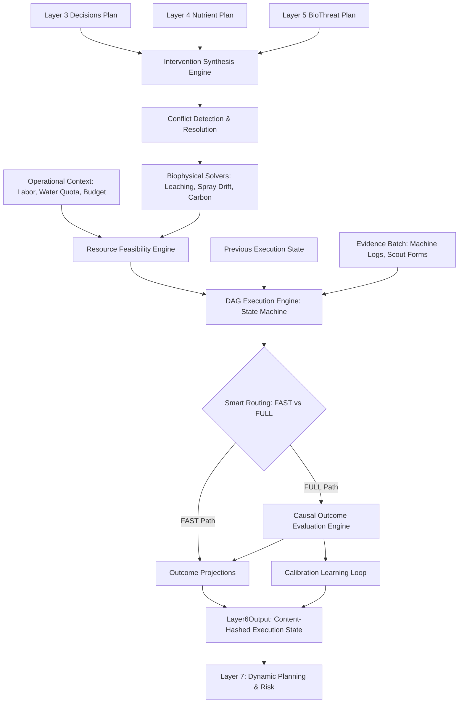

# Layer 6.0: Strategic Execution & Operational Dispatch (`layer6_exec`)

## 1. Overview and Architectural Scope

**Layer 6 Execution Engine** is the operational synthesis, constraint gating, and causal feedback engine of the AgriBrain platform. It translates diagnostic and prescriptive intelligence from **Decisions (Layer 3)**, **Nutrients (Layer 4)**, and **Biological Stress (Layer 5)** into a prioritized, conflict-free, operationally feasible execution DAG.

Layer 6 operates under strict physical and governance boundaries:
- **Consumes**:
  - Upstream plan task nodes from Layer 3 (irrigation/drainage), Layer 4 (fertilizer applications), and Layer 5 (scouting/treatment).
  - Real-world operational context (equipment fleet, workforce labor hours, water quota limits, chemical expenditure budgets, field polygon boundaries).
  - Incoming asynchronous evidence batches (machine logs, sensor pushes, scout observations, photos).
  - Previous DAG execution state.
- **Produces**:
  - Gated intervention portfolio categorized with letter feasibility grades (`A`, `B`, `C`, `D`, `F`) and explicit blocked reasons.
  - Resolved cross-layer conflict logs with transparent rationale (e.g. spray postponed due to wind or impending rain).
  - Updated acyclic DAG execution state (`ExecutionState`).
  - Advanced biophysical assessments: 1D Crank-Nicolson nitrogen leaching fraction, 3D Lagrangian spray drift fraction, and 5-pool RothC soil carbon sequestration balance.
  - Causal outcome evaluation reports (`OutcomeMetric`) assessing vegetative recovery post-intervention.
  - System calibration proposals (`CalibrationProposal`) closing the learning loop.
- **Emits**:
  - Immutable `Layer6Output` with deterministic content hash and run ID (`L6-<hash>`).



---

## 2. Directory Layout & Module Structure

```
services/agribrain/layer6_exec/
├── runner.py                     # Pipeline coordinator: run_layer6 and run_layer6_exec
├── schema.py                     # Pydantic & dataclass contracts: Layer6Input, Layer6Output, DAG
├── invariants.py                 # 13 production invariant enforcement checks
├── irrigation_bridge.py          # Bridge to irrigation runtime controller
├── engines/                      # Scientific and algorithmic sub-engines
│   ├── intervention_synthesis.py # Cross-layer intelligence fusion & conflict resolution
│   ├── resource_feasibility.py   # Operational resource gating & feasibility grading (A-F)
│   ├── nitrogen_leaching.py      # 1D Crank-Nicolson Advection-Dispersion solute transport solver
│   ├── vpd_spray_window.py       # 3D Lagrangian droplet trajectory, drift & evaporation solver
│   ├── carbon_sequestration.py   # 5-pool RothC soil carbon model integrated via RK4
│   └── calibration.py            # Learning loop parameter calibration proposals
├── execution/                    # DAG State Machine
│   └── dag_runner.py             # Topological dependency resolution & evidence-driven completion
├── evidence/                     # Evidence normalization & ingestion
│   └── normalizer.py             # Normalizes raw inputs into immutable NormalizedEvidence
├── governance/                   # Safety and policy audits
│   └── calibration.py            # Calibration governance
├── knowledge/                    # Agronomical catalogs and rules
│   └── intervention_catalog.py   # Intervention templates, cost of inaction, conflict rules
├── outcomes/                     # Causal evaluation
│   └── metrics.py                # Pre/post intervention NDVI recovery & growth velocity
├── tests/                        # Layer 6 Execution test suite (100% green)
│   ├── __init__.py
│   ├── test_biophysical_solvers.py
│   ├── test_intervention_and_feasibility.py
│   ├── test_dag_and_outcomes.py
│   └── test_exec_runner_and_invariants.py
├── engines.md                    # Detailed specification of the execution sub-engines
└── layer6_exec.md                # Architectural audit overview
```

---

## 3. Core Engines & Scientific Solvers

### 3.1 Intervention Synthesis Engine
Synthesizes candidate actions across all upstream layers:
- Extracts actions from Layer 3 (`decision_l3.execution_plan`), Layer 4 (`nutrient_l4.verification_plan`), and Layer 5 (`bio_l5.execution_plan`).
- Calculates utility score:
  $$\text{Utility} = \frac{\text{Impact} \cdot \text{Urgency} \cdot \text{Confidence}}{1 + \text{NormalizedCost}}$$
- Applies dominance pruning: if candidate $A$ subsumes candidate $B$ in the same spatial zone and domain, $B$ is suppressed with a documented conflict record.

### 3.2 Resource Feasibility Engine
Evaluates candidates against operational resource limits:
- **Water Quota**: Cumulative irrigation volume demand versus remaining allocation.
- **Budget**: Chemical and fertilizer purchase cost versus remaining operating budget.
- **Labor**: Estimated operator task hours versus available farm workforce hours.
- **Machinery**: Equipment availability in scheduled execution window.
- Assigns letter grades:
  - `Grade A`: Full resource feasibility ($\ge 0.90$).
  - `Grade B`: Minor operational constraint ($\ge 0.70$).
  - `Grade C`: Constrained, secondary intervention ($\ge 0.50$).
  - `Grade D`: Severe constraints, requires manual verification ($\ge 0.30$).
  - `Grade F`: Blocked by hard operational constraints ($< 0.30$).

### 3.3 1D Solute Transport Crank-Nicolson Solver (`nitrogen_leaching.py`)
Solves the Advection-Dispersion Equation (ADE) across 10 vertical soil layers ($dz = 0.1\text{ m}$):
$$\frac{\partial C}{\partial t} = D \frac{\partial^2 C}{\partial z^2} - v \frac{\partial C}{\partial z} - S(z)$$
Where:
- $v = \frac{q}{\theta}$ is pore water velocity derived from net infiltration flux and root water uptake.
- $D = D_0 + \alpha |v|$ is hydrodynamic dispersion.
- $S(z)$ is crop root nutrient uptake sink.
- Discretized using the implicit Crank-Nicolson finite-difference scheme and solved stably via the tridiagonal Thomas algorithm ($O(N)$).

### 3.4 3D Lagrangian Spray Droplet Evaporation & Drift Solver (`vpd_spray_window.py`)
Simulates droplet trajectories ($100\mu\text{m} \le D \le 400\mu\text{m}$) released from spray nozzles:
$$m \frac{d^2 \mathbf{x}}{dt^2} = \mathbf{F}_{\text{drag}} + \mathbf{F}_{\text{gravity}} + \mathbf{F}_{\text{buoyancy}}$$
Under a logarithmic atmospheric boundary layer wind velocity profile:
$$u(z) = \frac{u_*}{\kappa} \ln\left(\frac{z}{z_0}\right)$$
Coupled to droplet surface evaporation driven by Vapor Pressure Deficit (VPD):
$$\frac{d(D^2)}{dt} = -\lambda_{\text{evap}} \cdot \text{VPD} \quad \text{where } \text{VPD} = e_s(T) - e_a$$

### 3.5 5-Pool RothC Soil Carbon RK4 Simulator (`carbon_sequestration.py`)
Models soil organic carbon turnover across five discrete pools:
$$\mathbf{C} = \begin{bmatrix} \text{DPM} & \text{RPM} & \text{BIO} & \text{HUM} & \text{IOM} \end{bmatrix}^T$$
- $\text{DPM}$: Decomposable Plant Material
- $\text{RPM}$: Resistant Plant Material
- $\text{BIO}$: Microbial Biomass
- $\text{HUM}$: Humified Organic Matter
- $\text{IOM}$: Inert Organic Matter
The coupled ordinary differential equations are integrated over the 7-day execution window using a 4th-Order Runge-Kutta (RK4) routine:
$$\frac{d\mathbf{C}}{dt} = \mathbf{A} \cdot \mathbf{k} \cdot \rho_{\text{env}} \cdot N_{\text{limit}} \cdot \mathbf{C} + \mathbf{In}_{\text{carbon}}$$
Where $\rho_{\text{env}} = f_T(T) \cdot f_W(W)$ scales microbial activity based on soil temperature and moisture.

### 3.6 DAG Execution Engine & State Machine
Coordinates tasks as an acyclic graph:
- Validates that parent dependencies are completed before unlocking children ($\text{PENDING} \to \text{READY}$).
- Auto-completes tasks when verified incoming `NormalizedEvidence` records match task IDs.
- Tracks execution timestamps (`assigned_at`, `started_at`, `completed_at`).

---

## 4. Invariants & Governance Checks

Layer 6 enforces 13 strict invariants in [invariants.py](file:///c:/Users/E-C/Desktop/agriwise/services/agribrain/layer6_exec/invariants.py):

1. **DAG Integrity**: Zero duplicate task IDs allowed in the execution state dictionary.
2. **Bounded Outcome Metric Confidence**: Confidence scores for all evaluated outcome metrics must satisfy $0.0 \le \text{confidence} \le 1.0$.
3. **Evidence Well-Formedness**: All normalized evidence IDs must be non-empty and start with `"EV-"`.
4. **No No-Op Calibration Proposals**: Every calibration proposal must propose a tangible change ($\text{current} \ne \text{proposed}$).
5. **Task Completion Rate Bounds**: $0.0 \le \text{task\_completion\_rate} \le 1.0$.
6. **Decision Reliability Bounds**: $0.0 \le \text{decision\_reliability} \le 1.0$.
7. **Non-Negative Utility Scores**: All intervention utility scores must be $\ge 0.0$.
8. **Feasibility Grade Consistency**: Grade F interventions cannot have `action_type = "INTERVENE"` without non-empty `blocked_reasons`.
9. **Unique Conflict IDs**: All entries in the conflict log must possess unique identifiers.
10. **Digest Confidence Floor**: $0.0 \le \text{min\_upstream\_confidence} \le 1.0$.
11. **Content Hash Determinism**: Layer 6 outputs must produce a reproducible, non-empty content hash string.
12. **Descending Utility Ordering**: The intervention portfolio must be sorted in descending order of utility score.
13. **IPM Regulatory Compliance**: Any chemical phytosanitary intervention originating from Layer 5 must depend on a prior scouting or trap verification task.

---

## 5. Verification and Test Suite

Layer 6 Execution includes a dedicated unit test suite in [services/agribrain/layer6_exec/tests/](file:///c:/Users/E-C/Desktop/agriwise/services/agribrain/layer6_exec/tests/):

| Test Suite | Focus Area | Tests | Status |
| :--- | :--- | :---: | :---: |
| [`test_biophysical_solvers.py`](file:///c:/Users/E-C/Desktop/agriwise/services/agribrain/layer6_exec/tests/test_biophysical_solvers.py) | Crank-Nicolson N-leaching ADE, 3D droplet drift, RothC RK4 carbon | 3 | **PASSED** |
| [`test_intervention_and_feasibility.py`](file:///c:/Users/E-C/Desktop/agriwise/services/agribrain/layer6_exec/tests/test_intervention_and_feasibility.py) | Cross-layer synthesis, water quota & budget operational gating | 3 | **PASSED** |
| [`test_dag_and_outcomes.py`](file:///c:/Users/E-C/Desktop/agriwise/services/agribrain/layer6_exec/tests/test_dag_and_outcomes.py) | DAG state transitions, evidence auto-completion, outcome metrics | 2 | **PASSED** |
| [`test_exec_runner_and_invariants.py`](file:///c:/Users/E-C/Desktop/agriwise/services/agribrain/layer6_exec/tests/test_exec_runner_and_invariants.py) | End-to-end `run_layer6`, deterministic content hash & invariants | 2 | **PASSED** |
| **Total** | **End-to-End Layer 6 Execution Verification** | **10** | **100% Green** |

### Running Layer 6 Execution Tests
```bash
py -3 -m pytest services/agribrain/layer6_exec/tests/ -v
```
All 10 tests pass unconditionally.
