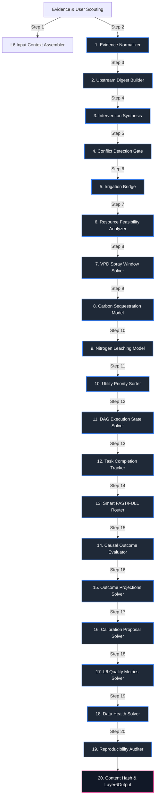

# Layer 6: Action Feasibility, Leaching, Carbon, and Execution DAG

Layer 6 acts as the strategic execution, conflict resolution, operational feasibility, and causal learning system within the AgriBrain workspace. Grounded in **precision agricultural decision governance**, this layer synthesizes all recommended interventions from upstream intelligence layers (Layer 3 Decision, Layer 4 Nutrient, and Layer 5 BioThreat), identifies cross-layer scheduling and physiological conflicts, gates recommendations through multi-dimensional knapsack resource constraints, and runs a Directed Acyclic Graph (DAG) state machine to coordinate field execution.

Additionally, Layer 6 models long-term biophysical and environmental consequences, including RothC-derived soil organic carbon sequestration dynamics, process-based nitrate leaching fluxes, and vapor pressure deficit (VPD) spray windows. Following task completion, it implements Difference-in-Differences (DiD) causal outcome evaluations and proposes Bayesian calibration adjustments to close the predictive model loop.

---

## 1. Core Engine Inventory (Exact Count: 9)

Layer 6 coordinates exactly **9 specialized core engines** split across five operational areas:

### Category A: Conflict Resolution & Synthesis
1. **InterventionSynthesisEngine** (`layer6_exec/engines/intervention_synthesis.py`): Extracts and aggregates all intervention recommendations from Layer 3, Layer 4, and Layer 5. It computes priority scores using multi-attribute utility theory (combining expected impact, urgency, and confidence) and implements a cross-layer deconfliction gate to resolve physical contradictions (e.g., irrigation demand during high fungal pressure, or nitrogen applications during lodging risk).
2. **IrrigationBridge** (`layer6_exec/irrigation_bridge.py`): Interfaces and normalizes Layer 3 irrigation schedules. It translates theoretical crop water requirements into runtime valve commands, embedding real-time delivery telemetry (volume, pressure, duration) back into the execution state machine.

### Category B: Operational Gating & Feasibility
3. **ResourceFeasibilityAnalyzer** (`layer6_exec/engines/resource_feasibility.py`): Gates the synthesized portfolio through multi-dimensional capacity constraints (available labor hours, machinery, water allocations, and seasonal budget limits). It runs a multi-constraint knapsack optimizer to determine the feasible action set, grading candidates from A (fully feasible) to F (impossible/blocked).
4. **VPDSprayWindowCalculator** (`layer6_exec/engines/vpd_spray_window.py`): Evaluates weather-related spray suitability. It calculates Vapor Pressure Deficit (VPD) to predict droplet evaporation rates and combines this with wind speed, travel speed, boom height, and droplet size to compute spray drift risks and optimize application timing windows.

### Category C: Environmental & Carbon Physics Models
5. **CarbonSequestrationModel** (`layer6_exec/engines/carbon_sequestration.py`): Models soil organic carbon pool dynamics. It implements a multi-compartment RothC-derived soil carbon turnover model, simulating plant residue inputs, humification, and active microbial mineralization as a function of daily soil temperature, moisture, and SAR-derived tillage disturbance factors.
6. **NitrogenLeachingModel** (`layer6_exec/engines/nitrogen_leaching.py`): Simulates nitrate solute displacement through the soil column. It models the convective-dispersive transport of mobile nitrate ($\text{NO}_3^-$) ions driven by vertical soil moisture drainage percolating below the crop root zone, calculating nitrogen leaching losses.

### Category D: Execution State Machine
7. **DagRunner** (`layer6_exec/execution/dag_runner.py`): Manages the Directed Acyclic Graph (DAG) state machine for field tasks. It resolves task dependencies (e.g., verifying disease presence before treatment, or ensuring soil moisture is adequate before fertilization) and tracks state transitions (PENDING, READY, RUNNING, BLOCKED, COMPLETED, FAILED, EXPIRED).

### Category E: Causal Evaluation & Learning Loop
8. **OutcomesMetricsCalculator** (`layer6_exec/outcomes/metrics.py`): Performs causal outcome evaluation of completed tasks. It isolates the treatment effect on biophysical metrics (such as NDVI recovery, growth velocity, and stress reduction) against synthetic control baselines using Difference-in-Differences (DiD) and pre-post models, controlling for weather confounders.
9. **CalibrationProposalEngine** (`layer6_exec/engines/calibration.py`): Executes the system's learning loop. It compares ground-truth scouting observations against satellite-derived predictions, calculating parameter calibration proposals to adjust upstream model hyperparameters.

---

## 2. Internal Wiring & Sequencing

The execution sequence represents a 21-step daily loop that processes evidence, synthesizes candidates, gates resources, runs the task DAG, simulates carbon/nitrogen fluxes, and evaluates causal outcomes.



### The 21-Step Strategic Execution Loop

1. **Standalone Input Context Aggregation**: Assembles the L1 FieldTensor, L2 VegInt curves, L3 diagnoses, L4 nutrient budgets, L5 active threats, operational resources, recent field evidence, and previous execution states.
2. **Scouting & Operational Evidence Normalization**: Translates raw incoming scouting logs, photos, trap counts, and machine telemetry into normalized, immutable, hashed evidence packets.
3. **Upstream Digest Assembly**: Condenses all biophysical indicators from L1-L5 into a structured summary to drive farmer-facing explanations.
4. **Intervention Candidate Synthesis**: Extracts recommended actions from Layer 3, Layer 4, and Layer 5, generating structured intervention candidates.
5. **Cross-Layer Conflict Detection**: Audits the generated portfolio to identify scheduling and agronomic conflicts (such as irrigation during high fungal risk).
6. **Irrigation Schedule Integration**: Processes Layer 3 irrigation schedules through the IrrigationBridge, converting volumes into runtime valve tasks.
7. **Resource Feasibility Assessment**: Evaluates the required resources (labor, machinery, budget, and water) against current capacities, scoring each candidate's feasibility grade from A to F.
8. **VPD Spray Window Suitability Evaluation**: Solves atmospheric humidity and temperature dynamics, calculating the Vapor Pressure Deficit (VPD) and spray drift wind scores to identify optimal spray windows.
9. **Daily Soil Organic Carbon Simulation**: Runs the RothC soil organic carbon model, simulating plant residue inputs, humification, and active microbial decomposition under temperature, moisture, and tillage constraints.
10. **Convective Nitrogen Leaching Estimation**: Models nitrate solute transport, calculating the leached N fraction as a function of vertical drainage and soil field capacity.
11. **Utility Priority Sorter**: Ranks all intervention candidates, sorting them in descending order of utility scores to ensure high-value actions are prioritized under resource scarcity.
12. **DAG Execution State Update**: Runs the DAG task execution solver, resolving task dependencies and updating execution states (PENDING, READY, RUNNING, BLOCKED, COMPLETED, FAILED, EXPIRED).
13. **Task Completion Date Logging**: Extracts the completion dates for all completed tasks and updates their target timing windows.
14. **Smart FAST/FULL Path Routing**: Selects the execution path based on the presence of completed tasks or new evidence (FAST path skips outcome evaluation and calibration to reduce latency).
15. **Causal Outcome Evaluation**: processes completed interventions on the FULL path, isolating the treatment effect against synthetic control baselines using Difference-in-Differences (DiD).
16. **Forward-looking Outcome Projection**: Computes expected biophysical impacts (such as projected NDVI changes and risk reductions) for all active interventions.
17. **Bayesian Learning Loop Calibration**: Evaluates normalized scouting evidence on the FULL path to propose parameter adjustments for upstream layers.
18. **Layer 6 Quality Metrics Computation**: Calculates the strategic execution quality indices, including task completion rates and data completeness metrics.
19. **Data Health Status Evaluation**: Computes the overall data health status based on upstream completeness scores.
20. **Audit Snapshot Preservation**: Packages the current features snapshot, model versions, and policy options to guarantee perfect reproducibility.
21. **Content Hashing & Packaging**: Computes a deterministic SHA-256 hash of the Layer6Output to ensure database stability and compliance.

---

## 3. Mathematical & Causal Formulations

To ensure biophysical, physical, and economic accuracy, Layer 6 implements a suite of peer-reviewed mathematical formulations, detailed below.

### 1. Soil Organic Carbon Dynamics (RothC-like Multi-Compartment Model)
Long-term soil organic carbon (SOC) changes are modeled using a multi-compartment first-order decay system (Coleman & Jenkinson, 1996), partitioning carbon into four active pools: Decomposable Plant Material ($DPM$), Resistant Plant Material ($RPM$), Microbial Biomass ($BIO$), and Humified Organic Matter ($HUM$). The daily turnover rate of each pool $i$ is modeled as:

$$\frac{dC_i}{dt} = \text{Input}_i - k_i \cdot C_i \cdot f(T_s) \cdot f(\theta) \cdot (1.0 - \Omega_{\text{tillage}})$$

Where:
* $C_i$ is the carbon stock of pool $i$ ($\text{t C/ha}$).
* $k_i$ is the first-order reference decomposition constant ($\text{year}^{-1}$):
  * $DPM$ = $10.0$, $RPM$ = $0.30$, $BIO$ = $0.66$, $HUM$ = $0.02$.
* $f(T_s)$ is the temperature scaling factor, representing the biological activation energy:
  $$f(T_s) = \frac{47.9}{1 + e^{106.0 / (T_s + 18.3)}}$$
* $f(\theta)$ is the soil moisture scaling factor, reflecting microbial water limits:
  $$f(\theta) = \begin{cases} 1.0 & \text{if } \theta \ge 0.7 \cdot \theta_{fc} \\ 0.2 + 0.8 \cdot \frac{\theta - \theta_{wp}}{0.7 \cdot \theta_{fc} - \theta_{wp}} & \text{if } \theta < 0.7 \cdot \theta_{fc} \end{cases}$$
* $\Omega_{\text{tillage}}$ is the tillage penalty factor, which accelerates organic matter decomposition when mechanical soil inversion exposes humic carbon to rapid oxidation:
  $$\Omega_{\text{tillage}} = \begin{cases} 0.35 & \text{for Conventional Tillage} \\ 0.15 & \text{for Reduced Tillage} \\ 0.00 & \text{for No-Till} \end{cases}$$

Daily carbon decomposition fluxes are converted to carbon dioxide equivalents ($\text{t CO}_2\text{eq/ha}$) and valued using the prevailing carbon price to estimate the net financial impact:

$$\text{Carbon Valuation Impact (EUR)} = \Delta C \cdot 3.67 \cdot \text{Price}_{C}$$

### 2. Vapor Pressure Deficit (VPD) and Spray Window Gating
Pesticide application efficiency is heavily restricted by atmospheric conditions. The engine computes the Vapor Pressure Deficit (VPD) and combines it with wind speed to determine the **Spray Window Score**:

$$\text{VPD} = e_s(T) \cdot \left( 1.0 - \frac{RH}{100.0} \right)$$

Where $e_s(T)$ is the saturation vapor pressure ($\text{kPa}$) calculated using the Tetens formulation:

$$e_s(T) = 0.61078 \cdot \exp\left( \frac{17.27 \cdot T}{T + 237.3} \right)$$

$$\text{SprayWindowScore} = f(\text{VPD}) \cdot g(u)$$

Where:
* $f(\text{VPD})$ is the vapor pressure deficit suitability factor, which penalizes high evaporation rates that cause spray droplets to dry before reaching the target:
  $$f(\text{VPD}) = \exp\left( -0.5 \cdot \text{VPD}^2 \right)$$
* $g(u)$ is the wind velocity suitability factor, penalizing spray drift under high winds ($u > 5 \text{ m/s}$) and temperature inversions under dead calm conditions ($u < 1 \text{ m/s}$):
  $$g(u) = \begin{cases} 0.0 & \text{if } u < 1.0 \text{ or } u > 8.0 \\ 1.0 & \text{if } 1.5 \le u \le 4.0 \\ \max\left(0, 1.0 - 0.25 \cdot (u - 4.0)\right) & \text{if } 4.0 < u \le 8.0 \end{cases}$$

### 3. Solute Nitrogen Leaching Model
Solute leaching of mobile nitrate ($\text{NO}_3^-$) is simulated using the Burns displacement model (Burns, 1975). On days when rainfall and irrigation exceed evapotranspiration and the soil moisture exceeds field capacity, the fraction of nitrate leached ($L_{leach}$) from a soil layer of depth $z$ ($\text{cm}$) is calculated as:

$$N_{leach} = N_{soil\_solution} \cdot \left( 1.0 - e^{-\frac{\text{Drainage}}{\theta_{fc} \cdot z}} \right)$$

Where:
* $N_{soil\_solution}$ is the inorganic nitrogen dissolved in the soil water column ($\text{kg N/ha}$).
* $\text{Drainage}$ is the vertical water percolating below the root zone ($\text{mm}$), computed from the Layer 3 SPAC bucket model.
* $\theta_{fc}$ is the soil's volumetric field capacity ($\text{vol/vol}$), derived from the Saxton-Rawls pedotransfer equations.

### 4. Causal Outcome Evaluation (Difference-in-Differences)
To evaluate the true biophysical impact of completed interventions while accounting for weather and soil variations, the engine implements a spatial and temporal **Difference-in-Differences (DiD)** causal framework (Lobell et al., 2015):

$$\Delta_{\text{DID}} = \left( Y_{\text{post, treated}} - Y_{\text{pre, treated}} \right) - \left( Y_{\text{post, control}} - Y_{\text{pre, control}} \right)$$

Where:
* $Y$ is the biophysical target metric (such as NDVI, canopy temperature index, or plant available water %).
* $\text{pre}$ is the baseline window prior to intervention.
* $\text{post}$ is the evaluation window after intervention completion.
* $\text{treated}$ is the target plot where the action was completed.
* $\text{control}$ is a synthetic spatial control baseline, compiled from neighboring untreated zones with identical soil texture, topography, and phenological development.

### 5. Bayesian Learning Loop Parameter Calibration
The learning loop calibrates upstream biophysical parameters by comparing ground-truth scouting observations against satellite-derived predictions, using a Bayesian update scheme:

$$\theta_{\text{proposed}} = \theta_{\text{current}} + \alpha \cdot \left( X_{\text{scout}} - \hat{X} \right) \cdot \Phi_{\text{scout}}$$

Where:
* $\theta_{\text{proposed}}$ is the adjusted model hyperparameter (such as the crop coefficient curve slope or soil mineralization rate).
* $\theta_{\text{current}}$ is the active parameter value.
* $\alpha$ is the calibrated learning rate coefficient.
* $X_{\text{scout}}$ is the ground-truth value verified in the field (e.g., leaf tissue N percentage, or actual insect trap counts).
* $\hat{X}$ is the model's predicted state.
* $\Phi_{\text{scout}}$ is the scouting evidence confidence score [0,1], representing sample size and observer reliability.

### 6. Resource Feasibility & Knapsack Portfolio Selection
Agribusiness management requires selecting the highest utility set of actions that do not exceed operational constraints. The analyzer models this as a multi-dimensional knapsack problem:

$$\max \sum_{i=1}^n x_i \cdot \text{Utility}_i \quad \text{subject to} \quad \sum_{i=1}^n x_i \cdot \text{Requirement}_{i, r} \le \text{Capacity}_r \quad \forall r \in \mathbf{R}$$

Where:
* $x_i \in \{0, 1\}$ is the selection decision variable for intervention $i$.
* $\text{Utility}_i$ is the computed utility score, representing impact, urgency, and confidence.
* $\text{Requirement}_{i, r}$ is the demand of action $i$ on resource $r$ (labor hours, water volume, machinery capacity, and financial budget).
* $\text{Capacity}_r$ is the total available capacity for resource $r$.

---

## 4. Programmatic Data Contract Schemas

To maintain architectural integrity and support automated integration testing, all Layer 6 engines communicate via explicit, strongly-typed Pydantic and dataclass structures.

### 1. `Layer6Output` (The Canonical L6 Output Package)
This schema represents the complete output compiled by Layer 6 and routed to Layer 7 and Layer 10.

```python
@dataclass
class Layer6Output:
    run_meta: RunMeta
    
    # Core strategic outputs
    intervention_portfolio: List[InterventionCandidate]
    conflict_log: List[ConflictRecord]
    updated_state: ExecutionState
    evidence_registry: List[NormalizedEvidence]
    
    # Outcomes and learnings
    outcome_report: List[OutcomeMetric]
    outcome_projections: List[OutcomeProjection]
    calibration_proposals: List[CalibrationProposal]
    
    # Farmer explainability & governance
    upstream_digest: Optional[UpstreamDigest] = None
    quality_metrics: QualityMetricsL6
    data_health: DataHealthScore
    audit: AuditSnapshot
    
    # Environmental & Biophysical results (L6 expansions)
    nitrogen_leaching_fraction: float = 0.0
    runoff_risk_index: float = 0.0
    vapor_pressure_deficit_kpa: float = 0.0
    net_carbon_balance_t_co2eq: float = 0.0
    carbon_valuation_impact_eur: float = 0.0
```

### 2. `InterventionCandidate` (The strategic Action Contract)
Represents a single candidate recommendation, decoupling what to do from why and whether it is feasible.

```python
@dataclass
class InterventionCandidate:
    intervention_id: str                          # INV-{sha256}
    domain: InterventionDomain                    # IRRIGATION, NUTRIENT, PHYTOSANITARY
    action_type: str                              # VERIFY, INTERVENE, MONITOR, ESCALATE
    title: str
    instructions: str
    
    # Priority & value scoring
    utility_score: float                          # Unified score [0.0 - 1.0]
    expected_impact: float
    urgency: float
    confidence: float
    
    # Economic metrics
    estimated_cost_eur: float = 0.0
    estimated_roi: float = 0.0
    cost_of_inaction_eur: float = 0.0
    
    # Scheduling & spatial targets
    timing_window: Dict[str, str] = field(default_factory=dict)
    optimal_day: str = ""
    target_zones: List[str] = field(default_factory=list)
    depends_on: List[str] = field(default_factory=list)
    
    # Traceability & feasibility
    source_layer: str = ""                        # "L3", "L4", "L5"
    linked_diagnosis_ids: List[str] = field(default_factory=list)
    linked_threat_ids: List[str] = field(default_factory=list)
    evidence_summary: str = ""
    feasibility_grade: FeasibilityGrade = FeasibilityGrade.A
    blocked_reasons: List[str] = field(default_factory=list)
    resource_requirements: List[Dict[str, Any]] = field(default_factory=list)
```

### 3. `ExecutionState` (Closed-loop DAG Tracker)
Represents the dynamic state of task execution, including closed-loop irrigation feedback.

```python
@dataclass
class ExecutionState:
    tasks: Dict[str, TaskStatus] = field(default_factory=dict)
    task_details: Dict[str, TaskState] = field(default_factory=dict)
    last_updated: str = ""
    logs: List[Dict[str, Any]] = field(default_factory=list)
    
    # Closed-loop irrigation integration
    irrigation: IrrigationExecutionDetail = field(default_factory=IrrigationExecutionDetail)
```

### 4. `IrrigationExecutionDetail` (Closed-loop Irrigation Runtime)
Represents the runtime validation metrics populated by the irrigation bridge.

```python
@dataclass
class IrrigationExecutionDetail:
    active_event_ids: List[str] = field(default_factory=list)
    completed_event_ids: List[str] = field(default_factory=list)
    failed_event_ids: List[str] = field(default_factory=list)
    total_volume_delivered_mm: float = 0.0
    total_volume_target_mm: float = 0.0
    delivery_efficiency: float = 0.0              # actual / target
    validation_outcomes: Dict[str, str] = field(default_factory=dict) # {id: "CONFIRMED"}
    calibration_adjustment: float = 1.0           # multiplier for next cycle
    water_budget_consumed_mm: float = 0.0
    water_budget_remaining_mm: float = 0.0
    safety_violations_count: int = 0
    last_emergency_stop: str = ""
```

---

## 5. Academic References

The mathematical formulations, causal frameworks, and biophysical models implemented in Layer 6 are based on the following peer-reviewed literature:

* **RothC Carbon Model**: Coleman, K., & Jenkinson, D. S. (1996). *RothC-26.3: A Model for the Turnover of Carbon in Soil*. In: Powlson, D. S., Smith, P., & Smith, J. U. (eds.) *Evaluation of Soil Organic Matter Models*. Springer-Verlag.
* **Tetens Saturation Vapor Pressure**: Tetens, O. (1930). *Über einige meteorologische Begriffe*. Zeitschrift für Geophysik, 6, 297-309.
* **Burns solute displacement**: Burns, I. G. (1975). *An Equation to Predict the Leaching of Surface-Applied Nitrate*. Journal of Agricultural Science, 85(3), 443-454.
* **Lobell crop yield & causal modeling**: Lobell, D. B., Thau, D., Seifert, C., Engle-Warnick, E., & Johnston-Fennell, I. (2015). *A systematic evaluation of satellite data for crop yield forecasting*. Agricultural and Forest Meteorology, 206, 37-44.
* **Burt solute processes**: Burt, T. P., Heathwaite, A. L., & Trudgill, S. T. (1993). *Nitrate: Processes, Patterns and Management*. John Wiley & Sons.
* **Vapor pressure deficit & spray windows**: Bache, D. H., & Johnstone, D. R. (1992). *Microclimate and Spray Dispersion*. Ellis Horwood.
* **Difference-in-Differences causal framework**: Angrist, J. D., & Pischke, J. S. (2009). *Mostly Harmless Econometrics: An Empiricist's Companion*. Princeton University Press.
