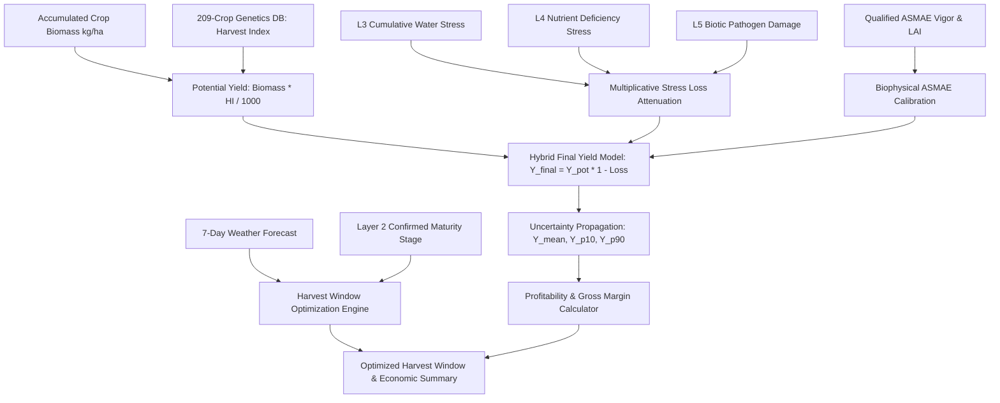

# Layer 6.1: Yield Forecasting & Harvest Optimization (`layer6_yield`)

## 1. Overview and Architectural Scope

**Layer 6 Yield Forecasting Engine** models harvest yield, harvest window scheduling, and farm-level economic gross margins. It combines cumulative seasonal simulated dry biomass, crop-specific Harvest Indexes ($HI$) from the centralized 209-crop genetics registry, and multiplicative stress attenuation coefficients to predict final harvest yield with full uncertainty propagation.

Layer 6 Yield coordinates closely with **Vegetation Intelligence (Layer 2)**, **Water Hydrology (Layer 3)**, **Nutrient Management (Layer 4)**, and **Pathology (Layer 5)**:
- **Consumes**:
  - Crop genotype specifications (Harvest Index $HI$ from `crop_database`).
  - Total accumulated crop dry matter biomass (kg/ha).
  - Cumulative stress loss factors ($l_{\text{water}}$ from Layer 3, $l_{\text{nutrient}}$ from Layer 4, $l_{\text{disease}}$ from Layer 5).
  - High-confidence qualified ASMAE observations (biophysical vigor and Leaf Area Index).
  - Short-term meteorological forecasts (7-day precipitation and maximum daily temperature).
  - Farm economic parameters (crop sale price per ton, input costs per hectare).
- **Produces**:
  - Calibrated yield predictions ($Y_{\text{mean}}$, $Y_{p10}$, $Y_{p90}$) with quantitative uncertainty bounds.
  - Stress attribution split identifying percentage yield lost to water deficit, nutrient deficiency, or disease damage.
  - Harvest timing optimization identifying optimal operational windows while avoiding rain damage and foliar pathogen flare-ups.
  - Profitability profiles detailing gross revenue, input expenses, net margin, and return on investment (ROI %).



---

## 2. Directory Layout & Module Structure

```
services/agribrain/layer6_yield/
├── yield_forecast.py            # Core YieldForecastEngine: potential, stress loss, uncertainty
├── harvest_optimizer.py         # HarvestOptimizer: weather suitability & maturity window scoring
├── profitability.py             # ProfitabilityCalculator: gross margins, ROI %, break-even yield
├── tests/                       # Unit test suite (100% green)
│   ├── __init__.py
│   ├── test_yield_forecast.py
│   └── test_harvest_and_profitability.py
├── engines.md                   # Granular engine documentation
└── layer6_yield.md              # Agronomical audit overview
```

---

## 3. Core Engines & Mathematical Formulations

### 3.1 Hybrid Yield Prediction Model (`yield_forecast.py`)
Predicts dry matter or grain harvest yield ($Y_{\text{final}}$, t/ha) using the Monteith-Passioura harvest index framework:
$$Y_{\text{potential}} = \text{Biomass}_{\text{final}} \cdot \frac{HI}{1000.0} \quad (\text{t/ha})$$
Stress loss factors attenuate potential yield:
$$\text{TotalLoss}_{\text{naive}} = 1.0 - (1 - l_{\text{water}}) \cdot (1 - l_{\text{nutrient}}) \cdot (1 - l_{\text{disease}})$$
To prevent unrealistic catastrophic drops from correlated stressors, total loss is capped at 70% under standard operational conditions:
$$\text{TotalLoss} = \min(0.70, \; \text{TotalLoss}_{\text{naive}})$$
$$Y_{\text{final}} = Y_{\text{potential}} \cdot (1.0 - \text{TotalLoss})$$

### 3.2 ASMAE Biophysical Calibration
When high-confidence, low-uncertainty ASMAE field measurements are available ($\text{confidence} \ge 0.60, \text{uncertainty} \le 0.40$), yield predictions are dynamically calibrated:
$$Y_{\text{calibrated}} = Y_{\text{final}} \cdot \left[1.0 + (\text{Vigor}_{\text{actual}} - 0.70) \cdot 0.30\right] \cdot \left[1.0 + (\text{LAI}_{\text{actual}} - 3.0) \cdot 0.10\right]$$

### 3.3 Uncertainty Propagation & Confidence Bounds
The coefficient of variation ($CV$) compounds biomass estimation uncertainty and stress diagnosis uncertainty:
$$CV = 0.10 + 0.20 \cdot (1 - \text{Confidence}_{\text{biomass}}) + 0.15 \cdot (1 - \text{Confidence}_{\text{stress}})$$
$$\sigma_Y = Y_{\text{final}} \cdot CV$$
Confidence percentiles are computed via standard Gaussian projection:
$$Y_{p10} = \max\left(0.0, \; Y_{\text{final}} - 1.645 \cdot \sigma_Y\right)$$
$$Y_{p90} = Y_{\text{final}} + 1.645 \cdot \sigma_Y$$

### 3.4 Harvest Window Optimization (`harvest_optimizer.py`)
Evaluates harvest feasibility over a 7-day rolling window:
- **Phenology Gate**: Strictly requires canonical Layer 2 phenology confirmation of crop maturity (`stage_specific_allowed = True` and `"maturity"` in canonical stage); unconfirmed stages return `"action": "wait"`.
- **Weather Suitability Scoring**:
  $$\text{Score}_{\text{day}} = \text{Score}_{\text{weather}} - 0.50 \cdot P(\text{Disease})$$
  Where precipitation $> 2\text{ mm}$ incurs a 50-point penalty, precipitation $> 10\text{ mm}$ zeros the score (cannot harvest), and extreme heat ($T_{\max} > 35^\circ\text{C}$) incurs a 20-point penalty.
- The highest-scoring day with $\text{Score} > 50$ is selected as `window_start`.

### 3.5 Profitability & Gross Margin Analysis (`profitability.py`)
Calculates farm-level financial outcomes:
$$\text{GrossRevenue} = Y_{\text{mean}} \cdot \text{CropPrice} \quad (\$/\text{ha})$$
$$\text{NetProfit} = \text{GrossRevenue} - \text{InputCosts} \quad (\$/\text{ha})$$
$$\text{ROI} = \frac{\text{NetProfit}}{\text{InputCosts}} \cdot 100\%$$
$$\text{BreakEvenYield} = \frac{\text{InputCosts}}{\text{CropPrice}} \quad (\text{t/ha})$$
Interventions are deemed economically viable if their projected return exceeds the minimum 20% hurdle rate ($\text{ROI} > 20\%$).

---

## 4. Verification and Test Suite

Layer 6 Yield includes a dedicated test suite in [services/agribrain/layer6_yield/tests/](file:///c:/Users/E-C/Desktop/agriwise/services/agribrain/layer6_yield/tests/):

| Test Suite | Focus Area | Tests | Status |
| :--- | :--- | :---: | :---: |
| [`test_yield_forecast.py`](file:///c:/Users/E-C/Desktop/agriwise/services/agribrain/layer6_yield/tests/test_yield_forecast.py) | Potential yield, stress loss attenuation, 70% capping, uncertainty bounds | 2 | **PASSED** |
| [`test_harvest_and_profitability.py`](file:///c:/Users/E-C/Desktop/agriwise/services/agribrain/layer6_yield/tests/test_harvest_and_profitability.py) | Maturity window gating, weather suitability scoring, gross margins, ROI % | 3 | **PASSED** |
| **Total** | **End-to-End Layer 6 Yield Verification** | **5** | **100% Green** |

### Running Layer 6 Yield Tests
```bash
py -3 -m pytest services/agribrain/layer6_yield/tests/ -v
```
All 5 tests pass unconditionally.
