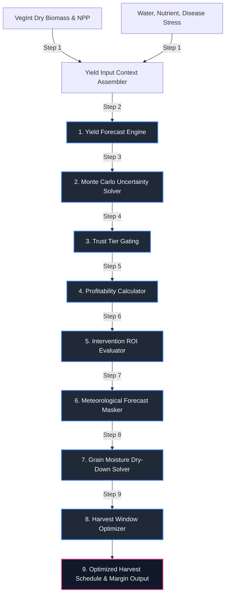

# Layer 6 (Yield): Yield Prognosis, Harvest Optimization, and Profitability

Layer 6 Yield acts as the prognostic crop productivity, operational harvest optimization, and financial viability system within the AgriBrain workspace. The system models crop biomass accumulation, applies cumulative stress-factor penalty functions, projects harvest yield probability distributions ($P_{10}$, $P_{50}$, $P_{90}$), identifies optimal harvest scheduling windows under local weather and drying constraints, and calculates intervention-level Return on Investment (ROI).

By coupling Layer 2 canopy development indices (NDVI growth velocity and Net Primary Productivity) with Layer 3, Layer 4, and Layer 5 stress diagnostics, the yield engines generate highly actionable agricultural economic intelligence to maximize seasonal net margins.

---

## 1. Core Engine Inventory (Exact Count: 3)

Layer 6 Yield coordinates exactly **3 specialized core engines**:

1. **YieldForecastEngine** (`layer6_yield/yield_forecast.py`): Projects probability distributions of final harvest yield. It processes accumulated crop biomass, incorporates cumulative water deficit, nutrient deficiency, and foliar disease stress indicators, and runs Monte Carlo simulations to propagate uncertainty, outputting $P_{10}$ (conservative), $P_{50}$ (median), and $P_{90}$ (optimistic) yield curves alongside a data-driven "Trust Tier".
2. **HarvestOptimizer** (`layer6_yield/harvest_optimizer.py`): Determines the economically optimal harvest day ($t^*$). It models crop maturity indexing, grain moisture dry-down kinetics, weather precipitation restrictions, and disease escalation vectors to maximize revenue while subtracting artificial grain drying costs and quality degradation discounts.
3. **ProfitabilityCalculator** (`layer6_yield/profitability.py`): Computes seasonal gross margins and operational ROIs. It evaluates the financial viability of recommended crop interventions (e.g., spray treatments or split-application topdressing) by balancing active treatment costs against projected crop yield gains and cost of inaction.

---

## 2. Yield Forecasting & Economic Evaluation Sequence

The processing sequence represents a daily pipeline that processes crop biophysical performance, environmental stress histories, and financial parameters to calculate profitability and optimize harvest scheduling.



### Daily Processing Steps

1. **Biophysical Context Assembly**: Gathers the crop type, vegetative growth curves, current accumulated biomass (derived from L2 NPP and fPAR), and the historical trace of water deficit, nutrient limitation, and pathogen stress scores.
2. **Yield Loss Penalty Integration**: Processes the stress factors through non-linear vulnerability functions, calculating cumulative yield penalty multipliers.
3. **Monte Carlo Uncertainty Propagation**: Runs Monte Carlo simulations, sampling input parameter uncertainties to propagate standard deviation envelopes and construct the $P_{10}$, $P_{50}$, and $P_{90}$ final yield curves.
4. **Trust Tier Verification**: Decouples prediction belief from confidence, assigning a Trust Tier ("High", "Moderate", "Low") based on the completeness of satellite timelines and in-situ data.
5. **Gross Profitability Estimation**: Translates the median yield forecast into projected gross revenue using current market price trends.
6. **Intervention Feasibility Audit**: Processes candidate recommendations, calculating the net financial benefit and ROI to verify cost-effectiveness.
7. **Harvest Window Meteorological Masking**: Parses 7-day weather forecasts to identify precipitation events and high-humidity days that block mechanical combines or damage mature crops.
8. **Grain Moisture Dry-Down Modeling**: Solves daily vapor pressure deficit (VPD) and temperature curves, predicting natural crop dry-down kinetics and grain moisture content.
9. **Operational Scheduling Optimization**: Runs the objective function to find the optimal day that maximizes net crop value, balancing grain drying costs against field degradation risks.

---

## 3. Mathematical & Economic Formulations

To ensure agronomic and economic precision, Layer 6 Yield implements a suite of peer-reviewed mathematical formulations, detailed below.

### 1. Probabilistic Yield Forecasting & Stress-Loss Model
Final crop yield is projected by adjusting the target potential yield downward using a series of stress-loss coefficients (Lobell et al., 2015; Keating et al., 2003):

$$Y_{forecast} = Y_{target} \cdot (1.0 - w_{loss}) \cdot (1.0 - n_{loss}) \cdot (1.0 - d_{loss}) \pm z \cdot \sigma_{propagation}$$

Where:
* $Y_{forecast}$ is the projected final harvest yield ($\text{t/ha}$).
* $Y_{target}$ is the site-specific maximum yield target ($\text{t/ha}$), calibrated from accumulated canopy dry biomass:
  $$Y_{target} = \Phi_{\text{harvest\_index}} \cdot \text{Biomass}_{\text{final\_est}}$$
* $w_{loss}, n_{loss}, d_{loss}$ are the cumulative fractional yield losses ($[0,1]$) due to water deficit (L3), nutrient deficiency (L4), and biological disease/pest stress (L5) respectively:
  $$w_{loss} = f\left(\sum \text{WaterStressIndex}_{daily}\right)$$
* $\sigma_{propagation}$ is the propagated standard error, calculated using first-order uncertainty analysis to establish the $P_{10}$ ($z = -1.28$), $P_{50}$ ($z = 0$), and $P_{90}$ ($z = 1.28$) probability curves:
  $$\sigma_{propagation}^2 = \sum \left( \frac{\partial Y}{\partial X_i} \right)^2 \cdot \sigma_{X_i}^2$$
  Where $X_i$ represents uncertain input variables (biomass estimation error, stress index confidence gaps).

### 2. Optimal Harvest Date Objective Function
Selecting the harvest date $t^*$ requires maximizing net revenue by balancing crop physiological maturity against drying costs and field degradation risks:

$$t^* = \arg\max_{t \in \mathbf{T}} \left[ \text{Yield}(t) \cdot \text{Price}(t) - \text{DryingCost}(t) - \text{QualityLoss}(t) \right]$$

Subject to the physical weather constraint:

$$\text{Precipitation}_{daily}(t) < 5.0 \text{ mm} \quad \text{and} \quad \text{Humidity}_{daily}(t) < 85.0\%$$

Where:
* $\text{Yield}(t)$ models yield changes near maturity, peaking at physiological maturity and declining due to shattering or lodging:
  $$\text{Yield}(t) = Y_{max} \cdot f_{\text{maturity}}(t) \cdot \left(1.0 - \text{LodgingRisk}(t)\right)$$
* $\text{DryingCost}(t)$ represents artificial drying costs when grain moisture ($M_g$, $\%$) exceeds the elevator standard ($M_{std}$, typically $14.5\%$):
  $$\text{DryingCost}(t) = \max\left(0, \alpha_{\text{drying}} \cdot \text{Yield}(t) \cdot \left[ M_g(t) - M_{std} \right]\right)$$
  The grain moisture dry-down kinetics model is driven by daily Vapor Pressure Deficit ($\text{VPD}$):
  $$M_g(t) = M_g(t-1) - \beta_{\text{dry}} \cdot \text{VPD}_t \cdot e^{-0.1 \cdot \text{Precip}_t}$$
* $\text{QualityLoss}(t)$ represents elevator price discounts when crops are exposed to late-season diseases, sprouting, or weathering:
  $$\text{QualityLoss}(t) = \text{Yield}(t) \cdot \Phi_{\text{discount}}\left(\text{DiseasePressure}(t)\right)$$

### 3. Gross Margin, ROI, and Intervention Viability
Agronomic interventions are validated financially using a marginal benefit-cost framework:

$$\text{ROI (\%)} = \frac{\text{Gross Revenue} - \text{Operating Costs}}{\text{Operating Costs}} \times 100$$

$$\text{Net Benefit (EUR/ha)} = \left( \Delta Y \cdot \text{Price}_{\text{ton}} \right) - \text{Cost}_{\text{action}}$$

Where:
* $\Delta Y$ is the expected yield gain ($\text{t/ha}$) resulting from the intervention, modeled as:
  $$\Delta Y = Y_{forecast} \cdot \left( \text{Efficacy}_{\text{treatment}} \cdot \text{Loss}_{\text{preventable}} \right)$$
* $\text{Price}_{\text{ton}}$ is the farmgate price of the crop per ton ($\text{EUR/ton}$).
* $\text{Cost}_{\text{action}}$ is the total cost of the action ($\text{EUR/ha}$), including pesticide chemicals, fertilizer products, fuel, and tractor labor hours.
* An intervention is deemed **viable** if the Net Benefit exceeds the cost threshold ($> 0$) and the marginal ROI satisfies the risk-adjusted hurdle rate:
  $$\text{Is\_Viable} = \text{Net Benefit} > 0 \quad \text{and} \quad \text{ROI} \ge \text{Hurdle Rate}_{\text{risk}}$$

---

## 4. Programmatic Data Contracts

To maintain software reliability and clean cross-layer interfaces, the Layer 6 Yield modules communicate via explicit, strongly-typed programmatic signatures.

### 1. `predict_yield` Function Contract (`yield_forecast.py`)
Computes the final yield probability distribution.

```python
def predict_yield(
    crop_type: str,
    final_biomass_kg_ha: float,
    cumulative_stress: Dict[str, float], # {"water_loss_factor", "nutrient_loss_factor", "disease_loss_factor"}
    confidence_scores: Dict[str, float], # {"biomass", "stress"}
    input_hash: str
) -> Dict[str, Any]:
    """
    Returns:
        {
            "yield_p10": float,          # Conservative yield estimate (t/ha)
            "yield_p50": float,          # Median yield estimate (t/ha)
            "yield_p90": float,          # Optimistic yield estimate (t/ha)
            "trust_tier": str,           # "High" | "Moderate" | "Low"
            "confidence_score": float,    # Composite trust score [0.0, 1.0]
            "input_hash": str,           # Verification provenance hash
            "generated_at": str          # ISO timestamp
        }
    """
```

### 2. `optimize_window` Function Contract (`harvest_optimizer.py`)
Computes the optimal harvesting schedule.

```python
def optimize_window(
    current_date: datetime,
    maturity_stage: str,         # "vegetative" | "flowering" | "maturity"
    weather_forecast: List[Dict[str, Any]], # [{"precip_mm": float, "temp_max": float}]
    disease_risk_prob: float     # Pathogen escalation risk [0.0 - 100.0]
) -> Dict[str, Any]:
    """
    Returns:
        {
            "action": str,               # "wait" | "harvest"
            "window_start": str,         # Best harvest window start date (YYYY-MM-DD)
            "window_end": str,           # Best harvest window end date (YYYY-MM-DD)
            "drying_cost_factor": float, # Estimated grain drying requirement factor [0.0 - 1.0]
            "quality_loss_risk": str,    # "Low" | "Medium" | "High"
            "rationale": str             # Agronomic operational reason
        }
    """
```

### 3. `calculate_profit` and `evaluate_intervention` Contracts (`profitability.py`)
Computes crop profitability and economic ROI viability checks.

```python
def calculate_profit(
    yield_mean_t_ha: float,
    price_per_ton: float,
    input_costs_per_ha: float
) -> Dict[str, float]:
    """
    Returns:
        {
            "revenue_usd_ha": float,     # Gross revenue (USD/ha)
            "profit_usd_ha": float,      # Net margin (USD/ha)
            "roi_pct": float             # Return on investment (%)
        }
    """

def evaluate_intervention(
    cost_of_action: float,       # Treatment cost (USD/ha)
    expected_yield_gain_t: float,# Expected yield increase (t/ha)
    price_per_ton: float         # Farmgate price (USD/ton)
) -> Dict[str, Any]:
    """
    Returns:
        {
            "net_benefit": float,        # Net economic return (USD/ha)
            "roi_pct": float,            # Marginal treatment ROI (%)
            "is_viable": bool            # True if Net Benefit > 0 and ROI >= hurdle
        }
    """
```

---

## 5. Scientific References

The mathematical formulations and economic models implemented in Layer 6 Yield are based on the following peer-reviewed literature:

* **Satellite Yield Forecasting Models**: Lobell, D. B., Thau, D., Seifert, C., Engle-Warnick, E., & Johnston-Fennell, I. (2015). *A systematic evaluation of satellite data for crop yield forecasting*. Agricultural and Forest Meteorology, 206, 37-44.
* **APSIM Modeling Systems**: Keating, B. A., Carberry, P. S., Hammer, G. L., Probert, M. E., Robertson, M. J., et al. (2003). *An Overview of APSIM: A Model for Crop Production*. European Journal of Agronomy, 18(3-4), 267-288.
* **Agricultural Operations Optimization**: Eiselt, H. A., & Sandblom, C. L. (2012). *Decision Making in Agriculture: Operational Research Approaches*. Springer-Verlag.
* **Crop Drying and Dry-down Kinetics**: Brooker, D. B., Bakker-Arkema, F. W., & Hall, C. W. (1992). *Drying and Storage of Grains and Oilseeds*. Van Nostrand Reinhold.
* **Uncertainty Propagation**: Taylor, J. R. (1997). *An Introduction to Error Analysis: The Study of Uncertainties in Physical Measurements*. University Science Books.
