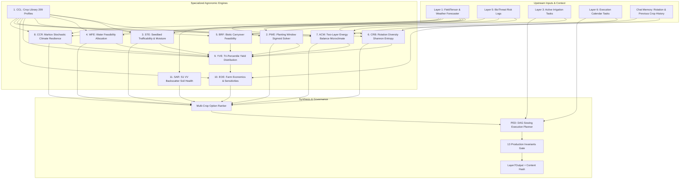

# Layer 7: Season Planning, Crop Suitability & Farm Economics (layer7_planning)

## 1. Executive Summary & Architectural Overview

**Layer 7 (Planning)** is AgriBrain's strategic agronomic optimization layer. Operating prior to planting or at seasonal pivot points, it assesses whether a field should proceed with a declared crop, delay planting, switch to an alternative crop, or introduce a cover crop.

The layer synthesizes environmental tensors from **Layer 1 (Fusion)**, biotic pressures from **Layer 5 (BioThreat)**, irrigation and active execution states from **Layer 3 (Decision)** and **Layer 6 (Execution)**, and rotational history from conversational memory.

---

## 2. Granular Engine Inventory

| Engine Name | File | Description | Core Output |
| :--- | :--- | :--- | :--- |
| **Crop Profile Library (CCL)** | [`engines/ccl_crop_library.py`](file:///c:/Users/E-C/Desktop/agriwise/services/agribrain/layer7_planning/engines/ccl_crop_library.py) | Stores physical, thermal, and economic priors for 209 Mediterranean, Sub-Saharan, and global crops. | `CropProfile` |
| **Planting Window Engine (PWE)** | [`engines/pwe_planting_window.py`](file:///c:/Users/E-C/Desktop/agriwise/services/agribrain/layer7_planning/engines/pwe_planting_window.py) | Logistic sigmoid evaluating regional calendars, real-time forecast temperatures, frost risks, and germination thresholds. | `SuitabilityState` |
| **Seedbed Workability (STE)** | [`engines/ste_seedbed.py`](file:///c:/Users/E-C/Desktop/agriwise/services/agribrain/layer7_planning/engines/ste_seedbed.py) | Evaluates machinery trafficability and seedbed prep suitability based on soil texture, 3-day/7-day rainfall, and soil moisture. | `SuitabilityState` |
| **Water Feasibility (WFE)** | [`engines/wfe_water_feasibility.py`](file:///c:/Users/E-C/Desktop/agriwise/services/agribrain/layer7_planning/engines/wfe_water_feasibility.py) | Assesses crop water requirements against available rainfall and irrigation quota. | `SuitabilityState` |
| **Biotic Risk Feasibility (BRF)** | [`engines/brf_biotic_risk.py`](file:///c:/Users/E-C/Desktop/agriwise/services/agribrain/layer7_planning/engines/brf_biotic_risk.py) | Maps pathogen histories from Layer 5 to potential crop disease vulnerabilities. | `SuitabilityState` |
| **Crop Rotation Engine (CRB)** | [`engines/crb_crop_rotation.py`](file:///c:/Users/E-C/Desktop/agriwise/services/agribrain/layer7_planning/engines/crb_crop_rotation.py) | Evaluates rotational diversity via Shannon entropy, winter pathogen mortality, and legume biological nitrogen credits. | `SuitabilityState` |
| **Canopy Microclimate (ACM)** | [`engines/acm_microclimate.py`](file:///c:/Users/E-C/Desktop/agriwise/services/agribrain/layer7_planning/engines/acm_microclimate.py) | Two-layer coupled canopy-soil surface energy balance solver using a 2D Newton-Raphson scheme. | `SuitabilityState` |
| **Climate Resilience (CCR)** | [`engines/ccr_resilience.py`](file:///c:/Users/E-C/Desktop/agriwise/services/agribrain/layer7_planning/engines/ccr_resilience.py) | Richardson-type first-order Markov Chain stochastic weather generator evaluating drought and thermal shock risk. | `SuitabilityState` |
| **Yield Distribution (YVE)** | [`engines/yve_yield_distribution.py`](file:///c:/Users/E-C/Desktop/agriwise/services/agribrain/layer7_planning/engines/yve_yield_distribution.py) | Forecasts yield distributions across $p_{10}$ (downside risk), $p_{50}$ (median), and $p_{90}$ (upside potential). | `YieldDistribution` |
| **Economics Engine (EOE)** | [`engines/eoe_economics.py`](file:///c:/Users/E-C/Desktop/agriwise/services/agribrain/layer7_planning/engines/eoe_economics.py) | Calculates gross margin, expected profit distributions, break-even yields, and price/yield sensitivity elasticities. | `EconomicOutcome` |
| **Planner & Execution DAG (PED)** | [`engines/ped_planner.py`](file:///c:/Users/E-C/Desktop/agriwise/services/agribrain/layer7_planning/engines/ped_planner.py) | Generates phased operational DAG tasks (`SOIL_PREP`, `SOWING`, `BASAL_FERT`, `IRRIGATION_SETUP`). | `ExecutionPlan` |
| **SAR Soil Health Trajectory** | [`runner.py`](file:///c:/Users/E-C/Desktop/agriwise/services/agribrain/layer7_planning/runner.py) | Sentinel-1 SAR VV backscatter time-series analysis detecting tillage disturbance spikes ($> 3.0\text{ dB}$). | `Dict[str, Any]` |

---

## 3. Key Mathematical Formulations

### A. SAR Soil Health Trajectory & Tillage Detection
Tillage breaks soil aggregates and increases surface roughness, resulting in pronounced Sentinel-1 VV backscatter spikes:
$$\Delta \text{VV}_i = \text{VV}_i - \frac{1}{W} \sum_{j=i-W}^{i-1} \text{VV}_j > 3.0\text{ dB}$$
Where window $W = 5$ observations. The topsoil structure health score decays with repeated tillage events:
$$\text{Soil Health Score} = \begin{cases}
1.00 & \text{if } N_{tillage} = 0 \quad (\text{conservation / no-till}) \\
0.85 & \text{if } N_{tillage} = 1 \quad (\text{minimal disturbance}) \\
0.60 & \text{if } 2 \le N_{tillage} \le 3 \quad (\text{conventional}) \\
\max(0.10, 0.40 - 0.05 \cdot (N_{tillage} - 4)) & \text{if } N_{tillage} \ge 4 \quad (\text{degrading risk})
\end{cases}$$

### B. Single-Crop Suitability Indexing
The overall suitability percentage synthesizes biophysical probabilities penalized by unknown risk (confidence gaps):
$$\text{Suitability} = \sum_{k} w_k \cdot P_k - 0.45 \cdot \sum_{k} w_k \cdot (1 - C_k)$$
Weights:
$$w_{window} = 0.20, \quad w_{water} = 0.15, \quad w_{soil} = 0.15, \quad w_{rotation} = 0.12, \quad w_{resilience} = 0.12, \quad w_{econ} = 0.10, \quad w_{bio} = 0.08, \quad w_{micro} = 0.08$$
* **Critical Overrides:** If any primary domain is flagged `CRITICAL`, overall suitability is scaled down by $0.30$.
* **SAR Penalty:** If soil health $< 0.50$, suitability is scaled by $(0.70 + 0.60 \times \text{Score})$.

### C. Shannon Entropy of Crop Rotation
Measures rotational crop diversity over $N$ historical seasons:
$$H = -\sum_{c \in \text{Crops}} p_c \ln(p_c), \quad p_c = \frac{\text{Count}(c)}{N}$$
* $H > 1.0$: High diversity $\implies \text{Logit} = +1.5$ (pathogen disruption).
* $0 < H \le 1.0$: Moderate diversity $\implies \text{Logit} = +0.5$.
* $H = 0.0$: Monoculture $\implies \text{Logit} = -1.2$ (elevated inoculum carryover).

### D. Farm Economics & Sensitivities
$$\text{Profit}_{p50} = (Y_{p50} \times P_{ton}) - C_{ha}$$
$$\text{Break-Even Yield} = \frac{C_{ha}}{P_{ton}}$$
Sensitivities compute direct bottom-line variance under a $-10\%$ price drop and $-10\%$ yield reduction:
$$\Delta \text{Profit}_{price,-10\%} = (Y_{p50} \times 0.90 \times P_{ton}) - C_{ha} - \text{Profit}_{p50}$$
$$\Delta \text{Profit}_{yield,-10\%} = (0.90 \times Y_{p50} \times P_{ton}) - C_{ha} - \text{Profit}_{p50}$$

---

## 4. Production Invariant Suite

Layer 7 enforces 13 production invariants on every generated `Layer7Output`:

1. `yield_non_negative`: All yield percentiles ($p_{10}, p_{50}, p_{90}, \text{mean}$) must be $\ge 0$.
2. `yield_percentile_order`: Strictly monotonic ordering $p_{10} \le p_{50} \le p_{90}$.
3. `profit_finite`: Expected profits and percentiles must be finite (no `NaN` or `Inf`).
4. `break_even_non_negative`: Break-even yield must be $\ge 0$.
5. `suitability_prob_range`: All domain probabilities $P \in [0.0, 1.0]$.
6. `suitability_conf_range`: All domain confidences $C \in [0.0, 1.0]$.
7. `chosen_plan_consistency`: `blocked_reason` and `is_allowed` are mutually exclusive.
8. `content_hash_valid`: Deterministic SHA-256 string $\ge 16$ characters.
9. `suitability_pct_range`: Overall suitability percentage $\in [0.0, 100.0]$.
10. `evidence_trace_non_empty`: Every `SuitabilityState` must contain $\ge 1$ `EvidenceLogit`.
11. `economics_profit_order`: Profit percentiles maintain ordering $\text{profit}_{p10} \le \text{profit}_{p50} \le \text{profit}_{p90}$.
12. `option_ranking_consistency`: Multi-crop options sorted strictly descending by `overall_rank_score`.
13. `agronomic_yield_realism`: Mean yield must not exceed $3\times$ baseline cultivar yield potential.

---

## 5. Test Suite & Verification Results

* Dedicated test directory: [`tests/`](file:///c:/Users/E-C/Desktop/agriwise/services/agribrain/layer7_planning/tests/)
* **16 Automated Tests** passing with 100% success rate:
  - [`test_crop_library_and_windows.py`](file:///c:/Users/E-C/Desktop/agriwise/services/agribrain/layer7_planning/tests/test_crop_library_and_windows.py): 7 tests covering profile retrieval, database physical priors, in-season vs out-of-season, frost/germination stress, missing weather telemetry, soil trafficability, and moisture limits.
  - [`test_rotation_and_economics.py`](file:///c:/Users/E-C/Desktop/agriwise/services/agribrain/layer7_planning/tests/test_rotation_and_economics.py): 5 tests covering Shannon entropy diversity, legume biological N credits, economic distributions, user overrides, stochastic climate resilience, and canopy microclimate.
  - [`test_planning_runner_and_invariants.py`](file:///c:/Users/E-C/Desktop/agriwise/services/agribrain/layer7_planning/tests/test_planning_runner_and_invariants.py): 4 tests covering SAR soil health trajectory, end-to-end runner execution, DAG task emission, invariant checking with fault injection, and Tier 0 gating blockers.
