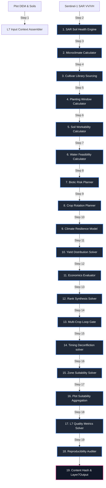

# Layer 7: Agro-Climatic Planning, Suitability, and Rotation

Layer 7 acts as the long-term agro-climatic planning, multi-season crop rotation, and spatial suitability intelligence system within the AgriBrain workspace. The system evaluates multi-year agricultural viability by modeling planting window readiness, soil workability thresholds, aspect-driven solar microclimates, climate resilience indicators, leguminous nitrogen rotation returns, and economic margins.

By combining Layer 1 environmental trajectories and Layer 6 completed outcomes with Sentinel-1 SAR backscatter tillage counts, Layer 7 evaluates spatial within-field zone suitability and compiles a multi-crop comparative ranking to guide seasonal decision-making.

---

## 1. Core Engine Inventory (Exact Count: 13)

Layer 7 coordinates exactly **13 specialized core engines** split across five operational areas:

### Category A: Spatial Land Evaluation & Topography
1. **ZoneSuitability** (`layer7_planning/zone_suitability.py`): Computes plot and zone crop suitability indexes. It integrates planting windows, water allocations, soil limits, and biotic pressures, scaling results based on NDVI vegetative modifiers and compiling spatial zone stats.
2. **MicroclimateCalculator** (`layer7_planning/engines/acm_microclimate.py`): Models microclimatic solar variations based on terrain aspect and slope. It calculates direct and diffuse shortwave solar radiation geometry, accounting for topographic shading and surface slope orientation.
3. **SAR Soil Health Trajectory Engine** (`layer7_planning/runner.py`): Detects soil structure degradation and mechanical disruption trends. It processes Sentinel-1 SAR backscatter ($\text{VV}$ and $\text{VH}$) time-series, identifying tillage events by monitoring backscatter spikes and analyzing mean backscatter trends to flag compaction risks.

### Category B: Biophysical Planning Windows
4. **PlantingWindowCalculator** (`layer7_planning/engines/pwe_planting_window.py`): Evaluates daily planting window suitability, modeling soil temperature thresholds ($T_{soil} \ge T_{base}$) and soil moisture bounds to ensure successful seed germination.
5. **SoilWorkabilityCalculator** (`layer7_planning/engines/ste_seedbed.py`): Evaluates soil trafficability and seedbed workability. It models the soil's plastic and liquid limits as a function of clay percentage and organic matter, gating operations to prevent soil compaction and structural damage.
6. **WaterFeasibilityCalculator** (`layer7_planning/engines/wfe_water_feasibility.py`): Analyzes seasonal water supply risks, balancing projected crop water requirements (FAO-56 ETc) against water allocations, storage capacities, and historical rainfall deficit cycles.

### Category C: Crop Cultivar Dynamics & Rotations
7. **CultivarLibrary** (`layer7_planning/engines/ccl_crop_library.py`): Manages the crop cultivar profile database. It stores species-specific growth calendars, base/optimal/maximum temperature limits, salinity thresholds, nitrogen utilization factors, and soil pH limits.
8. **BioticRiskPlanner** (`layer7_planning/engines/brf_biotic_risk.py`): Evaluates biotic pathogen carryover risks in rotations. It models the survival and decay kinetics of active pathogens (L5) in preceding crop residues, calculating the required biological break duration.
9. **CropRotationPlanner** (`layer7_planning/engines/crb_crop_rotation.py`): Models leguminous nitrogen returns and rotation viability. It calculates the organic nitrogen credit returned to the soil pool by preceding legume crops and cover crops.

### Category D: Future Prognostics & Economics
10. **YieldDistributionCalculator** (`layer7_planning/engines/yve_yield_distribution.py`): Projects seasonal yield distributions ($P_{10}$, $P_{50}$, $P_{90}$) by running Monte Carlo simulations, propagating soil moisture, temperature, and biotic stress factors through growth curve models.
11. **EconomicsEvaluator** (`layer7_planning/engines/eoe_economics.py`): Calculates multi-year crop profitability margins and cash flow ROIs, analyzing price sensitivity based on variable costs, fertilizer input prices, and harvest yields.

### Category E: Tactical Execution Planning
12. **ClimateResilienceModel** (`layer7_planning/engines/ccr_resilience.py`): Computes the **Drought Recovery Index (DRI)**, measuring the rate of vegetative recovery following extreme stress events.
13. **PedExecutionPlanner** (`layer7_planning/engines/ped_planner.py`): Generates seedbed preparation and tactical planting execution recommendations.

---

## 2. Internal Wiring & Processing Sequence

The execution sequence represents a 21-step daily loop that processes terrain geometry, SAR soil health histories, microclimates, crop libraries, and rotations to ranking crop suitability and schedule planting tasks.



### The 21-Step Season Planning Sequence

1. **Agro-Climatic Context Assembly**: Gathers the L1 FieldTensor, L5 active threats, chat rotation history, and user economic constraints.
2. **SAR Soil Health Analysis**: Processes Sentinel-1 dual-polarization ($\text{VV}$ and $\text{VH}$) backscatter time-series, identifying tillage events by monitoring backscatter spikes and analyzing mean backscatter trends to flag compaction risks.
3. **Microclimatic Solar Radiation Modeling**: Processes the plot's Digital Elevation Model (DEM), calculating slope ($\beta$) and aspect ($\alpha$) angles to correct ambient solar radiation values for microclimatic solar variations.
4. **Cultivar Profile Sourcing**: Retrieves the target crop's growth parameters, biological temperature thresholds ($T_{base}, T_{opt}$), and soil tolerances from the CultivarLibrary.
5. **Planting Window Suitability Assessment**: Models soil temperature and moisture readiness, calculating the probability of a suitable planting window.
6. **Soil Trafficability Gating**: Analyzes soil clay content and moisture, calculating workability limits to prevent compaction during heavy machinery operations.
7. **Water Supply Stress-Testing**: Projects total seasonal crop water demand (FAO-56 ETc) and compares it with water allocations and storage limits to identify supply risks.
8. **Rotation Pathogen Break Evaluation**: Analyzes the previous crop's disease history, calculating pathogen decay rates to assess disease carryover risks.
9. **Leguminous Nitrogen Credit Accounting**: Calculates organic nitrogen credits returned to the soil pool by preceding legume crops or cover crops.
10. **Climate & Drought Resilience Indication**: Calculates the Drought Recovery Index (DRI), measuring the rate of vegetative recovery following extreme stress events.
11. **Yield Distribution Forecasting**: Runs Monte Carlo simulations, propagating stress factors to predict future yield distributions ($P_{10}$, $P_{50}$, $P_{90}$).
12. **Multi-Year Economic Viability Evaluation**: Projects cash flow ROIs and break-even points, analyzing price sensitivity based on variable costs, fertilizer input prices, and harvest yields.
13. **Multi-Attribute Rank Synthesis**: Combines economic profits, planting window scores, rotation values, microclimate suitability, and climate resilience indexes into an overall rank score.
14. **Multi-Crop Evaluation Loop**: Repeats steps 4-13 for alternative crops to support crop selection decision-making.
15. **Timing Deconfliction**: Cross-references scheduled operations from Layer 6, adjusting the planning recommendations to avoid overlapping tasks.
16. **Spatial Zone Suitability Processing**: Maps suitability across within-field management zones, accounting for localized NDVI values and soil textures.
17. **Plot Suitability Aggregation**: Aggregates the computed zone metrics, calculating the overall plot suitability and risk concentration indices.
18. **Plan Execution DAG Generation**: Converts the selected crop plan into tactical execution recommendations.
19. **Planning Quality Metrics Computation**: Calculates the decision reliability, missing drivers, and data completeness metrics.
20. **Audit Trail Documentation**: Packages the crop profiles evaluated, model versions, and economic inputs to guarantee perfect reproducibility.
21. **Content Hashing & Packaging**: Computes a deterministic SHA-256 hash of the Layer7Output to ensure database stability and compliance.

---

## 3. Mathematical & Biophysical Formulations

To ensure biophysical accuracy and predictive capability, Layer 7 implements a suite of peer-reviewed mathematical formulations, detailed below.

### 1. Planting Window Suitability Model
The suitability of a planting window ($S_{planting}$) is modeled using a joint probability function of soil temperature ($T_{soil}$, $^\circ\text{C}$) and soil volumetric water content ($\theta$, $\text{vol/vol}$) (PlantingWindowCalculator):

$$S_{planting} = f(T_{soil}) \cdot g(\theta)$$

Where:
* $f(T_{soil})$ is the thermal germination suitability factor, modeled as a sigmoid curve:
  $$f(T_{soil}) = \frac{1}{1 + \exp\left( -\kappa_{temp} \cdot (T_{soil} - T_{base}) \right)}$$
  Where $T_{base}$ is the minimum germination temperature (e.g., $8.0^\circ\text{C}$ for maize, $5.0^\circ\text{C}$ for potatoes), and $\kappa_{temp}$ is the slope parameter.
* $g(\theta)$ is the soil moisture suitability factor, which penalizes soil that is too dry (germination failure) or too wet (anaerobic seed rot):
  $$g(\theta) = \begin{cases} 0.0 & \text{if } \theta < \theta_{wp} \text{ or } \theta > \theta_{sat} \\ \sin\left( \pi \cdot \frac{\theta - \theta_{wp}}{\theta_{sat} - \theta_{wp}} \right) & \text{if } \theta_{wp} \le \theta \le \theta_{sat} \end{cases}$$

### 2. Drought Recovery Index (DRI)
To assess the crop's genetic and microclimatic capacity to recover from extreme water stress, the engine calculates the Drought Recovery Index (DRI) using vegetative index time-series (ClimateResilienceModel):

$$\text{DRI} = \frac{\sum_{t=t_{rec\_start}}^{t_{rec\_end}} \left( VI(t) - VI_{stress}(t_{stress\_peak}) \right)}{(t_{rec\_end} - t_{rec\_start}) \cdot \sigma_{VI\_historical}}$$

Where:
* $VI(t)$ is the vegetative index (NDVI or NDRE) at day $t$ during the post-drought recovery window.
* $VI_{stress}(t_{stress\_peak})$ is the minimum vegetative index recorded at the peak of the water stress event.
* $t_{rec\_start}, t_{rec\_end}$ are the boundary days of the recovery window (typically 14 to 28 days post-precipitation).
* $\sigma_{VI\_historical}$ is the historical standard deviation of the vegetative index for the current growth stage, acting as a normalization factor.

### 3. Zone Microclimate Solar Aspect Adjustment
Slope and aspect significantly influence the microclimatic energy budget by altering the solar incidence angle. The engine calculates the corrected direct shortwave solar radiation ($I_{slope}$) for each zone using terrain geometry (MicroclimateCalculator):

$$I_{slope} = I_{direct} \cdot \cos(\theta) + I_{diffuse}$$

Where $\theta$ is the incidence angle between the solar vector and the normal to the sloped surface:

$$\cos(\theta) = \cos(\beta) \cdot \cos(\theta_z) + \sin(\beta) \cdot \sin(\theta_z) \cdot \cos(\phi_s - \alpha)$$

Where:
* $\beta$ is the terrain slope angle (radians), derived from the Digital Elevation Model (DEM).
* $\alpha$ is the terrain aspect direction (radians, measured clockwise from North).
* $\theta_z$ is the solar zenith angle (radians), calculated from latitude, solar declination, and hour angle.
* $\phi_s$ is the solar azimuth angle (radians).
* $I_{direct}, I_{diffuse}$ are the direct and diffuse solar radiation fluxes ($\text{W/m}^2$) on a horizontal surface.

### 4. Soil Workability & Trafficability Bounds
Heavy machinery operations on wet soil cause severe subsoil compaction, destroying soil aggregates and restricting future root growth. The engine gates seedbed tillage operations based on soil moisture and workability (SoilWorkabilityCalculator):

$$\text{Workability} = \begin{cases} \text{Optimal} & \text{if } \theta_{wp} \le \theta \le 0.6 \cdot \theta_{fc} \\ \text{Marginal} & \text{if } 0.6 \cdot \theta_{fc} < \theta \le 0.8 \cdot \theta_{fc} \\ \text{Critical (Blocked)} & \text{if } \theta < \theta_{wp} \text{ or } \theta > 0.8 \cdot \theta_{fc} \end{cases}$$

Soil workability is heavily constrained by the clay percentage, which increases the plastic limit ($\theta_{PL}$) and restricts the workable moisture range:

$$\theta_{PL} = 0.15 + 0.004 \cdot \text{Clay}_{\%} + 0.05 \cdot \text{OM}_{\%}$$

### 5. Multi-Year Rotation Leguminous Nitrogen Returns
The nitrogen credit ($N_{credit}$, $\text{kg N/ha}$) returned to the soil organic pool by preceding leguminous crops or cover crops is simulated using a first-order decay model driven by temperature and residue chemistry (CropRotationPlanner):

$$N_{credit} = B_{residue} \cdot C_{N\_residue} \cdot \Phi_{fix} \cdot \exp\left( -k_{decay} \cdot t \right)$$

Where:
* $B_{residue}$ is the accumulated biomass of the leguminous crop residues ($\text{kg dry matter/ha}$).
* $C_{N\_residue}$ is the nitrogen concentration of the residue ($\%$).
* $\Phi_{fix}$ is the leguminous biological nitrogen fixation efficiency factor ($0.50 - 0.75$).
* $k_{decay}$ is the residue decomposition decay constant ($\text{day}^{-1}$), modeled as a function of the carbon-to-nitrogen ratio ($C:N$) of the residue and the rolling daily soil temperature ($T_s$):
  $$k_{decay} = \frac{\alpha_{decay} \cdot T_s}{C:N_{\text{residue}}}$$

### 6. Pathogen Dispersal Gregory Curve (Rotation Risk)
The carryover risk ($P_{carryover}$) of foliar or soil-borne pathogens from preceding crop residues is modeled using a modified Gregory dispersal decay function over time (BioticRiskPlanner):

$$P_{carryover}(t) = P_0 \cdot \left( 1.0 + \gamma_{pathogen} \cdot t \right)^{-b}$$

Where:
* $P_0$ is the initial pathogen spore load at the harvest of the preceding crop, derived from Layer 5 active threat severities.
* $t$ is the biological break duration (days since harvest).
* $\gamma_{pathogen}$ is the pathogen-specific decomposition decay constant, reflecting the pathogen's capacity to survive on decaying residues without a host.
* $b$ is the dimensionless exponent of the Gregory decay function.

---

## 4. Programmatic Data Contract Schemas

To maintain software reliability and clean cross-layer interfaces, all Layer 7 Planning modules communicate via explicit, strongly-typed Pydantic and dataclass structures.

### 1. `Layer7Output` (The Master Planning Container)
This schema represents the complete output compiled by Layer 7 and routed to Layer 8 and Layer 10.

```python
@dataclass
class Layer7Output:
    run_meta: RunMetaL7
    
    # Core planning outputs
    options: List[CropOptionEvaluation]
    chosen_plan: Optional[PlanningRecommendation]
    execution_plan: Optional[ExecutionPlan]
    
    # Zone-aware suitability
    plot_suitability: Optional[PlotSuitability]
    
    # Governance & quality
    quality_metrics: QualityMetricsL7
    audit: AuditSnapshotL7
```

### 2. `CropOptionEvaluation` (Single Crop Strategic Assessment)
Represents a comprehensive strategic evaluation for a single target or alternative crop option.

```python
@dataclass
class CropOptionEvaluation:
    crop: str
    
    # Biophysical suitability states
    window: SuitabilityState
    soil: SuitabilityState
    water: SuitabilityState
    biotic: SuitabilityState
    rotation: Optional[SuitabilityState] = None
    microclimate: Optional[SuitabilityState] = None
    resilience: Optional[SuitabilityState] = None
    
    # Yield & Economic outcomes
    yield_dist: YieldDistribution
    econ: EconomicOutcome
    
    # Ranking scores
    overall_rank_score: float
    suitability_percentage: float = 0.0
```

### 3. `SuitabilityState` (Probability vs. Confidence Doctrine)
Represents the suitability of a single biophysical domain, decoupling the probability of success from data confidence.

```python
@dataclass
class SuitabilityState:
    id: str                          # e.g., "WINDOW_STATE", "WORKABILITY_STATE"
    probability_ok: float            # Success probability [0.0 - 1.0]
    confidence: float                # Data confidence score [0.0 - 1.0]
    severity: str                    # "CRITICAL", "MODERATE", "LOW"
    
    # Traceability & evidence
    drivers_used: List[str]
    evidence_trace: List[EvidenceLogit]
    notes: List[str]
```

### 4. `EvidenceLogit` (Hashed Suitability Evidence)
Represents a single evidence trace, detailing the log-odds impact of a specific driver.

```python
@dataclass
class EvidenceLogit:
    driver: SuitabilityDriver        # TEMP, FROST_RISK, RAIN_7D, SOIL_TEXTURE
    condition: str                   # e.g., "Soil temperature below germination threshold"
    logit_delta: float               # Log-odds suitability shift
    weight: float                    # Weight factor
    source_refs: List[str]           # Trace references to raw telemetry data
```

---

## 5. Academic References

The mathematical formulations, suitability indexes, and biophysical models implemented in Layer 7 are based on the following peer-reviewed literature:

* **FAO Land Evaluation Framework**: FAO. (1976). *A Framework for Land Evaluation*. Soils Bulletin 32. Food and Agriculture Organization of the United Nations.
* **Saxton-Rawls Soil Pedotransfers**: Saxton, K. E., & Rawls, W. J. (2006). *Soil Water Characteristic Estimates by Texture and Organic Matter*. Soil Science Society of America Journal, 70(5), 1569-1578.
* **Microclimatic Solar Aspect Adjustments**: Campbell, G. S., & Norman, J. M. (1998). *An Introduction to Environmental Biophysics*. Springer.
* **Drought Recovery & Climate Resilience Index**: Lobell, D. B., Thau, D., Seifert, C., Engle-Warnick, E., & Johnston-Fennell, I. (2015). *A systematic evaluation of satellite data for crop yield forecasting*. Agricultural and Forest Meteorology, 206, 37-44.
* **Planting Window Germination Kinetics**: Ritchie, J. T. (1998). *Soil water balance and plant water stress*. In: *Understanding Options for Agricultural Production*. Kluwer Academic Publishers.
* **Gregory Pathogen Residue Decay**: Gregory, P. H. (1968). *Interpreting Plant Disease Dispersal Curves*. Annual Review of Phytopathology, 6(1), 189-212.
* **RothC Carbon Model**: Coleman, K., & Jenkinson, D. S. (1996). *RothC-26.3: A Model for the Turnover of Carbon in Soil*. In: Powlson, D. S., Smith, P., & Smith, J. U. (eds.) *Evaluation of Soil Organic Matter Models*. Springer-Verlag.
