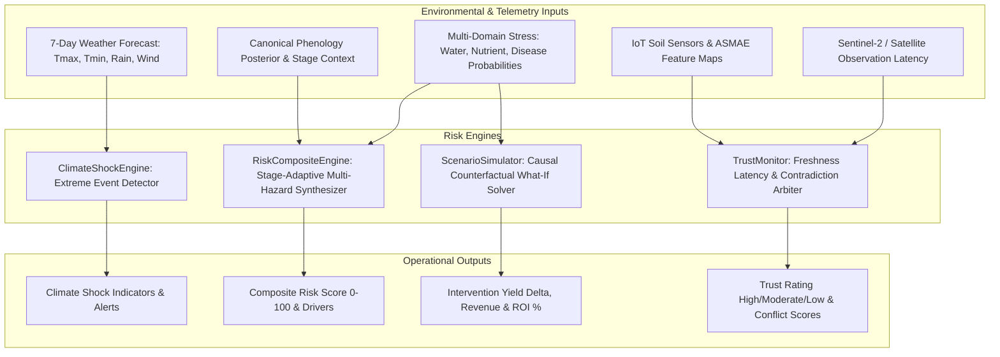

# Layer 7 Risk: Climate Shock, Scenario Simulator & Trust Monitor (layer7_risk)

## 1. Executive Summary & Architectural Overview

**Layer 7 Risk (`layer7_risk`)** provides continuous risk monitoring, extreme meteorological shock detection, counterfactual intervention simulation, and telemetry data trustworthiness auditing.

It acts as both a tactical early warning system for acute hazards (frost, heatwave, lodging winds, flood) and an operational trust arbiter that penalizes downstream decision confidence when satellite imagery or sensor connectivity lags.

---

## 2. Granular Engine Inventory

| Engine Name | File | Description | Core Output |
| :--- | :--- | :--- | :--- |
| **ClimateShockEngine** | [`climate_shock.py`](file:///c:/Users/E-C/Desktop/agriwise/services/agribrain/layer7_risk/climate_shock.py) | Analyzes 7-day forecast trajectories to flag acute meteorological hazards: heatwaves, frost, floods, and destructive wind gusts. | `Dict[str, Any]` (shock_prob, events, is_severe) |
| **RiskCompositeEngine** | [`risk_composite.py`](file:///c:/Users/E-C/Desktop/agriwise/services/agribrain/layer7_risk/risk_composite.py) | Marginalizes water, nutrient, pathogen, and climate risks using stage-adaptive weights driven by canonical phenology posteriors. | `Dict[str, Any]` (risk_score, risk_level, top_drivers) |
| **ScenarioSimulator** | [`scenario_simulator.py`](file:///c:/Users/E-C/Desktop/agriwise/services/agribrain/layer7_risk/scenario_simulator.py) | Evaluates causal interventions (`irrigate`, `fertilize`, `fungicide`) against baseline stress losses, calculating net yield deltas and ROI. | `Dict[str, Any]` (new_yield, profit_delta, roi_pct) |
| **TrustMonitor** | [`trust_monitor.py`](file:///c:/Users/E-C/Desktop/agriwise/services/agribrain/layer7_risk/trust_monitor.py) | Computes telemetry freshness scores and detects cross-layer contradictions between ASMAE remote sensing and in-situ sensors. | `Dict[str, Any]` (trust_score, conflict_score, agreement) |

---

## 3. Key Mathematical Formulations

### A. Stage-Specific Risk Aggregation
The composite risk score ($R_c \in [0, 100]$) aggregates cross-domain stress factors weighted by the physiological sensitivity of the crop stage:
$$R_c = w_w \cdot R_{water} + w_n \cdot R_{nutrient} + w_d \cdot R_{disease} + w_c \cdot R_{climate}$$
Weights adapt dynamically:
* **Reproductive / Flowering / Fruiting:** Disease risk weight escalates ($w_d = 0.40, w_n = 0.10, w_w = 0.30, w_c = 0.20$).
* **Vegetative:** Water and nutrient demand dominate ($w_w = 0.40, w_n = 0.30, w_d = 0.10, w_c = 0.20$).
* **Default / Neutral:** Balanced allocation ($w_w = 0.30, w_n = 0.20, w_d = 0.30, w_c = 0.20$).
* **Risk Categorization:** Low ($R_c \le 40$), Moderate ($40 < R_c \le 70$), High ($R_c > 70$).

### B. Climate Shock Thresholds
The `ClimateShockEngine` triggers based on strict physical thresholds:
* **Heatwave:** $T_{max} > 35^\circ\text{C} \implies P_{shock} \ge 80\%$.
* **Frost Risk:** $T_{min} < 2^\circ\text{C} \implies P_{shock} \ge 90\%$ (Critical).
* **Flood / Waterlogging:** Daily precipitation $P > 50\text{ mm} \implies P_{shock} \ge 70\%$.
* **Wind Gust Lodging:** Wind speed $u > 40\text{ km/h} \implies P_{shock} \ge 60\%$.
* A shock is categorized as **severe** if $P_{shock} > 60\%$.

### C. Trust Score & Telemetry Latency Penalties
$$\text{Trust Score} = 100 - P_{satellite} - P_{sensor} - P_{forecast}$$
Where:
$$P_{satellite} = \begin{cases} 30 & \text{if } \Delta t_{sat} > 10\text{ days} \\ 10 & \text{if } 5 < \Delta t_{sat} \le 10\text{ days} \\ 0 & \text{otherwise} \end{cases}$$
$$P_{sensor} = 20 \quad (\text{if in-situ telemetry is offline/uninstalled})$$
$$P_{forecast} = 20 \quad (\text{if numerical weather prediction is unavailable})$$
Trust Levels: `High` ($\ge 80$), `Moderate` ($50 \le \text{Score} < 80$), `Low` ($< 50$).

### D. Counterfactual Scenario Simulation (What-If Analysis)
Given baseline stress loss factors $L_w, L_n, L_d \in [0, 1]$, crop yield potential $Y_{pot}$ (t/ha), and commodity market price $P_{ton}$ (\$/ton):
$$Y = Y_{pot} \times (1 - L_w) \times (1 - L_n) \times (1 - L_d)$$
* **Irrigate:** Reduces water loss factor $L_{w,new} = 0.20 \times L_w$; Cost added $C_{add} = \$20/\text{ha}$.
* **Fertilize:** Reduces nutrient loss factor $L_{n,new} = 0.30 \times L_n$; Cost added $C_{add} = \$50/\text{ha}$.
* **Fungicide:** Reduces disease loss factor $L_{d,new} = 0.10 \times L_d$; Cost added $C_{add} = \$30/\text{ha}$.
Financial Delta:
$$\Delta Y = Y_{new} - Y_{old}, \quad \Delta \text{Profit} = (\Delta Y \times P_{ton}) - C_{add}, \quad \text{ROI (\%)} = \frac{\Delta \text{Profit}}{C_{add}} \times 100\%$$

---

## 4. Test Suite & Verification Results

* Dedicated test directory: [`tests/`](file:///c:/Users/E-C/Desktop/agriwise/services/agribrain/layer7_risk/tests/)
* **6 Automated Tests** passing with 100% success rate:
  - [`test_risk_and_shocks.py`](file:///c:/Users/E-C/Desktop/agriwise/services/agribrain/layer7_risk/tests/test_risk_and_shocks.py): 3 tests verifying climate shock detection (benign vs heatwave vs frost vs flood/wind), default composite risk weighting, and stage-adaptive weight shifts across flowering and vegetative stages.
  - [`test_simulation_and_trust.py`](file:///c:/Users/E-C/Desktop/agriwise/services/agribrain/layer7_risk/tests/test_simulation_and_trust.py): 3 tests verifying counterfactual what-if interventions (irrigate, fertilize, fungicide), telemetry trust scoring under latency/sensor dropout, and cross-layer contradiction detection (water, salinity, biotic, and BMA disagreements).
