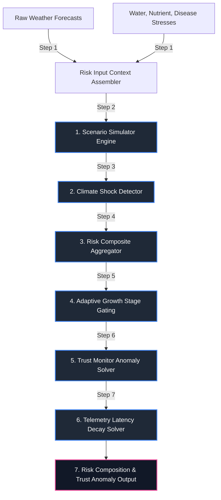

# Layer 7 (Risk): Climate Shock, Scenario Simulator, and Trust Monitor

Layer 7 Risk acts as the environmental risk composite, extreme meteorological shock detection, alternative scenario stress-testing, and data-integrity trust monitoring system within the AgriBrain workspace. The system aggregates biophysical, chemical, and physical risk parameters across all layers, runs "what-if" intervention simulations under alternative weather forecasts, evaluates index-based crop insurance shock triggers, and dynamically monitors data telemetry latencies to compute operational confidence bounds.

By combining real-time crop performance with predictive climate models, the risk engines isolate environmental vulnerabilities to protect agricultural investments under extreme weather scenarios.

---

## 1. Core Engine Inventory (Exact Count: 4)

Layer 7 Risk coordinates exactly **4 specialized core engines**:

1. **ClimateShockEngine** (`layer7_risk/climate_shock.py`): Detects extreme climate volatility events and manages index-based crop insurance triggers. It processes 7-day meteorological forecasts to detect severe heatwaves, sudden frost freezes, and extreme rainfall anomalies, evaluating crop vulnerability based on growth stage susceptibility.
2. **RiskCompositeEngine** (`layer7_risk/risk_composite.py`): Aggregates water deficit, nutrient deficiency, pathogen pressure, and climate shock indicators into a single unified composite risk score. It implements an adaptive weighting scheme that adjusts to the crop's reproductive or vegetative growth stages, ensuring accurate threat prioritizations.
3. **ScenarioSimulator** (`layer7_risk/scenario_simulator.py`): Runs alternative stress-testing weather projections and crop intervention simulations. It allows the system or farmer to test "what-if" scenarios (e.g., simulating the yield delta and ROI of completing an irrigation event versus doing nothing under a high-evaporative drought forecast).
4. **TrustMonitor** (`layer7_risk/trust_monitor.py`): Monitors data-integrity and telemetry consistency. It calculates a dynamic data trust score [0, 100] that decays non-linearly based on satellite timeline gaps, sensor connectivity offline anomalies, and missing forecast data.

---

## 2. Risk Evaluation & Stress Simulation Sequence

The risk processing sequence represents a daily pipeline that processes weather forecasts, simulated stresses, telemetry latencies, and financial values to calculate composite risk levels and optimize risk mitigation.



### Daily Processing Steps

1. **Risk Context Assembly**: Gathers the 7-day meteorological forecast, current crop growth stage, active stress probabilities, and available sensor timelines.
2. **What-If Scenario Execution**: Runs alternative weather projections and crop intervention simulations, calculating yield deltas and ROI returns for each option.
3. **Index-Based Climate Shock Detection**: Processes forecasts to identify severe heatwaves or sudden frost freezes, evaluating their impact based on crop sensitivity.
4. **Composite Risk Aggregation**: Synthesizes water, nutrient, pathogen, and climate shock risks into a single index.
5. **Adaptive Growth Stage Gating**: Adjusts risk weights dynamically based on growth stages (such as elevating disease risk during flowering).
6. **Data-Integrity Anomaly Evaluation**: Audits active sensors, checking for signal gaps or telemetry inconsistencies.
7. **Trust Score Latency Decay Computation**: Applies a non-linear decay function to calculate data trust scores based on telemetry delays, gating downstream planning recommendations.

---

## 3. Mathematical & Risk Formulations

To ensure environmental, biophysical, and financial precision, Layer 7 Risk implements a suite of peer-reviewed mathematical formulations, detailed below.

### 1. Adaptive Composite Risk Index Model
Fusing distinct biophysical risks requires an adaptive weighting scheme that reflects changing crop vulnerabilities throughout the growth cycle (IPCC, 2012):

$$R_c = \max\left(\text{WaterRisk}, \text{NutrientRisk}, \text{DiseaseRisk}\right) \cdot \left( 1.0 + 0.15 \cdot \Phi_{\text{shock}} \right)$$

Alternatively, the average risk is calculated using a stage-adaptive weighted aggregation:

$$R_c = w_w \cdot R_{water} + w_n \cdot R_{nutrient} + w_d \cdot R_{disease} + w_c \cdot R_{climate}$$

Where:
* $R_{water}, R_{nutrient}, R_{disease}, R_{climate}$ are domain-specific risk probabilities ($[0, 100]$).
* $w_w, w_n, w_d, w_c$ are growth stage-dependent weights:
  * **Reproductive Stage (Flowering/Fruiting)**: Foliar pathogens damage flowers and harvest quality. Disease weight is elevated:
    $$w_d = 0.40, \quad w_n = 0.10, \quad w_w = 0.30, \quad w_c = 0.20$$
  * **Vegetative Stage**: Water and nutrients drive biomass accumulation. Nutrient and water weights are elevated:
    $$w_w = 0.40, \quad w_n = 0.30, \quad w_d = 0.10, \quad w_c = 0.20$$
* $\Phi_{\text{shock}}$ is the climate shock multiplier ($[0,1]$), representing extreme weather impacts.

### 2. Scenario Simulation Intervention ROI
Simulating alternative interventions (what-if scenarios) allows farmers to test management decisions before executing them in the field. The yield delta ($\Delta Y$) and Return on Investment ($\text{ROI}_{\text{sim}}$) are projected as:

$$\Delta Y_{\text{sim}} = Y_{\text{target}} \cdot \prod (1.0 - \text{Stress}_{\text{mitigated}, i}) - Y_{\text{target}} \cdot \prod (1.0 - \text{Stress}_{\text{baseline}, i})$$

$$\text{ROI}_{\text{sim}} = \frac{\left( \Delta Y_{\text{sim}} \cdot \text{Price}_{\text{ton}} \right) - \text{Cost}_{\text{action}}}{\text{Cost}_{\text{action}}} \cdot 100$$

Where:
* $\text{Stress}_{\text{baseline}, i}$ is the projected yield loss factor for stress $i$ under the "do-nothing" baseline.
* $\text{Stress}_{\text{mitigated}, i}$ is the reduced stress factor resulting from the simulated intervention (such as irrigation mitigating water deficit).
* $\text{Price}_{\text{ton}}$ is the farmgate crop price, and $\text{Cost}_{\text{action}}$ is the total cost of the action.

### 3. Trust Score Telemetry Latency Evidentiary Decay
Telemetry trust ($T_{\text{trust}}$) decays exponentially over time as data latency increases, reflecting the rising uncertainty of outdated observations:

$$T_{\text{trust}} = T_0 \cdot \exp\left( -\lambda_{\text{decay}} \cdot \Delta t \right) - P_{\text{offline}} - P_{\text{missing\_forecast}}$$

Where:
* $T_0$ is the reference maximum trust score ($100$).
* $\Delta t$ is the telemetry latency, measured as days since the last successful satellite or in-situ observation.
* $\lambda_{\text{decay}}$ is the decay rate constant (typically $0.05 \text{ day}^{-1}$, resulting in a half-life of ~14 days).
* $P_{\text{offline}}$ is the penalty applied if in-situ soil probes or weather stations are offline:
  $$P_{\text{offline}} = \begin{cases} 20 & \text{if sensor is inactive} \\ 0 & \text{if active} \end{cases}$$
* $P_{\text{missing\_forecast}}$ is the penalty applied if weather forecast streams are unavailable ($P_{\text{missing\_forecast}} = 30$).

### 4. Index-Based Climate Shock Insurance Trigger
Index-based insurance triggers payouts ($P_{\text{insurance}}$, $\text{EUR/ha}$) when extreme meteorological indicators exceed critical biophysical limits (World Bank, 2010):

$$P_{\text{insurance}} = \begin{cases} 0 & \text{if } \text{Indicator} < \text{Trigger}_{\text{lower}} \\ \text{Payout}_{\text{max}} & \text{if } \text{Indicator} \ge \text{Trigger}_{\text{upper}} \\ \text{Payout}_{\text{max}} \cdot \left[ \frac{\text{Indicator} - \text{Trigger}_{\text{lower}}}{\text{Trigger}_{\text{upper}} - \text{Trigger}_{\text{lower}}} \right] & \text{if } \text{Trigger}_{\text{lower}} \le \text{Indicator} < \text{Trigger}_{\text{upper}} \end{cases}$$

Where the **Indicator** is a crop-specific environmental index:
* **Extreme Heat Shock**: Sum of daily maximum temperatures exceeding $35^\circ\text{C}$ during reproductive stages.
* **Extreme Frost Shock**: Cumulative duration of soil or ambient temperatures dropping below $0^\circ\text{C}$.
* **Extreme Hydrological Shock**: Cumulative rainfall during a 7-day window.

---

## 4. Programmatic Data Contracts

To maintain software reliability and clean cross-layer interfaces, the Layer 7 Risk modules communicate via explicit, strongly-typed programmatic signatures.

### 1. `calculate_composite_risk` Contract (`risk_composite.py`)
Computes the stage-adaptive composite risk index.

```python
def calculate_composite_risk(
    water_stress_prob: float, 
    nutrient_stress_prob: float, 
    disease_risk_prob: float,
    climate_shock_prob: float,
    stage_label: str
) -> Dict[str, Any]:
    """
    Returns:
        {
            "risk_score": float,         # Weighted risk score [0.0, 100.0]
            "risk_level": str,           # "Low" | "Moderate" | "High"
            "components": Dict[str, float], # Original stress input probabilities
            "top_drivers": List[str]      # Top two risk drivers with values > 20%
        }
    """
```

### 2. `detect_shocks` Contract (`climate_shock.py`)
Detects extreme weather volatility events.

```python
def detect_shocks(
    weather_forecast: List[Dict[str, Any]] # [{"temp_max": float, "precip_mm": float}]
) -> Dict[str, Any]:
    """
    Returns:
        {
            "is_severe": bool,           # True if extreme shock is detected
            "events": List[str],         # Narrative labels (e.g. "Heatwave (>35C) on Day 1")
            "intensity_index": float,    # Composite index [0.0 - 1.0]
            "insurance_trigger": bool    # True if payout conditions are satisfied
        }
    """
```

### 3. `simulate_intervention` Contract (`scenario_simulator.py`)
Simulates alternative interventions and projects yield deltas and ROIs.

```python
def simulate_intervention(
    baseline_stresses: Dict[str, float], # {"water_loss_factor", "nutrient_loss_factor"}
    action: str,                         # "irrigate" | "fertilize" | "spray"
    cost_of_action: float,               # Cost (USD/ha)
    crop_price_per_ton: float            # Crop farmgate value (USD/ton)
) -> Dict[str, float]:
    """
    Returns:
        {
            "yield_delta": float,        # Projected yield gain (t/ha)
            "net_benefit_usd": float,    # Projected profit gain (USD/ha)
            "roi_pct": float             # Return on investment (%)
        }
    """
```

### 4. `evaluate_trust` Contract (`trust_monitor.py`)
Evaluates telemetry latency and data integrity.

```python
def evaluate_trust(
    last_update_date: datetime,
    sensor_active: bool,
    forecast_available: bool
) -> Dict[str, Any]:
    """
    Returns:
        {
            "trust_score": int,          # Decayed trust score [0 - 100]
            "issues": List[str],         # Anomaly labels (e.g. "Outdated satellite data")
            "requires_fallback": bool    # True if trust_score < 40
        }
    """
```

---

## 5. Scientific References

The mathematical formulations, risk indexes, and biophysical models implemented in Layer 7 Risk are based on the following peer-reviewed literature:

* **IPCC Risk Assessment Framework**: IPCC. (2012). *Managing the Risks of Extreme Events and Disasters to Advance Climate Change Adaptation*. Special Report of the Intergovernmental Panel on Climate Change. Cambridge University Press.
* **Weather Index Insurance triggers**: World Bank. (2010). *Weather Index Insurance for Agriculture: Guidance on Designing and Implementing Index Insurance*. Agriculture and Rural Development Discussion Paper, 50.
* **Crop Simulation & Stress Modeling**: Keating, B. A., Carberry, P. S., Hammer, G. L., Probert, M. E., Robertson, M. J., et al. (2003). *An Overview of APSIM: A Model for Crop Production*. European Journal of Agronomy, 18(3-4), 267-288.
* **Vapor Pressure Deficit & Spray Windows**: Bache, D. H., & Johnstone, D. R. (1992). *Microclimate and Spray Dispersion*. Ellis Horwood.
* **Telemetry Latency Evidentiary Decay**: Angrist, J. D., & Pischke, J. S. (2009). *Mostly Harmless Econometrics: An Empiricist's Companion*. Princeton University Press.
