# Layer 8: Prescriptive Intelligence, Biophysical Safety Gating & Tactical Scheduling

## 1. Executive Summary & Verification Status
**Layer 8 (`layer8_prescriptive`)** is the authoritative prescriptive decision synthesis, biophysical safety gating, and tactical scheduling engine of AgriBrain. It translates diagnostic states, nutrient indices, and biological threat beliefs (from Layers 1–7) into prioritized, calendar-scheduled, zone-allocated, and psychologically-framed **Action Prescription Cards (`ActionCard`)**.

* **Operational Status:** Production-ready.
* **Pipeline Structure:** 12-stage sequential execution pipeline coordinating 16 specialized agronomic and behavioral engines.
* **Semantic Authority:** Enforces strict provenance gates (`crop_posterior_hash`, `phenology_posterior_hash`, `phenology_authority="CALIBRATED"`); unauthorized runs are safely demoted to non-destructive observations (`SCOUT`, `MONITOR`, `WAIT`).
* **Test Suite:** 13 dedicated integration tests in `services/agribrain/layer8_prescriptive/tests/` passing 100%.

---

## 2. Architectural Pipeline & System Flow

```mermaid
graph TD
    classDef engine fill:#1e293b,stroke:#3b82f6,stroke-width:2px,color:#f8fafc;
    classDef gate fill:#312e81,stroke:#6366f1,stroke-width:2px,color:#f8fafc;
    classDef out fill:#064e3b,stroke:#10b981,stroke-width:2px,color:#f8fafc;

    L8In["Layer8Input (Upstream Diagnoses, Nutrients, Threats, Forecast)"] --> Step1["Step 1: Multi-Objective Action Ranking Engine"]:::engine
    Step1 --> Step2["Step 2: Phenology Dosing (BBCH) & Microclimate Gates"]:::gate
    Step2 --> Step3["Step 3: Nutrient Interaction & Antagonism Audit (Liebig)"]:::engine
    Step3 --> Step4["Step 4: Integrated Pest Management (IPM) Cascade"]:::gate
    Step4 --> Step5["Step 5: Environmental Leaching & Runoff Audit"]:::gate
    Step5 --> Step6["Step 6: Priority Rescoring Solver"]:::engine
    Step6 --> Step7["Step 7: Constraint Scheduler (Weather/Wind/Rain Gating)"]:::engine
    Step7 --> Step8["Step 8: Zone Prioritizer (Spatial Telemetry Allocation)"]:::engine
    Step8 --> Step9["Step 9: Cognitive Load Complexity Budgeting"]:::engine
    Step9 --> Step10["Step 10: Technology Acceptance Model (TAM MLP Neural Net)"]:::engine
    Step10 --> Step11["Step 11: Prospect-Theory Economic Framing"]:::engine
    Step11 --> Step12["Step 12: Invariant Auditing & Auto-Fixing Engine"]:::gate
    Step12 --> Out["Layer8Output (Ranked Actions, Calendar Schedule, Zone Plan, ROI Forecast)"]:::out
```



### The 12-Step Prescriptive Sequence:
1. **Multi-Objective Candidate Ranking:** Scores candidate actions across impact, urgency, risk reduction, cost, and trust confidence.
2. **Phenology-Aware Rate Scaling & Physical Gates:** Applies BBCH rate scaling, evaluates canopy cooling, frost protection sprinkling, FAO-29 salinity leaching, subsoil compaction tillage, lodging PGR, and urea volatilization inhibitors.
3. **Nutrient Interaction Auditing:** Identifies limiting nutrients via Liebig's Law of the Minimum and penalizes antagonistic ion imbalances ($K \leftrightarrow Mg, Ca \leftrightarrow Mg, P \leftrightarrow Zn$).
4. **IPM Threat Cascading:** Gates chemical pesticide applications behind non-chemical and biological alternatives until threat pressure crosses the Economic Injury Level (EIL).
5. **Environmental Risk Assessment:** Computes pesticide leaching and runoff risks based on soil texture, slope, and forecast precipitation.
6. **Priority Rescoring:** Updates net priority scores based on biophysical adjustments and environmental penalties.
7. **Constraint-Based Calendar Scheduling:** Assigns feasible operational dates within the planning horizon, respecting EPA spray drift wind speed bounds ($3.0 \text{ km/h} \le v \le 25.0 \text{ km/h}$) and rain events.
8. **Spatial Zone Prioritization:** Distributes action quotas and volumes across field management zones weighted by spatial diagnosis severity and sensor reliability.
9. **Cognitive Load Pruning:** Applies Sweller's cognitive complexity limits to prune lower-priority non-critical recommendations and prevent farmer decision fatigue.
10. **Behavioral Adoption Estimation:** Computes adoption probability $P_{\text{adopt}}$ using a 2-layer Feedforward Neural Network (TAM MLP).
11. **Prospect Theory Message Framing:** Formulates gain vs. loss framed nudge messages anchored to economic ROI and potential yield losses.
12. **Invariant Auditing & Auto-Fixing:** Verifies 13 mathematical invariants (non-negative rates, safe rate ceilings, zone sum $\le 1.0$, valid calendar horizons, blocked status integrity) with automatic healing.

---

## 3. Specialized Engine Inventory (16 Engines)

| Category | Engine | Source File | Core Responsibility |
| :--- | :--- | :--- | :--- |
| **Ranking & Spatial** | `ActionRankingEngine` | `action_ranker.py` | Multi-objective scoring balancing yield impact, urgency, risk, cost, and confidence. |
| | `ZonePrioritizer` | `zone_prioritizer.py` | Allocates resource volumes across sub-field zones based on spatial telemetry trust. |
| **Biophysical Gates** | `SalinityLeachingEngine` | `engines/salinity_leaching.py` | Calculates FAO-29 leaching requirement to flush salts past the root zone. |
| | `CropCoolingEngine` | `engines/crop_cooling.py` | Triggers micro-sprinkling canopy cooling during extreme reproductive heat shocks. |
| | `FrostSprinklingEngine` | `engines/frost_sprinkling.py` | Recommends overhead sprinkling to release latent heat of fusion during freeze alerts. |
| | `SprayDriftGateEngine` | `engines/spray_drift_gate.py` | Enforces US EPA pesticide drift buffers and wind speed operational limits. |
| | `TillageCompactionEngine` | `engines/tillage_compaction.py` | Evaluates subsoil bulk density compaction to prescribe deep subsoiling tillage depth. |
| | `LodgingPGREngine` | `engines/lodging_pgr.py` | Prescribes Plant Growth Regulators for dense, over-fertilized cereal canopies. |
| | `VolatilizationInhibitorEngine` | `engines/volatilization_inhibitor.py` | Recommends NBPT urease inhibitors for urea applied on warm, alkaline soils ($pH > 7.5$). |
| **Agronomic Logic** | `PhenologyDosingEngine` | `engines/phenology_dosing.py` | Scales baseline rates according to BBCH crop phenological stages. |
| | `NutrientInteractionEngine` | `engines/nutrient_interaction.py` | Audits applications against Liebig's minimum and antagonism matrices. |
| | `IPMCascadeEngine` | `engines/ipm_cascade.py` | Implements IPM ladder: cultural $\to$ physical $\to$ biological $\to$ targeted chemical. |
| | `EnvironmentalRiskEngine` | `engines/environmental_risk.py` | Evaluates chemical leaching and runoff vulnerability. |
| **Scheduling & Behavioral** | `ConstraintScheduler` | `scheduler.py` | Builds calendar schedules respecting weather, soil moisture, and equipment limits. |
| | `CognitiveLoadEngine` | `engines/cognitive_load.py` | Limits action count per planning cycle according to human decision capacity. |
| | `AdoptionModelEngine` | `engines/adoption_model.py` | 2-layer MLP evaluating farmer adoption probability via TAM heuristics. |
| | `FramingEngine` | `engines/framing_engine.py` | Frames messages using Prospect Theory (Gain vs. Loss framing). |
| | `FeedbackLoop` | `feedback_loop.py` | Online SGD backpropagation loop updating TAM neural network weights from feedback. |

---

## 4. Key Mathematical Formulations

### A. Multi-Objective Priority Score
$$\text{Priority} = w_{\text{impact}} S_{\text{impact}} + w_{\text{urgency}} S_{\text{urgency}} + w_{\text{risk}} S_{\text{risk}} + w_{\text{cost}} S_{\text{cost}} + w_{\text{conf}} S_{\text{conf}}$$

* $w_{\text{impact}} = 0.30$ (Potential yield or quality improvement)
* $w_{\text{urgency}} = 0.25$ (Time criticality of the diagnostic event)
* $w_{\text{risk}} = 0.20$ (Crop risk reduction value)
* $w_{\text{cost}} = 0.10$ (Inverted cost score: lower cost yields higher score)
* $w_{\text{conf}} = 0.15$ (Diagnostic and upstream evidence confidence)

### B. FAO-29 Salinity Leaching Requirement
$$LF = \frac{EC_w}{5 \cdot EC_e - EC_w}, \quad LR = \frac{LF}{1.0 - LF}$$
$$\text{Rate}_{\text{adjusted}} = \text{Rate}_{\text{base}} \cdot (1.0 + LR)$$
* $EC_e$: Crop root-zone electrical conductivity tolerance threshold ($\text{dS/m}$).
* $EC_w$: Electrical conductivity of irrigation water ($\text{dS/m}$).

### C. EPA Pesticide Spray Drift Buffer Footprint
$$\text{Buffer Zone (m)} = \max\left(10.0, \frac{\text{Wind Speed (km/h)}}{5.0} \times 15.0 \times C_{\text{nozzle}}\right)$$
* Operational spray gating:
  $$\text{Blocked if } v_{\text{wind}} > 25.0 \text{ km/h (drift)} \quad \lor \quad v_{\text{wind}} < 3.0 \text{ km/h (temperature inversion risk)}$$
* Droplet coefficients: $\text{Fine} = 1.2$, $\text{Medium} = 1.0$, $\text{Coarse} = 0.7$, $\text{Ultra Coarse} = 0.4$.

### D. Subsoil Compaction Tillage Depth
$$BD_{\text{threshold}} = 1.65 - 0.005 \cdot \text{Clay}_{\%}$$
$$\text{Tillage Depth (cm)} = \max\left(15.0, 15.0 + 25.0 \cdot \frac{BD - BD_{\text{threshold}}}{0.3}\right)$$

### E. Ammonia Volatilization Risk & NBPT Gating
$$\text{VolatilizationRisk} = \frac{1.0}{1.0 + e^{-(\text{pH} - 7.0)}} \times \frac{T_s - 10.0}{20.0} \times \frac{80.0 - \theta}{60.0}$$
* When applied urea has $\text{pH} > 7.5$ and $T_{\text{air}} > 25^\circ\text{C}$, NBPT urease inhibitor coating is mandated.

### F. Technology Acceptance Model (TAM Neural Network)
* **Architecture:** 6-dimensional input vector $\to$ 4-neuron hidden layer (ReLU) $\to$ 1-neuron output (Sigmoid):
  $$a_1 = \max(0, X \cdot W_1 + b_1), \quad P_{\text{adopt}} = \frac{1}{1 + e^{-(a_1 \cdot W_2 + b_2)}}$$
* **Input Features:** $[x_1: \text{usefulness}, x_2: \text{ease}, x_3: \text{familiarity}, x_4: \text{cost sensitivity}, x_5: \text{trust grade}, x_6: \text{urgency}]$.
* **Online SGD Update:**
  $$W \leftarrow W - \eta \cdot \nabla_W \mathcal{L}_{\text{BCE}}(P_{\text{adopt}}, y_{\text{feedback}})$$

### G. Prospect Theory Framing (Kahneman & Tversky)
* **Loss Frame:** Selected when Urgency $> 0.7$ and Impact $> 0.5$. Emphasizes immediate yield loss averted.
* **Gain Frame:** Selected when Urgency $< 0.4$ or Impact $< 0.3$. Emphasizes upside potential.
* **Neutral Frame:** Default when confidence is low or evidence is uncertain.

---

## 5. Input & Output Contracts

### `Layer8Input`
* `diagnoses: List[Dict]`: Problem diagnoses from Layer 3.
* `nutrient_states: Dict`: Nutrient deficiencies and indices from Layer 4.
* `bio_threats: Dict`: Pathogen, weed, and insect pressures from Layer 5.
* `weather_forecast: List[Dict]`: Multi-day meteorological forecasts (temperature, wind, precipitation).
* `zone_ids: List[str]`: Identifiers for management zones in the field.
* `audit_grade: str`: Upstream data quality grade (`"A"` to `"F"`).
* `crop_posterior_hash: str`: 64-character hex cryptographic hash of crop classification belief.
* `phenology_posterior_hash: str`: 64-character hex cryptographic hash of phenological stage belief.
* `crop_authority: str` & `phenology_authority: str`: Must be `"CALIBRATED"` to authorize species/stage-specific application rates.

### `Layer8Output`
* `run_id: str`: Deterministic run identifier (`"L8-" + digest[:12]`).
* `actions: List[ActionCard]`: Ranked and gated prescription cards.
* `schedule: List[ScheduledAction]`: Day-by-day scheduled operations with feasibility flags.
* `zone_plan: Dict[str, List[ActionCard]]`: Spatial action distribution per zone.
* `outcome_forecast: OutcomeForecast`: Predicted yield delta, cost, revenue delta, and ROI percentage.
* `quality: Layer8Quality`: Confidence scores, audit metadata, and active degradation mode.

---

## 6. Degradation Modes & Semantic Authority

Layer 8 adapts its behavior based on data quality, sensor reliability, and upstream evidence provenance:

```
                  ┌───────────────────────────────┐
                  │ Upstream Provenance Validated?│
                  └──────────────┬────────────────┘
                                 │
                 ┌───────────────┴───────────────┐
                 ▼                               ▼
               [YES]                            [NO]
     ┌───────────────────────┐         ┌───────────────────────┐
     │ Calibrated Authority? │         │ DATA_GAP Degradation  │
     └───────────┬───────────┘         │  - Actions Demoted    │
                 │                     │    to SCOUT / MONITOR │
         ┌───────┴───────┐             │  - Rates Cleared      │
         ▼               ▼             └───────────────────────┘
       [YES]            [NO]
┌─────────────────┐ ┌─────────────────────────┐
│ NORMAL Execution│ │ Group-Contract Fallback │
│ Rates active    │ │ Only safe group actions │
└─────────────────┘ └─────────────────────────┘
```

* **NORMAL:** Audit Grade A/B, valid cryptographic hashes, calibrated phenology. Full rates and scheduling enabled.
* **LOW_TRUST:** Audit Grade C. Irreversible actions flagged with `requires_confirmation = True`. Wider rate tolerance spreads ($\pm 30\%$).
* **VERY_LOW_TRUST:** Audit Grade D/F. Irreversible actions blocked (`is_allowed = False`). Only passive actions (`SCOUT`, `MONITOR`, `WAIT`) allowed.
* **CONFLICT_FLAG:** Upstream conflicting sensor streams detected. Rates widened ($\pm 50\%$) and confirmation requested.
* **DATA_GAP:** Missing or uncalibrated crop/phenology authority. Prescriptive chemical/fertilizer actions demoted to observational `SCOUT`.

---

## 7. Safety Invariants Enforced

Layer 8 enforces 13 critical invariants via `enforce_layer8_invariants()`:

1. **`rate_non_negative`**: Recommended, minimum, and maximum rates must be $\ge 0.0$ (auto-fixes negative rates to 0.0).
2. **`rate_max_safe`**: Recommended rate cannot exceed `max_safe` limit (auto-clamps to `max_safe`).
3. **`zone_allocation_sum`**: Zone allocations per action must sum to $\le 1.0$ (auto-normalizes if sum $> 1.0$).
4. **`schedule_within_horizon`**: Scheduled dates must fall within the forecast horizon.
5. **`blocked_not_confirmed`**: Actions with active blocking reasons cannot have `CONFIRMED` status (auto-reverts to `BLOCKED`).
6. **`evidence_or_heuristic`**: Every action must possess traceable evidence references or be explicitly marked `heuristic=True`.
7. **`spray_wind_speed_safe`**: Chemical spraying blocked if wind speed exceeds $25.0 \text{ km/h}$.
8. **`spray_rain_clear`**: Chemical spraying blocked if rain is forecast within 6 hours.
9. **`tillage_soil_moisture`**: Deep tillage blocked if soil moisture exceeds field capacity.
10. **`nitrogen_groundwater_buffer`**: High nitrogen rates blocked within riparian buffer zones.
11. **`ipm_threshold_respected`**: Chemical pest treatment blocked unless population exceeds economic threshold.
12. **`cognitive_load_budget`**: Action count cannot exceed maximum cognitive complexity limit.
13. **`provenance_digest_valid`**: Audit manifest and policy hashes must be valid 64-character hex strings.

---

## 8. Test Suite Verification

The Layer 8 test suite is located in `services/agribrain/layer8_prescriptive/tests/`:

* `test_action_ranker_and_scheduler.py` (5 tests):
  - Multi-objective ranking weight verification.
  - Audit grade trust degradation and irreversible action gating.
  - Constraint scheduler under benign vs. blocked weather.
  - Sub-field zone prioritization and telemetry allocation.
* `test_prescriptive_engines.py` (5 tests):
  - Phenology-aware rate scaling across BBCH stages.
  - Liebig minimum nutrient interactions and ion antagonism penalties.
  - IPM threat escalation ladder (scout $\to$ biological $\to$ chemical).
  - Environmental risk calculation and prospect framing.
  - Cognitive load pruning and complexity budgeting.
* `test_runner_and_invariants.py` (3 tests):
  - Full 12-step end-to-end execution of `run_layer8()`.
  - Invariant violation detection and self-healing auto-fix rules.
  - Comprehensive degradation modes across grades A through D, conflicts, and data gaps.

**Execution Command:**
```bash
py -3 -m pytest services/agribrain/layer8_prescriptive/tests -v
```
**Results:** `13 passed in 0.33s` (100% pass rate).
