# Layer 8: Prescriptive Action Ranker, Scheduling, and IPM Cascades

Layer 8 acts as the prescriptive recommendation, tactical scheduling, biophysical safety gating, and behavioral nudge system within the AgriBrain workspace. Designed as the **operational control system** for precision agricultural actions, this layer converts strategic diagnostic beliefs and risk states (from Layer 1 to Layer 7) into highly actionable, prioritized, and safety-gated Action Prescriptions.

Layer 8 enforces exactly 7 biophysical safety gates (salinity leaching, crop cooling, EPA spray drift buffer zones, subsoil compaction, lodging plant growth regulators, nitrogen volatilization urease inhibitors, and overhead frost protection sprinkling) alongside an Integrated Pest Management (IPM) targeted cascade. To maximize on-farm execution, it implements a 2-layer Feedforward Neural Network (TAM MLP) to estimate farmer adoption probabilities, calibrates weights online via Stochastic Gradient Descent (SGD) backpropagation, applies cognitive load filters to prevent decision fatigue, and frames economic gain/loss prospect-theory messaging.

---

## 1. Core Engine Inventory (Exact Count: 16)

Layer 8 coordinates exactly **16 specialized core engines** split across five operational areas:

### Category A: Ranking & Optimization
1. **ActionRankingEngine** (`layer8_prescriptive/action_ranker.py`): Ranks intervention candidates using multi-objective optimization, calculating priority scores based on expected crop impact, emergency urgency, risk reduction value, inverse cost penalty, and trust-grade confidence.
2. **ZonePrioritizer** (`layer8_prescriptive/zone_prioritizer.py`): Allocates resources across within-field management zones, adjusting priorities based on spatial telemetry trust.

### Category B: Biophysical Safety Gates
3. **SalinityLeachingEngine** (`layer8_prescriptive/engines/salinity_leaching.py`): Evaluates soil salinity stress. It calculates the FAO-29 Leaching Requirement (LR) based on crop-specific electrical conductivity thresholds ($EC_e$), scaling irrigation volumes to flush soluble salts below the root zone.
4. **CropCoolingEngine** (`layer8_prescriptive/engines/crop_cooling.py`): Prescribes crop canopy micro-irrigation cooling on days when maximum temperatures exceed reproductive heat thresholds, mitigating flower sterility and heat shocks.
5. **SprayDriftGateEngine** (`layer8_prescriptive/engines/spray_drift_gate.py`): Enforces US EPA pesticide spray drift safety limits. It calculates physical off-target buffer zones based on droplet size, boom height, and travel speed, blocking spray actions when wind speed exceeds $25 \text{ km/h}$.
6. **TillageCompactionEngine** (`layer8_prescriptive/engines/tillage_compaction.py`): Gates mechanical tillage operations. It evaluates bulk density compaction risk against USDA soil texture thresholds, prescribing deep subsoil tillage depths.
7. **LodgingPGREngine** (`layer8_prescriptive/engines/lodging_pgr.py`): Evaluates plant lodging risks. It models plant height, growth speed, nitrogen surplus, and wind gust mechanics, prescribing Plant Growth Regulators (PGRs) to restrict stem elongation.
8. **VolatilizationInhibitorEngine** (`layer8_prescriptive/engines/volatilization_inhibitor.py`): Models fertilizer ammonia volatilization risks on dry, alkaline soils, prescribing NBPT urease inhibitor coatings to slow urea hydrolysis.
9. **FrostSprinklingEngine** (`layer8_prescriptive/engines/frost_sprinkling.py`): Models overhead frost protection sprinkling, calculating rates to release latent heat of fusion during freezing events.

### Category C: Agronomy & Scheduling
10. **PhenologyDosingEngine** (`layer8_prescriptive/engines/phenology_dosing.py`): Scales fertilizer and pesticide rates based on crop BBCH growth stages, matching target absorption calendars.
11. **NutrientInteractionEngine** (`layer8_prescriptive/engines/nutrient_interaction.py`): Audits chemical applications using Liebig's Law of the Minimum, adjusting application rates to prevent nutrient antagonisms and leverage physiological synergies.
12. **IPMCascadeEngine** (`layer8_prescriptive/engines/ipm_cascade.py`): Enforces Integrated Pest Management (IPM) targeted cascades. It gates chemical actions, escalating from monitoring and biological controls to chemical targeted inputs only when threat pressures exceed Economic Injury Levels (EIL) and Pre-Harvest Interval (PHI) limits.
13. **ConstraintScheduler** (`layer8_prescriptive/scheduler.py`): Schedules actions into weather-compliant calendar slots within the planning horizon, accounting for rain, temperature, and wind.

### Category D: Behavioral & Cognitive Science
14. **AdoptionModelEngine** (`layer8_prescriptive/engines/adoption_model.py`): Scores farmer adoption probability using a 2-layer Feedforward Neural Network (TAM MLP). It maps farmer ease, usefulness, cost, and trust into adoption scores.
15. **CognitiveLoadEngine** (`layer8_prescriptive/engines/cognitive_load.py`): Prunes redundant or excessive recommendations to prevent decision fatigue.
16. **FramingEngine** (`layer8_prescriptive/engines/framing_engine.py`): Formulates gain/loss messaging anchored in economic outcomes, using prospect-theory framing.

### Category E: The Causal Learning Loop
* **FeedbackLoop** (`layer8_prescriptive/feedback_loop.py`): Implements the online learning loop. It processes farmer compliance feedback, running online backpropagation gradient descent (SGD) to calibrate TAM neural weights and adjust biophysical response models.

---

## 2. Internal Wiring & Processing Sequence

The execution sequence represents a 21-step daily loop that processes candidates, applies safety gates, schedules actions, and generates framed nudge messages.

```mermaid
graph TD
    classDef engine fill:#1f2937,stroke:#3b82f6,stroke-width:2px,color:#fff;
    classDef input fill:#111827,stroke:#10b981,stroke-width:2px,color:#fff;
    classDef output fill:#111827,stroke:#ec4899,stroke-width:2px,color:#fff;

    In_Candidates[Intervention Candidates] -->|Step 1| Assembler[L8 Input Context Assembler]
    In_Forecast[7-Day Weather Forecasts] -->|Step 1| Assembler
    Assembler -->|Step 2| Ranker[1. Action Ranking Engine]:::engine
    Ranker -->|Step 3| Phenology[2. Phenology Dosing Engine]:::engine
    
    Phenology -->|Step 4| Cooling[3. Crop Cooling Engine]:::engine
    Cooling -->|Step 5| Frost[4. Frost Sprinkling Engine]:::engine
    Frost -->|Step 6| Salinity[5. Salinity Leaching Engine]:::engine
    
    Salinity -->|Step 7| Compaction[6. Tillage Compaction Engine]:::engine
    Compaction -->|Step 8| Nutrient[7. Nutrient Interaction Engine]:::engine
    Nutrient -->|Step 9| Volatilization[8. Volatilization Inhibitor Engine]:::engine
    
    Volatilization -->|Step 10| IPM[9. IPM Cascade Engine]:::engine
    IPM -->|Step 11| Lodging[10. Lodging PGR Engine]:::engine
    Lodging -->|Step 12| EnvRisk[11. Environmental Risk Engine]:::engine
    
    EnvRisk -->|Step 13| SprayDrift[12. Spray Drift Buffer Solver]:::engine
    SprayDrift -->|Step 14| Rescoring[13. Priority Re-Scoring Solver]:::engine
    Rescoring -->|Step 15| Scheduler[14. Constraint Scheduler]:::engine
    
    Scheduler -->|Step 16| Spatial[15. Zone Prioritizer]:::engine
    Spatial -->|Step 17| Cognitive[16. Cognitive Load fatigue Solver]:::engine
    Cognitive -->|Step 18| TAM[17. TAM Neural Net Adoption Solver]:::engine
    
    TAM -->|Step 19| SGD[18. Online SGD Backprop Calibration]:::engine
    SGD -->|Step 20| Framing[19. Prospect Framing Engine]:::engine
    Framing --> Out[21. Action Prescription Cards Layer8Output]:::output
```



### The 21-Step Prescriptive Sequence

1. **Standalone Input Context Aggregation**: Assembles diagnoses, nutrient states, threat probabilities, forecasts, zone configurations, and previous task history.
2. **Initial Multi-Objective Ranking**: Computes baseline priority scores using expected crop impact, emergency urgency, risk reduction, and trust confidence.
3. **Phenology-Aware Rate Scaling**: Adjusts baseline fertilization and crop protection rates based on crop BBCH growth stages.
4. **Crop Micro-Irrigation Cooling Evaluation**: Evaluates microclimate temperature thresholds during reproductive stages, prescribing canopy cooling micro-irrigation on hot days.
5. **Overhead Frost protection Sprinkling check**: Evaluates wet bulb temperatures and wind speeds, prescribing overhead frost protection sprinkling.
6. **FAO-29 Salinity Leaching Requirement Gating**: Calculates leaching requirements based on crop salinity tolerances and water electrical conductivities, scaling irrigation rates to flush soluble salts.
7. **Subsoil Compaction Tillage Depth Assessment**: Evaluates soil bulk density and textures to identify compaction risks, prescribing deep tillage depths.
8. **Nutrient Interaction Synergistic Auditing**: Audits chemical applications using Liebig's Law, adjusting rates to avoid nutrient antagonisms and leverage physiological synergies.
9. **Urea Ammonia Volatilization NBPT Gating**: Models volatilization risks based on soil pH, temperature, and moisture, prescribing NBPT urease inhibitor coatings for urea applications.
10. **IPM Economic Injury Level Cascading**: Applies IPM targeted cascades, gating chemical actions based on Economic Injury Levels (EIL) and Pre-Harvest Intervals (PHI).
11. **Lodging Plant Growth Regulator Gating**: Models lodging risks based on stem heights, growth speed, nitrogen surplus, and wind gust mechanics, prescribing Plant Growth Regulators (PGRs).
12. **Environmental Leaching and Runoff Scoring**: Assesses environmental risks, adjusting priorities based on rainfall forecasts and slope parameters.
13. **US EPA Spray Drift Buffer Zone Gating**: Calculates buffer zones based on droplet size, boom height, and travel speed, blocking spray actions when wind speed exceeds $25 \text{ km/h}$.
14. **Priority Re-Scoring Solver**: Re-evaluates priority scores after applying all biophysical safety gates.
15. **Weather-Constrained Calendar Scheduling**: Places actions in calendar slots based on wind, temperature, and rainfall constraints.
16. **Zone Prioritization**: Allocates resources across within-field management zones, adjusting priorities based on spatial telemetry trust.
17. **Cognitive Load Fatigue Pruning**: Prunes redundant or excessive recommendations to prevent decision fatigue using Sweller's cognitive complexity limits.
18. **TAM Neural Net Adoption Projection**: Scores farmer adoption probability using the 2-layer Feedforward Neural Network (TAM MLP).
19. **Online Compliance Backpropagation Feedback**: Processes compliance feedback, running online backpropagation gradient descent (SGD) to calibrate TAM neural weights.
20. **Prospect-Theory Gain/Loss Message Framing**: Generates economically framed gain/loss messaging using prospect theory.
21. **Prescriptive Safety Invariant Check**: Audits the compiled Layer8Output to verify that all safety parameters, rate bounds, and schedule limits conform to agronomic requirements.

---

## 3. Mathematical & Biophysical Formulations

To ensure biophysical, behavioral, and computational accuracy, Layer 8 implements a suite of peer-reviewed mathematical formulations, detailed below.

### 1. Multi-Objective Priority Ranking Model
Action cards are ranked by a priority score ($P_{\text{action}}$), which balances economic benefit against environmental and confidence risks (Rogers, 1995):

$$P_{\text{action}} = w_1 \cdot \text{Impact} + w_2 \cdot \text{Urgency} + w_3 \cdot \text{Risk} + w_4 \cdot \text{Cost} + w_5 \cdot \text{Confidence}$$

Where:
* $\text{Impact}, \text{Urgency}, \text{Risk}, \text{Cost}, \text{Confidence}$ are normalized indices ($[0,1.0]$).
* $w_i$ are weight coefficients satisfying $\sum w_i = 1.0$.
* The final priority score is scaled by the farmer's predicted adoption probability ($A_{\text{prob}}$):
  $$P_{\text{action, adjusted}} = P_{\text{action}} \times A_{\text{prob}}$$

### 2. FAO-29 Salinity Leaching Requirement Gating
Soil salinity stress is managed by scaling irrigation rates to flush soluble salts below the root zone, using the FAO-29 leaching requirement equations (Ayers & Westcot, 1985):

$$LF = \frac{EC_w}{5 \cdot EC_e - EC_w}$$

$$LR = \frac{LF}{1.0 - LF}$$

$$\text{Rate}_{adjusted} = \text{Rate}_{raw} \cdot \left( 1.0 + LR \right)$$

Where:
* $LF$ is the dimensionless Leaching Fraction.
* $LR$ is the Leaching Requirement, representing the additional water volume fraction required.
* $EC_e$ is the crop-specific electrical conductivity tolerance threshold ($\text{dS/m}$).
* $EC_w$ is the electrical conductivity of the irrigation water ($\text{dS/m}$).

### 3. Evaporative Crop Canopy Micro-Irrigation Cooling
Reproductive stage heat shocks (which cause pollen sterility) are mitigated using micro-sprinkler canopy cooling, prescribed when ambient temperatures exceed critical crop thresholds:

$$\text{Cooling\_Irrigation\_mm} = \begin{cases} 0.0 & \text{if } T_{\text{air\_max}} \le T_{\text{threshold}} \\ 0.5 \cdot \left( T_{\text{air\_max}} - T_{\text{threshold}} \right) \cdot K_{\text{cooling}} & \text{if } T_{\text{air\_max}} > T_{\text{threshold}} \end{cases}$$

Where $T_{\text{threshold}}$ is the crop-specific temperature limit (typically $35^\circ\text{C}$ for maize and $32^\circ\text{C}$ for potatoes), and $K_{\text{cooling}}$ is the canopy microclimate cooling efficiency coefficient.

### 4. US EPA Pesticide Spray Drift Buffer Zone Gating
Off-target pesticide drift is controlled by enforcing physical buffer zones and blocking spray operations when wind speeds exceed safety limits:

$$\text{Buffer\_Zone\_m} = \max\left( 10.0, \frac{\text{Wind\_Speed\_kmh}}{5.0} \times 15.0 \cdot C_{\text{nozzle}} \right)$$

Where spray operations are blocked ($\text{is\_allowed} = \text{False}$) if:

$$\text{Wind\_Speed\_kmh} > 25.0 \text{ km/h} \quad \text{or} \quad \text{Wind\_Speed\_kmh} < 3.0 \text{ km/h (Temperature Inversion Risk)}$$

Where $C_{\text{nozzle}}$ is the nozzle droplet size classification coefficient (e.g., $1.0$ for Fine, $0.5$ for Medium, $0.25$ for Extremely Coarse).

### 5. Subsoil Compaction Tillage Depth Assessment
Subsoil compaction risks are managed by prescribing deep mechanical tillage, scaling the tillage depth based on soil bulk density and texture thresholds (Unger & Kaspar, 1994):

$$\text{Tillage\_Depth\_cm} = \max\left( 15.0, 15.0 + 25.0 \cdot \frac{BD - BD_{\text{threshold}}}{0.3} \right)$$

Where $BD$ is the measured soil bulk density ($\text{g/cm}^3$), and $BD_{\text{threshold}}$ is the compaction limit calculated from soil clay content:

$$BD_{\text{threshold}} = 1.65 - 0.005 \cdot \text{Clay}_{\%}$$

### 6. Crop Lodging Risk PGR Gating
Lodging risks (stem buckle and root lodging) are managed by prescribing Plant Growth Regulators (PGRs), modeled as a force balance (Berry et al., 2004):

$$\text{LodgingRisk} = \text{Height} \times \left( 1.0 + 5.0 \cdot \text{GrowthVelocity} \right) \times \left( 1.0 + 0.005 \cdot N_{\text{surplus}} \right) \times \left( \frac{\text{WindGust}}{30.0} \right)$$

Where:
* $\text{Height}$ is the canopy height ($\text{meters}$).
* $\text{GrowthVelocity}$ is the daily growth rate ($\text{m/day}$).
* $N_{\text{surplus}}$ is the active soil mineral nitrogen surplus ($\text{kg N/ha}$).
* $\text{WindGust}$ is the maximum predicted wind gust speed ($\text{m/s}$).
* A PGR treatment is prescribed when the lodging risk exceeds the safety limit ($\text{LodgingRisk} > 1.2$).

### 7. Fertilizer Ammonia Volatilization NBPT Gating
Ammonia volatilization losses from surface-applied urea are managed by prescribing NBPT urease inhibitor coatings (Vlek & Carter, 1983):

$$\text{VolatilizationRisk} = \frac{1.0}{1.0 + e^{-(\text{pH} - 7.0)}} \times \frac{T_s - 10.0}{20.0} \times \frac{80.0 - \theta}{60.0}$$

Where $\text{pH}$ is the soil pH, $T_s$ is the soil temperature, and $\theta$ is the soil moisture percentage. An NBPT coating is prescribed when the volatilization risk exceeds the safety limit ($\text{VolatilizationRisk} > 0.65$).

### 8. Frost protection Sprinkling latent heat rate
Overhead frost protection sprinkling uses the latent heat of fusion released as water freezes to keep plant tissues at $0^\circ\text{C}$ (Hamer, 1989):

$$\text{SprinklingRate\_mm\_hr} = 0.5 \cdot \left( 0.0 - T_{\text{wet\_bulb}} \right) \cdot \left( 1.0 + 0.05 \cdot u \right)$$

Where $T_{\text{wet\_bulb}}$ is the wet bulb temperature ($^\circ\text{C}$) and $u$ is the wind speed ($\text{m/s}$).

### 9. Technology Acceptance Model (TAM) MLP Neural Network
Farmer adoption probabilities are modeled using a 2-layer Feedforward Neural Network (Davis, 1989):

$$\mathbf{z}_1 = \mathbf{x} \cdot \mathbf{W}_1 + \mathbf{b}_1$$

$$\mathbf{a}_1 = \text{ReLU}(\mathbf{z}_1) = \max\left( 0, \mathbf{z}_1 \right)$$

$$z_2 = \mathbf{a}_1 \cdot \mathbf{W}_2 + b_2$$

$$a_2 = \sigma(z_2) = \frac{1}{1 + e^{-z_2}}$$

Where:
* $\mathbf{x} \in \mathbb{R}^6$ represents the input feature vector: $[\text{usefulness}, \text{ease}, \text{familiarity}, \text{cost\_sensitivity}, \text{trust\_score}, \text{urgency}]$.
* $\mathbf{W}_1 \in \mathbb{R}^{6 \times 4}$, $\mathbf{b}_1 \in \mathbb{R}^4$ represent hidden layer weights and biases.
* $\mathbf{W}_2 \in \mathbb{R}^{4 \times 1}$, $b_2 \in \mathbb{R}^1$ represent output layer weights and biases.
* $a_2$ is the predicted adoption probability.

### 10. Online Backpropagation SGD Calibration
Weights are calibrated online via Stochastic Gradient Descent (SGD) based on compliance feedback ($y_{\text{true}} \in \{0, 1\}$):

$$\delta_2 = a_2 - y_{\text{true}}$$

$$\frac{\partial L}{\partial \mathbf{W}_2} = \mathbf{a}_1^T \cdot \delta_2, \quad \frac{\partial L}{\partial b_2} = \delta_2$$

$$\delta_1 = \left( \delta_2 \cdot \mathbf{W}_2^T \right) \odot \mathbb{I}(\mathbf{z}_1 > 0)$$

$$\frac{\partial L}{\partial \mathbf{W}_1} = \mathbf{x}^T \cdot \delta_1, \quad \frac{\partial L}{\partial \mathbf{b}_1} = \delta_1$$

Weights and biases are updated using a learning rate of $\eta = 0.1$:

$$\mathbf{W}_i \leftarrow \mathbf{W}_i - \eta \cdot \frac{\partial L}{\partial \mathbf{W}_i}$$

$$\mathbf{b}_i \leftarrow \mathbf{b}_i - \eta \cdot \frac{\partial L}{\partial \mathbf{b}_i}$$

---

## 4. Programmatic Data Contract Schemas

To maintain software reliability and clean cross-layer interfaces, all Layer 8 modules communicate via explicit, strongly-typed programmatic signatures.

### 1. `Layer8Output` (The Master Prescriptive Package)
This schema represents the complete output compiled by Layer 8 and routed to Layer 9 and Layer 10.

```python
@dataclass
class Layer8Output:
    run_id: str
    timestamp: str
    
    # Core prescriptive outputs
    actions: List[ActionCard]
    schedule: List[ScheduledAction]
    zone_plan: Dict[str, ZoneActionPlan]
    
    # Outcomes and load profiles
    outcome_forecast: OutcomeForecast
    tradeoffs: List[Tradeoff] = field(default_factory=list)
    cognitive_load: Optional[CognitiveLoadProfile] = None
    
    # Governance & audit
    quality: PrescriptiveQuality
    audit: PrescriptiveAudit
```

### 2. `ActionCard` (The Action Prescription Card)
Represents a single candidate recommendation, decoupling what to do from why and whether it is feasible.

```python
@dataclass
class ActionCard:
    action_id: str
    action_type: ActionType              # IRRIGATE, FERTILIZE, SPRAY, SCOUT
    priority_score: float                # Weighted priority score
    priority_breakdown: PriorityBreakdown
    
    # Spatial targets & rates
    zone_targets: List[str]
    zone_allocation: Dict[str, float]    # zone_id -> fraction (0.0 - 1.0)
    rate: Optional[RateRange] = None
    time_window: Optional[TimeWindow] = None
    
    # Traceability & evidence
    evidence: List[PrescriptiveEvidence]
    is_allowed: bool = True
    blocked_reason: List[str] = field(default_factory=list)
    requires_confirmation: bool = False
    heuristic: bool = False
    confidence: ConfidenceLevel = ConfidenceLevel.MODERATE
    explain: str = ""
    
    # Intelligence engine outputs
    phenology_info: Optional[BBCHStageInfo] = None
    nutrient_interaction: Optional[NutrientInteractionResult] = None
    ipm_decision: Optional[IPMDecision] = None
    env_risk: Optional[EnvironmentalRiskScore] = None
    adoption: Optional[AdoptionProfile] = None
    framed_message: Optional[FramedMessage] = None
```

### 3. `AdoptionProfile` (Farmer Adoption Metadata)
Decouples farmer adoption profiles from action priorities.

```python
@dataclass
class AdoptionProfile:
    adoption_probability: float          # Adoption probability [0.0 - 1.0]
    perceived_usefulness: float          # TAM usefulness factor [0.0 - 1.0]
    perceived_ease: float                # TAM ease factor [0.0 - 1.0]
    cost_sensitivity: float              # Cost sensitivity factor [0.0 - 1.0]
    familiarity_score: float             # Familiarity score [0.0 - 1.0]
    barriers: List[str]                  # Identified barriers
    nudge_strategy: str                  # "SIMPLIFY" | "REFRAME" | "SOCIAL_PROOF"
```

### 4. `NutrientInteractionResult` (Nutrient Synergy & Antagonism)
Represents chemical fertilizer synergy and antagonism analysis.

```python
@dataclass
class NutrientInteractionResult:
    limiting_nutrient: Optional[str]     # Most limiting nutrient
    limiting_severity: float             # Limitation severity [0.0 - 1.0]
    interaction_adjustments: Dict[str, float] # nutrient -> rate multiplier
    antagonisms_detected: List[Tuple[str, str, float]] # (nutrient_A, nutrient_B, severity)
    synergies_detected: List[Tuple[str, str, float]]   # (nutrient_A, nutrient_B, benefit)
    recommended_order: List[str]         # Application order
    explain: str
```

---

## 5. Scientific References

The mathematical formulations, behavioral models, and biophysical safety gates implemented in Layer 8 are based on the following peer-reviewed literature:

* **Diffusion of Innovations**: Rogers, E. M. (1995). *Diffusion of Innovations*. The Free Press.
* **Technology Acceptance Model (TAM)**: Davis, F. D. (1989). *Perceived Usefulness, Perceived Ease of Use, and User Acceptance of Information Technology*. MIS Quarterly, 13(3), 319-340.
* **Integrated Pest Management**: Stern, V. M., Smith, R. F., van den Bosch, R., & Hagen, K. S. (1959). *The Integrated Control Concept*. Hilgardia, 29(2), 81-101.
* **Cognitive Load Theory**: Sweller, J. (1988). *Cognitive Load during Problem Solving: Effects on Learning*. Cognitive Science, 12(2), 257-285.
* **FAO-29 Irrigation Salinity Requirements**: Ayers, R. S., & Westcot, D. W. (1985). *Water Quality for Agriculture*. FAO Irrigation and Drainage Paper 29. Food and Agriculture Organization of the United Nations.
* **Soil bulk density & Compaction**: Unger, P. W., & Kaspar, T. C. (1994). *Soil Compaction and Root Growth: A Review*. Agronomy Journal, 86(5), 759-767.
* **Plant Lodging & Stem biomechanics**: Berry, P. M., Sterling, M., Spink, J. H., Baker, C. J., et al. (2004). *Understanding and Reducing Wheat Lodging*. Advances in Agronomy, 84, 217-271.
* **Ammonia Volatilization & NBPT inhibitors**: Vlek, P. L., & Carter, M. F. (1983). *The Effect of Soil pH and Moisture on Ammonia Volatilization*. Soil Science, 135(1), 32-42.
* **Frost overhead Protection sprinkling**: Hamer, P. J. C. (1989). *Overhead Sprinkler Irrigation for Frost Protection*. Journal of Agricultural Engineering Research, 42(2), 95-105.
* **Prospect Theory Framing**: Kahneman, D., & Tversky, A. (1979). *Prospect Theory: An Analysis of Decision under Risk*. Econometrica, 47(2), 263-291.
