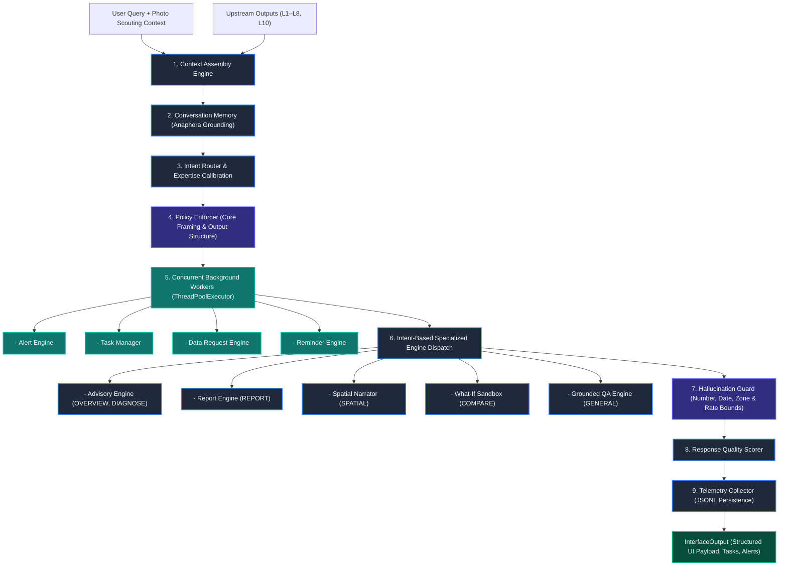

# Layer 9: GenAI Interface, Conversational LLM Orchestration & Hallucination Governance

## 1. Executive Summary & Verification Status
**Layer 9 (`layer9_interface`)** is the natural language communication gateway, multi-turn conversational agent, and cognitive interface of the AgriBrain system. It translates complex diagnostic beliefs, risk indexes, and prescriptive action cards (from Layers 1–8 and Layer 10) into verified, persona-adapted, and safety-audited dialogue cards.

* **Operational Status:** Production-ready.
* **Pipeline Structure:** Orchestrates a 17-engine pipeline combining context assembly, linguistic intent routing, anaphora pronoun grounding, concurrent background tasks, and deterministic template generation.
* **Safety & Governance:** Enforces rigorous safety gating via `PolicyEnforcerEngine` (chemical whitelist, blocked action suppression, economic ROI sanity) and `HallucinationGuard` (biophysical rate limits, ungrounded number/date/zone rejection).
* **Test Suite:** 9 dedicated integration tests in `services/agribrain/layer9_interface/tests/` passing 100%.

---

## 2. Architectural Pipeline & System Flow



### The 9-Stage Orchestration Pipeline:
1. **Context Assembly (`ContextAssemblyEngine`):** Centralizes all upstream inputs into a strongly-typed `Layer9Input`. Extracts plot DNA, biophysical history, diagnoses, actions, schedules, and spatial zones.
2. **Conversation Memory (`ConversationMemoryEngine`):** Tracks session history and performs contextual pronoun resolution (anaphora grounding), resolving vague references (e.g., *"How much water does it need?"* $\to$ *"How much water does the wheat crop need?"*).
3. **Intent Classification & Expertise Profiling (`IntentRouterEngine`):** Classifies user queries across 12 distinct intents (`OVERVIEW`, `DIAGNOSE`, `ACTION_DETAIL`, `COMPARE`, `SCHEDULE`, `REPORT`, `SPATIAL`, `COACHING`, `TASK_MGMT`, `DATA_REQUEST`, `REMINDER`, `GREETING`) and calibrates persona depth (`NOVICE`, `FARMER`, `TECHNICIAN`, `AGRONOMIST`, `RESEARCHER`).
4. **Policy Enforcement (`PolicyEnforcerEngine`):** Builds core summary, sets phrasing mode (`CONFIDENT`, `HEDGED`, `RESTRICTED`), verifies chemical whitelists, and audits economic ROI.
5. **Concurrent Background Execution:** Dispatches non-blocking workers in parallel:
   - `AlertEngine`: Synthesizes push/SMS notifications.
   - `TaskManager`: Maps Layer 8 ActionCards into actionable `FieldTask` lists.
   - `DataRequestEngine`: Identifies telemetry gaps and requests farmer scouting inputs.
   - `ReminderEngine`: Evaluates operational windows and impending deadlines.
6. **Intent-Driven Content Dispatch:** Routes context to specialized engines (Advisory, Report, Spatial Narrator, What-If Sandbox, or QA).
7. **Hallucination Verification (`HallucinationGuard`):** Programmatically validates generated responses against upstream telemetry to prevent hallucinated numbers, dates, zones, or unauthorized chemicals.
8. **Response Quality Scoring (`ResponseQualityEngine`):** Evaluates groundedness, completeness, and coherence to feed the continuous improvement loop.
9. **Telemetry Collection (`TelemetryCollectorEngine`):** Emits detailed operational latencies and intent distributions to structured storage.

---

## 3. Specialized Engine Inventory (17 Engines)

| Category | Engine | Source File | Core Responsibility |
| :--- | :--- | :--- | :--- |
| **Context & Parsing** | `ContextAssemblyEngine` | `engines/context_assembly.py` | Normalizes heterogeneous inputs into strongly-typed `Layer9Input`. |
| | `IntentRouterEngine` | `engines/intent_router.py` | Classifies query intent and estimates user expertise level. |
| | `ConversationMemoryEngine` | `engines/conversation_memory.py` | Maintains multi-turn memory and performs pronoun resolution. |
| **Content Generation** | `AdvisoryEngine` | `engines/advisory_engine.py` | Generates structured advice cards matching user persona and expertise. |
| | `QAEngine` | `engines/qa_engine.py` | Factual question-answering grounded in upstream diagnostic outputs. |
| | `ReportEngine` | `engines/report_engine.py` | Formats multi-page markdown agronomic, financial, and compliance reports. |
| | `SpatialNarratorEngine` | `engines/spatial_narrator.py` | Translates Layer 10 spatial rasters and zone plans into natural language. |
| | `CoachEngine` | `engines/coach_engine.py` | Proactively guides farmers to collect targeted high-value field observations. |
| **Field Operations** | `AlertEngine` | `engines/alert_engine.py` | Triggers prioritized push/SMS notifications based on threat severity. |
| | `TaskManagerEngine` | `engines/task_manager.py` | Synchronizes Layer 8 ActionCards into trackable `FieldTask` taskboards. |
| | `DataRequestEngine` | `engines/data_request.py` | Detects telemetry gaps and formulates structured photo/sensor requests. |
| | `ReminderEngine` | `engines/reminder_engine.py` | Evaluates weather windows and deadline triggers for pending operations. |
| **Safety & Governance** | `PolicyEnforcerEngine` | `engines/policy_enforcer.py` | Enforces chemical whitelists, blocked action gating, and ROI sanity. |
| | `HallucinationGuard` | `hallucination_guard.py` | Verifies numbers, dates, zones, and clamps dangerous fertilizer/irrigation rates. |
| | `ResponseQualityEngine` | `engines/response_quality.py` | Evaluates response groundedness, naturalness, and coherence. |
| | `TelemetryCollectorEngine` | `engines/telemetry_collector.py` | Logs execution traces and latency vectors to JSONL files. |
| **Simulations & Vision** | `WhatIfSandboxEngine` | `engines/what_if_sandbox.py` | Interactive sandbox for simulating alternative management scenarios. |

---

## 4. Key Mathematical Formulations & Safety Rules

### A. Contextual Pronoun Resolution (Anaphora Grounding)
$$\text{Query}_{\text{resolved}} = f_{\text{MemoryGrounding}}(\text{Query}_{\text{current}}, \text{SessionHistory})$$
Resolves pronouns (`it`, `they`, `them`, `this`, `that`) using active crop, topic, and management zone entities from the conversation thread.

### B. Hallucination Guard Screening
1. **Numeric Claims Proximity Check:**
   Every numeric claim with agricultural units ($\text{kg}$, $\text{mm}$, $\text{L}$, $\text{t}$, $\text{ha}$, $\%$, $^\circ$) must exist in upstream outputs or satisfy a $10\%$ relative error bound:
   $$\min_{u \in \mathcal{U}_{\text{numbers}}} \frac{|v - u|}{\max(|u|, 0.01)} < 0.10$$
2. **Date Invariant Check:** Mentioned dates must exist in the scheduled list of intervention events:
   $$\text{Date} \in \mathcal{U}_{\text{dates}}$$
3. **Zone Invariant Check:** Referenced management zones must exist in the active zone plan:
   $$\text{Zone} \in \mathcal{U}_{\text{zones}}$$
4. **Biophysical Safety Clamps:**
   - **Urea Application Limit:** Nitrogen / urea application rates cannot exceed $200.0\text{ kg/ha}$. Rates above this ceiling are flagged and clamped to $200\text{ kg/ha}$.
   - **Soil Moisture Anoxia Prevention:** If soil moisture is high ($\ge 38.0\%$, field capacity saturation), irrigation recommendations $> 25.0\text{ mm}$ are flagged and clamped to $15\text{ mm}$ to prevent root suffocation.

### C. Economic Safety Gating (ROI Protection)
$$\text{Revenue Gain} = Y_{\text{expected}} \cdot \left( \frac{\Delta Y_{\%}}{100} \right) \cdot P_{\text{market}}$$
$$\text{Net Margin} = \text{Revenue Gain} - \text{Cost}_{\text{intervention}}$$
If $\text{Net Margin} < 0$, the intervention is flagged with an `economic_roi_safety` warning detailing the net loss per hectare.

---

## 5. Input & Output Contracts

### `Layer9Input`
* `audit_grade: str`: Upstream data quality grade (`"A"` through `"F"`).
* `source_reliability: Dict[str, float]`: Confidence weights for upstream sources.
* `conflicts: List[Dict]`: Cross-layer data conflict records.
* `diagnoses: List[Dict]`: Diagnosed crop stress and disease conditions (Layer 3).
* `actions: List[Dict]`: Serialized ActionCards (Layer 8).
* `schedule: List[Dict]`: Serialized ScheduledActions (Layer 8).
* `zone_plan: Dict[str, Any]`: Zone-specific action and allocation mapping.
* `user_query: Optional[str]`: User question or natural language command.
* `plot_id: str`: Unique plot identifier for session context anchoring.

### `InterfaceOutput`
* `summary: str`: High-level natural language summary tailored to user persona.
* `zone_cards: List[ZoneCard]`: Formatted status and action summaries per zone.
* `alerts: List[Alert]`: Critical and warning alerts with trigger evidence references.
* `explanations: List[Explanation]`: Evidence-backed reasoning statements (*"Because..."*).
* `disclaimers: List[Disclaimer]`: Policy-mandated reliability disclaimers.
* `citations: List[Citation]`: Cross-layer provenance citations.
* `render_hints: RenderHint`: UI rendering directives (badge color, conflict icons).
* `task_board: Optional[TaskBoard]`: Synchronized trackable field tasks.
* `data_requests: List[DataRequest]`: Proactive requests for farmer photos or sensor inputs.
* `reminders: List[Reminder]`: Scheduled time-sensitive reminders.

---

## 6. Phrasing Modes & Degradation Controls

| Audit Grade | Phrasing Mode | Badge Color | Behavioral Profile |
| :--- | :--- | :--- | :--- |
| **Grade A / B** | `CONFIDENT` | `GREEN` | Direct, authoritative recommendations. Full prescriptive advice displayed without disclaimers. |
| **Grade C** | `HEDGED` | `YELLOW` | Cautious recommendations. Suggests actions with explicit hedging (*"suggested — field confirmation recommended"*); disclaimers attached. |
| **Grade D / F** | `RESTRICTED` | `RED` | Highly restricted phrasing. Advises field scouting rather than chemical/mechanical intervention. High-priority disclaimers mandate verification. |

---

## 7. Test Suite Verification

The Layer 9 test suite is located in `services/agribrain/layer9_interface/tests/`:

* `test_intent_router_and_memory.py` (3 tests):
  - Natural language intent classification across 11 agronomic query categories.
  - User expertise level detection (`NOVICE` through `RESEARCHER`).
  - Session creation, turn recording, and contextual pronoun resolution.
* `test_safety_and_hallucination_guard.py` (3 tests):
  - Hallucination guard detection of ungrounded numbers and dates.
  - Zone validation and biophysical safety limits (excess urea and saturated soil irrigation).
  - PolicyEnforcer phrasing mode degradation and chemical / blocked / economic policy gates.
* `test_interface_runner_and_engines.py` (3 tests):
  - Full end-to-end execution of `run_layer9()` under confident mode.
  - Phrasing mode and disclaimer behavior under degraded audit grades (C and D).
  - Specialized engine dispatch for report generation and spatial narration.

**Execution Command:**
```bash
py -3 -m pytest services/agribrain/layer9_interface/tests -v
```
**Results:** `9 passed in 0.40s` (100% pass rate).
