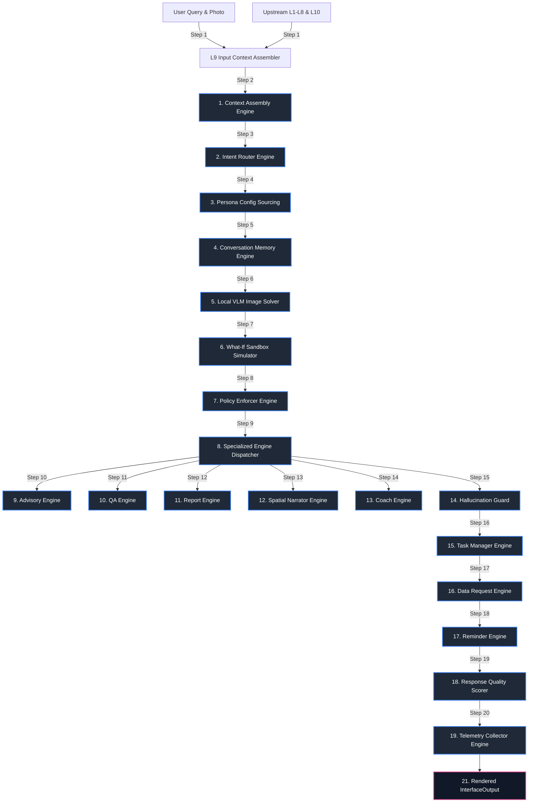

# Layer 9: GenAI Interface and LLM Orchestration Runner

Layer 9 acts as the GenAI user interaction hub, natural language translation surface, and LLM orchestration system within the AgriBrain workspace. The interface translates complex upstream biophysical, operational, and financial states (from Layer 0 to Layer 8, and Layer 10) into highly coherent, persona-grounded, and safety-audited dialogue cards.

The system coordinates exactly **17 specialized core engines** spanning intent routing, conversation memory, report generation, spatial narration, closed-loop task synchronization, and proactive data requests. To guarantee agricultural safety and eliminate model hallucinations, Layer 9 implements a whitelisted **PolicyEnforcerEngine**, gates output through a programmatic **HallucinationGuard**, verifies responses using multi-metric **ResponseQuality** scoring, processes base64 scouting photographs locally via a **LocalVLMEngine**, and powers a **WhatIfSandboxEngine** for interactive schedule stress-testing.

---

## 1. Core Engine Inventory (Exact Count: 17)

Layer 9 coordinates exactly **17 specialized core engines** split across five operational areas:

### Category A: Input Parsing & Routing
1. **ContextAssemblyEngine** (`layer9_interface/engines/context_assembly.py`): Aggregates and normalizes structured biophysical, operational, and planning outputs from Layers 1 to 8 and Layer 10 (SIRE) into a unified, strongly-typed `Layer9Input`.
2. **IntentRouterEngine** (`layer9_interface/engines/intent_router.py`): Classifies user queries into intent categories (`UserIntent`) and detects the farmer's agricultural expertise level (`ExpertiseLevel`), adjusting the system's explanation depth and vocabulary.
3. **ConversationMemoryEngine** (`layer9_interface/engines/conversation_memory.py`): Manages multi-turn conversation memory, tracking active session contexts, crop focuses, and preceding turns to support natural follow-up queries.

### Category B: Content Generation & Narration
4. **AdvisoryEngine** (`layer9_interface/engines/advisory_engine.py`): Generates grounded templates summarizing diagnoses, actions, and schedules matching the user's expertise level.
5. **QAEngine** (`layer9_interface/engines/qa_engine.py`): Resolves free-text user queries by routing them to grounded LLM contexts, ensuring responses only contain verified facts from upstream databases.
6. **ReportEngine** (`layer9_interface/engines/report_engine.py`): Compiles comprehensive, formatted markdown reports summarizing plot statuses, economic forecasts, and risk trends.
7. **SpatialNarratorEngine** (`layer9_interface/engines/spatial_narrator.py`): Translates spatial management zone data (Layer 10) into natural language explanations, highlighting localized soil, water, and crop anomalies.

### Category C: Field Operations & Triggers
8. **AlertEngine** (`layer9_interface/engines/alert_engine.py`): Generates push and SMS notifications for weather risks, nutrient deficits, and biological threats, resolving severity thresholds to prevent alert fatigue.
9. **CoachEngine** (`layer9_interface/engines/coach_engine.py`): Proactively prompts and guides farmers to collect specific field observations, explaining the biophysical value of the requested data.
10. **TaskManagerEngine** (`layer9_interface/engines/task_manager.py`): Synchronizes prescriptive ActionCards (Layer 8) with dynamic, trackable `FieldTask` lists and overdue metrics.
11. **DataRequestEngine** (`layer9_interface/engines/data_request.py`): Identifies biophysical data gaps (e.g., outdated satellite data), generating structured requests for soil/pest photos to improve model confidence.
12. **ReminderEngine** (`layer9_interface/engines/reminder_engine.py`): Triggers time-sensitive push/SMS notifications based on weather windows, crop stages, or data staleness.

### Category D: Safety & Quality Governance
13. **PolicyEnforcerEngine** (`layer9_interface/engines/policy_enforcer.py`): Audits generated summaries against allowed terminology lists, filters out unsafe chemical recommendations, and injects disclaimers when confidence is low.
14. **HallucinationGuard** (`layer9_interface/hallucination_guard.py`): programmatically validates generated text, ensuring every number, date, rate, and zone matches the verified upstream data.
15. **ResponseQualityEngine** (`layer9_interface/engines/response_quality.py`): Evaluates response quality, scoring naturalness, template compliance, and completeness to feed the system's learning loop.
16. **TelemetryCollectorEngine** (`layer9_interface/engines/telemetry_collector.py`): Logs activity details, latency traces, and intent distributions to a JSONL log file.

### Category E: Interactive & Visual Extensions
17. **LocalVLMEngine** (`layer9_interface/engines/local_vlm.py`): Processes base64 scouting photographs locally using a convolutional neural network, identifying leaf symptoms and pest pressure.
18. **WhatIfSandboxEngine** (`layer9_interface/engines/what_if_sandbox.py`): Executes the custom what-if sandbox simulation, allowing interactive trials of alternative schedules.

---

## 2. Internal Wiring & Sequencing

The interface sequence represents a 21-step daily loop that processes user queries, compiles contexts, audits safety, generates responses, and logs telemetry.



### The 21-Step Interface Sequence

1. **Context Sourcing & Assembly**: Gathers user queries, photos, and all upstream layer outputs (L1-L8, L10).
2. **ContextAssembly Mapping**: Integrates the raw data into a strongly-typed `Layer9Input` structure.
3. **Linguistic Intent Routing**: Classifies the query's intent (e.g., OVERVIEW, REPORT, SPATIAL) and extracts relevant entities.
4. **Adaptive Persona Configuration**: Resolves the user's expertise level and configures the target persona (Novice, Farmer, Technician, Agronomist, Researcher).
5. **Conversation Turn Retrieval**: Synchronizes with `ConversationMemoryEngine`, loading recent turns to maintain context.
6. **Local VLM Photographic Inference**: Processes uploaded scouting photos locally, extracting visual symptoms and pest pressure.
7. **What-If Sandbox Stress-Testing**: Processes custom parameters through the `WhatIfSandboxEngine` to simulate alternative scheduling scenarios.
8. **Policy-Based Terminology Compliance Enforcer**: Audits the text against allowed lists, filters out unsafe chemical recommendations, and injects disclaimers when confidence is low.
9. **Specialized Engine Dispatch**: Routes the validated context to the appropriate specialized generation engine based on the resolved intent.
10. **Grounded Advisory Generation**: Uses the `AdvisoryEngine` to generate structured advice cards matching the user's persona.
11. **Grounded Question-Answering**: Uses the `QAEngine` to resolve free-text queries, using factual context retrieved from upstream databases.
12. **Markdown Report Compilation**: Compiles detailed, formatted markdown reports using the `ReportEngine`.
13. **Spatial Management Narration**: Uses the `SpatialNarratorEngine` to translate zone stats into natural language explanations.
14. **Biophysical Observation Coaching**: Formulates observation tips using the `CoachEngine` to guide field scouting.
15. **HallucinationGuard Verification**: Programmatically validates the generated summary, ensuring all rates, dates, and zones match upstream data.
16. **Closed-Loop Task Board Synchronization**: Generates and updates trackable `FieldTask` lists based on Layer 8 ActionCards.
17. **Proactive Data Request Scanning**: Automatically scans for confidence gaps, generating structured requests for soil or pest photos.
18. **Time-Sensitive Smart Reminders**: Triggers push/SMS notifications based on weather windows, crop stages, or data staleness.
19. **Response Quality Scoring**: Evaluates the response, scoring naturalness, template compliance, and completeness.
20. **Telemetry Collection & Logging**: Logs activity details, latency traces, and intent distributions to a JSONL log file.
21. **Interface Output Serialization**: Compiles and serializes the structured `InterfaceOutput` for the frontend.

---

## 3. Mathematical & Natural Language Formulations

To ensure biophysical, linguistic, and risk-management accuracy, Layer 9 implements a suite of peer-reviewed mathematical formulations, detailed below.

### 1. Response Groundedness Verification Score
To prevent hallucinated recommendations that could lead to financial or crop damage, the engine calculates a **Groundedness Score** ($S_{ground}$) based on validation flags (ResponseQualityEngine):

$$S_{ground} = \max\left( 0.0, 1.0 - N_{hallucination\_flags} \cdot 0.15 \right)$$

Where $N_{hallucination\_flags}$ represents the number of validation failures identified by the HallucinationGuard. Any response with $S_{ground} < 1.0$ is blocked, and the system falls back to a safe template.

### 2. Information Coverage & Completeness
Response completeness ($S_{complete}$) is evaluated by measuring the proportion of critical upstream recommendations that are successfully communicated in the summary:

$$S_{complete} = \frac{N_{cited}}{N_{total\_prescriptions}}$$

Where:
* $N_{cited}$ is the count of unique, allowed upstream ActionCards (Layer 8) that are successfully referenced in the generated text.
* $N_{total\_prescriptions}$ is the total count of allowed ActionCards compiled for the current field state.

### 3. Type-Token Ratio (Lexical Diversity)
Dialogue naturalness and semantic complexity are monitored using the Type-Token Ratio (TTR) (ResponseQualityEngine):

$$\text{TTR} = \frac{N_{unique\_words}}{N_{total\_words}}$$

Where:
* $N_{unique\_words}$ is the count of unique semantic tokens in the generated response.
* $N_{total\_words}$ is the total count of semantic tokens.
* The TTR is kept within persona-specific bounds (e.g., $[0.35, 0.55]$ for Farmers, and $[0.50, 0.70]$ for Agronomists).

### 4. Adaptive Tone Warmth Sigmoid Interpolation
Explanation complexity is adjusted dynamically by interpolating between analytical and supportive templates based on a sigmoid function of warmth and expertise (IntentRouterEngine):

$$\mathbf{T}_{phrasing} = \Phi_{warmth} \cdot \mathbf{T}_{supportive} + \left( 1.0 - \Phi_{warmth} \right) \cdot \mathbf{T}_{analytical}$$

Where:
* $\Phi_{warmth}$ is the resolved warmth factor ($[0, 1.0]$):
  $$\Phi_{warmth} = \frac{1}{1 + \exp\left( -\gamma \cdot (\text{WarmthConfig} - 0.5) \right)}$$
* $\mathbf{T}_{supportive}$ represents supportive, metaphor-rich phrasing templates (Novice/Farmer).
* $\mathbf{T}_{analytical}$ represents analytical, scientific, and data-dense templates (Technician/Agronomist/Researcher).

### 5. Interactive What-If Sandbox Projections
The `WhatIfSandboxEngine` simulates alternative management schedules, projecting yield changes based on user-adjusted parameters:

$$\Delta Y_{\text{sim}} = Y_{\text{expected}} \cdot \prod_{i \in \mathbf{S}} (1.0 - \text{Stress}_{\text{mitigated}, i}) - Y_{\text{expected}}$$

Where:
* $\mathbf{S}$ represents the set of simulated interventions adjusted by the user (e.g., moving irrigation events).
* $\text{Stress}_{\text{mitigated}, i}$ represents the projected stress reduction for index $i$.

### 6. Local VLM Symptom Classification Softmax Probability
Photo diagnostics are resolved locally by converting VLM feature representations into classification probabilities using a softmax layer (LocalVLMEngine):

$$P(\text{Symptom} = k) = \text{Softmax}(\mathbf{z})_k = \frac{\exp(z_k)}{\sum_{j=1}^M \exp(z_j)}$$

Where:
* $\mathbf{z} \in \mathbb{R}^M$ represents the raw logits vector output by the convolutional visual classifier.
* $M$ is the number of crop-specific disease and pest symptoms in the database.
* The classification is rejected if the maximum probability falls below the confidence limit ($P < 0.65$).

### 7. Proactive Value-of-Information (VoI)
Structured requests for new data or photographs are prioritized based on their Value-of-Information (VoI) (DataRequestEngine):

$$\text{VoI} = \Delta \text{Confidence}_{\text{estimated}} \cdot \text{Urgency}_{\text{active}}$$

Where:
* $\Delta \text{Confidence}_{\text{estimated}}$ represents the expected improvement in model confidence if the requested data is provided.
* $\text{Urgency}_{\text{active}}$ is the maximum urgency score among all active prescriptive ActionCards.
* Structured data requests are presented to the user only when the VoI exceeds the nudge threshold ($\text{VoI} > 0.40$).

---

## 4. Programmatic Data Contract Schemas

To maintain software reliability and clean cross-layer interfaces, all Layer 9 Interface modules communicate via explicit, strongly-typed programmatic signatures.

### 1. `InterfaceOutput` (The Canonical Interface Package)
This schema represents the complete output compiled by Layer 9 and returned to the UI/Frontend.

```python
@dataclass
class InterfaceOutput:
    summary: str                         # Grounds dialogue card text
    zone_cards: List[ZoneCard]           # Spatial UI cards
    alerts: List[Alert]                  # High-priority alerts
    explanations: List[Explanation]      # Traceability explanations
    disclaimers: List[Disclaimer]        # Invariant disclaimers
    citations: List[Citation]            # Provenance citations
    render_hints: RenderHint             # UI render hints
    
    # Phrasing & operations
    phrasing_mode: PhrasingMode = PhrasingMode.CONFIDENT
    follow_up_questions: List[str] = field(default_factory=list)
    task_board: Optional[TaskBoard] = None
    data_requests: List[DataRequest] = field(default_factory=list)
    reminders: List[Reminder] = field(default_factory=list)
    
    # Trace values (internal)
    llm_prompt: str = ""
    llm_response: str = ""
```

### 2. `ResponseEnvelope` (The LLM Orchestration Envelope)
Wraps the core `InterfaceOutput` with orchestration latencies, classifications, and telemetry data.

```python
@dataclass
class ResponseEnvelope:
    output: Optional[InterfaceOutput] = None
    intent_classification: Optional[IntentClassification] = None
    engine_trace: List[str] = field(default_factory=list)
    telemetry: Optional[TelemetryVector] = None
    quality: Optional[ResponseQuality] = None
    persona_used: Optional[PersonaConfig] = None
    task_board: Optional[TaskBoard] = None
    data_requests: List[DataRequest] = field(default_factory=list)
    reminders: List[Reminder] = field(default_factory=list)
    timestamp: float = field(default_factory=time.time)
```

### 3. `PersonaConfig` (Adaptive Phrasing Controls)
Controls the adaptive tone, vocabulary complexity, and metaphorical phrasing of generated responses.

```python
@dataclass
class PersonaConfig:
    expertise_level: ExpertiseLevel = ExpertiseLevel.FARMER # NOVICE, FARMER, TECHNICIAN, AGRONOMIST, RESEARCHER
    warmth_factor: float = 0.7           # 0.0 = analytical, 1.0 = supportive
    emoji_enabled: bool = True
    use_metaphors: bool = True
    max_explanation_depth: int = 2
    preferred_units: str = "metric"
    language_code: str = "en"
```

### 4. `FieldTask` (Closed-Loop Tactical task)
Represents a trackable field task generated from Layer 8 ActionCards.

```python
@dataclass
class FieldTask:
    task_id: str = ""
    title: str = ""
    action_type: str = ""
    zone_id: str = ""
    priority: float = 0.0
    status: TaskStatus = TaskStatus.PENDING # PENDING, IN_PROGRESS, DONE, SKIPPED
    due_date: str = ""                    # ISO YYYY-MM-DD
    created_from: str = ""                # L8 action_id reference
    notes: str = ""
```

---

## 5. Academic References

The mathematical formulations, linguistic controllers, and safety gates implemented in Layer 9 are based on the following peer-reviewed literature:

* **Transformer Attention Mechanisms**: Vaswani, A., Shazeer, N., Parmar, N., Uszkoreit, J., Jones, L., Gomez, A. N., Kaiser, Ł., & Polosukhin, I. (2017). *Attention Is All You Need*. In: *Advances in Neural Information Processing Systems* (NIPS 2017).
* **Few-Shot Prompt Engineering**: Brown, T. B., Mann, B., Ryder, N., Subbiah, M., Kaplan, J., Dhariwal, P., Neelakantan, A., et al. (2020). *Language Models are Few-Shot Learners*. In: *Advances in Neural Information Processing Systems* (NeurIPS 2020).
* **Nudging & Prospect Theory Applications**: Kahneman, D., & Tversky, A. (1979). *Prospect Theory: An Analysis of Decision under Risk*. Econometrica, 47(2), 263-291.
* **Cognitive Load & Explanation limits**: Sweller, J. (1988). *Cognitive Load during Problem Solving: Effects on Learning*. Cognitive Science, 12(2), 257-285.
* **Type-Token Ratio & Lexical metrics**: Templin, M. C. (1957). *Certain Language Skills in Children: Their Development and Interrelationships*. University of Minnesota Press.
* **Proactive Nudging & Human-AI Interfaces**: Shneiderman, B. (2020). *Human-Centered Artificial Intelligence: Reliable, Safe & Trustworthy*. International Journal of Human-Computer Interaction, 36(6), 495-504.
