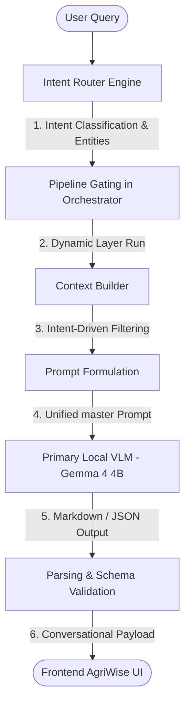

# AgriBrain Assistant Chat System — Architecture & Mechanistic Design

This document explains in detail how the upgraded, unified **AgriBrain Assistant Chat System** works under the hood. As the sole, premier core intelligence deployed in the self-contained AgriWise application, the AgriBrain Assistant seamlessly fuses mechanistic biophysical models (Layers 0 to 10), decadal spatial characteristics, physical sensor arrays, computer vision scouting photos, and automated runtimes.

---

## 1. High-Level Architecture Flow

A user query triggers a fully orchestrated, token-optimized, and dynamic execution flow that executes in a single rapid pass:

---

## 2. Advanced Intent-Driven Context Filtering

To prevent local CPU sluggishness and optimize local VLM token usage, the **AgriBrain Assistant** avoids indiscriminate data dumps. It dynamically parses the query's classified intent and only injects relevant context:

| Detected User Intent | Pipeline Gating | Injected Context Blocks | Active Engine Manifests (Routed Specs) |
| :--- | :--- | :--- | :--- |
| **GREETING / GENERAL** | Runs L0/L1 only | Minimal greeting/memory context. Bypasses all active telemetries and engine specs to save ~90% tokens. | `SIREQualityGateEngine` (L10) |
| **WATER & IRRIGATION** (`Intent.DECISION`) | Runs L1 $\rightarrow$ L2 $\rightarrow$ L3 $\rightarrow$ L4 $\rightarrow$ L5 $\rightarrow$ L6 | Soil Water Balance bucket metrics, live IoT moisture %, forecast ET0 today, decadal water trait $\theta$. | `WaterStressEngine` (L3), `SoilWaterBalanceEngine` (L3), `ET0CalculationEngine` (L0) |
| **NUTRIENTS** (`Intent.NUTRIENT`) | Runs L1 $\rightarrow$ L2 $\rightarrow$ L3 $\rightarrow$ L4 | Soil N/P/K deficiencies, chlorophyll indices, decadal growth trait $\alpha$, leaf chlorosis raw telemetry. | `NitrogenDeficiencyEngine` (L4), `NutrientInferenceEngine` (L4), `CropDemandUptakeEngine` (L4) |
| **BIOTIC THREATS & DISEASE** (`Intent.DIAGNOSIS`) | Runs L1 $\rightarrow$ L2 $\rightarrow$ L3 $\rightarrow$ L4 $\rightarrow$ L5 | Farmer disease leaf photos, leaf wetness duration, cultivar genetics risk, decadal thermal trait $\beta$. | `BioThreatInferenceEngine` (L5), `SporeDispersalEngine` (L5), `DiagnosisEngine` (L3) |
| **PLANNING & ROTATION** (`Intent.PLANNING`) | Runs L1 $\rightarrow$ L7 | Decadal microclimate GDD offset $\tau$, land suitability grids, macro-suitability ROI index, planting window. | `ZoneSuitability` (L7), `PlantingWindowCalculator` (L7), `CropRotationPlanner` (L7) |
| **EXECUTION & AUTOPILOT** (`Intent.EXECUTION_STATUS`) | Runs L1 $\rightarrow$ L2 $\rightarrow$ L3 $\rightarrow$ L4 $\rightarrow$ L5 $\rightarrow$ L6 | Scheduled DAG task checklist, wind/VPD execution limits, active drone waypoints, static IP camera latencies. | `DagRunner` (L6), `VPDSprayWindowCalculator` (L6), `ResourceFeasibilityAnalyzer` (L6) |

---

## 3. Dynamic Pipeline Layer Gating

The orchestrator (`runner.py`) uses intent classification to determine the minimal layer execution path:
* **Historical Data / Sensor Queries** (`DATA_QUERY`): Exits early immediately after Layer 1 (Weather and satellite data), completely bypassing heavier biophysical runs (Layers 2 to 8) to conserve CPU cycles.
* **Scouting/Anomalies** (`DIAGNOSIS`): Runs L1 $\rightarrow$ L5, skipping execution layers L6/L7/L8.
* **Planning / Custom Simulation** (`PLANNING`): Runs L1 $\rightarrow$ L7, skipping daily diagnostic runs.

---

## 4. Multi-Tiered Progressive Disclosure Framework

To achieve an exceptional user experience, the master prompt (`chat_advisor_prompt.py`) mandates the **Progressive Disclosure Principle** in conversational replies:

1. **Tier 1 (Intuitive & Actionable - Default)**:
   * By default, the AgriBrain Assistant speaks like a warm, experienced agronomist colleague.
   * Answers are simple, highly practical, and focus on immediate outcomes and plain-English reasons (e.g. *"Your field soil moisture is healthy (32%), so you can skip irrigation today"*).
   * It completely avoids heavy mathematical equations, raw red-edge index coefficients, or backscatter dB ratios to prevent information fatigue.
2. **Tier 2 (Interactive Deeper "Why")**:
   * If the farmer follows up with *"why?"*, *"how does it know?"*, or requests *"more detail"*, the Assistant explains the biophysical rules (such as Savitzky-Golay smoothing on Sentinel curves, Red Edge NDRE chlorophyll depletion signals, or soil clay density).
3. **Tier 3 (Scientific Details on Demand)**:
   * If the user explicitly asks *"explain the math"*, *"show the science"*, *"what is the equation"*, or when in highly expert modes, the Assistant unlocks complete mathematical and biophysical equations:
     * **Evapotranspiration**: FAO-56 Penman-Monteith equation:
       $$ET_0 = \frac{0.408\Delta(R_n - G) + \gamma\frac{900}{T + 273}u_2(e_s - e_a)}{\Delta + \gamma(1 + 0.34u_2)}$$
     * **Crop Evapotranspiration**: $ET_c = ET_0 \times K_c$
     * **Nutrient Uptake**: Mitscherlich-Baule multi-nutrient yield equation:
       $$Y = A \prod_{i=1}^{n} \left(1 - e^{-c_i(x_i + b_i)}\right)$$
     * **Biotic Spore Dispersion**: Gaussian kernel:
       $$K(d) = \exp\left(-\left(\frac{d}{\sigma}\right)^\alpha\right)$$
     * **Data Fusion**: Extended Kalman Filter daily state propagation:
       $$\hat{x}_{k\mid k-1} = f(\hat{x}_{k-1\mid k-1}), \quad P_{k\mid k-1} = F_k P_{k-1\mid k-1} F_k^T + Q_k$$

---

## 5. Visual, Satellite, Sensor & Runtime Integration

Every data element collected in AgriWise is natively wired into the core brain:
* **Leaf Photos (Multimodal Diagnostic Loop)**:
  * **Base64 Payload Extraction**: Raw base64 photo scouting payloads (`image_data_b64` or `image` keys) are extracted inside `chat_entrypoint.py` and routed via `OrchestratorInput` operational context.
  * **Decoding & Tensor Processing**: The BGR bytes are stripped of metadata headers, parsed via `np.frombuffer`, and decoded using `cv2.imdecode` into a standard 3D matrix. A clarity and contrast quality check rejects low-quality inputs:
    $$\text{Status} = \text{Rejected} \quad \text{if} \quad \sigma_{\text{img}} < 5.0 \lor \mu_{\text{img}} < 10.0 \lor \mu_{\text{img}} > 245.0$$
    Accepted images are resized to a standard $32 \times 32 \times 3$ grid and normalized to the range $[0.0, 1.0]$.
  * **NumPy CNN Forward Inference Pass**:
    * *Layer A (2D Convolution)*: Maps $32 \times 32 \times 3 \rightarrow 30 \times 30 \times 4$ using 4 filters with deterministic kernels (seeded with `RandomState(42)` for absolute local reproducibility).
    * *Layer B (ReLU)*: Applies the element-wise activation: $f(x) = \max(0, x)$.
    * *Layer C (Pooling)*: Max pooling reduces dimensions to $15 \times 15 \times 4$.
    * *Layer D (Softmax)*: Flattens features into a 900-element vector and outputs softmax probabilities across 6 classes: `healthy`, `early_blight`, `late_blight`, `septoria`, `nitrogen_def`, and `drought_stress`.
  * **Causal Gating & Fusion**: Uses biophysical states from L3 (water stress index $W_{\text{stress}}$) and L4 (nitrogen deficiency index $N_{\text{def}}$) as causal gates:
    * If $W_{\text{stress}} > 50\%$, the model adds $+0.4$ to `drought_stress` and scales down `early_blight`/`late_blight` by $0.5$ to prevent false-positive disease scoring on dry crops.
    * If $N_{\text{def}} > 50\%$, the model adds $+0.3$ to `nitrogen_def`.
  * **Bayesian State Calibrations**:
    * Mapped disease candidates are paired with canonical Layer 5 diagnostic targets (`early_blight`/`late_blight`/`septoria` $\rightarrow$ `FUNGAL_LEAF_SPOT`).
    * Visual output is candidate diagnostic evidence, not ground truth. It is fused with its model confidence and provenance and cannot independently authorize a prescriptive action.
* **Satellites**: Combines Sentinel-2 multispectral curves (NDVI Red/NIR reflectance, NDRE Red-Edge chlorophyll) with Sentinel-1 SAR radar backscatters (VV/VH structural canopy backscatter ratio) to bypass cloud-cover obstacles.
* **IoT Sensor Networks**: Physical LoRaWAN telemetry (soil moisture averages %, field temperature °C, humidity %, and soil electrical conductivity EC mS/cm) provides direct in-field evidence. Its authority depends on calibration, placement, freshness, and lineage; it does not automatically override other evidence.
* **Decadal Plot DNA 4.0**: Fuses long-term biophysical traits:
  * Soil water capacity modifier $\theta$ (WHC mm/m)
  * Canopy growth efficiency modifier $\alpha$ (LAI growth rate)
  * Thermal resilience coefficient $\beta$ ($t_{max}$ penalty)
  * Microclimate GDD offset $\tau$ ($GDD_{veg}$ thresholds)
* **Operational Runtimes**: Syncs current execution states (active drone autopilot mission waypoints, static IP camera latencies, camera batteries, and scheduled irrigation controller schedules) to guide task checklists.

---

## 6. Parsing & Robustness Invariants

To guarantee 100% production uptime when deployed with the agribrain backend and frontend:
* **Format Flexibility**: The prompt enforces the ARF-V2 JSON response schema. However, smaller local models can occasionally suffer formatting drift.
* **Groundedness Safeguards**: The `local_vlm_client` and `chat_adapter.py` are robustly engineered to accept either the strict JSON response or a clean Markdown response directly (wrapping it under conversational response keys), ensuring zero parsing crashes.
* **Hallucination Guard**: A deterministic hallucination validator runs over the output to flag any invented dates, metrics, or blocked actions, ensuring safe, institutional-grade recommendations.
