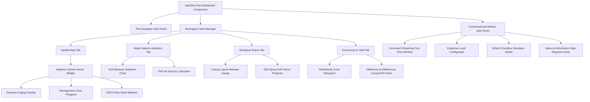

# AgriWise: Plot Dashboard Frontend Specification
## Version 4.8.0 — Premium Glassmorphic Web Workspace & React Contracts

This document outlines the frontend engineering specification, visual guidelines, UI design assets, and React component contracts for the **AgriWise Plot Dashboard**. Designed to match the biophysical, geostatistical, and GenAI capabilities of the AgriBrain 11-layer backend, this frontend dashboard integrates Mapbox spatial vector overlays, dynamic biophysical charting grids, and a multi-turn conversational AI companion.

---

## 1. Visual Design System & Core Theme (Aesthetics)

### Core Theme & Palette
The AgriWise workspace implements a premium **glassmorphism** design system with a sleek dark mode. It uses vibrant accent colors tailored to agricultural contexts:

* **Backdrop Dark Background**: `hsl(222, 47%, 6%)` (Deep Slate Navy)
* **Glass Card Background**: `hsla(222, 47%, 12%, 0.45)`
* **Glass Border**: `hsla(217, 24%, 32%, 0.25)`
* **Active Vegetation Accent**: `hsl(142, 72%, 40%)` (Vibrant Emerald Green)
* **Active Irrigation/Water Accent**: `hsl(217, 91%, 60%)` (Cerulean Blue)
* **Alert/Pathogen Risk Accent**: `hsl(38, 92%, 50%)` (Vibrant Amber / Deep Ochre)
* **Cognitive GenAI Accent**: `hsl(272, 72%, 60%)` (Royal Purple)
* **Typography Core**: `Outfit` (for high-end headings and metric numbers), `Inter` (for readable system body text).

```css
:root {
  --bg-primary: hsl(222, 47%, 6%);
  --card-glass: hsla(222, 47%, 12%, 0.45);
  --border-glass: hsla(217, 24%, 32%, 0.25);
  --accent-veg: hsl(142, 72%, 40%);
  --accent-water: hsl(217, 91%, 60%);
  --accent-risk: hsl(38, 92%, 50%);
  --accent-ai: hsl(272, 72%, 60%);
  --font-display: 'Outfit', sans-serif;
  --font-sans: 'Inter', sans-serif;
}

.glass-panel {
  background: var(--card-glass);
  backdrop-filter: blur(16px);
  -webkit-backdrop-filter: blur(16px);
  border: 1px solid var(--border-glass);
  border-radius: 16px;
  box-shadow: 0 8px 32px 0 rgba(0, 0, 0, 0.37);
  transition: all 0.3s cubic-bezier(0.4, 0, 0.2, 1);
}

.glass-panel:hover {
  border-color: hsla(217, 24%, 45%, 0.4);
  box-shadow: 0 12px 40px 0 rgba(0, 0, 0, 0.5);
  transform: translateY(-2px);
}
```

### Micro-Animations & Interactivity
* **Hover Transitions**: Dynamic scaling and border lighting using hardware-accelerated transforms (`transform: translateY(-2px)`, `transition: all 0.3s`).
* **AI Glow pulse**: Subtle Royal Purple radial-gradient pulsing on the Conversational Advisor sidepanel during LLM token streaming.
* **Canvas-based Winds**: Particle wind-field overlays on the map widget, animating wind shear drag forces.

---

## 2. Interactive Grid Workspace Layout

The dashboard is organized as a responsive, multi-column grid workspace, optimizing information density and avoiding cognitive fatigue:

```
┌────────────────────────────────────────────────────────────────────────────────────────┐
│  AgriWise Plot Dashboard                                                     [Plot 42] │
├────────────┬──────────────────────────────────────────────┬────────────────────────────┤
│  PLOT      │  [TAB: SPATIAL MAP] [TAB: WATER] [TAB: BIO]   │  Conversational Advisor    │
│  NAVIGATOR │ ┌──────────────────────────────────────────┐ │  (Layer 9 Grounded AI)     │
│            │ │                                          │ │                            │
│  Plot 01   │ │           Leaflet / Mapbox               │ │ ┌────────────────────────┐ │
│  Plot 02   │ │          Spatial kriging Map         │ │ │ active Advisor Chat    │ │
│  Plot 42   │ │          Contour vector Overlay      │ │ │ "Recommend 40 kg/ha N  │ │
│  Plot 103  │ │                                          │ │ │ in Zone 2 by Thursday" │ │
│            │ └──────────────────────────────────────────┘ │ └────────────────────────┘ │
│  [Status]  ├──────────────────────────────────────────────┤  Expertise Slider          │
│  Active    │  Prescriptive Action Cards (Layer 8 DAG)     │  [───o───] Intermediate    │
│  Healthy   │  ┌──────────────┐ ┌──────────────┐           │                            │
│            │  │ ActionCard 1 │ │ ActionCard 2 │           │  What-If Simulation        │
│  Settings  │  │ Nitrogen VRA │ │ Irrigation   │           │  [Run Sandbox Trial]       │
└────────────┴──┴──────────────┴─┴──────────────┴───────────┴────────────────────────────┘
```

---

## 3. Core Component Specifications

### 1. Spatial Coordinates Map Widget
* **Interactive Layer Rendering**: Renders Leaflet or Mapbox continuous canvas tiles.
* **Ordinary Kriging Overlay**: Displays spatial interpolation outputs generated by Layer 10 (SIRE). Map zones are represented as vector contour polygons (`ZoneBoundaryProps`) styled with a dynamic opacity gradient based on crop health.
* **FDR Sensor Node Markers**: Displays active in-situ soil moisture probe locations. Clicking a marker displays a tooltip showing real-time volumetric water content ($\theta$), field capacity ($\theta_{fc}$), and wilting point ($\theta_{wp}$) values.
* **Multi-Spectral Sliders**: Provides a slider overlay to toggle between Sentinel-2 true-color, raw NDVI, and Layer 10 Semivariogram heterogeneity views.

---

### 2. Soil Moisture Depletion & FAO-56 Transpiration Chart
* **Visual Metric**: A dual-axis time-series chart mapping the last 14 days and forecasting the next 7 days.
* **Primary Y-Axis**: Root zone soil moisture depletion ($D_r$) in millimeters (solid blue line), bounded by horizontal lines representing Total Available Water ($TAW$) and Readily Available Water ($RAW$).
* **Secondary Y-Axis**: Crop transpiration ($ET_c$) and effective precipitation ($P_{\text{eff}}$) in millimeters represented as bar charts.
* **Interactivity**: Users can adjust a target irrigation volume slider to recalculate root zone depletion forecasts in real-time.

```
Volumetric Water Content (mm)
▲
│    TAW Boundary (Field Capacity)  ──────────────────────────────────────────
│    
│                                                   Forecast Curve
│    Soil moisture Depletion (Dr) ───\             /~\
│                                     \           /   \
│    RAW Boundary (Stress Limit)   ────\─────────/─────\──────────────────────
│                                       \       /       \____
│    Wilting Point Boundary         ─────\_____/──────────────────────────────
│
└────────────────────────────────────────────────────────────────────────► Time (Days)
```

---

### 3. Nutrient Zone Planner & Mitscherlich-Baule Curves
* **Visual Metric**: A non-linear response curve demonstrating predicted crop yield ($\text{t/ha}$) relative to fertilizer application rates ($\text{kg/ha}$).
* **Yield Projection Curve**: Visualizes the Mitscherlich-Baule crop yield response curve:
  $$Y = Y_{\text{max}} \cdot \left( 1 - \exp\left( -\beta_N \cdot (N + x_N) \right) \right)$$
* **Interactivity**: Dragging the target Nitrogen application rate slider dynamically adjusts the predicted crop yield and profit margin calculations, visualizing Liebig's Law of the Minimum limitations.

---

### 4. Disease Pathogen Spore Risk Grid
* **Visual Metric**: A radial risk indicator that visualizes canopy spore levels, leaf wetness duration, and aerodynamic spore release detachment probabilities.
* **Spray Drift Vector projection**: Displays a visual vector overlay on the spatial map, indicating off-target spray drift buffers based on wind speed, boom height, and travel speed constraints.
* **Dynamic Warning System**: If wind speeds exceed $25 \text{ km/h}$, a high-contrast Alert Card is displayed to prevent off-target pesticide applications.

---

### 5. Yield Monte Carlo Strategic Economics Panel
* **Visual Metric**: A probability density histogram showing projected crop yields.
* **Probability Milestones**: Highlights projected yield thresholds ($P_{10}$, $P_{50}$, and $P_{90}$) alongside baseline target values.
* **Causal Outcome Chart**: Visualizes Difference-in-Differences treatment effects, comparing yield improvements in treated zones against synthetic spatial control zones.

---

### 6. Conversational AI Companion Sidepanel
* **Visual Metric**: A conversational chat interface.
* **Streaming Responses**: Renders streaming markdown text word-by-word, displaying verified agricultural facts and ActionCards.
* **Expertise Level Selector**: A slide-toggle to adjust conversational responses based on the farmer's experience level:
  * *Novice*: Emphasizes high-level explanations, avoiding technical jargon.
  * *Intermediate*: Integrates biophysical terminology and concrete action plans.
  * *Expert*: Provides full scientific details, including LaTeX equations and citations.
* **Proactive Nudge Prompts**: Display contextual buttons prompting users to collect field observations when data gaps are identified.
* **What-If Sandbox Simulation Run Button**: Clicking this button allows users to run simulated field operations, such as shifting fertilizer application dates, to evaluate the biophysical impact of alternative strategies before execution.

---

## 4. Strict TypeScript Props & API Contracts

These TypeScript type-definitions establish strict contracts between the React frontend components and the AgriBrain Layer 9 and Layer 10 endpoints, ensuring type safety.

```typescript
export type CropType = 'Corn' | 'Soybeans' | 'Wheat' | 'Alfalfa' | 'Barley' | 'Citrus';
export type ExpertiseLevel = 'Novice' | 'Intermediate' | 'Expert';
export type AdvisoryIntent = 'Diagnosis' | 'ActionPlan' | 'WeatherAudit' | 'GeneralQA';

export interface SoilTextureLimits {
  clayPercentage: number;
  organicMatter: number;
  bulkDensity: number;
  fieldCapacity: number; // Volumetric moisture theta at FC
  wiltingPoint: number;  // Volumetric moisture theta at WP
  porosity: number;
}

export interface FDRSensorNode {
  nodeId: string;
  coordinates: {
    latitude: number;
    longitude: number;
  };
  soilDepthCm: number;
  volumetricWaterContent: number;
  soilTemperatureC: number;
  lastUpdated: string;
  sensorTrustGrade: number; // Range 0.0 - 1.0
}

export interface ZoneBoundaryProps {
  zoneId: string;
  coordinatesGeoJSON: {
    type: 'Polygon';
    coordinates: number[][][];
  };
  organicCarbonSequestrationRate: number; // tons C/ha/year
  meanNDVI: number;
  recommendedNitrogenRate: number; // kg/ha
  soilTexture: SoilTextureLimits;
}

export interface ActionCardProps {
  actionId: string;
  priorityScore: number; // Range 0.0 - 100.0
  title: string;
  description: string;
  category: 'Irrigation' | 'Fertilization' | 'PestControl' | 'Harvest';
  executionWindowStart: string;
  executionWindowEnd: string;
  expectedYieldIncrease: number; // tons/ha
  estimatedCost: number; // Currency
  estimatedROI: number; // ROI ratio
  safetyGatesChecked: string[]; // ["EPA_SprayDrift", "FAO_Leaching"]
  adoptionProbability: number; // Range 0.0 - 1.0 (TAM MLP)
}

export interface PlotDashboardProps {
  plotId: string;
  plotName: string;
  currentCrop: CropType;
  sowingDate: string;
  bbchGrowthStage: number; // BBCH standard scale
  growingDegreeDays: number;
  soilLimits: SoilTextureLimits;
  activeSensors: FDRSensorNode[];
  managementZones: ZoneBoundaryProps[];
  prescribedActions: ActionCardProps[];
  waterBalance: {
    rootZoneDepletionMm: number;
    totalAvailableWaterMm: number;
    readilyAvailableWaterMm: number;
    cropCoefficientKc: number;
    soilEvaporationKe: number;
    transpirationKcb: number;
  };
  pathogenRisk: {
    sporeDetachmentProb: number;
    leafWetnessDurationHours: number;
    aerodynamicFlutterAcceleration: number;
    currentRiskIndex: number; // Range 0.0 - 1.0
  };
  strategicEconomics: {
    p10YieldTonsPerHectare: number;
    p50YieldTonsPerHectare: number;
    p90YieldTonsPerHectare: number;
    causalTreatmentEffectDelta: number; // tons/ha
    estimatedNetProfit: number;
  };
}

export interface Layer9InterfaceResponse {
  sessionId: string;
  queryIntent: AdvisoryIntent;
  detectedExpertise: ExpertiseLevel;
  streamedTextContent: string;
  structuredActionCards: ActionCardProps[];
  hallucinationAuditScore: number; // Range 0.0 - 1.0
  citationsList: string[]; // Academic/Data reference citations
  proactiveDataRequests: {
    fieldId: string;
    requestType: 'ScoutingPhoto' | 'SoilTestSample';
    description: string;
    valueOfInformationScore: number;
  }[];
}
```

---

## 5. UI Hierarchical Wiring Schema


